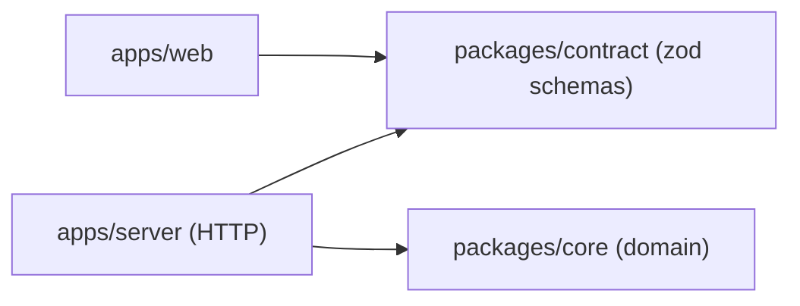

# A shared API contract package

## What it is

`@sextou/contract` holds the API's request and response schemas, written in zod, and the TypeScript types inferred from them. The server imports it to type what it sends. A client imports the same package to type what it receives and, at runtime, to check it. The API's shape is declared once, in a package that neither side owns.

## Why here, rather than the obvious alternative

The obvious alternative is for the server to export its own types. The web app would then depend on the server package and could pull Node-only code into its browser bundle. With a separate contract, the web app depends on schemas only. The server stays free to change how it works inside, as long as it keeps the contract.

The domain rules sit in `@sextou/core`, which imports neither the contract nor any HTTP code. The server is the one place that knows both: it calls the core and answers in the contract's shape. CI's knip enforces the boundary, because a package may only import what its own `package.json` declares.

## An example from this change

`packages/contract/src/modules/health/health.schema.ts` defines `healthResponseSchema` (`version` is a string, `uptimeSeconds` a non-negative integer). The route in `apps/server/src/modules/health/health.routes.ts` answers with `c.json<HealthResponse>(…)`, and its tests parse the real response with the schema, so a response that drifts from the contract fails a test.

## When not to use it

A contract package earns its place when more than one program reads the API. For an endpoint only the server itself calls, or for internal data that never crosses the wire, a type next to the code is enough. The contract also stays free of Node or DOM globals, because browser code imports it.
