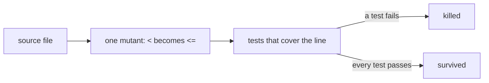

# Mutation testing

## What it is

A mutation tool changes the code one small step at a time: it flips a `<` to `<=`, empties a function body, replaces a string with `""`. Each change is a mutant. For every mutant it runs the tests that cover the changed line. A test that fails kills the mutant; a mutant no test notices survives. The score is the share of mutants killed. Coverage says a line ran during the tests; the score says the tests would notice if that line were wrong.

## Why here, rather than the obvious alternative

The obvious alternative is coverage alone, which this change also raises to 90% per file. Coverage passes a test that calls a function and asserts nothing, or asserts only that it didn't throw. Each package's tests are what agents and people lean on when they change sextou, so a floor on how much they check, not only on what they run, keeps that trust honest. StrykerJS is a mutation tool for JavaScript and TypeScript, with a runner for Vitest.

## An example from this change

While this change was checked, a test that called its function and asserted nothing kept the file's coverage where it was and failed the package's mutation run: its mutants survived. Each package's `pnpm --filter <package> test:mutation` fails below 80% of its mutants killed (`thresholds.break` in `stryker.parent.conf.json`), and an HTML report under `reports/` shows each survivor.

## When not to use it

- On code a mutant can't change in a way that matters: a mutant that changes no behavior survives forever. Disable that mutator on that line, with the reason, instead of writing a test that checks nothing real.
- On generated code, entry points that only wire modules together, and files excluded from coverage: they're left out of `mutate`.
- As a per-change gate on a package whose full run takes too long: run it incrementally, as CI does on pull requests.
