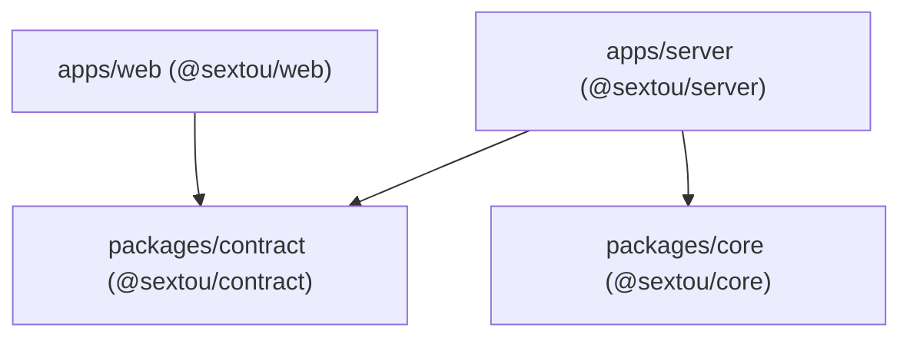
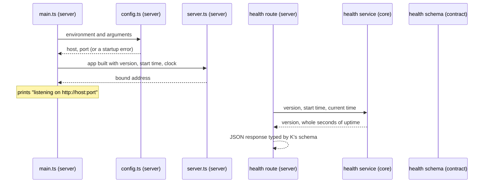

# Backend Server Structure - Plan

## Goal Capsule

- **Objective:** The repository has a backend skeleton whose layout shows where each part of a feature goes (domain rules, API contract, HTTP route), so the first real feature lands in the agreed place instead of setting the architecture by accident.
- **Means:** three new workspace packages, a domain core, an HTTP server and an API contract, each organized by feature module, with one trivial endpoint that crosses all three (KD1, KD3), built on Hono and zod (KTD1, KTD2).
- **Product authority:** the repository owner. Only the server's structure is in scope; no product feature is.
- **Stop conditions:**
  - Stop and report if the organization's pnpm policy (one-day minimum release age, trust policy `no-downgrade`) rejects a new dependency: its exception only takes effect once merged to `main`, so it cannot be fixed in this pull request.
  - Stop and report if the root `tsconfig.json` cannot see Node's types for `apps/server` without changing the root's `types` (KTD10).
  - Stop and report if the Vite build cannot produce a single file whose only imports are `node:` built-ins (KTD4).
- **Execution profile:** one pull request against `main`, squash-merged. `ce-work` implements; the user reviews and merges.
- **Open blockers:** none.

---

## Product Contract

Product Contract preservation: unchanged except that its five questions deferred to planning are now answered by KTD1, KTD2, KTD3, KTD4, KTD6, KTD8 and KTD11, and the Outstanding Questions section that held them is removed.

### Summary

The backend starts as three packages: `@sextou/core` holds the domain and knows nothing about HTTP, `@sextou/server` is the process that exposes the core over HTTP, and `@sextou/contract` holds the API's schemas, which the server and the web app import. Each package groups code by feature under `modules/<feature>/`. The only feature is `health`, which proves the three layers are wired together.

### Problem Frame

sextou has a web app, a desktop shell that loads it by URL, and shared UI components, but no backend. The web and desktop interfaces will talk to a server that runs either on the user's machine or on a remote one. Without an agreed structure, the first feature decides on its own where domain rules live, where HTTP lives, and how the web app learns the API's shapes, and moving those later is expensive.

### Key Decisions

- KD1. **Three packages from the start: core, server and contract.** The boundary between domain and transport exists from the first commit, so a CLI or an MCP server can later reuse the core without touching the HTTP server. (session-settled: user-directed — chosen over a server package that holds the domain alongside a separate contract package, and over a single server package that exports its own contract: the target shape is in place from day one rather than extracted later.) Governs R1, R2, R3, R4, R5.
- KD2. **The server is its own process, the same locally and remotely.** A desktop that starts a local server is running that same process, so local and remote differ only in the URL a client points at. (session-settled: user-directed — chosen over a server that exists only as a process the desktop starts: a desktop-started server is the standalone process run locally.) Governs R8, R10.
- KD3. **Code is grouped by feature, in every package.** A feature is the same `modules/<feature>/` folder in core, contract and server, so its schema, its rules and its route are found by one name. (session-settled: user-approved — proposed with grouping by global layer as the alternative; the user asked for `modules/<feature>/` in all three packages.) Governs R6, R7.
- KD4. **The web app stays hosted and does not call the server in this work.** Pointing the hosted web app at a local server needs CORS on the server and the local network permission in Electron, both small and both deferred to the first real call. (session-settled: user-approved — proposed after the user asked whether this needed TLS workarounds; it does not.)
- KD5. **One endpoint, `health`, is the whole API.** With 90% coverage required per file, an empty skeleton has nothing to test; one endpoint gives every layer real code and a test. Governs R9.

### Requirements

**Packages and boundaries**

- R1. Three new workspace packages exist: `apps/server` (`@sextou/server`), `packages/core` (`@sextou/core`) and `packages/contract` (`@sextou/contract`).
- R2. `@sextou/core` holds the domain and imports no HTTP framework and no other sextou package.
- R3. `@sextou/server` holds no business rules: a route validates input against the contract, calls a core service, and returns a response in the contract's shape.
- R4. `@sextou/contract` holds the API's request and response schemas and the types derived from them, and the web app can import it without pulling Node-only code into the browser bundle.
- R5. Dependencies point one way: `@sextou/web` may import `@sextou/contract`; `@sextou/server` may import `@sextou/contract` and `@sextou/core`; `@sextou/core` imports neither.



**Folder structure**

- R6. Each of the three packages groups features under `src/modules/<feature>/`, using the same feature name in every package, with each test file beside the file it tests. Code shared across features (such as the contract's error response for failed input validation) sits at the top of that package's `src/`, outside `modules/`.
- R7. The server's process concerns (entry point, configuration, assembly of the HTTP app and registration of each module's routes) sit at the top of `apps/server/src`, outside `modules/`.

The reference layout, with `health` as the one real feature and `issues` showing where a future feature goes. File suffixes (`.routes`, `.service`, `.schema`, `.repository`) are examples; planning may adjust them to the chosen framework, but the package split and the `modules/<feature>/` grouping are fixed by R1 and R6.

```text
apps/
  server/                         @sextou/server: the process, HTTP only
    src/
      main.ts                     reads configuration, starts the server
      config.ts                   host, port, ... (validated environment)
      app.ts                      builds the HTTP app, registers each module
      modules/
        health/
          health.routes.ts        GET /health: passes version and start time to core, answers in the contract's shape
          health.routes.test.ts
        issues/                   (future)
          issues.routes.ts
          issues.routes.test.ts

packages/
  contract/                       @sextou/contract: what crosses the API
    src/
      index.ts
      modules/
        health/
          health.schema.ts        schema of the /health response
          health.schema.test.ts
        issues/                   (future)
          issues.schema.ts

  core/                           @sextou/core: the domain, no HTTP
    src/
      index.ts
      modules/
        health/
          health.service.ts       builds version and uptime from the inputs the server passes
          health.service.test.ts
        issues/                   (future)
          issues.service.ts       business rules
          issues.repository.ts    data access, once there is a database
          issues.service.test.ts
```

**The server process**

- R8. The server runs as its own process, started from the command line, the same way on the user's machine and on a remote one, with host and port taken from configuration.
- R9. The `health` feature exposes one endpoint that returns the server's version and uptime, with its schema in the contract, its route in the server, and its logic in the core, which builds the response from the version and process start time the server passes in and reads no process or package state itself.
- R10. The server starts from a single command that reads its configuration from the environment or its arguments, so the desktop app can later start a local server as a child process without restructuring it.

**Repository integration**

- R11. The new packages pass the repository's existing checks: `pnpm lint`, `pnpm typecheck`, CI (knip and `pnpm run build`), and a unit suite with at least 90% coverage per file that also runs from a root `vitest run`.
- R12. `AGENTS.md`'s Architecture section and `README.md`'s Layout table describe the three packages, the feature-module grouping (R6) and the dependency direction (R5).

### Acceptance Examples

- AE1. **Covers R3, R5, R6.** Given a future `issues` feature, when it is added, its schema goes in `packages/contract/src/modules/issues/`, its rules and data access in `packages/core/src/modules/issues/`, and its route in `apps/server/src/modules/issues/`; the route only validates, calls the core and responds.
- AE2. **Covers R2, R5.** Given a change in `@sextou/core` that imports an HTTP framework, `@sextou/contract` or `@sextou/server`, it breaks the boundary and does not belong in the core.
- AE3. **Covers R8, R9.** Given the server started from the command line with a host and port, when a client requests the health endpoint, it receives the version and uptime in the shape `@sextou/contract` defines.

### Scope Boundaries

- The web app calling the server, a screen to choose a server, CORS, and Electron's local network permission (KD4).
- The desktop app starting a local server; R10 only keeps that possible.
- Authentication for remote access.
- A database, including Dolt and beads.
- A generated client, an OpenAPI document, a CLI, an MCP server, and executor hosts.
- A browser (Chromium) integration suite for the new packages; they have only the unit suite.
- Packaging, deploying or releasing the server.

### Dependencies / Assumptions

- The future store (Dolt with beads) sits behind repositories inside `@sextou/core`; nothing in this work depends on it.
- A hosted web app over HTTPS can call a server at `http://localhost` once the server allows the web app's origin (CORS) and Electron grants the local network permission. This is unverified and gets checked with the first real call.
- The repository's current wiring needs updates for new packages: `vitest.config.ts` at the root lists only `packages/ui` in `test.projects`, and coverage thresholds exist only in `packages/ui/vitest.config.ts`.

---

## Planning Contract

### Key Technical Decisions

- KTD1. **HTTP: Hono 4 on `@hono/node-server` 2.** Hono has no dependencies, tests a route through `app.request()` without a port, ships CORS for KD4's later step, and bundles to about 183 kB, against about 1.3 MB for a bare Fastify route. Pin `hono` to `^4.13`: 5.0 is at release candidate with type changes and no migration guide. No validator package is added, because `/health` takes no input (R3's validation arrives with the first route that has input). (session-settled: user-approved — chosen over Fastify 5: no dependencies and a bundle about 7x smaller, with built-in CORS.)
- KTD2. **Contract schemas use zod 4's standard API (`zod`), not `zod/mini`.** The chained API keeps contract files readable and stays compatible with zod's OpenAPI tooling for later. The cost, about 9 kB gzipped in the web bundle, does not apply yet because the web app imports nothing (KD4). Contract code uses no Node or DOM globals, since the server's and the root's type-checks compile it now, and the web app's will once it imports the contract (R4).
- KTD3. **Development runs `tsx watch src/main.ts`.** The repository imports without file extensions under `moduleResolution: bundler`. Node 24's built-in TypeScript support would need a `.ts` extension on every relative import and `allowImportingTsExtensions` in every tsconfig that type-checks the contract, `apps/web` included. tsx accepts the existing style for the cost of one dev dependency. (session-settled: user-approved — chosen over `node --watch` with Node's built-in TypeScript support: no `.ts` import extensions and no tsconfig change in `apps/web`.)
- KTD4. **Production is one bundled file built by Vite.** `apps/server/vite.config.mts` builds an SSR bundle with `ssr.noExternal: true`, targeting Node 24, into `apps/server/dist/server.mjs`, whose only imports are `node:` built-ins. The entry is declared in `build.rolldownOptions.input`, because knip reads production entries from there and not from a string `build.ssr`. This follows the desktop main's Vite bundle (`apps/desktop/vite.main.config.mts`) and gives R10's later desktop spawn a self-contained file. `apps/server/dist` is already gitignored. The bundle is a build output that CI's `pnpm run build` proves; packaging it into the desktop app, deploying it or releasing it stays out of scope. (session-settled: user-approved — chosen over running only from source with tsx: one self-contained file the desktop can start later, built in CI.)
- KTD5. **Configuration comes from `SEXTOU_SERVER_HOST`/`SEXTOU_SERVER_PORT` and `--host`/`--port`, arguments winning.** Arguments are parsed with `node:util`'s `parseArgs` in strict mode, so an unknown flag is an error. Defaults are host `127.0.0.1` and port `4310`. Binding to loopback by default keeps an unauthenticated server off the network until someone asks for it with `--host 0.0.0.0` (security is expensive to retrofit). A port is valid only as digits in 0–65535. Port 0 means the system picks one, which a desktop-spawned server will want later. Any invalid value fails startup with an error that names the variable or flag and the value. Malformed flag syntax (a missing value, or a space-separated value starting with a dash such as `--port -1`) fails earlier, with `parseArgs`'s own strict-mode error. Governs R8, R10. (session-settled: user-approved — chosen over binding to all interfaces by default: no authentication exists yet.)
- KTD6. **The process splits into four files at the top of `apps/server/src`, per R7.**
  - `config.ts` turns an environment and an argument list into a validated configuration, with no side effects.
  - `app.ts` builds the Hono app from the version, the start time and a clock, and registers each module's routes.
  - `server.ts` starts listening and resolves with the bound address once listening, or rejects when listening fails (for example a port in use).
  - `main.ts` only wires them: it loads the configuration from `process.env` and `process.argv`, takes the version from `apps/server/package.json` (an import Vite inlines into the bundle), records the start time, starts the server, and prints `listening on http://<host>:<port>`.
- KTD7. **The health response is `{ version, uptimeSeconds }`.** `version` is a string and `uptimeSeconds` a non-negative integer of whole seconds. The core's health service takes the version, the start time and the current time, all from the server, and computes whole seconds elapsed, so it reads no clock or process state (R9). The core returns its own type, because it cannot import the contract (R2). The route test proves the two shapes match by parsing the response with the contract's schema.
- KTD8. **The R2/R5 boundary is enforced by declared dependencies, checked by CI's knip.** CI runs knip with `--strict --include unlisted`, which fails when a package imports something missing from its own `dependencies`. `@sextou/core` declares no runtime dependencies. `@sextou/contract` declares only `zod`. `@sextou/server` declares `@sextou/core`, `@sextou/contract` (both `workspace:*`), `hono` and `@hono/node-server`. A core import of Hono or of another sextou package therefore fails CI. A lint rule is not added. (session-settled: user-approved — chosen over a new import-restriction lint rule: the existing knip check already catches it.)
- KTD9. **Each package has its own Vitest unit suite, named after the package.** The suites are `contract`, `core` and `server`, each with environment `node` and v8 coverage at 90% per file on lines, branches, functions and statements, copying `packages/ui/vitest.config.ts`. Unique names are required: a root `vitest run` refuses duplicate project names, and `packages/ui` already uses `unit`. Re-export-only `src/index.ts` files and `.d.ts` files are excluded from coverage, as in `packages/ui`. Each package path is added to the root `vitest.config.ts` `projects`. The 90% floor is enforced by each package's `test:unit` (and so by `pnpm test:unit` and the pre-push hook). CI's root run reads only root coverage settings and has no floor, which is the repository's current behavior.
- KTD10. **Node types reach the server through a declarations file.** TypeScript 7 defaults `types` to `[]`, and the root `tsconfig.json` type-checks `apps/*/src/**` with no `types` set. `apps/server/src/env.d.ts` holds a triple-slash reference to `node`, so both the server's tsconfig and the root's see Node globals without the root changing. This mirrors `apps/desktop/src/declarations.d.ts`. `@types/node` `^24` matches `.node-version`. The core and the contract need no Node types.
- KTD11. **`pnpm start` keeps starting only the web app and the desktop app.** Nothing calls the server yet (KD4), and AGENTS.md leaves long-running processes to the developer. The server runs with `pnpm --filter @sextou/server dev`, which the README and AGENTS.md document. (session-settled: user-approved — chosen over adding the server to `pnpm start`: nothing calls it yet.)

### High-Level Technical Design

How a health request crosses the three packages. The core and the contract never see each other; the server is the only place that knows both.



### Considered and Not Built

- **Graceful shutdown on signals.** Node exits on `SIGTERM` and `SIGINT` by default, and the server holds no state to flush. Revisit when a feature holds connections or data that must close cleanly.
- **A friendly message for a port already in use.** `server.ts` rejects and the process exits with the error, which is visible at once to whoever started it.
- **A warning when binding to a non-loopback host.** The loopback default (KTD5) already makes remote binding an explicit choice. Revisit with authentication.
- **A JSON body for 404 and 500 responses.** Hono's defaults suffice while the only client is a test. The first route with input brings the contract's shared error schema (R6).
- **Request logging and an IPC readiness message for a spawning parent.** No consumer exists yet. The printed listening line covers the manual case.

### Assumptions

- `hono`, `@hono/node-server`, `zod`, `tsx` and `@types/node@24` pass the organization's pnpm policy (stop condition in the Goal Capsule).
- tsx runs workspace packages that export TypeScript source through pnpm's links, as the framework research found for Node itself.

### Risks & Dependencies

| Risk                                                                                                                                                                                            | Mitigation                                                                                                                         |
| ----------------------------------------------------------------------------------------------------------------------------------------------------------------------------------------------- | ---------------------------------------------------------------------------------------------------------------------------------- |
| A new dependency fails the pnpm trust or release-age policy in CI.                                                                                                                              | Install under the same policy locally before pushing. If it fails, stop (Goal Capsule).                                            |
| Adding `@types/node@24` changes how the lockfile resolves Vite's `@types/node` peer, which is hoisted at 26.                                                                                    | Accept a nested copy for `apps/server`. Check that `pnpm typecheck` still passes for `apps/web` and `apps/desktop`.                |
| CI proves the bundle builds, not that it runs.                                                                                                                                                  | U5 includes one manual run of `apps/server/dist/server.mjs` from outside the repository.                                           |
| The desktop's fuses disable running as Node (`apps/desktop/forge.config.mts`), so its later spawn of the server will need Electron's utility process and the bundle inside what Forge packages. | Nothing to build now. KTD4's self-contained file and KTD5's environment and argument configuration keep that spawn possible (R10). |

### Sources & Research

- Hono on Node, testing and CORS: https://hono.dev/docs/getting-started/nodejs, https://hono.dev/docs/helpers/testing, https://hono.dev/docs/middleware/builtin/cors
- Hono 5 status: https://github.com/honojs/hono/issues/5106
- zod 4 and JSON Schema: https://zod.dev/packages/mini, https://zod.dev/json-schema
- Node TypeScript support and its constraints: https://nodejs.org/api/typescript.html
- Vite SSR options: https://github.com/vitejs/vite/blob/v8.0.10/docs/config/ssr-options.md
- knip entry files and script parsing: https://knip.dev/overview/configuration, https://knip.dev/features/script-parser
- Repository precedents: `packages/ui/package.json` and `packages/ui/vitest.config.ts` (package and suite shape), `apps/desktop/vite.main.config.mts` (bundling a Node entry), `apps/desktop/src/declarations.d.ts` (declarations file).

---

## Implementation Units

### U1. Contract package with the health schema

**Goal:** `@sextou/contract` exists and defines the shape of the health response.

**Requirements:** R1, R4, R6, R11; KD1, KD3; KTD2, KTD7, KTD8, KTD9.

**Dependencies:** none.

**Files:**

- `packages/contract/package.json`
- `packages/contract/tsconfig.json`
- `packages/contract/vitest.config.ts`
- `packages/contract/src/index.ts`
- `packages/contract/src/modules/health/health.schema.ts`
- `packages/contract/src/modules/health/health.schema.test.ts`
- `vitest.config.ts` (root: add the project)

**Approach:**

1. Shape the package like `packages/ui`: private, `"type": "module"`, `exports` pointing at `./src/index.ts`, with `typecheck`, `test:unit` and `test` scripts. `zod` goes in `dependencies` (KTD8). `typescript`, `vitest` and `@vitest/coverage-v8` go in `devDependencies`.
2. Define the health response schema per KTD7, and export it and its inferred type from `src/index.ts`.
3. Add the `contract` suite per KTD9 and register it at the root.

**Patterns to follow:** `packages/ui/package.json`, `packages/ui/tsconfig.json`, `packages/ui/vitest.config.ts`. Test style from `packages/ui/src/Button/Button.test.tsx`: explicit Vitest imports, sentence-style `it` names.

**Test scenarios:**

- A body with a string version and an integer `uptimeSeconds` of 0 parses.
- A body without `version` is rejected.
- A negative `uptimeSeconds` is rejected.
- A fractional `uptimeSeconds` such as 1.5 is rejected.

**Verification:** the package's `test:unit` passes at 90% per file, and its `typecheck` passes.

### U2. Core package with the health service

**Goal:** `@sextou/core` exists and computes the health result from inputs alone.

**Requirements:** R1, R2, R6, R9, R11; KD1, KD3; KTD7, KTD8, KTD9.

**Dependencies:** none.

**Files:**

- `packages/core/package.json`
- `packages/core/tsconfig.json`
- `packages/core/vitest.config.ts`
- `packages/core/src/index.ts`
- `packages/core/src/modules/health/health.service.ts`
- `packages/core/src/modules/health/health.service.test.ts`
- `vitest.config.ts` (root: add the project)

**Approach:**

1. Shape the package as in U1, with no runtime `dependencies` (KTD8).
2. The health service takes the version, the start time and the current time, and returns the version and whole seconds elapsed (KTD7). It reads no clock, environment or file.
3. Add the `core` suite per KTD9 and register it at the root.

**Patterns to follow:** U1's package shape.

**Test scenarios:**

- The version passed in comes back unchanged.
- A current time equal to the start time gives 0 seconds.
- A current time 1,999 ms after the start gives 1 second (whole seconds, rounded down).
- A current time 90 s after the start gives 90 seconds.

**Verification:** the package's `test:unit` passes at 90% per file. `package.json` lists no runtime dependencies.

### U3. Server app: configuration, app assembly and the health route

**Goal:** `@sextou/server` exists with a validated configuration and an HTTP app that answers `/health` through the core, in the contract's shape.

**Requirements:** R1, R3, R5, R6, R7, R8, R9, R11; KD1, KD2, KD3; KTD1, KTD5, KTD6, KTD7, KTD8, KTD9, KTD10.

**Dependencies:** U1, U2.

**Files:**

- `apps/server/package.json`
- `apps/server/tsconfig.json`
- `apps/server/vitest.config.mts`
- `apps/server/src/env.d.ts`
- `apps/server/src/config.ts`
- `apps/server/src/config.test.ts`
- `apps/server/src/app.ts`
- `apps/server/src/app.test.ts`
- `apps/server/src/modules/health/health.routes.ts`
- `apps/server/src/modules/health/health.routes.test.ts`
- `vitest.config.ts` (root: add the project)

**Approach:**

1. Create the package with the dependencies KTD8 lists. `tsx`, `@types/node` `^24`, `typescript`, `vitest` and `@vitest/coverage-v8` go in `devDependencies`. Scripts: `dev` (KTD3), `typecheck`, `test:unit`, `test`. Config files use `.mts`, which the root `tsconfig.json` includes as `apps/*/*.mts`. The package tsconfig includes `src/**/*` and `*.mts`.
2. Add `src/env.d.ts` per KTD10.
3. Write `config.ts` per KTD5.
4. Write `app.ts` per KTD6. It takes the clock as an input, so tests control time.
5. The health route calls the core's health service with the version, the start time and the clock's current time, and returns the result as JSON typed by the contract's schema type.
6. Add the `server` suite per KTD9 and register it at the root.

**Patterns to follow:** `apps/web/package.json` for an app package (no `exports`). `apps/desktop/src/declarations.d.ts` for the declarations file. `apps/desktop/src/main/main.ts` for explicit `void` on promises that are not awaited.

**Test scenarios:**

- With no environment and no arguments, the configuration is host `127.0.0.1`, port `4310`.
- `SEXTOU_SERVER_HOST` and `SEXTOU_SERVER_PORT` set the host and port.
- `--host` and `--port` override the environment values.
- Port `0` is accepted.
- Ports `''`, `abc`, `0x50`, `1e3`, `-1` and `65536` are each rejected with an error naming the source and the value, tested through `SEXTOU_SERVER_PORT` and through `--port=<value>` (the `=` form, since `--port -1` fails earlier in `parseArgs`).
- An unknown flag such as `--verbose` is rejected.
- Covers AE3. `GET /health` returns 200 with a JSON body that the contract's health schema parses, with the version passed to the app.
- With a clock 5 s past the start time, `GET /health` reports `uptimeSeconds` 5.
- `GET /missing` returns 404.

**Verification:** the package's `test:unit` passes at 90% per file. `pnpm typecheck` passes in the package and at the root.

### U4. Server process: listening and the entry point

**Goal:** the server starts as a process from one command and reports where it listens.

**Requirements:** R8, R10, R11; KD2; KTD5, KTD6.

**Dependencies:** U3.

**Files:**

- `apps/server/src/server.ts`
- `apps/server/src/server.test.ts`
- `apps/server/src/main.ts`
- `apps/server/src/main.test.ts`

**Approach:**

1. `server.ts` starts `@hono/node-server` on the configured host and port. It resolves with the bound address once listening, rejects on a listen error, and gives the caller a way to close the server (KTD6).
2. `main.ts` does only what KTD6 lists.
3. `main.test.ts` mocks the `server.ts` module, so the entry point is covered without opening a port or spawning a process.

**Patterns to follow:** U3's tests. `apps/desktop/src/main/main.ts` for promise handling at an entry point.

**Test scenarios:**

- Starting on `127.0.0.1` port 0 resolves with a nonzero bound port.
- After starting on port 0, an HTTP request to `/health` on the bound port returns 200 and a body the contract's schema parses (integration over real HTTP).
- Closing the server stops it accepting connections.
- Starting a second server on a port already taken by the first rejects with the address-in-use error.
- With `server.ts` mocked, running `main.ts` with `--port 0` passes the parsed configuration, the version from `apps/server/package.json` and a start time to the start function, then prints the listening line with the address the mock returns.

**Verification:** the package's `test:unit` passes at 90% per file, including `server.ts` and `main.ts`. `pnpm --filter @sextou/server dev` serves `/health` at `http://127.0.0.1:4310`.

### U5. Production bundle and root wiring

**Goal:** the server builds into one self-contained file, and the repository's build proves it.

**Requirements:** R10, R11; KTD4.

**Dependencies:** U4.

**Files:**

- `apps/server/vite.config.mts`
- `apps/server/package.json` (scripts `build` and `start`, `vite` in `devDependencies`)
- `package.json` (root: append the server build to `build`)

**Approach:**

1. Configure the SSR build per KTD4. The `start` script runs `node dist/server.mjs`.
2. Append `pnpm --filter @sextou/server build` to the root `build` script, so CI's `pnpm run build` covers it.

**Execution note:** this is packaging. Prove it with a build and a manual run, not unit coverage.

**Patterns to follow:** `apps/desktop/vite.main.config.mts`.

**Test expectation:** none — build configuration with no runtime behavior of its own. U3 and U4 cover the code it bundles.

**Verification:**

- `pnpm build` produces `apps/server/dist/server.mjs`, and its only imports are `node:` built-ins.
- Copied outside the repository and run with `--port 0`, the file prints a listening line, and `/health` on that port returns the version from `apps/server/package.json`.

### U6. Documentation

**Goal:** contributors and agents learn the three packages, their boundary and how to run the server from the repository's docs.

**Requirements:** R12; KTD8, KTD11.

**Dependencies:** U1, U2, U3, U4, U5.

**Files:**

- `AGENTS.md`
- `README.md`

**Approach:**

1. In `AGENTS.md`:
   - Architecture: one bullet per package, with its boundary (R2, R4, R5) and the feature-module grouping (R6).
   - Commands: the server's `dev` command (KTD11) and what `pnpm build` now produces.
   - Tests: generalize the line that names only `packages/ui`'s suites.
2. In `README.md`: Layout table rows for the three packages, and the server's command and build output in Develop.
3. Run oxfmt on both files. CI checks markdown formatting, and oxfmt aligns the README table.

**Test expectation:** none — documentation only.

**Verification:** both files describe all three packages and the dependency direction, and `pnpm lint` passes.

---

## Verification Contract

| Gate                                | Command or check                                                                                          | Proves                                                                   |
| ----------------------------------- | --------------------------------------------------------------------------------------------------------- | ------------------------------------------------------------------------ |
| Dependency policy                   | `pnpm install` under the organization's policy (one-day minimum release age, trust policy `no-downgrade`) | New dependencies install in CI                                           |
| Lint and format                     | `pnpm lint`                                                                                               | oxlint and oxfmt pass on code and markdown                               |
| Types                               | `pnpm typecheck`, plus `tsc --noEmit` against the root `tsconfig.json`                                    | Every package and the root type-check (CI checks every tracked tsconfig) |
| Unit suites and coverage floor      | `pnpm test:unit`                                                                                          | Each new suite passes at 90% per file (KTD9)                             |
| Root run as CI does                 | `vitest run` at the repository root                                                                       | All projects load together with unique names                             |
| Unlisted dependencies               | knip with `--strict --include unlisted`, as CI runs it                                                    | Each package declares what it imports (KTD8)                             |
| Build                               | `pnpm build`                                                                                              | The server bundle builds alongside the existing builds                   |
| Bundle smoke                        | Run `apps/server/dist/server.mjs` from outside the repository with `--port 0` and request `/health`       | The bundle is self-contained and serves the contract's shape             |
| Full suites before the pull request | `pnpm test`                                                                                               | AGENTS.md's pre-PR rule, including `packages/ui`'s Chromium suite        |

---

## Definition of Done

- R1–R12 hold, and AE1–AE3 are true of the code as written.
- Every gate in the Verification Contract passes.
- `packages/core` declares no runtime dependencies, and no file in it imports Hono, `@sextou/contract` or `@sextou/server`.
- No file in `apps/web` or `apps/desktop` imports `@sextou/contract`, `@sextou/core` or `@sextou/server` in this work. KD4 holds; R5 governs the web app's later import of the contract.
- No abandoned attempt (an alternative runner, framework or config tried and dropped) remains in the diff.
- Per unit: U1–U4 each meet their Verification line with their test scenarios written. U5 passes the bundle smoke. U6 passes `pnpm lint`.
