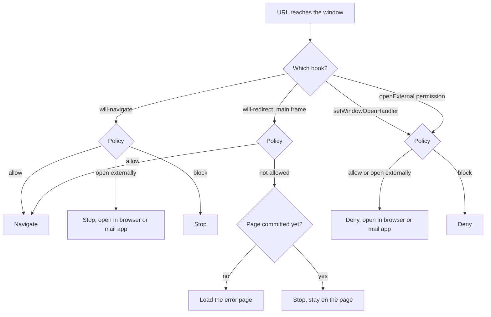

# Harden the Electron Window - Plan

## Goal Capsule

- **Objective:** Whatever runs in the desktop window, including a compromised deploy of the web app, can't take the window to another site, open new windows, reach Node, or use the camera, microphone or other permissions. Links to other sites open in the user's default browser.
- **Means:** Lock down the Electron window around one link policy (KTD1, KTD2) and give the web app's built page a Content Security Policy (KTD5), following Electron's security checklist.
- **Product authority:** Issue #9, extended by the Key Decisions below. #6 (delivered in #7) has the desktop load the hosted web app by URL, so the window runs remote content.
- **Stop conditions:** Stop and ask if the headless check shows an in-place `mailto:` link can't be opened while permissions are denied (KTD4), or if the CSP blocks anything the built web app loads.
- **Execution profile:** Standard, inline, one PR on `issue-9-hardening`.
- **Open blockers:** None.

---

## Product Contract

Product Contract preservation: changed: R13 and R14 added, confirmed in the plan's scoping synthesis; the planning questions are resolved in the Planning Contract.

### Summary

The desktop window stays on the app's origin and sends links to other sites to the default browser. It declares isolation explicitly, denies every permission request, and opens DevTools on its own only in development. Packaging refuses a web app URL that isn't https. The web app's page gets a Content Security Policy, and every checklist item left out is recorded in the repo with its reason.

### Problem Frame

`apps/desktop/src/main/main.ts` is still Forge's scaffold. The window sets only `preload` in `webPreferences`, opens DevTools on every launch, follows any navigation, and opens any new window the page asks for. Electron approves every permission request a page makes unless the app sets a handler, and nothing stops a build from loading the web app over http. That was harmless while the window showed a local placeholder. Since #7 it loads the hosted web app, so a script injected into that page, or a compromised deploy, inherits all of it.

### Requirements

**Navigation and links**

- R1. The window shows only pages from the web app's origin and the bundled error page. A navigation to any other origin, whether the page starts it or a server redirect causes it, is stopped and the window stays where it was.
- R2. A link to another site opens in the user's default browser (or mail app, for `mailto`), whether the link opens in place or in a new window. The app never opens a second Electron window.
- R3. Only `http`, `https` and `mailto` links go to the operating system. A link with any other scheme opens nothing.
- R4. The error page still shows when the web app can't load, offline included, and its "Try again" link still returns to the app.
- R13. A link to the app itself that asks for a new window (`target="_blank"`, a middle click) opens in the default browser.
- R14. When the first load is redirected to another origin, the window shows the error page instead of staying blank.

**Isolation and permissions**

- R5. The window declares context isolation and the sandbox on and Node integration off, instead of relying on Electron's defaults.
- R6. Every permission request from a page (camera, microphone, geolocation, notifications and the rest) is denied without prompting the user.
- R7. The app badge from #8 keeps working in the desktop app.

**Content Security Policy**

- R8. The web app's page carries a Content Security Policy that lets it load scripts, styles, fonts, images and connections only from its own origin, in the desktop app and in browsers.
- R9. `pnpm start` and the web dev server keep working, hot reload included.

**DevTools**

- R10. DevTools opens on launch only in development. In the packaged app it doesn't open on its own and stays available from the menu and its keyboard shortcut.

**Packaging**

- R11. Packaging fails when `SEXTOU_WEB_URL` is set to a URL that isn't https. Development keeps loading `http://localhost:5173`.

**Security checklist**

- R12. Each item of Electron's security checklist is either covered by this work or recorded in the repo as left out, with the reason.

### Acceptance Examples

- AE1. **Covers R1, R2.** **Given** the web app in the desktop window, **when** the user clicks a link to `https://example.com` that opens in place, **then** the default browser opens it and the window still shows the app.
- AE2. **Covers R2.** **Given** the same window, **when** the user clicks a link to another site with `target="_blank"`, **then** the default browser opens it and no second Electron window appears.
- AE3. **Covers R3.** **Given** the same window, **when** the page links to a `file:` URL or another app's custom scheme, **then** nothing opens and the window stays on the app.
- AE4. **Covers R1, R14.** **Given** the window loading the web app, **when** the server redirects to another origin, **then** the window doesn't show that origin: it shows the error page on the first load, and stays on the current page afterwards.
- AE5. **Covers R4.** **Given** the desktop app started offline, **when** the network comes back and the user clicks "Try again", **then** the window shows the app.
- AE6. **Covers R6.** **Given** the web app in the desktop window, **when** the page asks for the camera, **then** the request is denied and no prompt appears.
- AE7. **Covers R11.** **Given** `SEXTOU_WEB_URL=http://example.com`, **when** the desktop is packaged, **then** packaging fails with a message naming the https requirement. With an `https` URL, packaging succeeds.

### Key Decisions

- **The issue's items plus two checklist items: deny permissions, require https.** Both let remote content do harm before anyone would notice. Governs R6, R11. (session-settled: user-approved — chosen over only the issue's items with these two recorded as left out: Electron grants every permission by default, and an http URL lets anyone on the network swap the code the window runs)
- **DevTools stays reachable in the packaged app.** Only someone at the machine can open it, as in a browser, and it helps investigate production bugs. Governs R10. (session-settled: user-approved — chosen over disabling DevTools in the packaged app: it isn't a remote attack path)
- **The CSP lives on the web app's page, so browsers get it too.** Since #7 the desktop has no page of its own (`apps/desktop/index.html`, which the issue names, is gone), and the page the window loads is the one browsers load. Governs R8.
- **Only `http`, `https` and `mailto` reach the operating system.** Handing any URL to the OS lets a page launch local files or other apps' protocol handlers, which the checklist warns against. Governs R3.
- **Cross-origin server redirects are stopped too.** Otherwise a redirect would take the window off the app without a click. Governs R1, R14.
- **An unset `SEXTOU_WEB_URL` still packages.** There is no deploy yet, and `pnpm build` (run by CI) packages the desktop without a URL, so the https check applies only to a URL that is set. Governs R11.
- **A same-origin link asking for a new window goes to the browser.** The app never opens a second window, and dropping the click would leave the user with nothing. Governs R13. (session-settled: user-approved — chosen over ignoring the click: a dead click looks broken)
- **A redirect blocked on the first load shows the error page.** A host that redirects its bare domain to `www` would otherwise leave a white window on every launch. Governs R14. (session-settled: user-approved — chosen over leaving the window blank: the user has no way out of it)

### Scope Boundaries

**Deferred for later**

- Allowing a specific permission (web notifications, fullscreen, clipboard writes). The first feature that needs one allows only that one.
- An exception to R1 for a login hosted on another origin, when one exists.
- Validating the sender of IPC messages. The preload exposes nothing and main handles no IPC yet; the checklist note records it for when it does.
- A deployed web app URL and its hosting headers, including `frame-ancestors`, which a meta CSP can't set.

**Non-goals**

- Code signing and the macOS badge check.
- Exporting `@sextou/ui`'s Tailwind and Lingui setup (#10).
- Other native features.
- Requiring a click before a link goes to the operating system. Considered and not built: a compromised deploy could open browser tabs or mail drafts without one, but what opens stays outside the window and in front of the user. A report of abuse would change the call.
- Stripping `mailto` parameters such as `attach=`. Considered and not built: the user still has to send the draft. Same trigger as above.
- A CSP for the bundled error page. Considered and not built: it has no script and its only dynamic value is the build-time `SEXTOU_WEB_URL`.
- A CSP in development. The dev server injects an inline script and inline styles (KTD5), so Electron logs its "Insecure Content-Security-Policy" warning under `pnpm start`, in development only.

### Dependencies / Assumptions

- Electron 44.9.0 already defaults to context isolation, the sandbox and no Node integration (`electron.d.ts`, `WebPreferences`); R5 states them so a future change can't drop them silently.
- The Badging API in Electron doesn't go through the permission request handler, so R6 doesn't break R7: Electron's `badge_manager.cc` calls the native badge with no permission check (read on Electron's main branch, not the v44.9.0 tag). The notification permission macOS needs for the badge is the operating system's, not the page's.
- The web app and `@sextou/ui` load nothing from other origins at runtime: the Inter font comes from npm and is bundled, and every font file is above Vite's 4 KB inline limit, so the build emits no `data:` URLs.

### Sources / Research

- Issue #9 (scope and done-when).
- Electron's security checklist: https://www.electronjs.org/docs/latest/tutorial/security
- `apps/desktop/src/main/main.ts` (window, DevTools, load and error handling), `apps/desktop/src/main/error-page.ts` (the `data:` error page), `apps/desktop/forge.config.mts` (fuses already set), `apps/desktop/vite.main.config.mts` (`SEXTOU_WEB_URL`), `apps/web/index.html`.
- `.compound-engineering/artifacts/plans/2026-10-19-1406-feat-platform-interface-plan.md` (the badge and the deferred preload API).

---

## Planning Contract

### Key Technical Decisions

- KTD1. **One pure link policy decides every URL.** A module in `apps/desktop/src/main` takes the web app URL and a target URL and answers allow, open externally, or block. Allow requires an `http`/`https` target whose origin equals the web app's, and never matches when the web app URL is empty, unparseable or has the `"null"` origin. Open externally covers any other `http`, `https` or `mailto` target. Everything else is blocked. The origin check alone would let `blob:` URLs through (their origin is the app's) and would match `data:`, `file:` and `about:` against a `"null"` origin. Covers R1, R3, R13.
- KTD2. **Three Electron hooks apply the policy, wired before the first load.**
  - `will-navigate` stops anything not allowed and, for open externally, hands the URL to `shell.openExternal`.
  - `will-redirect` stops a main-frame redirect that isn't allowed and never opens it externally. When the window has committed no page yet, it loads the error page (R14), because a cancelled navigation emits no `did-fail-load`.
  - `setWindowOpenHandler` always denies, and sends allowed and open-externally URLs to `shell.openExternal` (R2, R13).

  `will-navigate` doesn't fire for `loadURL`, so the app's own loads of the web app and the error page pass untouched. A link from the error page fires it with the web app's URL, which is allowed.

- KTD3. **`shell.openExternal` gets the parsed URL's `href`, and its rejection is swallowed.** On Linux it rejects when no handler exists; nothing in the window depends on the result. This follows the `.catch(() => undefined)` already in `main.ts`.
- KTD4. **Permissions are denied on the default session by both handlers.** `setPermissionRequestHandler` answers false and `setPermissionCheckHandler` returns false, set once before the window is created. If the headless check shows that an in-place `mailto:` link reaches the `openExternal` permission instead of `will-navigate`, the request handler sends that permission's URL through the link policy before denying it. Covers R6, and R2 for `mailto`.
- KTD5. **The CSP is a meta tag that a build-only Vite plugin injects into `apps/web`'s `index.html`.** The policy: `default-src 'self'`, `script-src 'self'`, `style-src 'self'`, `img-src 'self'`, `font-src 'self'`, `connect-src 'self'`, `object-src 'none'`, `base-uri 'self'`, `form-action 'self'`. A meta tag reaches browsers and the desktop through the same file, which a desktop-added header would not. Applying it only at build keeps the dev server's inline React Refresh preamble, inline `<style>` tags and its WebSocket working (R9). The plugin follows `packages/ui/lingui-macros.ts` and injects at the start of `<head>` so it precedes every resource. Covers R8, R9.
- KTD6. **DevTools opens on launch only when `!app.isPackaged`; `devTools` stays enabled.** `app.isPackaged` is false under `electron-forge start` and true in the packaged app. Setting `webPreferences.devTools` to false would also remove it from the menu, which R10 keeps. Covers R10.
- KTD7. **`vite.main.config.mts` throws in production mode when `SEXTOU_WEB_URL` is non-empty and doesn't parse as an `https:` URL.** Forge's Vite plugin builds main with mode `production` for `package` and `make` and `development` for `start`, and a throw there fails packaging with the message in Forge's output. An empty value (`SEXTOU_WEB_URL=`) counts as unset. Covers R11.
- KTD8. **The desktop gets a unit suite, scoped to its pure modules.** It covers the link policy and the error page, in Node, with the 90% per-file floor, and `main.ts` stays out of coverage, as `src/main.tsx` does in `apps/web`. The hooks are proven by the headless Electron check in the Verification Contract.
- KTD9. **The checklist notes live in a "Desktop security" section of `AGENTS.md`.** It says what each item relies on and why the rest is left out. Agents and contributors already read that file before changing the shell. Covers R12.

### High-Level Technical Design

How each URL the window meets is handled:

The permission path applies only if the headless check shows that in-place `mailto:` links arrive there (KTD4).

### Assumptions

- An in-place `mailto:` link fires `will-navigate` before Electron hands it to the operating system. This was read from Electron's navigation throttle but not run; the headless check settles it (KTD4).

---

## Implementation Units

### U1. Link policy and the desktop unit suite

**Goal:** A tested, pure answer to "what happens to this URL" that `main.ts` can wire up.

**Requirements:** R1, R3, R13 (KTD1, KTD8).

**Dependencies:** None.

**Files:**

- Create `apps/desktop/src/main/link-policy.ts` and `apps/desktop/src/main/link-policy.test.ts`.
- Create `apps/desktop/src/main/error-page.test.ts`.
- Create `apps/desktop/vitest.config.mts`.
- Modify `apps/desktop/package.json` (`test` and `test:unit` scripts, `vitest` and `@vitest/coverage-v8` devDependencies), `vitest.config.ts` (add `apps/desktop` to `projects`) and `pnpm-lock.yaml`.

**Approach:**

- The policy takes both URLs as strings, as `errorPageURL` takes its URL, so it stays free of Electron imports.
- The suite mirrors `apps/web/vitest.config.ts`: name `desktop`, Node environment, `src/**/*.test.ts`, v8 coverage over `src/**/*.ts` excluding tests, `main.ts` and `declarations.d.ts`, with the 90% per-file thresholds.
- The config file is `.mts` because the desktop `tsconfig.json` includes only `src/**/*` and `*.mts`.

**Patterns to follow:** `apps/web/vitest.config.ts`, `apps/web/package.json` scripts, `apps/desktop/src/main/error-page.ts`.

**Test scenarios:**

- With the web app at `https://app.example`, `https://app.example/inbox?x=1#y` is allowed.
- With the web app at `http://localhost:5173`, `http://localhost:5173/settings` is allowed and `http://localhost:3000/` opens externally.
- `http://app.example/` against an `https://app.example` web app opens externally, because the scheme makes it another origin.
- `https://app.example.evil.com/` and `https://user@app.example.evil.com/` open externally.
- `mailto:someone@example.com` opens externally.
- `file:///etc/passwd`, `javascript:alert(1)`, `data:text/html,x`, `about:blank`, `otherapp://open` and `blob:https://app.example/uuid` are blocked.
- An unparseable target (`not a url`) is blocked.
- With the web app URL empty or unparseable, no target is allowed: `https://example.com` still opens externally, and `data:` and `about:blank` are blocked.
- The error page URL is a `data:text/html` URL whose decoded HTML holds a "Try again" link to the given web app URL.

**Verification:** `pnpm --filter @sextou/desktop test:unit` passes with every file in coverage at 90% or more, and a root `vitest run` runs the desktop project.

### U2. Harden the window in `main.ts`

**Goal:** The window applies the link policy, denies permissions, declares isolation and opens DevTools only in development.

**Requirements:** R1, R2, R4, R5, R6, R7, R10, R13, R14 (KTD2, KTD3, KTD4, KTD6). R6 and R10 carry the session-settled Key Decisions on permissions and DevTools.

**Dependencies:** U1.

**Files:** Modify `apps/desktop/src/main/main.ts`.

**Approach:**

1. Set the permission request and check handlers on the default session once, when the app is ready and before the first window (KTD4).
2. Add `contextIsolation: true`, `sandbox: true` and `nodeIntegration: false` beside `preload` (R5).
3. Wire `will-navigate`, `will-redirect` and `setWindowOpenHandler` to the policy before `loadURL` (KTD2), using the `details` event object Electron 44 passes rather than the deprecated positional URL.
4. Keep the `did-fail-load` handler and its `errorCode !== -3` guard: other paths still emit -3.
5. Wrap `openDevTools()` in `!app.isPackaged` (KTD6).

**Execution note:** The behavior lives in Electron's event wiring, so the headless Electron check in the Verification Contract is this unit's proof; run it before declaring the unit done.

**Patterns to follow:** The existing `did-fail-load` handler and `.catch(() => undefined)` in `main.ts`.

**Test scenarios:** Not in the unit suite, because `main.ts` imports Electron and is excluded from coverage (KTD8). The headless Electron run in the Verification Contract executes these, with `shell.openExternal` replaced by a recorder:

- Covers AE1, AE2. An in-place link and a `target="_blank"` link to another site each record one `openExternal` call, the window URL stays on the app, and `BrowserWindow.getAllWindows()` stays at one.
- A same-origin `target="_blank"` link records one `openExternal` call (R13).
- Covers AE3. `file:` and custom-scheme links record nothing.
- An in-place `mailto:` link records one call; if it doesn't, apply KTD4's fallback and rerun.
- Covers AE6. `navigator.mediaDevices.getUserMedia({ video: true })` rejects.
- The Hello and Reset clicks read `app.getBadgeCount()` 0, 1, 2, 0 (R7).
- Covers AE4. A launch against a URL that redirects to another origin shows the error page (R14).
- Covers AE5. A launch with the server stopped shows the error page, and "Try again" after starting it shows the app.

**Verification:** Every scenario above passes in the headless run.

### U3. Refuse a non-https URL when packaging

**Goal:** A packaged build can't load the web app over http.

**Requirements:** R11 (KTD7), carrying the session-settled Key Decision on requiring https.

**Dependencies:** None.

**Files:** Modify `apps/desktop/vite.main.config.mts`.

**Approach:** In the `defineConfig` callback, when `mode` isn't `development` and `SEXTOU_WEB_URL` is non-empty, parse it and throw unless its protocol is `https:`. The message names `SEXTOU_WEB_URL` and the https requirement.

**Test scenarios:** Test expectation: none in the unit suite -- this is build configuration; the packaging runs in the Verification Contract cover AE7.

**Verification:** Packaging with an http URL fails with the message, packaging with an https URL or none succeeds, and `pnpm start` still loads `http://localhost:5173`.

### U4. Content Security Policy for the web app

**Goal:** The built web app carries the CSP in browsers and in the desktop window.

**Requirements:** R8, R9 (KTD5).

**Dependencies:** None.

**Files:**

- Create the plugin module in `apps/web`, next to `vite.config.ts`.
- Modify `apps/web/vite.config.ts` to add it.

**Approach:** A Vite plugin with `apply: 'build'` whose `transformIndexHtml` returns one `meta http-equiv="Content-Security-Policy"` tag injected at the start of `<head>`, holding KTD5's policy.

**Patterns to follow:** `packages/ui/lingui-macros.ts` (a plugin factory in its own module, imported by `vite.config.ts`).

**Test scenarios:** Test expectation: none in the unit suite -- the plugin is build configuration outside `apps/web/src`, which the coverage floor measures. The built `apps/web/dist/index.html` and the browser checks in the Verification Contract prove it.

**Verification:** `apps/web/dist/index.html` has the meta tag first in `<head>`. The built app renders in Chromium with no CSP violation in the console. `pnpm --filter @sextou/web dev` serves the page without the tag.

### U5. Document the checklist and the desktop suite

**Goal:** Every checklist item has a recorded owner or reason, and the docs describe the new suite and the https rule.

**Requirements:** R12 (KTD9).

**Dependencies:** U1, U2, U3, U4.

**Files:** Modify `AGENTS.md` and `README.md`.

**Approach:**

1. Add a "Desktop security" section to `AGENTS.md`. It names where each enforced item lives: the link policy and hooks, `webPreferences`, the permission handlers, the CSP plugin, the https check, and the fuses in `forge.config.mts`. It records the items left out, each with its reason:
   - `<webview>` items: the tag is off by default and unused.
   - IPC sender validation: there is no IPC yet; validate senders when the first handler lands.
   - `file://`: unused, since the window loads the web app by URL.
   - Exposing Electron APIs: the preload exposes nothing.
   - Keeping Electron current: a standing practice, not a code change.
   - Development: http on localhost, and no CSP.
2. Update the Tests bullets: the desktop has a unit suite for its pure main-process modules, and the root config runs it.
3. In `README.md`, add that `SEXTOU_WEB_URL` must be https when set.

**Test scenarios:** Test expectation: none -- documentation only.

**Verification:** Every one of the checklist's 20 items appears in the section, as covered or left out with its reason.

---

## Verification Contract

| Check                                                                                                                                                                                                                                                              | Proves                                                                    | Units |
| ------------------------------------------------------------------------------------------------------------------------------------------------------------------------------------------------------------------------------------------------------------------ | ------------------------------------------------------------------------- | ----- |
| `pnpm lint`, `pnpm typecheck`, `pnpm test`, `pnpm build`                                                                                                                                                                                                           | Lint, types, all suites with their coverage floors, packaging with no URL | U1–U5 |
| `vitest run` at the root lists the `desktop` project                                                                                                                                                                                                               | CI runs the new suite                                                     | U1    |
| `SEXTOU_WEB_URL=http://example.com pnpm package` fails with the https message; `SEXTOU_WEB_URL=https://example.com pnpm package` succeeds                                                                                                                          | AE7                                                                       | U3    |
| `apps/web/dist/index.html` starts `<head>` with the CSP meta; headless Chromium on the built app shows both buttons and no console errors or CSP violations                                                                                                        | R8                                                                        | U4    |
| Headless Electron 44 (Playwright `_electron`) against the web build served over https on localhost with a throwaway self-signed certificate (`--ignore-certificate-errors` on that run only), with `shell.openExternal` replaced in the main process by a recorder | AE1–AE6, R7, R13, R14                                                     | U2    |

The headless desktop run executes U2's test scenarios. It launches `apps/desktop` with the plain Electron binary through Playwright's `_electron`, never the packaged app in `out/`: that app's `EnableNodeCliInspectArguments` fuse blocks the inspector Playwright attaches through. Main is built by packaging with `SEXTOU_WEB_URL` set to the https localhost URL of the served web build, since the URL is fixed at build time. The redirect scenario (AE4) needs a second build whose `SEXTOU_WEB_URL` points at the redirecting URL.

Manual, left to the user: `pnpm start` with hot reload (R9), and DevTools not opening on launch of the packaged app while the menu still offers it (R10).

---

## Definition of Done

- Every unit's Verification holds, and every check in the Verification Contract passes, except the manual ones, which are reported as not run.
- The unit test suites keep every source file at 90% or more coverage.
- `AGENTS.md` and `README.md` match the shipped behavior.
- No abandoned-attempt code, throwaway certificates or scratch scripts are in the diff; verification scripts stay in the scratchpad.
