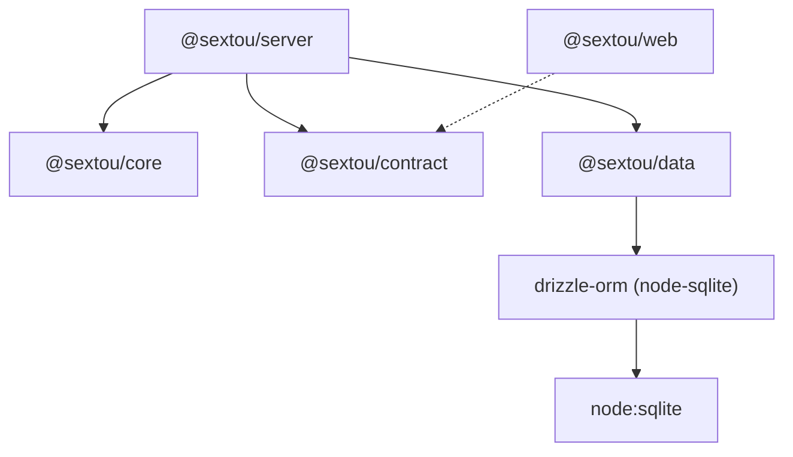
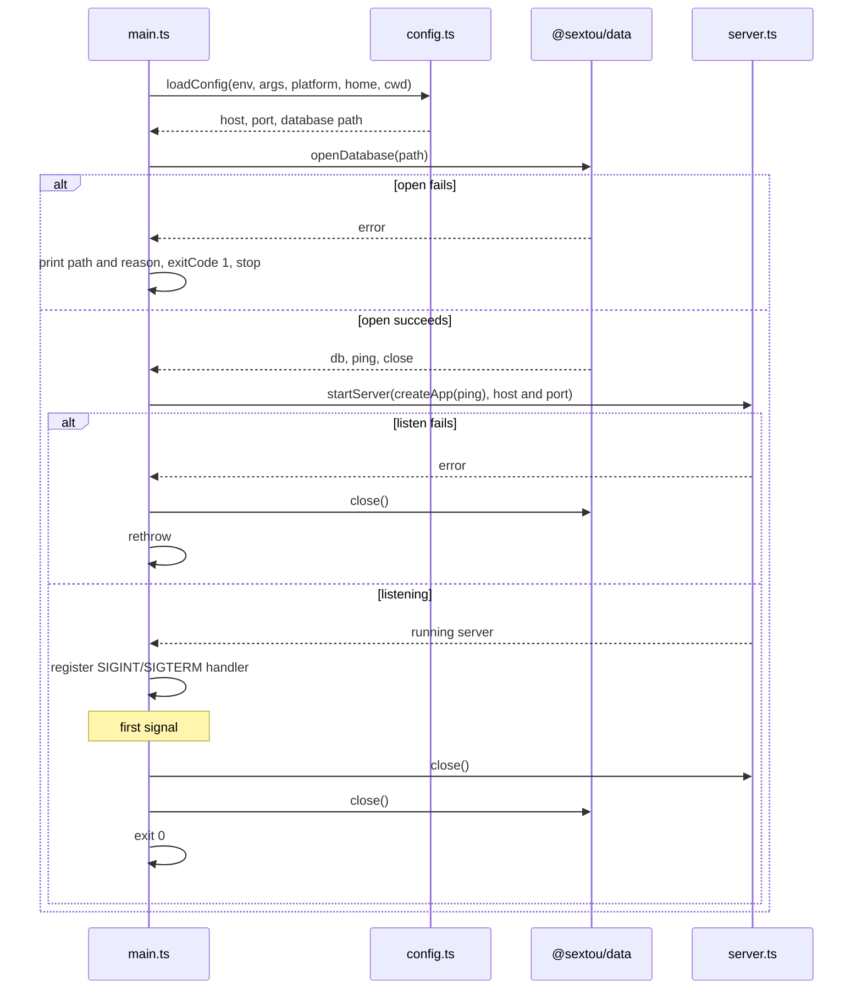

# SQLite Data Access - Plan

## Goal Capsule

- **Objective:** The sextou server keeps its data in a SQLite database that it opens on start, so the first feature that stores data (actors, #28) can save records that survive a restart.
- **Means:** a new data package over the SQLite that Node ships, queried through drizzle (KD7, KTD1), opened by the server before it takes requests and checked by the health endpoint.
- **Product authority:** the repository owner. Only issue #20 is in scope; #21, #22 and #28 are not.
- **Stop conditions:**
  - Stop and report if the organization's pnpm policy (one-day minimum release age, trust policy `no-downgrade`) rejects `drizzle-orm@1.0.0-rc.4`: an exception only takes effect once merged to `main`.
  - Stop and report if `node:sqlite` prints an `ExperimentalWarning` on the Node 24 release CI resolves from `.node-version`.
  - Stop and report if the Vite build stops leaving `node:sqlite` as an external import in `apps/server/dist/server.mjs` (R5).
- **Execution profile:** one pull request against `main`, squash-merged. `ce-work` implements; the user reviews and merges.
- **Open blockers:** none.

---

## Product Contract

Product Contract preservation: unchanged except that the questions deferred to planning are answered by KTD1–KTD9 and removed from Outstanding Questions, and the Node 24 assumption now states the exact release where `node:sqlite` stops warning.

### Summary

A new workspace package, `@sextou/data`, opens a SQLite database through Node's `node:sqlite` and hands later features a drizzle database to query. The server reads the database path from `--database` or `SEXTOU_SERVER_DATABASE`, defaulting to `sextou/sextou.db` in the user's data directory, and opens it before listening. It exits with a readable message when the open fails, and closes the server and then the database on SIGINT or SIGTERM. The health response gains a `database` field, `up` or `down`, and answers 503 when the database does not answer.

### Problem Frame

sextou has a backend skeleton with one endpoint, `health`, and stores nothing. The next feature, actors (#28), must save real records that survive a restart, with no mock or in-memory store. No package declares a database driver, query builder or SQL dependency today, and the server neither handles shutdown signals nor turns a startup failure into a readable message (`apps/server/src/main.ts`).

Issue #20 was opened as a database-agnostic layer on Dolt. Dolt was chosen because beads will run on it. sextou's own data has no such constraint.

### Key Decisions

- KD1. **sextou's data lives in SQLite; beads keeps Dolt as a separate database outside this package.** (session-settled: user-directed — chosen over SQLite replacing Dolt everywhere, beads included, and over SQLite only until a later move to Dolt: only beads needs Dolt.) Governs R1.
- KD2. **Queries are written against SQLite, with no layer for swapping databases.** No other database is planned for this data, so a swap layer would have nothing to swap. (session-settled: user-directed — chosen over repository interfaces in `@sextou/core` with a Dolt adapter, and over portable SQL that runs on several databases: the user asked for queries coupled to the one database.) Governs R1, R2.
- KD3. **Database access gets its own package.** `@sextou/core` keeps declaring no dependencies, and `@sextou/server` keeps holding no data code. (session-settled: user-directed — chosen over putting the database in `@sextou/core`, which would break its no-dependency rule, and over putting it in `@sextou/server` next to the routes.) Governs R2, R3.
- KD4. **This work proves the connection end to end and creates no table.** The server opens and closes the database, and the health endpoint checks it. (session-settled: user-directed — chosen over adding an example table and query as a model for #28, which would create schema before migrations (#21) exist, and over the package alone with no server wiring.) Governs R6, R11.
- KD5. **The default database file sits in the operating system's per-user data directory.** Data then survives a reinstall and does not depend on the directory the server starts from. (session-settled: user-directed — chosen over a file in the server's working directory and over requiring an explicit path.) Governs R7.
- KD6. **A database that cannot be opened stops the server.** No real feature works without it, and health only reports problems that arise after start. (session-settled: user-directed — chosen over starting anyway with health reporting the database as down.) Governs R9.
- KD7. **The driver is the SQLite built into Node, not a native addon.** The server's bundle inlines every dependency (`ssr.noExternal: true` in `apps/server/vite.config.mts`), and a native addon would break the rule that `server.mjs` needs only Node. (session-settled: user-approved — proposed with a native driver as the alternative and the bundling cost stated.) Governs R5.

### Requirements

**Data package**

- R1. A new workspace package holds sextou's database access: it opens a SQLite database at a given file path, or in memory, and exposes a handle that later features query through.
- R2. The data package imports no HTTP framework; `@sextou/server` imports it and `@sextou/core` does not.
- R3. The data package reads no environment, path default or process state itself; the server passes it the database location.
- R4. The data package's tests run against an in-memory SQLite database, with no external database process, so CI needs no new service.
- R5. The server's bundle still needs only Node: the driver is the SQLite module Node ships, and no native addon is added.

**Server lifecycle**

- R6. On start, the server opens the database before it accepts requests.
- R7. By default the database is one file in sextou's folder under the operating system's per-user data directory, and the server creates the folder and the file when they are missing.
- R8. An environment variable and a command-line flag override the database path, with the flag winning over the variable, as they do for host and port.
- R9. When the database cannot be opened, the server exits with a non-zero code and a message that names the path and the reason, without listening on its port.
- R10. On SIGINT or SIGTERM, the server stops accepting requests, closes the database and exits.

**Health**

- R11. The health response, defined in `@sextou/contract`, also reports whether the database answers.
- R12. When the database does not answer, the health endpoint responds with a non-200 status.

### Acceptance Examples

- AE1. **Covers R6, R7, R11.** Given no database file exists yet, when the server starts with no path configured, it creates the file in the default location, and health responds 200 and reports that the database answers.
- AE2. **Covers R8.** Given the environment variable and the flag name different paths, when the server starts, it opens the flag's path.
- AE3. **Covers R9.** Given a database path in a directory the server cannot write to, when the server starts, it exits with a non-zero code and a message naming that path and the reason, and nothing listens on the port.
- AE4. **Covers R11, R12.** Given the server is running and its database stops answering, when a client requests health, the response has a non-200 status and says the database does not answer.
- AE5. **Covers R10.** Given the server is running with its database open, when it receives SIGTERM, it closes the database and exits.

<!-- ce-section: work-relationships -->

### How This Work Fits Together

This plan covers issue #20 in the "Database support" project (#18). The breakdown below is the current understanding, not a committed roadmap.

- #21, Database migrations: depends on this work for the database it migrates.
- #28, Actors CRUD: depends on this work and on #21. Its rules live in `@sextou/core`, its queries in the data package, and the server joins the two.
- #22, Dolt for development and tests: still to decide. With sextou's data in SQLite, Dolt serves only beads.

### Scope Boundaries

- Tables, schema and migrations (#21).
- Any feature's data, actors included (#28).
- A layer for swapping SQLite for another database.
- Beads and its Dolt database.
- Readable messages for startup failures other than the database, such as a bad config value or a port in use.
- The web app showing the database's status.
- Backups, encryption, and several processes sharing one database file.

#### Deferred to Follow-Up Work

- `drizzle-kit`, pinned to the same `1.0.0-rc.4` as `drizzle-orm`, arrives with the first schema and the migration flow in #21. Its stable 0.31 line has no `node:sqlite` support.
- Moving `drizzle-orm` and `drizzle-kit` to 1.0.0 together once a stable 1.0 is published.

### Dependencies / Assumptions

- The project runs on Node 24 (`.node-version`, build target `node24` in `apps/server/vite.config.mts`), which ships `node:sqlite` without a flag. Node 24 marks it a release candidate from v24.15.0; v24.14.0 and earlier print an `ExperimentalWarning` on start. CI resolves `.node-version` to v24.22.0, which prints none.
- The texts of issues #18, #20 and #22 still describe a database-agnostic layer on Dolt. They are updated separately from this plan.

### Outstanding Questions

**Deferred to Planning**

- Whether the data package may import types from `@sextou/core`. #28 decides it with the first table, since this work's package needs no core type.

### Sources / Research

- `.compound-engineering/artifacts/plans/2026-10-19-1428-feat-backend-server-structure-plan.md`: the three-package structure and dependency direction this plan extends. Its assumption that the store "sits behind repositories inside `@sextou/core`" is superseded by KD2 and KD3.
- `apps/server/src/config.ts`: how host and port are read from flags and environment variables, the pattern R8 follows.
- `apps/server/src/main.ts`, `apps/server/src/server.ts`: startup with no error handling and no signal handling; `RunningServer.close()` exists but nothing calls it.
- `apps/server/vite.config.mts`: the single-file bundle that inlines every dependency.
- `packages/contract/src/modules/health/health.schema.ts`, `apps/server/src/modules/health/health.routes.ts`: today's `GET /health`, which always answers 200 with `version` and `uptimeSeconds`.

---

## Planning Contract

### Key Technical Decisions

- KTD1. **Queries go through `drizzle-orm` pinned exactly to `1.0.0-rc.4`, with its `node-sqlite` driver.** The data package builds the `DatabaseSync` client itself and passes it as `drizzle({ client })`, so it keeps the client's options and closes it. Results come back synchronously. The pin is exact because the 1.0 line is a release candidate; the `rc5`-style hash-suffixed snapshot tags are never used. The RC is published through npm's trusted publisher with attestations. Governs R1, R5. (session-settled: user-directed — chosen over `drizzle-orm` 0.45.4, the stable line, with the `sqlite-proxy` driver: the official driver needs no hand-written glue between drizzle and `DatabaseSync`.)
- KTD2. **`@sextou/data` exports one `openDatabase(path)` that returns the drizzle database plus `ping()` and `close()`.**
  - `path` is an absolute file path or the literal `:memory:`.
  - For a file, it creates the parent folder with mode `0700` and the file with mode `0600` when they are missing, and sets the existing file and its `-wal` and `-shm` sidecars to `0600`. SQLite gives new sidecars the main file's mode, so the file must be `0600` before the first open (KTD5).
  - It opens the client, then runs `PRAGMA journal_mode = WAL` and `PRAGMA synchronous = NORMAL` for a file. For `:memory:` it skips the folder, the modes and WAL, and runs a `select 1`. Running a statement inside the open matters: SQLite opens a file that is not a database without complaint and fails only on the first statement.
  - Any error from these steps is thrown to the caller unchanged.
  - `ping()` runs `select 1` and returns `true`, or `false` on any error, so health never answers 500.
  - `close()` does nothing when the client is already closed, because a second `DatabaseSync.close()` throws `ERR_INVALID_STATE`.
  - Governs R1, R3, R7. Node's foreign-key enforcement is already on by default (`enableForeignKeyConstraints`).
- KTD3. **The database path comes from `--database`, then `SEXTOU_SERVER_DATABASE`, then the OS default.** It follows KTD5 of the backend plan: `parseArgs` in strict mode, the flag winning, an error that names the flag or variable and the value. An empty value is rejected, because `new DatabaseSync('')` opens a temporary database that SQLite deletes on close and would lose every record. `:memory:` passes through unchanged. A relative path is resolved against the working directory, so the file never lands inside the repository by accident when the server runs from `apps/server`. Governs R8.
- KTD4. **The default path is `<data dir>/sextou/sextou.db`, from a small function in the server instead of a dependency.** The data directory is `$XDG_DATA_HOME` when it is set, non-empty and absolute, otherwise `~/.local/share`, on Linux and other Unix systems. On macOS it is `~/Library/Application Support`. On Windows it is `%LOCALAPPDATA%`, otherwise `<home>\AppData\Local`. Each branch joins with its platform's separator (`path.win32` for Windows), so all branches are testable on Linux. The function takes the platform, the environment and the home directory as arguments, so `loadConfig` stays free of process state, as R3 asks of the data package and the backend plan asked of config. Governs R7. (session-settled: user-approved — chosen over the `env-paths` package: it adds a `-nodejs` suffix, uses a `Data` subfolder on Windows and accepts a relative `XDG_DATA_HOME`.)
- KTD5. **The folder and file are owner-only, and the database runs in WAL mode.** Mode `0700` on the folder and `0600` on the file and sidecars keep sextou's data unreadable to other users on the machine. WAL keeps a crash from corrupting the file mid-write and lets reads proceed during a write. On Windows the modes have no effect, and the user profile's own permissions apply. Governs R7. (session-settled: user-approved — proposed as the default with the file permissions and journal mode stated; the user confirmed.)
- KTD6. **`main.ts` owns the lifecycle, in this order.**
  1. Load the config.
  2. Open the database. On failure, print `Could not open the database at <path>: <reason>` to stderr, set `process.exitCode = 1`, and stop before listening. `<reason>` is the error's message, with its code when it has one. SQLite's own message, "unable to open database file", names neither the path nor the OS cause, so the path comes from the server. Governs R9.
  3. Build the app with the database's `ping`, and start listening. If listening fails, close the database and rethrow, which keeps today's behavior for a port in use.
  4. Register one handler for both SIGINT and SIGTERM, only after listening succeeds. Before that, Node's default signal exit applies, which is safe for SQLite.
  5. The first signal removes the handler from both signals, closes the HTTP server, then the database, then exits with code 0. Shutdown therefore runs once, and a second signal gets Node's default exit, which ends a shutdown stuck on a request in flight. Governs R10.
- KTD7. **Health reports `database: 'up' | 'down'` and answers 503 when it is `down`.** The contract adds the field to the one response schema, so the 200 and 503 bodies share a shape. The core's `getHealth` takes whether the database answered and returns the field, so the core still reads no process state and imports nothing. The route calls the probe on each request and picks the status, because the status code is an HTTP concern. Governs R11, R12.
- KTD8. **`startServer` takes only the host and port (`Pick<Config, 'host' | 'port'>`).** `Config` gains `database`, and the server does not need it. `server.test.ts`'s literal configs stay as they are.
- KTD9. **The data package follows the existing package shape.** `packages/data`: private ESM, `exports` pointing at `./src/index.ts`, the shared `typecheck`/`test`/`test:unit` scripts, and a Vitest suite named `data` in Node, with v8 coverage at 90% per file that excludes `src/index.ts` and `src/env.d.ts`. `src/env.d.ts` references Node's types, because TypeScript 7 loads none by default. It declares `drizzle-orm` (`1.0.0-rc.4`) in `dependencies` and `@types/node` (`^24.19.2`, the server's existing lock entry) in `devDependencies`. The server declares `"@sextou/data": "workspace:*"`. CI's knip then fails on any undeclared import, as it does for the other packages. The data package imports neither `@sextou/core` nor `@sextou/contract`.

### High-Level Technical Design

Package dependencies after this work. The data package sits beside the core, and only the server knows all three.



The server's lifecycle (KTD6). Each failure path ends without the port open.



### Output Structure

```text
packages/data/
  package.json
  tsconfig.json
  vitest.config.ts
  src/
    env.d.ts
    index.ts
    database.ts
    database.test.ts
```

### Considered and Not Built

- **`PRAGMA busy_timeout` and other tuning for several connections.** One process holds one connection, and several processes sharing a file is out of scope. Revisit with a second connection or process.
- **A health check that notices the file was deleted while the server runs.** The open handle still answers `select 1`, so health reports `up`. Nothing deletes the file in normal use. Revisit if users report it.
- **A readable message when the home directory cannot be found.** `os.homedir()` throws only with no `HOME` and no user entry, and the thrown config error still stops the server before it listens. Other startup failures are out of scope.
- **A minimum Node version in `engines`.** CI and `.node-version` resolve to v24.22.0. A Node 24 release before v24.15.0 only prints a warning and still works. Revisit if a supported environment runs an older Node 24.
- **A `*.db` entry in `.gitignore`.** The default path is outside the repository, and KTD3 resolves relative paths to absolute ones. Revisit if a database file ever shows up in a diff.

### Risks & Dependencies

| Risk                                                                                                            | Mitigation                                                                                                                         |
| --------------------------------------------------------------------------------------------------------------- | ---------------------------------------------------------------------------------------------------------------------------------- |
| `drizzle-orm` 1.0 changes its API before stable, or an upgrade from the RC breaks the handle.                   | KTD1's exact pin. This work uses only `drizzle({ client })` and `sql`, and the server reaches drizzle only through `openDatabase`. |
| The RC fails the organization's pnpm policy in CI.                                                              | Install under the same policy locally before pushing. If it fails, stop (Goal Capsule).                                            |
| Local machines run Node 26 while CI runs Node 24, so local runs miss Node 24 behavior.                          | The bundle smoke run uses Node 24 explicitly (Verification Contract).                                                              |
| `main.test.ts` imports the real `main.ts`, so a test could create a database in the developer's data directory. | U5 sets the database path, or the home directory and `XDG_DATA_HOME`, to `:memory:` or a temporary folder in every case.           |

### Sources & Research

- drizzle `node:sqlite` driver: https://orm.drizzle.team/docs/connect-node-sqlite, and the `node-sqlite/driver.js` source in https://registry.npmjs.org/drizzle-orm/-/drizzle-orm-1.0.0-rc.4.tgz. The get-started page shows `db.execute()`, which rc.4's SQLite database lacks; use `db.get(sql\`select 1\`)`. One docs snippet passes `connection: { source }`, which the code ignores and opens `:memory:`.
- drizzle versions and dist-tags: https://registry.npmjs.org/drizzle-orm, https://registry.npmjs.org/drizzle-kit
- `node:sqlite` on Node 24 (stability, options, errors): https://nodejs.org/docs/latest-v24.x/api/sqlite.html
- SQLite WAL and sidecar files: https://www.sqlite.org/wal.html
- Behavior checked by running it (Node 24.14, 24.15, 24.22 and 26.8.1):
  - Opening a path in a missing folder, an unwritable folder or a folder throws `ERR_SQLITE_ERROR`, errcode 14, "unable to open database file".
  - A non-database file opens and fails on the first statement, errcode 26.
  - `new DatabaseSync('')` opens a temporary database.
  - A second `close()` throws `ERR_INVALID_STATE`.
  - A Vite 8.3.4 build with the server's config keeps `import { DatabaseSync } from "node:sqlite"` external, and the bundle runs.
- Repository precedents: `packages/core/package.json`, `packages/core/vitest.config.ts` and `apps/server/src/env.d.ts` (package shape), `apps/server/src/config.ts` (option parsing), `apps/server/src/main.test.ts` (testing the entry point through a mocked module).

---

## Implementation Units

### U1. Data package that opens, pings and closes the database

**Goal:** `@sextou/data` exists and opens a SQLite database at a path or in memory, behind a drizzle handle.

**Requirements:** R1, R2, R3, R4, R5, R7 (folder and file creation); KD2, KD3, KD7; KTD1, KTD2, KTD5, KTD9.

**Dependencies:** none.

**Files:**

- `packages/data/package.json`
- `packages/data/tsconfig.json`
- `packages/data/vitest.config.ts`
- `packages/data/src/env.d.ts`
- `packages/data/src/index.ts`
- `packages/data/src/database.ts`
- `packages/data/src/database.test.ts`
- `vitest.config.ts` (root: add `packages/data` to `projects`, in alphabetical order)
- `pnpm-lock.yaml`

**Approach:**

1. Shape the package per KTD9, copying `packages/core`.
2. Write `openDatabase` per KTD2: folder and file creation with their modes, the client, drizzle over it, then the pragmas or `select 1`.
3. Export `openDatabase` and its return type from `src/index.ts`.
4. Install with pnpm so the lockfile records `drizzle-orm@1.0.0-rc.4`.

**Patterns to follow:** `packages/core/package.json`, `packages/core/tsconfig.json`, `packages/core/vitest.config.ts`, `apps/server/src/env.d.ts`. Test style from `packages/core/src/modules/health/health.service.test.ts`.

**Test scenarios:**

- `:memory:` opens, and the drizzle handle answers `select 1` with 1.
- `ping()` returns `true` on an open database.
- `ping()` returns `false` after `close()`, with no throw.
- Calling `close()` twice does not throw.
- A file path in a temporary folder whose parent folder is missing creates the folder with mode `0700` and the file with mode `0600`.
- A file database reports `wal` from `PRAGMA journal_mode`, and its `-wal` and `-shm` sidecars have mode `0600`.
- Reopening an existing file that has mode `0644` sets it to `0600`.
- A path whose parent is a regular file throws.
- A file that holds text, not a database, throws from `openDatabase` instead of from a later query.

Mode checks run only on POSIX systems. CI runs Linux.

**Verification:** the package's `test:unit` passes at 90% per file, its `typecheck` passes, and no file in it imports Hono, `@sextou/core` or `@sextou/contract`.

### U2. Database status in the health contract and the core

**Goal:** the health shape carries `database: 'up' | 'down'`, computed by the core from what the server passes in.

**Requirements:** R11; KTD7.

**Dependencies:** none.

**Files:**

- `packages/contract/src/modules/health/health.schema.ts`
- `packages/contract/src/modules/health/health.schema.test.ts`
- `packages/core/src/modules/health/health.service.ts`
- `packages/core/src/modules/health/health.service.test.ts`

**Approach:**

1. Add `database` as an enum of `up` and `down` to `healthResponseSchema`.
2. Add whether the database answered to `HealthInput`, and `database` to `Health`, mapping `true` to `up` and `false` to `down`.

**Patterns to follow:** the existing fields and tests in both files.

**Test scenarios:**

- A body with `database: 'up'` parses, and so does one with `database: 'down'`.
- A body without `database` is rejected.
- A body with `database: 'unknown'` is rejected.
- `getHealth` with the database answering returns `database: 'up'`, and with it not answering returns `database: 'down'`, with version and uptime unchanged.

**Verification:** both packages' `test:unit` pass at 90% per file, and `@sextou/core` still declares no dependencies.

### U3. Database path in the server's config

**Goal:** `loadConfig` returns an absolute database path from the flag, the variable or the OS default.

**Requirements:** R7, R8; KD5; KTD3, KTD4.

**Dependencies:** none.

**Files:**

- `apps/server/src/config.ts`
- `apps/server/src/config.test.ts`
- `apps/server/src/database-path.ts`
- `apps/server/src/database-path.test.ts`

**Approach:**

1. Add the default-path function per KTD4 in `database-path.ts`, taking the platform, the environment and the home directory.
2. Give `loadConfig` the platform, home directory and working directory as inputs next to `env` and `args`, and add `database` to `Config`. Read the home directory only when the default is needed.
3. Add the `--database` option and `SEXTOU_SERVER_DATABASE` per KTD3, with a validator that rejects the empty string and resolves relative paths.

**Patterns to follow:** `parseHost`, `parsePort` and the precedence ternaries in `apps/server/src/config.ts`, and `describe.each` over invalid values in `apps/server/src/config.test.ts`.

**Test scenarios:**

- With nothing set, the path is the Linux default under the given home directory.
- `XDG_DATA_HOME=/data` gives `/data/sextou/sextou.db`.
- An empty or relative `XDG_DATA_HOME` is ignored for `~/.local/share`.
- macOS gives `<home>/Library/Application Support/sextou/sextou.db`.
- Windows with `LOCALAPPDATA` gives `<LOCALAPPDATA>\sextou\sextou.db`, and without it gives `<home>\AppData\Local\sextou\sextou.db`.
- Covers AE2. With `SEXTOU_SERVER_DATABASE=/a.db` and `--database /b.db`, the path is `/b.db`.
- The variable alone sets the path.
- A relative `--database data.db` resolves against the given working directory.
- `--database :memory:` passes through unchanged.
- An empty `--database` or `SEXTOU_SERVER_DATABASE` throws an error naming the flag or variable.
- The home directory is not read when a path is given.
- The existing host and port cases still pass with the new fields in the expected config.

**Verification:** the server's `test:unit` passes at 90% per file for both files.

### U4. Health route and app wiring with the database probe

**Goal:** `GET /health` reports the database status and answers 503 when it is down.

**Requirements:** R11, R12; KTD7, KTD8.

**Dependencies:** U1, U2.

**Files:**

- `apps/server/package.json` (add `"@sextou/data": "workspace:*"`)
- `pnpm-lock.yaml`
- `apps/server/src/modules/health/health.routes.ts`
- `apps/server/src/modules/health/health.routes.test.ts`
- `apps/server/src/app.ts`
- `apps/server/src/app.test.ts`
- `apps/server/src/server.ts`
- `apps/server/src/server.test.ts`

**Approach:**

1. Add a database probe (a function returning whether the database answers) to `HealthRoutesOptions` and `AppOptions`, and pass it through `createApp`.
2. In the route, call the probe per request, pass its result to `getHealth`, and answer 503 with the same body when it is `down`.
3. Narrow `startServer`'s parameter per KTD8, and give the `createApp` calls in the server tests a probe.

**Patterns to follow:** `apps/server/src/modules/health/health.routes.test.ts` (calling the routes directly and parsing with the contract schema).

**Test scenarios:**

- With a probe returning `true`, the response is 200 and parses with `healthResponseSchema` with `database: 'up'`.
- Covers AE4. With a probe returning `false`, the response is 503 and parses with `database: 'down'`.
- With the `ping` of a `:memory:` database from `@sextou/data` that was then closed, the response is 503. This proves the real probe end to end.
- The probe is called again on each request, so a database that comes back reports `up` on the next one.
- `createApp` passes its probe to the health route.

**Verification:** the server's `test:unit` passes at 90% per file, and `server.test.ts` passes with its existing literal configs.

### U5. Server lifecycle: open before listening, exit on failure, close on signals

**Goal:** `main.ts` opens the database before listening, stops with a readable message when it cannot, and closes cleanly on SIGINT and SIGTERM.

**Requirements:** R6, R7, R9, R10; KD4, KD6; KTD6.

**Dependencies:** U1, U3, U4.

**Files:**

- `apps/server/src/main.ts`
- `apps/server/src/main.test.ts`

**Approach:**

1. Pass `process.platform`, `os.homedir` and `process.cwd()` to `loadConfig`.
2. Follow KTD6's order: open, build the app with `ping`, listen, register the signal handler.
3. Keep the IPv6 bracketing and the listening line as they are.

**Execution note:** every `main.test.ts` case sets the database path to `:memory:` or a temporary folder, or, for AE1, stubs `HOME` to a temporary folder and `XDG_DATA_HOME` to undefined. The AE1 case uses the real `@sextou/data`; the others may mock it. Every case spies on `process.on`, `process.exit` and `console.error`, so no test writes to the developer's data directory or leaves a handler in the test process.

**Patterns to follow:** `apps/server/src/main.test.ts` (`vi.mock`, `vi.resetModules`, `vi.stubEnv`, the `argv` spy).

**Test scenarios:**

- Covers AE1. With `HOME` set to a new temporary folder, `XDG_DATA_HOME` stubbed to undefined and no path configured, the server creates `.local/share/sextou/sextou.db` under it, and health answers 200 with `database: 'up'`. The file is not under the developer's real data directory.
- The database opens before `startServer` is called.
- Covers AE3. With a database path whose parent is a regular file, `startServer` is never called, `process.exitCode` is 1, and stderr names that path and the reason.
- When `startServer` rejects, the database is closed and the error propagates.
- Covers AE5. On SIGTERM, the HTTP server closes, then the database closes, then the process exits with 0. The test asserts the order.
- SIGINT runs the same shutdown.
- After the first signal, neither signal has the handler any more, so shutdown runs once.
- No signal handler is registered when the open fails.
- The existing cases still pass: the config from the arguments, the listening line, and the IPv6 brackets.

**Verification:** the server's `test:unit` passes at 90% per file, and running it leaves no new file in the developer's data directory.

### U6. Documentation

**Goal:** `AGENTS.md` and `README.md` describe four backend packages, the dependency direction and the database settings.

**Requirements:** R2, R7, R8; KD3.

**Dependencies:** U1, U3.

**Files:**

- `AGENTS.md`
- `README.md`

**Approach:**

1. In `AGENTS.md`'s Architecture:
   - The backend becomes four packages. `@sextou/server` imports the core, the contract and the data package. The data package imports neither the core nor the contract.
   - Add a `packages/data` bullet: SQLite through `node:sqlite` and drizzle, with no swap layer.
   - Add `--database`/`SEXTOU_SERVER_DATABASE` and the default location to the server bullet.
2. In `AGENTS.md`'s Tests, add `packages/data` to the packages that have a unit suite only.
3. In `README.md`, add a Layout row for `packages/data`, update the dependency sentence, and add the database path and its default to the server's paragraph.
4. Run oxfmt on both files, which aligns the README table.

**Test expectation:** none — documentation only.

**Verification:** both files name four backend packages and the database settings, and `pnpm lint` passes.

---

## Verification Contract

| Gate                                | Command or check                                                                                                                                                   | Proves                                                                                                                |
| ----------------------------------- | ------------------------------------------------------------------------------------------------------------------------------------------------------------------ | --------------------------------------------------------------------------------------------------------------------- |
| Dependency policy                   | `pnpm install` under the organization's policy (one-day minimum release age, trust policy `no-downgrade`)                                                          | `drizzle-orm@1.0.0-rc.4` installs in CI                                                                               |
| Lint and format                     | `pnpm lint`                                                                                                                                                        | oxlint and oxfmt pass on code and markdown                                                                            |
| Types                               | `pnpm typecheck`, plus `tsc --noEmit` against the root `tsconfig.json`                                                                                             | Every package and the root type-check                                                                                 |
| Unit suites and coverage floor      | `pnpm test:unit`                                                                                                                                                   | Each suite passes at 90% per file, `data` included                                                                    |
| Root run as CI does                 | `vitest run` at the repository root                                                                                                                                | All projects load together with unique names                                                                          |
| Unlisted dependencies               | knip with `--strict --include unlisted`, as CI runs it                                                                                                             | The server declares `@sextou/data`, and the data package declares `drizzle-orm`                                       |
| Build                               | `pnpm build`                                                                                                                                                       | The server bundle builds with drizzle inlined                                                                         |
| Bundle import check                 | Search `apps/server/dist/server.mjs` for its imports                                                                                                               | Its only imports are `node:` built-ins, `node:sqlite` among them (R5)                                                 |
| Bundle smoke on Node 24             | With Node 24, run `apps/server/dist/server.mjs --port 0 --database <temporary folder>/sextou.db` from outside the repository, request `/health`, then send SIGTERM | 200 with `database: 'up'`, the file created with mode `0600`, no `ExperimentalWarning`, and exit code 0 after SIGTERM |
| Open failure smoke                  | Run the bundle with `--database` under a regular file                                                                                                              | Exit code 1, a message naming the path, and nothing listening                                                         |
| Full suites before the pull request | `pnpm test`                                                                                                                                                        | AGENTS.md's pre-PR rule, including `packages/ui`'s Chromium suite                                                     |

---

## Definition of Done

- R1–R12 hold, and AE1–AE5 are true of the code as written.
- Every gate in the Verification Contract passes.
- `packages/core` still declares no runtime dependencies, and `packages/data` imports neither `@sextou/core`, `@sextou/contract` nor Hono.
- `drizzle-orm` is pinned exactly to `1.0.0-rc.4`, and `drizzle-kit` is not added.
- Running the unit suites leaves no database file in the developer's data directory.
- No abandoned attempt (another driver, query builder or path helper tried and dropped) remains in the diff.
- Per unit: U1–U5 each meet their Verification line with their test scenarios written. U6 passes `pnpm lint`.
