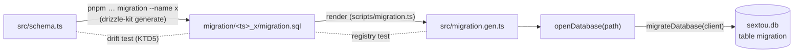

# Database Migrations - Plan

## Goal Capsule

- **Objective:** Features can add and change sextou's tables, and every user's existing database catches up on its own the next time the server starts, with no manual step and no partial change left behind.
- **Means:** a drizzle schema in TypeScript, SQL migrations generated from it with `drizzle-kit` and committed, rendered into a TypeScript registry, and applied by `openDatabase` when the server opens the database (KTD1, KTD2, KTD3).
- **Product authority:** the repository owner. Only issue #21 is in scope; #22 and #28 are not.
- **Stop conditions:**
  - Stop and report if the organization's pnpm policy (one-day minimum release age, trust policy `no-downgrade`) rejects `drizzle-kit@1.0.0-rc.4` or its nested `esbuild@0.25.12`, which has no provenance. An exception in `pnpm-workspace.yaml` only takes effect once merged to `main`.
  - Stop and report if `apps/server/dist/server.mjs` imports anything other than `node:` built-ins after this work (R9).
- **Execution profile:** one pull request against `main`, squash-merged. `ce-work` implements; the user reviews and merges.
- **Open blockers:** none.

---

## Product Contract

Product Contract preservation: requirements and decisions unchanged. Dependencies / Assumptions and Sources were rewritten, because they described drizzle's own migrator and the plan uses a small runner of its own (KTD2). Outstanding Questions was removed: KTD1–KTD3 answer its two deferred questions.

### Summary

The data package holds sextou's schema in TypeScript, and `drizzle-kit generate` turns each schema change into a versioned SQL migration committed to the repository. On start, the server applies the pending migrations before it listens. It refuses to start when a migration fails or when the database carries migrations it doesn't know. A unit test fails when the schema and the migrations disagree. This work creates no table: fixture migrations prove the mechanism in tests.

### Problem Frame

Since #20 (merged as #35), the server opens a SQLite database on start, but nothing can create a table in it. That plan created no schema on purpose, so that the first table would arrive through migrations (its KD4). Actors (#28) needs the first table, and every later feature will change the schema of databases that already hold user data.

The server runs on the user's machine, and sometimes on a remote host, with no operator to run a command before an upgrade. A database left half-changed, or read by a server that expects another schema, breaks every feature at once.

### Key Decisions

- KD1. **Migrations apply on server start, before it listens.** No one stands by to run a command on a user's machine. (session-settled: user-directed — chosen over a separate migrate command the server requires before starting, and over offering both.) Governs R5, R6.
- KD2. **The TypeScript schema is the source; migrations are SQL generated from it with `drizzle-kit`, then committed.** Query types and tables can't drift apart. (session-settled: user-directed — chosen over hand-written SQL files kept beside the schema, and over `drizzle-kit push` with no versioned files.) Governs R1, R2, R3.
- KD3. **This work ships the mechanism and no table.** The actors table is #28's first migration. (session-settled: user-directed — chosen over creating the actors table here, and over an internal table with no feature value.) Governs R4.
- KD4. **A database with migrations this server doesn't know stops the server.** It means a newer sextou wrote the database, and this server's queries may not match its schema. Same stance as a database that can't open (#20's KD6). (session-settled: user-directed — chosen over starting anyway, and over leaving the case unhandled.) Governs R8.
- KD5. **A failed migration rolls back; nothing else protects the data.** A migration that succeeds but loses data has no way back on the user's machine. (session-settled: user-directed — chosen over copying the database file before migrating, and over hand-written down migrations.) Governs R7.
- KD6. **A unit test catches a schema change with no generated migration.** It runs in the pre-push hook and in CI's `vitest run`. (session-settled: user-directed — chosen over relying on feature tests to notice.) Governs R3.

### Requirements

**Authoring**

- R1. sextou's schema is declared in TypeScript in the data package, the one place features add and change tables.
- R2. A developer generates a migration from a schema change with one repository command, and the generated SQL is committed and can be edited before the commit.
- R3. A unit test fails when generating migrations from the current schema would produce a new one.
- R4. This work adds no table to the schema; the database's only table after start is the one the migrator uses to record applied migrations.

**Applying**

- R5. On start, the server applies every pending migration after opening the database and before listening on its port.
- R6. A database already at the latest migration starts with no change to its schema.
- R7. When a pending migration fails, the database is left as it was before the start, and the server exits with a non-zero code and a message naming the migration and the reason, without listening.
- R8. When the database records a migration this server doesn't ship, the server exits with a non-zero code and a message saying the database belongs to a newer sextou, without listening and without changing the database.
- R9. The server's bundle still needs only Node: the migrations ship inside it, with no folder to deploy beside it.

**Tests**

- R10. The data package's tests prove R5–R8 against in-memory or temporary databases, using fixture migrations, with no external database process.

### Acceptance Examples

- AE1. **Covers R5, R6.** Given a database that has none of the shipped migrations, when the server starts, it applies them all and then listens. On the next start, it applies none.
- AE2. **Covers R7.** Given two pending migrations where the second fails, when the server starts, neither is applied, the server exits non-zero naming the second migration, and nothing listens on the port.
- AE3. **Covers R8.** Given a database that records a migration the server doesn't ship, when the server starts, it exits non-zero saying the database is from a newer sextou, and the database is unchanged.
- AE4. **Covers R3.** Given a developer adds a column to the schema and doesn't generate a migration, when the unit tests run, the drift test fails.
- AE5. **Covers R9.** Given the built `apps/server/dist/server.mjs` copied alone to an empty folder, when it starts against a new database path, it applies the shipped migrations.

<!-- ce-section: work-relationships -->

### How This Work Fits Together

This plan covers issue #21 in the "Database support" project (#18). The breakdown below is the current understanding, not a committed roadmap.

- #20, SQLite data access: delivered (#35). This work depends on the database it opens.
- #28, Actors CRUD: depends on this work. Its actors table is the first real migration.
- #22, Dolt for development and tests: can proceed independently of this work.

### Scope Boundaries

- Any feature's table, actors included (#28).
- Copying or backing up the database before migrating.
- Down migrations, or undoing a migration that succeeded.
- A separate command to apply migrations outside server start.
- Reporting migration state in the health response: a running server has a current database.
- Several servers migrating one database file at once.

#### Deferred to Follow-Up Work

- Moving `drizzle-orm` and `drizzle-kit` to 1.0.0 together once a stable 1.0 is published (carried from #20's plan).

### Dependencies / Assumptions

- `drizzle-kit` arrives pinned to `1.0.0-rc.4`, the same as `drizzle-orm`, as #20's plan deferred to this issue. Its stable 0.31 line has no `node:sqlite` support.
- The server's development command runs the sources with `tsx`, which cannot import a `.sql` file as text or use Vite's `import.meta.glob`. The registry of KTD1 is plain TypeScript, so the same import works under `tsx`, Vitest and the Vite build.

### Sources / Research

- `.compound-engineering/artifacts/plans/2026-10-19-1641-feat-sqlite-data-access-plan.md`: the data package, the server's start and stop order, and KD4 and KD6, which this plan builds on.
- `packages/data/src/database.ts`: `openDatabase(path)`, the handle migrations run against.
- `apps/server/src/main.ts`: opens the database before listening, and prints `Could not open the database at <path>: <reason>` with exit code 1 when it can't.

---

## Planning Contract

### Key Technical Decisions

- KTD1. **Migrations reach the runtime as a generated TypeScript registry.** `drizzle-kit generate` writes `packages/data/migration/<UTC timestamp>_<name>/migration.sql` (plus its `snapshot.json`). A script reads every `migration.sql`, splits it on `--> statement-breakpoint`, trims, drops empty chunks, normalizes CRLF, sorts by folder name, and writes `packages/data/src/migration.gen.ts`: an array of `{ id, statements }`, where `id` is the folder name. The file says it is generated and must not be edited. Vite inlines it into `server.mjs` like any module, so R9 holds with no build change. Governs R2, R9.
- KTD2. **A small runner of sextou's own applies the registry; drizzle's `migrate()` is not used.** `migrateDatabase(client, migrations = registry)` takes the `DatabaseSync`:
  1. `BEGIN`, then create `migration (id TEXT PRIMARY KEY, time_completed INTEGER NOT NULL)` if it is missing. Creating it inside the transaction means a failure leaves a never-migrated database without it (R7).
  2. Read the applied ids. If any applied id is not in `migrations`, `ROLLBACK` and throw `This database was written by a newer sextou (unknown migration <id>)` (R8).
  3. Run each pending migration in registry order: its statements, then its row with `Date.now()`. Then `COMMIT`, which with no pending migration only keeps the new table.
  4. On a migration's error, `ROLLBACK` and throw `Migration <id> failed: <reason>`, with the original error as `cause` (R7).
  - It returns the ids it applied. Drizzle's migrator reads a folder from disk, does not know unknown ids, and does not name the failing migration. Governs R4, R5, R6, R7, R8.
- KTD3. **`openDatabase` applies the migrations as part of opening.** After the pragmas (or the `select 1` for `:memory:`), it calls `migrateDatabase` inside its existing `try`, so a failure closes the client and reaches the caller. `main.ts` already prints `Could not open the database at <path>: <reason>` and exits with 1 before listening, and that message carries KTD2's text unchanged. Every caller, tests included, gets a current database. Governs R5, R7, R8.
- KTD4. **One package script generates and renders: `pnpm --filter @sextou/data migration --name <change>`.** With `--name`, it runs `drizzle-kit generate --name <change>` first. Without it, it only renders, which is the step after editing a generated `migration.sql` by hand. It then formats the registry with oxfmt. The script is `packages/data/scripts/migration.ts`, run by Node 24's built-in TypeScript type stripping. Its folder-reading function lives in `packages/data/src/migration-files.ts`, so the registry test reuses it. Governs R2.
- KTD5. **The drift test asks `drizzle-kit` itself whether it would generate anything.** It calls `generate({ config: <absolute path to packages/data/drizzle.config.ts>, explain: true })` from `drizzle-kit/cli`, which writes nothing, and expects `status: 'no_changes'`. The test and the `migration` command then agree by construction, including after two branches that each added a migration are merged. `drizzle-kit check` does not detect drift, and `generate --explain` on the command line exits 0 either way. Governs R3.
- KTD6. **`drizzle-kit` is a devDependency of `@sextou/data`, pinned exactly to `1.0.0-rc.4`, and configured by `packages/data/drizzle.config.ts`** with `dialect: 'sqlite'`, `schema: './src/schema.ts'` and `out: './migration'`. Generating needs no database connection. `src/schema.ts` starts empty and is exported from `src/index.ts` for #28's queries. Governs R1, R4.

### High-Level Technical Design

Authoring, then applying, the same migration.



### Output Structure

```text
packages/data/
  drizzle.config.ts
  scripts/
    migration.ts
  migration/              # drizzle-kit output; empty until #28's first migration
  src/
    schema.ts
    migration.gen.ts
    migration-files.ts
    migration-files.test.ts
    migration.ts
    migration.test.ts
    drift.test.ts
```

### Considered and Not Built

- **Foreign-key handling around table rebuilds.** `drizzle-kit` rebuilds a table with `PRAGMA foreign_keys=OFF/ON`, which does nothing inside the runner's transaction. A rebuild of a parent table with `ON DELETE CASCADE` children would then delete those children. No table has a foreign key yet. Revisit with the first migration that rebuilds a table that has children.
- **Noticing an edited migration that was already applied.** Pending is decided by id only, so a later edit to an applied migration never runs on existing databases. Refusing to start over it would stop users' servers for a developer's mistake.
- **drizzle's `__drizzle_migrations` table and hashes.** Nothing reads them; sextou's runner keeps its own table.

### Risks & Dependencies

| Risk                                                                                                   | Mitigation                                                                                                       |
| ------------------------------------------------------------------------------------------------------ | ---------------------------------------------------------------------------------------------------------------- |
| The pnpm policy rejects `drizzle-kit` or its nested `esbuild@0.25.12`.                                 | Install under the policy locally first. If it fails, stop (Goal Capsule). Nothing loads that esbuild at runtime. |
| A developer edits `migration.sql` and forgets to re-render.                                            | The registry test fails in the pre-push hook and in CI.                                                          |
| The drift test's `generate` call loads the config through `drizzle-kit`'s bundled jiti, inside Vitest. | The research ran it in plain Node; U3 confirms it under Vitest first.                                            |

### Sources & Research

- `drizzle-kit@1.0.0-rc.4`, checked by running it in a scratch folder:
  - `generate` writes `<UTC yyyyMMddHHmmss>_<name>/{migration.sql,snapshot.json}`, with no journal.
  - With an empty schema, it prints "No schema changes" and writes nothing.
  - It loads TypeScript through a bundled jiti, so it never runs esbuild.
  - `generate({ config, explain: true })` from `drizzle-kit/cli` returns `no_changes` or `ok` with the statements, and writes nothing.
  - With two migrations generated from the same parent, `generate` composes both and reports no changes.
- Docs: https://orm.drizzle.team/docs/drizzle-kit-generate, https://orm.drizzle.team/docs/migrations
- npm: `drizzle-kit@1.0.0-rc.4` and `drizzle-orm@1.0.0-rc.4` were published on 2026-06-27, both with provenance.

---

## Implementation Units

### U1. Schema, drizzle-kit config, and the migration registry

**Goal:** a developer can generate a migration and render it into `src/migration.gen.ts`, which today holds an empty registry.

**Requirements:** R1, R2, R4, R9; KTD1, KTD4, KTD6.

**Dependencies:** none.

**Files:**

- `packages/data/package.json` (`drizzle-kit` devDependency, `migration` script)
- `packages/data/tsconfig.json` (include `scripts/**/*`, and set `allowImportingTsExtensions`: Node's type stripping needs the script to import `../src/migration-files.ts` with its extension)
- `packages/data/drizzle.config.ts`
- `packages/data/scripts/migration.ts`
- `packages/data/src/schema.ts`
- `packages/data/src/migration-files.ts`
- `packages/data/src/migration-files.test.ts`
- `packages/data/src/migration.gen.ts`
- `packages/data/src/index.ts`
- `pnpm-lock.yaml`

**Approach:**

1. Add `drizzle-kit` at `1.0.0-rc.4` and install under the org policy (stop condition).
2. Write the config and an empty `schema.ts` per KTD6.
3. Write `readMigrationFolder(directory)` in `migration-files.ts` per KTD1. A missing folder returns `[]`.
4. Write the script per KTD4, then run it to produce the empty registry.

**Patterns to follow:** `apps/server/src/config.ts` for `parseArgs` in strict mode.

**Test scenarios:**

- A temporary folder with two migration folders returns them sorted by name, each with its id and statements.
- A file split by `--> statement-breakpoint` gives trimmed statements with no empty ones.
- A CRLF file gives the same statements as its LF copy.
- A subfolder without `migration.sql` is skipped.
- A missing folder returns `[]`.
- The registry in `migration.gen.ts` equals `readMigrationFolder` of `packages/data/migration`.

**Verification:** `pnpm --filter @sextou/data migration` leaves `migration.gen.ts` unchanged, the data package's `test:unit` and `typecheck` pass, and knip reports nothing unlisted.

### U2. The runner, applied by `openDatabase`

**Goal:** opening a database applies the pending migrations, refuses a newer database and rolls back a failed migration.

**Requirements:** R4–R8, R10; KD1, KD4, KD5; KTD2, KTD3.

**Dependencies:** U1.

**Files:**

- `packages/data/src/migration.ts`
- `packages/data/src/migration.test.ts`
- `packages/data/src/database.ts`
- `packages/data/src/database.test.ts`

**Approach:**

1. Write `migrateDatabase` per KTD2, with the registry as the default list.
2. Call it from `openDatabase` per KTD3.

**Test scenarios:** fixture migrations are inline `{ id, statements }` arrays on a `:memory:` client.

- Covers AE1. A fresh database gets every fixture migration's tables and one `migration` row per id, and the call returns the ids.
- Covers AE1. A second call returns `[]` and changes nothing.
- A database with the first migration applied gets only the second.
- Covers AE2. With two pending migrations where the second has invalid SQL, the call throws a message naming the second id, neither table exists and no row is recorded.
- A failure on a later call leaves the migrations and data from earlier calls in place.
- A failing first migration on a never-migrated database leaves no `migration` table.
- Covers AE3. A database that records an id missing from the list throws the newer-sextou message, and its tables and rows are unchanged.
- Covers R4. With the empty registry, `openDatabase(':memory:')` leaves `migration` as the only table.
- `openDatabase` on a file whose database records an unknown id throws and leaves the client closed.

**Verification:** the data package's `test:unit` passes at 90% per file.

### U3. Drift test

**Goal:** the unit suite fails when the schema has changes with no generated migration.

**Requirements:** R3; KD6; KTD5.

**Dependencies:** U1.

**Files:**

- `packages/data/src/drift.test.ts`

**Approach:** call `drizzle-kit`'s `generate` in explain mode per KTD5.

**Test scenarios:**

- The committed schema and migrations produce no statements.
- Covers AE4. Checked once by hand, not committed: adding a table to `schema.ts` without generating makes the test fail.

**Verification:** the test passes in `vitest run` at the root.

### U4. Documentation

**Goal:** `AGENTS.md` and `README.md` say where the schema lives and how to generate a migration.

**Requirements:** R2.

**Dependencies:** U1, U2.

**Files:**

- `AGENTS.md`
- `README.md`

**Approach:**

1. In `AGENTS.md`'s `packages/data` bullet: the schema in `src/schema.ts`, migrations in `migration/`, the `migration --name <change>` command, the generated `src/migration.gen.ts`, and that `openDatabase` applies pending migrations. Add two rules:
   - Never rename, delete or edit a merged migration folder. Its name is its id: an unknown id stops users' servers, and an edit never runs on databases that already applied it.
   - A migration that rebuilds a table with foreign-key children runs with foreign keys on, so `ON DELETE CASCADE` children are deleted. Such a migration adds foreign-key handling to the runner first.
2. In `README.md`, add the command next to the data package.

**Test expectation:** none — documentation only.

**Verification:** `pnpm lint` passes.

---

## Verification Contract

| Gate                    | Command or check                                                                                                                                        | Proves                                                                |
| ----------------------- | ------------------------------------------------------------------------------------------------------------------------------------------------------- | --------------------------------------------------------------------- |
| Dependency policy       | `pnpm install` under the org policy                                                                                                                     | `drizzle-kit@1.0.0-rc.4` installs in CI                               |
| Lint and format         | `pnpm lint`                                                                                                                                             | oxlint and oxfmt pass, the generated registry included                |
| Types                   | `pnpm typecheck`                                                                                                                                        | The data package, its script included, type-checks                    |
| Unit suites             | `pnpm test:unit`, then `vitest run` at the root                                                                                                         | Each suite passes at 90% per file                                     |
| Unlisted dependencies   | knip as CI runs it                                                                                                                                      | `drizzle-kit` is declared, and the config and script count as entries |
| Build                   | `pnpm build`                                                                                                                                            | The server bundle builds                                              |
| Bundle imports          | Search `apps/server/dist/server.mjs` for its imports                                                                                                    | Only `node:` built-ins (R9)                                           |
| Bundle smoke on Node 24 | Copy `server.mjs` alone to an empty folder outside the repository, start it with `--port 0 --database <tmp>/sextou.db`, request `/health`, send SIGTERM | 200, the file has a `migration` table, exit code 0 (AE5)              |
| Full suites             | `pnpm test`                                                                                                                                             | AGENTS.md's rule before a pull request                                |

---

## Definition of Done

- R1–R10 hold, and AE1–AE5 are true of the code as written.
- Every gate in the Verification Contract passes.
- `drizzle-kit` and `drizzle-orm` are both pinned exactly to `1.0.0-rc.4`.
- `src/schema.ts` declares no table, and `packages/data/migration` holds no migration.
- `apps/server` is unchanged.
- No abandoned attempt (drizzle's `migrate()`, `import.meta.glob`, a migrations folder copied beside the bundle) remains in the diff.
- Per unit: U1–U3 meet their Verification line with their test scenarios written. U4 passes `pnpm lint`.
