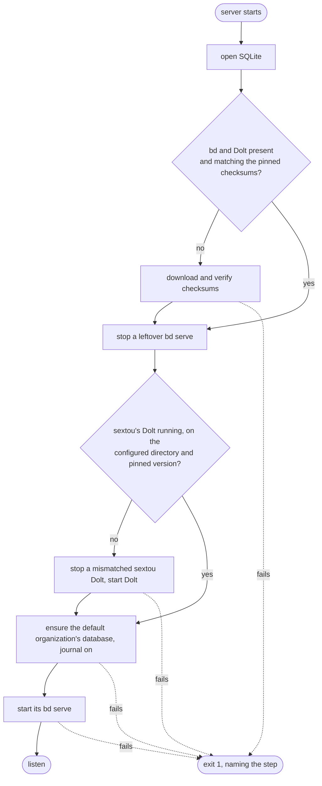
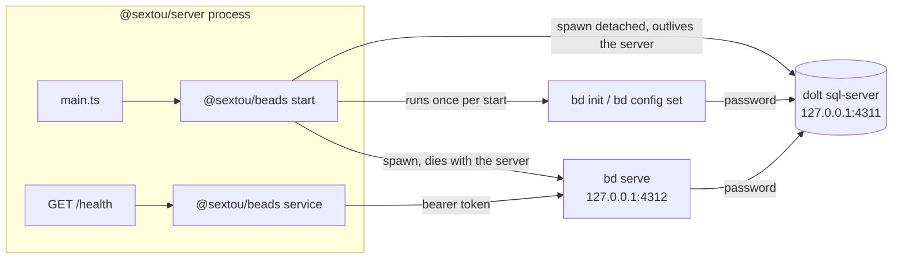
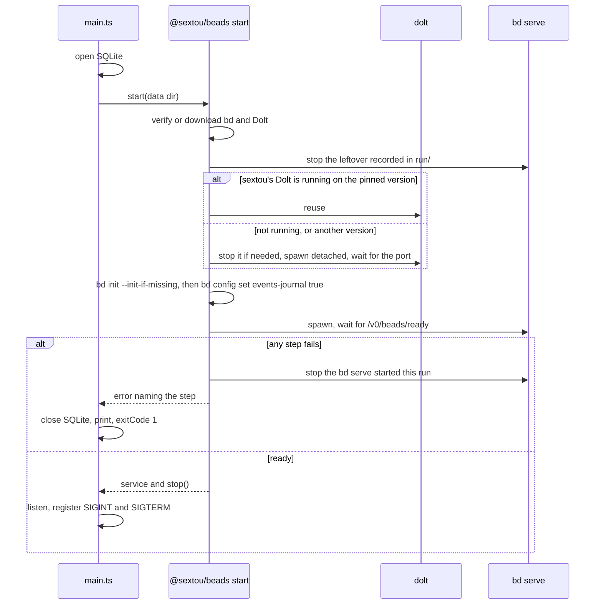
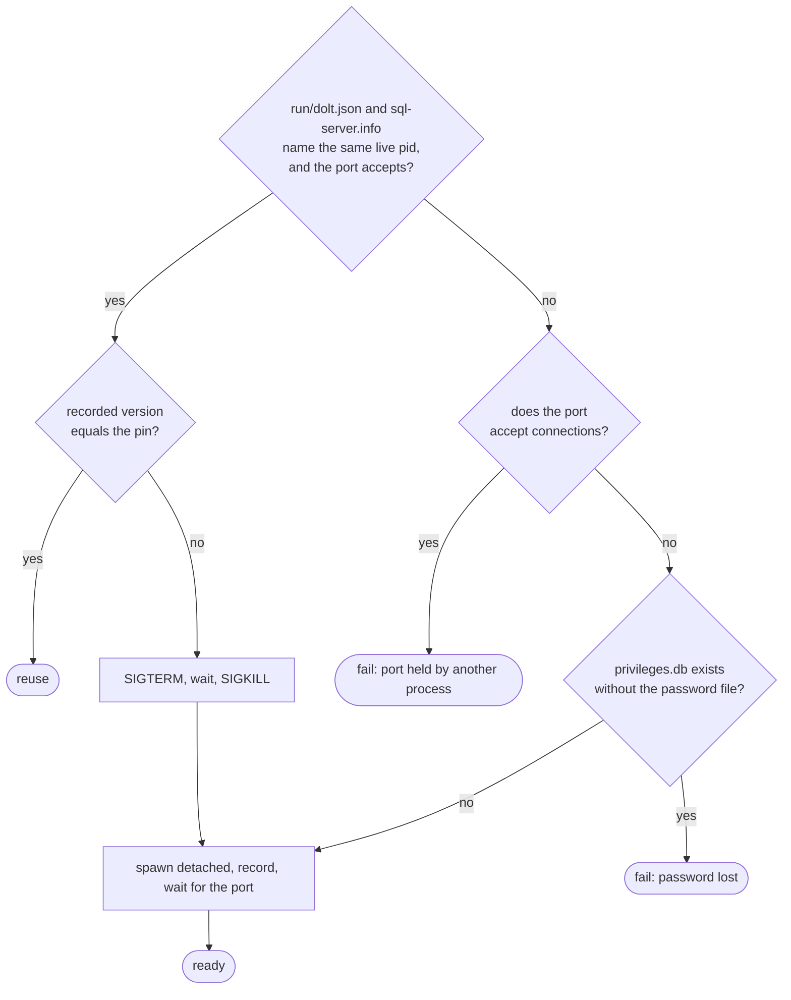

# Beads Engine - Plan

## Goal Capsule

- **Objective:** The sextou server owns beads: on start it brings up the pinned bd and Dolt, the default organization's beads database and its `bd serve`, and proves end to end that beads answers. Features that later need beads then call it through one service instead of each deciding how beads runs and how to reach it.
- **Means:** a new package, `@sextou/beads`, that runs the start steps and holds the service, called by the server between opening SQLite and listening (KTD1, KTD12).
- **Product authority:** the repository owner. Only bringing beads up and proving the connection is in scope; methods that read or write beads, organizations as a feature, and remote access are not.
- **Stop conditions:**
  - Stop and report if bd 1.3.1 with Dolt 2.2.0 fails the smoke run (`bd init`, `bd serve` readiness, a write through `bd serve`): the pin pair (KTD3) would need the user again.
  - Stop and report if Dolt refuses bd's TCP login as `root` from `127.0.0.1` even with `DOLT_ROOT_HOST=127.0.0.1` (KTD7).
  - Stop and report if the server bundle gains an import that is not a `node:` built-in.
- **Execution profile:** one pull request against `main`, squash-merged. `ce-work` implements; the user reviews and merges.
- **Open blockers:** none.

---

## Product Contract

Product Contract preservation: changed R2 (each binary is checked once per server start, before its first run, instead of before every run), Dependencies / Assumptions (Dolt pinned to 2.2.0 instead of 2.5.0, beads served from `gastownhall/beads`), F1 (a leftover `bd serve` is stopped before the Dolt step, not after it), R3 and the Summary (only sextou's own Dolt, in the configured data directory and on another version, is replaced; any other Dolt fails the step), KD2 (the exception also turns the journal on) and R6 (the database is created only when its beads configuration is missing). Added during implementation: KD13 and R15 (git is required). The questions deferred to planning are answered by KTD2–KTD11 and removed from Outstanding Questions.

### Summary

On start, the server downloads the pinned bd and Dolt when they are missing and verifies their checksums. It then reuses the Dolt sql-server it started earlier, or starts one, makes sure the default organization's beads database exists with the events journal on, and starts that organization's `bd serve`. The server reaches beads only over `bd serve`'s HTTP, through a service in a new package, and every call to that service names the organization. The health endpoint reports whether beads answers, and any failure while bringing beads up stops the server with exit code 1, as a failed SQLite open already does.

### Problem Frame

In the product's design notes, which live outside this repository, beads is the operational layer. Its graph decides which step can run next, and its journal is the bus: every change becomes a numbered event that `bd serve` pushes over SSE. Participants (stage executors, the reaper, the user's inbox) react to those events, and only `bd serve` mediates claims and leases. Integrations, metrics and chat are planned as more subscribers of the same journal.

Nothing in sextou runs beads today. No tracked file outside the plans mentions beads, bd or Dolt, and the SQLite plan (`.compound-engineering/artifacts/plans/2026-10-19-1641-feat-sqlite-data-access-plan.md`, KD1) kept beads on its own Dolt database outside `@sextou/data`. Without this work, the first feature that needs beads would have to settle, on its own, who starts Dolt and `bd serve`, where the binaries come from, how the server talks to beads, and how organizations map to databases. Each of those choices is expensive to move once features build on it.

### Key Decisions

- KD1. **Beads is a service sextou calls, not a database layer.** sextou never reads or writes beads' tables; its own methods call beads and adapt the result when a feature needs it. Reading Dolt directly would tie sextou to beads' internal schema, which beads versions and guards. (session-settled: user-directed — chosen over treating beads as a database abstraction over its Dolt tables: the user asked for a service with sextou's own methods on top.) Governs R9, R11.
- KD2. **The service talks to beads over `bd serve`'s HTTP.** The design notes recommend one beads authority per organization, which executors on other hosts claim against over the network, and `bd serve` is also where the journal's SSE stream comes from. (session-settled: user-directed — chosen over running the `bd` CLI with `--json` for each call, and over HTTP for daily work plus the CLI for setup.) The one exception is creating an organization's database and turning its events journal on, which `bd serve` cannot do: the start flow runs the pinned `bd` CLI for that alone, and the service never runs it. (session-settled: user-approved — proposed in review after `bd serve` was found to have no call that creates a database; the alternative was writing beads' tables directly, which KD1 rules out.) Governs R6, R9.
- KD3. **The sextou server starts Dolt and `bd serve`.** This follows the design notes, where the app's main process starts those daemons when they are missing, so a user who isn't a developer never sees bd. (session-settled: user-directed — chosen over running them outside sextou and passing a URL by config, and over both modes depending on config.) Governs R3, R7.
- KD4. **This work only brings beads up and proves it answers.** It adds no method that reads or writes beads; each feature adds the methods it needs, as the SQLite work created no table. (session-settled: user-directed — chosen over also adding the methods an executor uses (ready, claim, heartbeat, close, journal), and over adding a web screen that shows beads live.) Governs R11, R14.
- KD5. **The server downloads pinned versions of bd and Dolt.** The user installs nothing. (session-settled: user-directed — chosen over the user installing them, as with gitleaks, and over shipping them inside sextou's package.) Governs R1, R2.
- KD6. **A failure while bringing beads up stops the server with exit code 1.** This matches what the server does when SQLite can't open. (session-settled: user-directed — chosen over listening without beads, answering 503 on health and retrying later.) Governs R13.
- KD7. **One beads database per organization, from the start.** The service takes the organization on every call. Because `bd serve` serves a single database, each organization also gets its own `bd serve`. (session-settled: user-directed — chosen over one database for a single organization with a fixed name: the design notes put the organization above the workspace, and one store per organization has to exist from day one.) Governs R6, R7, R10.
- KD8. **The only organization is a default one that the server creates.** It has a fixed id. Organizations as a feature (storing, listing and creating them) come later. (session-settled: user-directed — chosen over starting a `bd serve` for every beads database found in Dolt, and over an organizations table in SQLite.) Governs R6.
- KD9. **Dolt outlives the server; `bd serve` does not.** As in the design notes, Dolt is a user daemon that work in progress keeps using after the app closes. A later server start reuses it. Governs R3, R4, R7.
- KD10. **The events journal is on from the first start.** No one subscribes yet, but turning it on later means restarting `bd serve`, and every planned participant depends on it. Governs R6.
- KD11. **Dolt and `bd serve` require credentials, not just loopback.** Loopback alone lets any local process, or a web page in the user's browser, write to beads without going through the service. (session-settled: user-approved — proposed in review with loopback alone as the alternative.) Governs R8.
- KD12. **Each binary is checked once per server start, before its first run.** A start runs bd up to three times, and hashing the 154 MB binary costs about 0.8 s each time. The check guards against a corrupted download or a tampered release, not against malware running as the same user. (session-settled: user-approved — proposed in plan scoping against checking before every run.) Governs R2.
- KD13. **git is required on the server's PATH.** `bd serve` 1.3.1 runs `git rev-parse` to find the root of the folder it serves and refuses to start outside a repository; a `.beads/redirect` does not avoid it (checked with the real binaries). The organization's folder becomes an empty git repository of its own, with no commit and no hook, and the bd children get a PATH holding only git's folder. (session-settled: user-directed — chosen during implementation over downloading a portable git when the machine has none, which is #37.) Governs R6, R7, R15.

### Requirements

**Binaries**

- R1. On start, the server makes sure the pinned versions of bd and Dolt are in sextou's data directory. A binary that is missing, or whose checksum does not match the pinned one, is downloaded.
- R2. The expected checksum of each binary, per platform, is committed in sextou's source next to its pinned version and is never fetched at run time. The server checks each binary against it once per start, before its first run, and never runs one that does not match; a fresh download that does not match ends the start (R13).

**Dolt**

- R3. The server reuses a running Dolt sql-server only when it is the one sextou recorded starting in the configured data directory (R5) and it runs the pinned version; with no Dolt on its port, it starts one. A Dolt that sextou started there on another version is stopped and replaced. Any other process on Dolt's port, a sextou Dolt serving another data directory included, fails the Dolt step, naming the port.
- R4. When the server stops, Dolt keeps running.
- R5. Dolt's data lives in sextou's data directory by default, beside the SQLite database, and a config value moves it, as `--database` and `SEXTOU_SERVER_DATABASE` move the SQLite file.

**Organization**

- R6. On every start, before `bd serve` starts, the server makes sure the default organization's beads database exists and its events journal is on. It creates the database when the organization's beads configuration is missing from sextou's data directory, and turns the journal on every time. A database missing from Dolt while its configuration exists is not recreated: the `bd serve` step fails. Only this step runs the pinned `bd` CLI: it runs `bd init` against Dolt with agent integrations turned off, and keeps the database's beads configuration in sextou's data directory, never in a repository.
- R7. The server starts one `bd serve` for each organization, which today means the default one, and stops it when the server stops. Before starting it, the server stops any `bd serve` for that organization that an earlier run left behind.
- R8. Dolt and `bd serve` listen on loopback only and require credentials. On first start, the server generates a Dolt password and a `bd serve` token, stores them in sextou's data directory readable only by the user, and starts Dolt and each `bd serve` with them. The beads service sends the token on every call.

**The beads service**

- R9. A new package in the monorepo holds the beads service. The server reaches beads only through it, and the service reaches beads only over `bd serve`'s HTTP; it never runs the `bd` CLI.
- R10. Every call to the service names the organization it is for.
- R11. The service has no method that reads or writes beads data; it has only what R14 needs to check that beads answers.
- R12. The new package imports no other sextou package, and `@sextou/core` stays free of beads, as it is free of the database.

**Server start and health**

- R13. When any step of F1 fails, the server exits with code 1 without listening, and its message names the step that failed. It stops any `bd serve` it started and closes the SQLite database it already opened.
- R14. The health response reports whether beads answers, and the endpoint answers 503 when beads does not answer, as it does for the database.
- R15. The server finds git on its PATH; without it, the binaries step fails naming git. The default organization's folder in the data directory is a git repository of its own, never the user's.

### Key Flows

- F1. **Server start.**
  - **Trigger:** the server process starts.
  - **Steps:** open SQLite, then ensure the binaries (R1, R2), then stop a leftover `bd serve` (R7), then ensure Dolt (R3), then ensure the default organization's database (R6), then start its `bd serve` (R7), then listen.
  - **Outcome:** the server listens with SQLite and beads both up; any failed step ends in R13.
  - **Covers R1, R2, R3, R6, R7, R13.**
- F2. **Server stop.**
  - **Trigger:** SIGINT or SIGTERM.
  - **Steps:** stop listening, stop each `bd serve`, close SQLite, and leave Dolt running.
  - **Covers R4, R7.**



### Acceptance Examples

- AE1. **Covers R1, R13.** Given a first start with no network, when the server tries to download bd, it exits with code 1 without listening, and the message says the download failed.
- AE2. **Covers R2, R13.** Given a downloaded Dolt whose checksum does not match the pinned one, when the server starts, it does not run that binary and exits with code 1, naming the checksum.
- AE3. **Covers R3, R4.** Given a server that stopped earlier and left Dolt running, when the server starts again, it reuses that Dolt instead of starting a second one, and starts the default organization's `bd serve`.
- AE4. **Covers R6.** Given a first start, when the server reaches the organization step, it creates the default organization's database with the events journal on. On the next start, it finds the database with the journal on and changes nothing.
- AE5. **Covers R14.** Given a running server whose `bd serve` stopped answering, when a client calls the health endpoint, the response reports beads down and the status is 503.
- AE6. **Covers R7, R13.** Given a server that was killed without stopping its `bd serve`, when the server starts again, it stops the leftover `bd serve`, starts a fresh one and listens.

### Scope Boundaries

- Methods that read or write beads (ready, claim, heartbeat, close, create, listening to the journal), and any subscriber of the journal.
- Organizations as a feature: storing, listing, creating or naming them, and any organization data in SQLite.
- Workspaces and `.beads/redirect` in repositories.
- Exposing Dolt or `bd serve` to other machines, executors on other hosts, and read replicas or standbys (#32, #33).
- The web app showing beads or its status.
- Retrying when beads fails to come up, or running without it.
- Upgrading bd or Dolt other than by changing the pinned versions and checksums in sextou's source.
- Downloading a portable git when the machine has none (#37).

#### Considered and Not Built

- **A lock against two servers on one data directory.** A second server would stop the first one's `bd serve` and then fail to bind its own port, leaving the first answering 503 on health, which shows the problem at once. Revisit when the desktop starts the server itself.
- **Checking a process's executable before signalling it.** KTD8 and KTD9 signal only a pid that sextou recorded and that still holds sextou's port, so a reused pid would also have to hold that port. Revisit if a wrong process is ever stopped.
- **Checking the journal through `bd serve` after it starts.** KTD7 turns it on in the config on every start, and the child env never overrides it. Revisit if the journal is found off.
- **Re-creating an organization database that is missing from Dolt.** `bd serve`'s readiness check fails with `db_unavailable`, so the start fails naming the `bd serve` step. Revisit if users move or wipe Dolt's data.
- **Detecting musl or a glibc older than 2.34 before running bd.** bd's own spawn error stops the start in that step. Revisit if sextou targets Alpine or older Linux.
- **An HTTPS proxy for the download.** Node's `fetch` ignores `HTTPS_PROXY` by default, and AE1's message already names the failed download. Revisit with the first user behind a proxy.
- **Cleaning up on a signal that arrives during start.** A download in progress leaves a temporary folder that the next start removes (KTD4), and a `bd serve` started before the signal is a leftover the next start stops (R7).
- **Stopping the old Dolt when the data directory moves.** It keeps running on its port, and the new directory's Dolt step fails naming that port. Revisit if moving the data directory becomes a supported operation.

<!-- ce-section: work-relationships -->

### How This Work Fits Together

This plan covers bringing beads up inside the server. The breakdown below is the current understanding, not a committed roadmap.

- #22, Dolt for development and tests: this work covers its development half, since developers get Dolt through the same download the server does. Running Dolt and `bd serve` in the test suites stays in #22.
- Methods for executors and other participants: depend on this work. Each feature adds the service methods it calls.
- Organizations as a feature: depend on this work; they decide how organizations other than the default one get their database and `bd serve`.
- #32 and #33, reaching a server on the network: still to decide whether exposing `bd serve` to executors on other hosts belongs there or in its own work.

### Dependencies / Assumptions

- The pins are bd 1.3.1 and Dolt 2.2.0, the pair beads 1.3.1 itself tests (`scripts/ci/install-dolt.sh`). The design notes measured Dolt 2.5.0, which beads has not validated.
- beads' releases are served from `github.com/gastownhall/beads`; `steveyegge/beads` redirects there.
- `bd serve` needs a Dolt sql-server and does not run on beads' embedded mode (design notes).
- `bd serve` 1.3.1 needs git, and its working folder inside a git repository (KD13).
- One `bd serve` serves one database, with its own journal and sequence (design notes).
- The events journal must be on before `bd serve` starts; turning it on later needs a restart (design notes, `bd serve` reads it once at startup).
- beads marks its HTTP backend experimental and asks embedders to pin an exact version (beads README).
- `bd init` installs agent integrations into the directory it runs in unless told not to (design notes).
- `apps/server/src/main.ts` already opens SQLite before listening, exits with code 1 when it can't, and closes it on SIGINT or SIGTERM; the health route answers 503 when the database is down (`apps/server/src/modules/health/health.routes.ts`).
- The root `vitest.config.ts` lists each package's unit suite by name, so the new package must be added there.

### Sources / Research

- beads v1.3.1 source: `cmd/bd/init.go` (flags, `--init-if-missing`, `BEADS_DIR`), `cmd/bd/serve.go`, `engdocs/SERVE_RUNBOOK.md` (no pid file; the fixed port is the mutual exclusion; 20 s drain), `internal/httpapi/spec/openapi.v0.yaml`, `internal/eventsjournal/activation.go`, `scripts/ci/install-dolt.sh`. https://github.com/gastownhall/beads/tree/v1.3.1
- Dolt sql-server source: `go/cmd/dolt/commands/sqlserver/` (`DOLT_ROOT_PASSWORD` applies only before `privileges.db` exists; `.dolt/sql-server.info` holds `pid:port:secret`). https://github.com/dolthub/dolt
- `.compound-engineering/artifacts/plans/2026-10-19-1641-feat-sqlite-data-access-plan.md`: KD1 (beads on its own Dolt), KD4 (prove the connection, create no schema), and KTD2, KTD4, KTD6 and KTD9 (the package shape, data directory and lifecycle this plan extends).
- `.compound-engineering/artifacts/plans/2026-10-19-1428-feat-backend-server-structure-plan.md`: KD2 (the server is its own process, the same locally and remotely).

---

## Planning Contract

### Key Technical Decisions

- KTD1. **`@sextou/beads` holds both the start steps and the service, in separate modules.** The server calls one start function and gets back the service and a stop function, as `@sextou/data` opens its own database for the server. Only the start modules spawn processes; the service module only sends HTTP requests (R9). The package reads no environment: the server passes the data directory and, on Windows, the values of `SystemRoot`, `TEMP` and `TMP` that KTD7 forwards; tests pass `fetch`, `spawn`, the platform, the architecture, the ports and the pins. Governs R9, R12.
- KTD2. **One data directory holds everything, from `--data-dir`, then `SEXTOU_SERVER_DATA_DIR`, then `<platform data dir>/sextou`.** The default is the folder that holds `sextou.db` today, and the database's default becomes `<data dir>/sextou.db`, so nothing moves for an existing install. A configured `--database` still wins for the SQLite file. The parsing follows KTD3 of the SQLite plan: strict flags, the empty string rejected, a relative path resolved against the working directory. The start function creates the data directory and every folder below with mode `0700`, and sets existing ones to `0700`, as `@sextou/data` does for the SQLite file, so beads' data and logs are as private as the credentials. Governs R5, R6, R8.

  | Path under the data directory                     | Holds                                                                          |
  | ------------------------------------------------- | ------------------------------------------------------------------------------ |
  | `bin/bd-1.3.1/`, `bin/dolt-2.2.0/`                | The verified binaries, one folder per version (KTD4)                           |
  | `dolt/`                                           | Dolt's `--data-dir`, with `.doltcfg/privileges.db` and `.dolt/sql-server.info` |
  | `dolt-home/`                                      | `DOLT_ROOT_PATH` and the children's home (KTD7)                                |
  | `beads/default/.beads/`                           | The default organization's `BEADS_DIR`                                         |
  | `secrets/dolt-password`, `secrets/bd-serve-token` | The credentials, folder `0700`, files `0600` (KTD5)                            |
  | `run/dolt.json`, `run/bd-serve-default.json`      | Pid, port and version of each process sextou started (KTD8, KTD9)              |
  | `logs/dolt.log`, `logs/bd-serve-default.log`      | Each process's stdout and stderr                                               |

- KTD3. **Pins live in `packages/beads/src/pins.ts`: bd 1.3.1 and Dolt 2.2.0.** Each platform entry holds the release URL, the archive's sha256, the binary's path inside the archive and the binary's sha256. The supported platforms are linux x64 and arm64, darwin x64 and arm64, and win32 x64; Dolt has no Windows arm64 build. Any other platform fails the binaries step, naming it. The implementer computes each hash from the downloaded file and cross-checks the archive hash against beads' `checksums.txt` and GitHub's asset digest for Dolt, which publishes no checksums file. The module is imported, so the bundle carries it. Governs R1, R2. (session-settled: user-approved — Dolt 2.2.0 chosen over the 2.5.0 the design notes measured: 2.2.0 is the version beads 1.3.1 pins and tests, and 2.5.0 is two days old and changes commit behavior.)
- KTD4. **Download, verify, then extract with the system `tar`, as opencode extracts ripgrep.** The steps, per binary:
  1. Remove any `bin/.tmp-*` folder a crashed start left.
  2. If `bin/<tool>-<version>/<binary>` exists and its sha256 matches the pin, use it.
  3. Otherwise fetch the https URL into `bin/.tmp-<random>/`, and fail the step naming the URL when the request fails or the archive's sha256 differs from the pin.
  4. Extract with `tar` (on Windows, `%SystemRoot%\System32\tar.exe`, which reads zip; Git's `tar` on the PATH does not). A missing `tar` fails the step, naming it.
  5. Check the extracted binary's sha256, set mode `0755`, and rename the folder into place.

  Pinning the archive hash keeps an untrusted archive away from `tar`; pinning the binary hash is what R2 checks on later starts. Node's built-ins cover the rest, so no npm dependency is added. Governs R1, R2.

- KTD5. **Each credential is created once, before its first use, and never regenerated.** Each is 32 random bytes in base64url. The file is written to a temporary name with mode `0600` and linked into place, so a crash leaves no partial file.
  - Dolt applies `DOLT_ROOT_PASSWORD` only on the launch that creates `dolt/.doltcfg/privileges.db`. When that file exists and the password file does not, the Dolt step fails, naming both.
  - The `bd serve` token file is passed with `--auth-token-file`, which `bd serve` enforces on every route except `/healthz`. A missing token file is simply created, since only sextou holds the token.

  Governs R8.

- KTD6. **Fixed loopback ports: Dolt on `127.0.0.1:4311`, the default organization's `bd serve` on `127.0.0.1:4312`.** `bd init` records Dolt's port in the organization's `metadata.json`, so it can't change later. `bd serve`'s bind on a fixed port is its only guard against a second copy. A participant outside the server can find both addresses without asking it. A port held by another process fails the step, naming the port. The ports are options of the start function with these defaults, not user config, so tests pick free ports. Governs R3, R7, R8.
- KTD7. **Every child gets an environment built from scratch, never `process.env`.** That keeps a user's `BEADS_*`, `BD_*` or `DOLT_*` from overriding sextou's settings and keeps both tools out of the user's home. Telemetry is off, because both tools send it by default.

  | Child                               | Arguments                                                                                                                                                                                                      | Environment beyond the platform minimum                                                                                                       |
  | ----------------------------------- | -------------------------------------------------------------------------------------------------------------------------------------------------------------------------------------------------------------- | --------------------------------------------------------------------------------------------------------------------------------------------- |
  | `dolt sql-server`                   | `-H 127.0.0.1 -P <dolt port> --data-dir <data>/dolt --loglevel warning`                                                                                                                                        | `DOLT_ROOT_PATH`, `DOLT_DISABLE_EVENT_FLUSH=1`, and `DOLT_ROOT_PASSWORD` with `DOLT_ROOT_HOST=127.0.0.1` only when `privileges.db` is missing |
  | `bd init`                           | `--server --server-host 127.0.0.1 --server-port <dolt port> --server-user root --database sextou_default --prefix sx --skip-agents --skip-hooks --non-interactive --role maintainer --quiet --init-if-missing` | `BEADS_DIR`, `BEADS_DOLT_PASSWORD`, `BEADS_DOLT_AUTO_START=0`, `BD_DISABLE_METRICS=1`, `BD_NON_INTERACTIVE=1`                                 |
  | `bd config set events-journal true` | as shown                                                                                                                                                                                                       | same as `bd init`                                                                                                                             |
  | `bd serve`                          | `--addr 127.0.0.1:<bd serve port> --auth-token-file <data>/secrets/bd-serve-token`                                                                                                                             | `BEADS_DIR`, `BEADS_DOLT_PASSWORD`, `BEADS_DOLT_AUTO_START=0`, `BD_DISABLE_METRICS=1`                                                         |

  The platform minimum is `HOME` set to `dolt-home/` on POSIX, plus `SystemRoot`, `TEMP` and `TMP` on Windows, with `USERPROFILE` set to `dolt-home\`. `BEADS_DOLT_AUTO_START=0` with an explicit `--server-port` stops bd from starting a Dolt of its own. `BEADS_DIR` stops `bd init` from running `git init`. The bd children run with `beads/default/` as their working folder, and get `PATH` set to git's folder (KD13); `git init` gets the platform minimum. Secrets travel only in the environment, never in arguments, which other users can read. Governs R6, R7, R8.

- KTD8. **Dolt is reused when two independent records agree; anything else on its port fails the step.** `run/dolt.json` holds the pid, port and version sextou started, written right after spawning. Dolt's own `dolt/.dolt/sql-server.info` names the pid serving that directory.
  - Dolt counts as sextou's running Dolt when both files name the same pid, that pid is alive, and its port accepts a TCP connection. Reuse it when the recorded version also equals the pin.
  - A sextou Dolt on another version is stopped: SIGTERM, wait up to 30 s for its pid to exit, then SIGKILL, so the new one never finds the old one still writing to the data directory. A new one is then started (R3).
  - A port that accepts connections without the two records agreeing fails the step, naming the port.
  - A new Dolt is spawned detached, with `unref()` and its output in `logs/dolt.log`, so a Ctrl+C in a terminal doesn't reach it (R4). The step waits up to 30 s for the port to accept connections, and fails at once, with the log's last lines, when the process exits. A Dolt started this run that never became ready is killed.

  Governs R3, R4, R5.

- KTD9. **A leftover `bd serve` is stopped before the Dolt step.** `run/bd-serve-default.json` holds the pid and port, written right after spawning. When that pid is alive and its port accepts a connection, the server sends SIGTERM, waits up to 25 s (bd drains for 20 s), sends SIGKILL, and removes the file. This runs before the Dolt step because a leftover holds connections to the old Dolt while it is being replaced. Governs R7.
- KTD10. **`bd serve` is ready when `GET /v0/beads/ready?limit=1` with the token answers 200.** This route reaches the database, while `/healthz` stays up even with Dolt down. The step spawns `bd serve` in the server's process group, so a Ctrl+C reaches it too. Its output goes to `logs/bd-serve-default.log`. The step polls this route for up to 30 s, fails at once when the process exits, and kills it when it never becomes ready. Governs R7, R14.
- KTD11. **The service is a factory over each organization's port and the token, with one `ping(organization)` that never throws.** `ping` sends the KTD10 request with a 2 s timeout and returns `true` only for a 200. It returns `false` for any other answer, an error, a timeout or an organization it doesn't know. Once the `bd serve` child the start function spawned for that organization has exited, `ping` returns `false` without sending anything, because another local user could bind the freed port and collect the token (KD11). The package exports the default organization's id, so the server names it on every call. Governs R10, R11, R14.
- KTD12. **One start function runs the steps in F1's order and owns their cleanup.** It throws an error carrying the step's name (`binaries`, `bd serve leftover`, `dolt`, `organization`, `bd serve`) and the reason. Before throwing, it stops the `bd serve` it started, and leaves a ready Dolt running (KD9). On success it returns the service and a `stop()` that stops each `bd serve`. `main.ts` then:
  1. opens SQLite;
  2. starts beads, and on failure prints `Could not start beads (<step>): <reason>`, closes SQLite and sets `process.exitCode = 1`;
  3. listens, stopping beads and closing SQLite when listening fails, then rethrows as today;
  4. on the first signal, closes the HTTP server, stops beads, closes SQLite, and exits with 0.

  Messages never contain the password or the token: they reach the children only through the environment, and the step errors carry no environment. Governs R13, F2.

- KTD13. **Health adds `beads: 'up' | 'down'` the way it added `database`.** The contract adds the field to the one response schema. The core's `getHealth` takes whether beads answered. The route becomes async, awaits `ping` for the default organization, and answers 503 when either field is `down`. Governs R14.
- KTD14. **Tests use fake binaries, real temporary folders and real loopback sockets, never the network or the real tools.**
  - The fake `bd` and `dolt` are Node scripts that listen on the given port, write the files the real ones write, and record their arguments and environment. Each archive holds an extensionless `bd` or `dolt` that is a `#!/bin/sh` wrapper running `exec "<process.execPath>" "<fake script>" "$@"`. KTD7 gives children no `PATH`, so a `#!/usr/bin/env node` shebang would not find Node, and `exec` keeps the pid KTD8 matches. The tests hash those wrappers, pass the hashes as pins, and build the archives with `tar`.
  - `fetch` is injected and answers with those archives.
  - Each test picks free ports and kills the pids it spawned in `afterEach`, since detached fakes outlive the test.
  - Fake-binary tests run only on POSIX (CI runs Linux). The Windows branches of path, `tar` and environment selection are pure functions tested on any OS.
  - `main.test.ts` mocks `@sextou/beads` the way it mocks `@sextou/data`.

  Governs every unit's tests.

### High-Level Technical Design

The processes after this work. The server starts each process and the service talks only to `bd serve`.



The start sequence (KTD12). Each failure path ends without the port open.



How the Dolt step decides (KTD8).



### Output Structure

```text
packages/beads/
  package.json
  tsconfig.json
  vitest.config.ts
  src/
    env.d.ts
    index.ts
    pins.ts
    platform.ts        platform and architecture to pin entry, tar path
    binaries.ts        KTD4
    secrets.ts         KTD5
    processes.ts       run files, liveness, port checks, stopping a recorded process
    child-env.ts       KTD7
    dolt.ts            KTD8
    organization.ts    bd init and the journal
    bd-serve.ts        KTD9, KTD10
    service.ts         KTD11
    start.ts           KTD12
    test/              fake bd and dolt scripts, archive builder
    *.test.ts          beside each module
apps/server/src/
  data-directory.ts    replaces database-path.ts
```

### Implementation Constraints

- No new npm dependency: Node's built-ins cover fetch, hashing, processes and files, and `tar` comes from the system (KTD4).
- Every spawn passes an argument array, never `shell: true`, and downloads use https only, which keeps CodeQL's command-injection and download-integrity queries quiet.
- Coverage stays at 90% per file in the `beads` suite and the server's suite, `main.ts` included.

### Risks & Dependencies

| Risk                                                                         | Mitigation                                                                                                |
| ---------------------------------------------------------------------------- | --------------------------------------------------------------------------------------------------------- |
| `bd serve`'s HTTP backend is experimental and may change between releases.   | The exact pin (KTD3), and the service using only the readiness route.                                     |
| bd 1.3.1 with Dolt 2.2.0 behaves unlike the 2.5.0 the design notes measured. | The smoke run in the Verification Contract, and the stop condition in the Goal Capsule.                   |
| A first start downloads about 280 MB of unpacked binaries before listening.  | It happens once per version; the log line names each download so a slow start reads as progress.          |
| `root@localhost` may not match bd's TCP login from `127.0.0.1`.              | KTD7 sets `DOLT_ROOT_HOST=127.0.0.1`; the smoke run checks the login, with a Goal Capsule stop condition. |
| macOS and Windows run only in unit tests, since CI runs Linux.               | Their path, `tar` and environment branches are pure functions tested on Linux.                            |
| A detached fake left running by a failing test keeps a port busy.            | `afterEach` kills every pid the test spawned (KTD14).                                                     |

### Deferred to Implementation

- The exact platform-minimum environment each tool needs on each OS, found by running the fakes and the smoke run.
- Whether `bd init --init-if-missing` exits 0 when `.beads/` exists but a crash stopped it before the database was created, and if not, how the organization step recovers.
- The hashes in `pins.ts`, computed from the downloaded files.

---

## Implementation Units

| U-ID | Title                                          | Files touched                                                                      | Depends on |
| ---- | ---------------------------------------------- | ---------------------------------------------------------------------------------- | ---------- |
| U1   | Beads status in the health contract and core   | `packages/contract/.../health.schema.ts`, `packages/core/.../health.service.ts`    | none       |
| U2   | Data directory in the server's config          | `apps/server/src/config.ts`, `apps/server/src/data-directory.ts`                   | none       |
| U3   | Package, pins, platform and service            | `packages/beads/{package.json,src/pins.ts,src/platform.ts,src/service.ts}`         | none       |
| U4   | Binaries: download, verify, extract            | `packages/beads/src/binaries.ts`                                                   | U3         |
| U5   | Secrets, run files, process control, child env | `packages/beads/src/{secrets,processes,child-env}.ts`                              | U3         |
| U6   | Dolt step                                      | `packages/beads/src/dolt.ts`                                                       | U4, U5     |
| U7   | Organization and `bd serve` steps              | `packages/beads/src/{organization,bd-serve}.ts`                                    | U4, U5     |
| U8   | Start function                                 | `packages/beads/src/start.ts`                                                      | U6, U7     |
| U9   | Server wiring: health and lifecycle            | `apps/server/src/{main,app}.ts`, `apps/server/src/modules/health/health.routes.ts` | U1, U2, U8 |
| U10  | Documentation                                  | `AGENTS.md`, `README.md`                                                           | U9         |

### U1. Beads status in the health contract and core

**Goal:** the health shape carries `beads: 'up' | 'down'`, computed by the core from what the server passes in.

**Requirements:** R14; KTD13.

**Dependencies:** none.

**Files:**

- `packages/contract/src/modules/health/health.schema.ts`
- `packages/contract/src/modules/health/health.schema.test.ts`
- `packages/core/src/modules/health/health.service.ts`
- `packages/core/src/modules/health/health.service.test.ts`

**Approach:**

1. Add `beads` as an enum of `up` and `down` to the response schema.
2. Add whether beads answered to the core's input, and `beads` to its output.

**Patterns to follow:** the `database` field in both files and its tests.

**Test scenarios:**

- A body with `beads: 'up'` parses, and so does one with `beads: 'down'`.
- A body without `beads` is rejected, and so is one with `beads: 'unknown'`.
- `getHealth` with beads answering returns `beads: 'up'`, and without returns `beads: 'down'`, with the other fields unchanged.

**Verification:** both packages' `test:unit` pass at 90% per file, and `@sextou/core` still declares no dependencies.

### U2. Data directory in the server's config

**Goal:** `loadConfig` returns an absolute data directory, and the database's default lives inside it.

**Requirements:** R5; KTD2.

**Dependencies:** none.

**Files:**

- `apps/server/src/data-directory.ts` (replaces `database-path.ts`)
- `apps/server/src/data-directory.test.ts` (replaces `database-path.test.ts`)
- `apps/server/src/config.ts`
- `apps/server/src/config.test.ts`

**Approach:**

1. Turn the default-path function into one that returns `<platform data dir>/sextou`, keeping its platform branches.
2. Add `dataDir` to `Config` from `--data-dir`, then `SEXTOU_SERVER_DATA_DIR`, then the default, with the database's validator rules.
3. Make the database's default `<data dir>/sextou.db`.

**Patterns to follow:** `parseDatabase` and the precedence ternaries in `apps/server/src/config.ts`; `describe.each` over invalid values in `apps/server/src/config.test.ts`.

**Test scenarios:**

- With nothing set on Linux, the data directory is `~/.local/share/sextou` and the database is `~/.local/share/sextou/sextou.db`, as today.
- The macOS and Windows defaults, and `XDG_DATA_HOME`, follow the existing branches with `sextou` as the last segment.
- `--data-dir /d` gives the data directory `/d` and the database `/d/sextou.db`.
- `--data-dir /d --database /x.db` keeps the database at `/x.db`.
- `--data-dir` wins over `SEXTOU_SERVER_DATA_DIR`, and the variable alone sets it.
- A relative `--data-dir` resolves against the working directory.
- An empty `--data-dir` or `SEXTOU_SERVER_DATA_DIR` throws an error naming it.
- The home directory is not read when both paths are given.

**Verification:** the server's `test:unit` passes at 90% per file.

### U3. Package, pins, platform and service

**Goal:** `@sextou/beads` exists with its pins, platform selection and the service that pings an organization's `bd serve`.

**Requirements:** R2 (pins in source), R9, R10, R11, R12, R14; KTD1, KTD3, KTD11, KTD14.

**Dependencies:** none.

**Files:**

- `packages/beads/package.json`
- `packages/beads/tsconfig.json`
- `packages/beads/vitest.config.ts`
- `packages/beads/src/env.d.ts`
- `packages/beads/src/index.ts`
- `packages/beads/src/pins.ts`
- `packages/beads/src/platform.ts`
- `packages/beads/src/platform.test.ts`
- `packages/beads/src/service.ts`
- `packages/beads/src/service.test.ts`
- `vitest.config.ts` (root: add `packages/beads` to `projects`)
- `apps/server/package.json` (add `"@sextou/beads": "workspace:*"`)
- `pnpm-lock.yaml`

**Approach:**

1. Shape the package like `packages/data`, with the suite named `beads`, and exclude `src/test/**` from coverage: the fakes run only as child processes, which v8 coverage does not see.
2. Write `pins.ts` per KTD3, with the hashes computed from the downloaded files.
3. Map platform and architecture to a pin entry, and select the `tar` path per KTD4.
4. Write the service factory per KTD11, and export it with the default organization's id.

**Patterns to follow:** `packages/data/package.json`, `packages/data/vitest.config.ts`, `packages/data/src/env.d.ts`, `packages/data/src/database.ts` (a factory returning closures, with its never-throw contract in a comment).

**Test scenarios:**

- Each supported platform and architecture selects its entry, with an https URL and both hashes.
- win32 arm64, freebsd and an unknown architecture throw an error naming the platform.
- On win32 the `tar` path is `System32\tar.exe` under `SystemRoot`; elsewhere it is `tar`.
- `ping('default')` against a loopback server answering 200 to the readiness route with the right bearer returns `true`.
- The request carries `Authorization: Bearer <token>` and asks for `/v0/beads/ready?limit=1`.
- Covers AE5. A 503 answer, a 401 answer, a refused connection and a server that never answers within the timeout each return `false`, without throwing.
- An organization the service doesn't know returns `false`.
- After the `bd serve` child it was given has exited, `ping` returns `false` and a listener on that port receives no request.

**Verification:** the `beads` suite passes at 90% per file, and the package declares no sextou dependency.

### U4. Binaries: download, verify, extract

**Goal:** a binaries step returns the verified path of bd and Dolt, downloading what is missing or wrong.

**Requirements:** R1, R2; KD5, KD12; KTD3, KTD4.

**Dependencies:** U3.

**Files:**

- `packages/beads/src/binaries.ts`
- `packages/beads/src/binaries.test.ts`
- `packages/beads/src/test/archives.ts` (builds a `.tar.gz` around a file, for tests)

**Approach:** follow KTD4's steps for each binary, hashing each one once and returning the verified paths, so later steps never hash again.

**Execution note:** start with the "present and matching" case, since it is the path every start after the first takes.

**Patterns to follow:** `packages/data/src/database.ts` for folder modes and the test layout with temporary folders.

**Test scenarios:**

- A binary already in place with the pinned hash is returned without calling `fetch`.
- A missing binary is fetched, extracted, given mode `0755` and moved to `bin/<tool>-<version>/`; no `.tmp-` folder remains.
- A binary in place with another hash is fetched again and replaced.
- Covers AE1. A `fetch` that rejects throws an error naming the URL, and nothing is left in `bin/`.
- Covers AE2. An archive whose hash differs from the pin throws an error naming the checksum, and `tar` is never run.
- An archive whose extracted binary has another hash throws an error naming the binary's checksum, and the binary is not moved into place.
- A `.tmp-` folder from an earlier crash is removed.
- A missing `tar` throws an error naming it.

**Verification:** the `beads` suite passes at 90% per file.

### U5. Secrets, run files, process control, child env

**Goal:** the shared pieces the Dolt and `bd serve` steps use.

**Requirements:** R7, R8; KTD5, KTD7, KTD8, KTD9.

**Dependencies:** U3.

**Files:**

- `packages/beads/src/secrets.ts`
- `packages/beads/src/secrets.test.ts`
- `packages/beads/src/processes.ts`
- `packages/beads/src/processes.test.ts`
- `packages/beads/src/child-env.ts`
- `packages/beads/src/child-env.test.ts`

**Approach:**

1. `secrets.ts`: read or create a credential file per KTD5.
2. `processes.ts`: read and write a run file, tell whether a pid is alive, tell whether a loopback port accepts a connection, and stop a recorded process with SIGTERM, a deadline and SIGKILL.
3. `child-env.ts`: build each child's environment per KTD7 from the platform, the data directory and the credentials.

**Test scenarios:**

- A missing credential is created with 32 random bytes, mode `0600`, in a `0700` folder; a second read returns the same value.
- An existing credential is returned as is and never rewritten.
- A data directory that already exists with mode `0755` ends with it and each folder below at `0700`.
- A run file round-trips its pid, port and version, and a missing or unreadable one reads as absent.
- A pid of a live child reads as alive, and the pid of a process that exited reads as dead.
- A port with a listener accepts, and a free port does not.
- Stopping a child that exits on SIGTERM resolves before the deadline; stopping one that ignores SIGTERM sends SIGKILL at the deadline.
- Each child's environment holds exactly KTD7's variables and the platform minimum, and none of a stubbed `BEADS_DIR`, `BD_EVENTS_JOURNAL` or `DOLT_ROOT_PASSWORD` from the parent.
- The Dolt environment carries `DOLT_ROOT_PASSWORD` only when asked to.
- On win32 the environment carries `SystemRoot`, `TEMP`, `TMP` and `USERPROFILE`; on Linux it carries `HOME`.

**Verification:** the `beads` suite passes at 90% per file.

### U6. Dolt step

**Goal:** a Dolt step that reuses, replaces or starts sextou's Dolt per KTD8 and returns its port.

**Requirements:** R3, R4, R5, R8; KD3, KD9, KD11; KTD5, KTD6, KTD7, KTD8.

**Dependencies:** U4, U5.

**Files:**

- `packages/beads/src/dolt.ts`
- `packages/beads/src/dolt.test.ts`
- `packages/beads/src/test/fake-dolt.ts` (the fake binary)

**Approach:** follow KTD8's decision, creating the password per KTD5 before the first spawn.

**Patterns to follow:** `apps/server/src/server.ts` (resolve on readiness, reject on the process's error).

**Test scenarios:**

- A first start creates the password, spawns the fake detached with KTD7's arguments and `DOLT_ROOT_PASSWORD`, writes `run/dolt.json`, and resolves once the port accepts.
- Covers AE3. A second start with the fake still running and matching records reuses it without spawning.
- A recorded version that differs from the pin stops the running fake, waits for its pid to exit, spawns a new one and records the new version.
- A port held by an unrelated listener throws an error naming the port, and no fake is spawned.
- `privileges.db` present without the password file throws an error naming both.
- A spawned fake that exits at once throws an error with its log's last lines.
- A spawned fake that never opens its port is killed at the deadline, and the step throws.
- The fake started by the step is still running after the step returns and its parent's handles are closed.

**Verification:** the `beads` suite passes at 90% per file, and no fake outlives the test file.

### U7. Organization and `bd serve` steps

**Goal:** an organization step that makes the default database exist with the journal on, and a `bd serve` step that stops a leftover and starts a ready one.

**Requirements:** R6, R7, R8; KD2, KD7, KD8, KD10; KTD6, KTD7, KTD9, KTD10.

**Dependencies:** U4, U5.

**Files:**

- `packages/beads/src/organization.ts`
- `packages/beads/src/organization.test.ts`
- `packages/beads/src/bd-serve.ts`
- `packages/beads/src/bd-serve.test.ts`
- `packages/beads/src/test/fake-bd.ts` (the fake binary: `init`, `config set` and `serve`)

**Approach:**

1. Organization: run `bd init` then `bd config set events-journal true` with KTD7's arguments and environment, from `beads/default/`, and fail with the command's stderr when either exits non-zero.
2. Leftover: stop it per KTD9.
3. `bd serve`: spawn per KTD7, write the run file, and wait for readiness per KTD10.

**Test scenarios:**

- Covers AE4. A first run calls `init` with `--init-if-missing`, `--skip-agents`, `--database sextou_default`, `--prefix sx` and the Dolt port, then `config set events-journal true`, both with `BEADS_DIR` under the data directory.
- Covers AE4. A second run calls the same two commands, and the fake reports nothing created.
- No file is written outside the data directory.
- A non-zero exit from `init` throws an error carrying its stderr and not the password.
- Covers AE6. A live fake `bd serve` recorded in the run file and holding its port is stopped before the new one starts.
- A recorded pid that is dead, or alive without holding the port, is left alone and its run file removed.
- `bd serve` is spawned with `--addr 127.0.0.1:<port>` and `--auth-token-file`, records its pid, and resolves when the readiness route answers 200 with the token.
- A fake that answers 503 until the deadline is killed, and the step throws.
- A fake that exits at once throws an error with its log's last lines.

**Verification:** the `beads` suite passes at 90% per file.

### U8. Start function

**Goal:** one exported start function runs the steps in F1's order and returns the service and `stop()`, or throws naming the step.

**Requirements:** R7, R13; KD6; KTD1, KTD12.

**Dependencies:** U6, U7.

**Files:**

- `packages/beads/src/start.ts`
- `packages/beads/src/start.test.ts`
- `packages/beads/src/index.ts`

**Approach:** call the steps in F1's order with injectable dependencies defaulting to Node's own. Keep a list of what this run started, so a failure stops the `bd serve` started this run, and `stop()` stops each `bd serve`.

**Test scenarios:**

- A run with the fakes calls the steps in order: binaries, leftover, Dolt, organization, `bd serve`.
- The returned service's `ping('default')` returns `true`.
- `stop()` stops the fake `bd serve` and leaves the fake Dolt running.
- A failure in each step throws an error naming that step.
- A failure after `bd serve` started stops it before throwing.
- No error message contains the password or the token, even when a fake prints them to stderr.

**Verification:** the `beads` suite passes at 90% per file.

### U9. Server wiring: health and lifecycle

**Goal:** the server starts beads before listening, reports it in health, and stops it on shutdown.

**Requirements:** R4, R7, R13, R14; F1, F2; KTD12, KTD13.

**Dependencies:** U1, U2, U8.

**Files:**

- `apps/server/src/modules/health/health.routes.ts`
- `apps/server/src/modules/health/health.routes.test.ts`
- `apps/server/src/app.ts`
- `apps/server/src/app.test.ts`
- `apps/server/src/server.test.ts`
- `apps/server/src/main.ts`
- `apps/server/src/main.test.ts`

**Approach:**

1. Add an async beads probe to the route and app options, and make the route await it per KTD13.
2. In `main.ts`, follow KTD12's order, passing `config.dataDir`.

**Execution note:** `main.test.ts` mocks `@sextou/beads` in every case, so no test downloads or spawns, and keeps stubbing `HOME` and the `SEXTOU_SERVER_*` variables as today.

**Patterns to follow:** `apps/server/src/main.test.ts` (`vi.mock`, `vi.resetModules`, `invocationCallOrder`); `apps/server/src/modules/health/health.routes.test.ts`.

**Test scenarios:**

- With both probes answering, health is 200 with `database: 'up'` and `beads: 'up'`.
- Covers AE5. With beads not answering, health is 503 with `beads: 'down'`, and the body parses with the contract.
- The beads probe is asked for the default organization, again on each request.
- SQLite opens before beads starts, and beads starts before `startServer`.
- Covers AE1. When the start function throws a binaries error, `startServer` is never called, `process.exitCode` is 1, stderr says `Could not start beads (binaries)`, and the database is closed.
- When `startServer` rejects, beads is stopped and the database closed before the error propagates.
- On SIGTERM: the HTTP server closes, then beads stops, then the database closes, then the process exits with 0.
- The config passed to the start function carries the data directory.

**Verification:** the server's `test:unit` passes at 90% per file, `main.ts` included.

### U10. Documentation

**Goal:** `AGENTS.md` and `README.md` describe five backend packages, the data directory and beads at start.

**Requirements:** R5, R9, R12.

**Dependencies:** U9.

**Files:**

- `AGENTS.md`
- `README.md`

**Approach:**

1. In `AGENTS.md`'s Architecture: the backend becomes five packages, the server imports `@sextou/beads`, and `@sextou/beads` imports no sextou package. Add a `packages/beads` bullet: it downloads and verifies bd and Dolt, starts Dolt and each organization's `bd serve`, and reaches beads only over `bd serve`'s HTTP. Add `--data-dir`/`SEXTOU_SERVER_DATA_DIR` to the server bullet, and that a start step failing exits with 1.
2. In `AGENTS.md`'s Tests, add `packages/beads` to the packages with a unit suite only.
3. In `README.md`, add a Layout row, the data directory and its contents, the first start's download, the ports 4311 and 4312, that Dolt keeps running after the server stops, and how to stop it (the pid in `<data dir>/run/dolt.json`).

**Test expectation:** none — documentation only.

**Verification:** both files name five backend packages and the data directory, and `pnpm lint` passes.

---

## Verification Contract

| Gate                                | Command or check                                                                                                                                                                 | Proves                                                                                                                                       |
| ----------------------------------- | -------------------------------------------------------------------------------------------------------------------------------------------------------------------------------- | -------------------------------------------------------------------------------------------------------------------------------------------- |
| Lint and format                     | `pnpm lint`                                                                                                                                                                      | oxlint and oxfmt pass on code and markdown                                                                                                   |
| Types                               | `pnpm typecheck`                                                                                                                                                                 | Every package type-checks, `beads` included                                                                                                  |
| Unit suites and coverage floor      | `pnpm test:unit`                                                                                                                                                                 | Each suite passes at 90% per file                                                                                                            |
| Root run as CI does                 | `vitest run` at the repository root                                                                                                                                              | All projects load together with unique names                                                                                                 |
| Unlisted dependencies               | knip with `--strict --include unlisted`, as CI runs it                                                                                                                           | The server declares `@sextou/beads`, and `@sextou/beads` declares nothing it doesn't import                                                  |
| Build and bundle imports            | `pnpm build`, then search `apps/server/dist/server.mjs` for its imports                                                                                                          | Its only imports are `node:` built-ins                                                                                                       |
| First start smoke (Linux, Node 24)  | Run the bundle with `--port 0 --data-dir <temporary folder>`, request `/health`                                                                                                  | Both binaries downloaded and verified, 200 with `beads: 'up'`, secrets `0600` in a `0700` folder, no file written outside the data directory |
| Credentials smoke                   | Request `127.0.0.1:4312/v0/beads/ready` without a token, and log in to Dolt on 4311 without the password                                                                         | 401 from `bd serve`, and Dolt refuses the login                                                                                              |
| Write smoke                         | With the token, create one bead through `bd serve`, then read `/v0/beads/events?since=0&limit=1`                                                                                 | The write lands and the journal answers 200 with a record                                                                                    |
| Stop and restart smoke              | SIGTERM the server, check processes, start it again                                                                                                                              | `bd serve` gone and Dolt still running after stop; the restart reuses Dolt (AE3)                                                             |
| Leftover smoke                      | SIGKILL the server, start it again                                                                                                                                               | The leftover `bd serve` is stopped and the server listens (AE6)                                                                              |
| Failure smokes                      | A new data directory with the network off; then a byte changed in the downloaded `dolt`                                                                                          | Exit 1 naming the download (AE1); the binary is replaced on the next start with the network on                                               |
| Smoke cleanup                       | Before the smokes, check that nothing listens on 4311 or 4312. After them, SIGTERM the pid in `<temporary folder>/run/dolt.json`, check that 4311 is free, and remove the folder | The smokes leave no Dolt holding the fixed port the user's own data directory needs                                                          |
| Full suites before the pull request | `pnpm test`                                                                                                                                                                      | AGENTS.md's pre-PR rule                                                                                                                      |

---

## Definition of Done

- R1–R14 hold, and AE1–AE6 are true of the code as written.
- Every gate in the Verification Contract passes, the smokes included.
- `@sextou/beads` imports no sextou package, `@sextou/core` still declares no dependencies, and no npm dependency was added.
- No test downloads anything, runs the real bd or Dolt, or leaves a process running.
- No message the server prints contains the Dolt password or the `bd serve` token.
- No abandoned attempt (another extractor, port scheme or credential store tried and dropped) remains in the diff.
- Per unit: U1–U9 each meet their Verification line with their test scenarios written; U10 passes `pnpm lint`.
