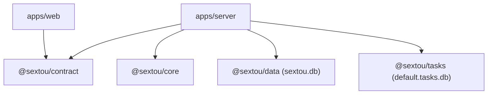
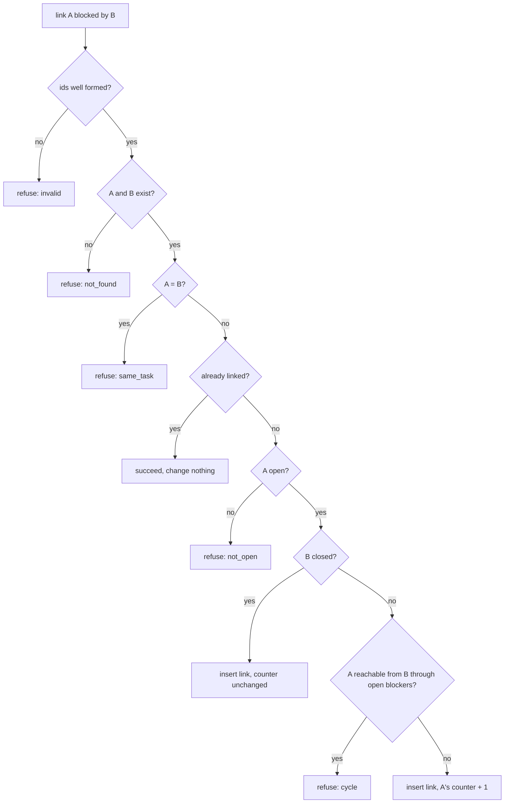

# SQLite Task Graph - Plan

## Goal Capsule

- **Objective:** The sextou server starts with only Node and its own SQLite files: it downloads and runs no bd, Dolt or git. It keeps the default organization's work items and their blocking links in a database file of their own, where the work that claims and closes them (#41) can build on it.
- **Means:** remove `@sextou/beads` and add `@sextou/tasks`, a self-contained library over a database path that the server opens on start (KTD1, KTD2).
- **Product authority:** the repository owner. Only removing beads and the task graph are in scope. Claiming and closing under a reservation, decomposition, an event journal, HTTP routes, organizations as a feature and the flow engine are not.
- **Stop conditions:**
  - Stop and report if, on the repo's Node 24 (`.node-version`), SQLite will not plan the ready list through its partial index, as it did in the benchmark on Node 26.8.1.
  - Stop and report if removing `@sextou/beads` breaks the server bundle (`apps/server/dist/server.mjs`) in a way that restoring the pre-beads shape of `main.ts` (commit `b3e0d94`) does not fix.
- **Execution profile:** one pull request against `main`, squash-merged. `ce-work` implements; the user reviews and merges.
- **Open blockers:** none.

---

## Product Contract

Product Contract preservation: changed KD3, R6 and AE7, and added KD9 and R17, after the user decided in planning that tasks is a library that knows nothing about organizations and that each organization gets its own database file, named by the server. R10 lost its cross-organization clause, AE5 was removed (the gap stays), and R14 gained the caller's limit. The questions deferred to planning are answered by KTD3–KTD8 and removed from Outstanding Questions.

### Summary

beads leaves the repository: no package, no bd or Dolt download, no extra process, no `beads` field in health. In its place, a new library, `@sextou/tasks`, keeps a task graph in a SQLite file whose path its caller passes. It creates tasks, links and unlinks `blocked_by` while refusing cycles, closes a task once none of its blockers is open, and lists the ready tasks by priority. The server opens `default.tasks.db` in the data directory for the default organization.

### Problem Frame

beads was brought in on 2026-10-19 (`.compound-engineering/artifacts/plans/2026-10-19-2030-feat-beads-engine-plan.md`) as the operational layer: its graph decides which step runs next, and its journal is the bus that `bd serve` pushes over SSE. What shipped in #42 only starts it and pings it. Its service has one method, `ping` (`packages/beads/src/service.ts:14-19`), and its only reader is the health check.

For that ping, every server start downloads and checks about 280 MB of pinned bd and Dolt (`packages/beads/src/pins.ts:37-38`). It runs a detached Dolt on 127.0.0.1:4311 and a `bd serve` on 4312, and it needs git on the PATH because `bd serve` refuses to run outside a repository. Two open issues exist only to carry that weight: #37 (a portable git for machines without one) and #22 (Dolt for development and tests, which the SQLite plan says only beads needs). Tasks would live in a store sextou can't query, behind a second server with its own versioning, so a library with its own model sits where a few queries would do.

On 2026-10-20 a research pass and a benchmark on `node:sqlite` settled the question. SQLite in WAL mode answered the ready queue, the cycle check and concurrent claims at 10k to 50k tasks, with no index held in memory. The flow engine that would have composed bd formulas has been dropped.

### Key Decisions

- KD1. **SQLite is the only store for tasks and their links.** beads, bd and Dolt go away entirely. (session-settled: user-directed — chosen over keeping beads: a library with its own model reinvents what SQLite and a few queries already do.) Governs R1, R2, R6.
- KD2. **This work removes beads and builds the graph; claiming stays in #41.** Reservations with a deadline, `claim_version`, slots per actor and closing under a reservation belong to #41. An event journal belongs to whichever work first needs one. (session-settled: user-directed — chosen over removing beads alone, over also building get next with reservations, and over also building the journal.)
- KD3. **Each organization gets its own tasks database, and the server names the file.** Today only the default organization exists, so the server opens one file. (session-settled: user-directed — chosen over every organization's tasks in `sextou.db` with the organization on each row: organization is sextou's domain, and per-organization files need no cross-organization checks.) Governs R6, R17.
- KD4. **The graph has no HTTP surface yet.** The server opens it on start, but no route reaches it; #41 adds the routes it needs. (session-settled: user-directed — chosen over contract schemas and routes for creating, linking, closing and listing ready tasks.) Governs R16, R17.
- KD5. **A parent only organizes; decomposition is #41's.** Giving a task a parent never creates a block in either direction, and the operation that makes a parent wait on new children is left to the actors that decompose work. (session-settled: user-directed — chosen over a decompose operation in this work and over every child blocking its parent.) Governs R9.
- KD6. **Closed is final.** Redoing work means creating a new task. This keeps the invariant that no closed task has an open blocker, which keeps the cycle check away from closed history. (session-settled: user-approved — proposed against reopening when no dependent had closed yet, and against reopening that cascades to dependents.) Governs R12.
- KD7. **kind is a free label with no nesting rule.** The initiative > project > issue > task tree is a convention callers follow, not something the graph enforces. (session-settled: user-approved — chosen over a fixed set of four kinds, with or without an enforced order.) Governs R8.
- KD8. **No code cleans up what beads left behind.** No release ever shipped beads, so only development machines have its detached Dolt and its files in the data directory; the pull request says how to stop and delete them by hand. (session-settled: user-approved — chosen over a cleanup on start that stops sextou's Dolt and deletes beads' files.) Governs R5.
- KD9. **The task graph is a library sextou imports, not part of sextou's domain.** It knows tasks and links only; it never learns what an organization, an actor or a flow is, and imposes no file layout on its caller. (session-settled: user-directed — chosen over rules in `@sextou/core` over a store interface, over everything in `@sextou/data`, and over core deciders called by data: "pense como se o sextou estivesse importando uma lib".) Governs R6.

### Requirements

**Removing beads**

- R1. The server opens its databases and listens without downloading any binary or starting any process besides itself, and it starts on a machine with no git.
- R2. The `@sextou/beads` package is gone, with every dependency on it, its entry in the root test configuration, and its start, ping and stop steps in the server.
- R3. The health response drops its `beads` field and keeps the version, the uptime and whether the database answers.
- R4. README, AGENTS.md and CONCEPTS.md stop describing beads, `bd serve` and Dolt, and describe the task graph where they described beads. That covers the data directory's contents, the start steps and where an organization's tasks live.
- R5. The pull request explains how a development machine stops the Dolt that #42 left running and deletes beads' files from the data directory.

**The task graph**

- R6. The tasks library keeps one graph per database file, at the path its caller passes, and knows nothing of organizations.
- R7. A new task has a title, a kind, a priority from 0 to 4 (0 is the most urgent) and, optionally, a parent, and it starts open.
- R8. A task's kind is any non-empty label the caller picks.
- R9. A task's parent must be a task of the same graph and is set only when the task is created.
- R10. Linking "A is blocked by B" is refused when the link would close a cycle, when A and B are the same task, when either task is missing, or when A is not open. Linking a pair that is already linked changes nothing.
- R11. Unlinking "A is blocked by B" is allowed while A is open. Unlinking a pair that isn't linked changes nothing.
- R12. Closing a task is refused while any of its blockers is open. Closing a closed task changes nothing, and a closed task never reopens.
- R13. A task is ready when it is open and every task that blocks it is closed.
- R14. The ready list returns ready tasks by priority, most urgent first, then oldest first, up to a limit the caller passes.
- R15. Every operation that changes tasks or links is atomic: a refused operation leaves the graph as it was, and a close updates the readiness of the tasks it blocked in the same write.
- R16. The server exposes no route for tasks.

**The server and the graph**

- R17. The server keeps the default organization's graph in `default.tasks.db` in the data directory, opens it on start, closes it on shutdown, and exits with code 1 without listening when it can't open it.

### Acceptance Examples

- AE1. **Covers R10, R15.** Given B blocked by A and C blocked by B, when A is linked as blocked by C, the link is refused and the graph keeps only the two original links.
- AE2. **Covers R12.** Given B blocked by A with A open, when B is closed, the close is refused and B stays open.
- AE3. **Covers R13, R14, R15.** Given C blocked by A and by B, with A already closed, when B is closed, C appears in the ready list in the same write.
- AE4. **Covers R12.** Given a closed task, when it is closed again, the call succeeds and nothing changes.
- AE6. **Covers R9, R13.** Given an issue with two child tasks and no links, the issue is ready from the start and stays ready while its children are open.
- AE7. **Covers R1, R17.** Given a machine with no git on the PATH and an empty data directory, the server starts and answers health with the database up, and its data directory holds `sextou.db` and `default.tasks.db` (with their WAL sidecars) and nothing else.

### Success Criteria

- With 50k tasks in one graph, fetching the first ready tasks and closing a task each stay in the low milliseconds, and the time does not grow with the number of closed tasks. The 2026-10-20 benchmark measured p50 near 0.25 ms with `synchronous=NORMAL` and about 3 ms with `FULL`, with no change from 10k to 50k.
- The server's bundle and its start no longer depend on anything beads needed.

<!-- ce-section: work-relationships -->

### How This Work Fits Together

This plan covers removing beads and the task graph. The breakdown below is the current understanding, not a committed roadmap.

- Claiming and closing under a reservation: get next by actor or role, a deadline on each reservation, `claim_version` checked on close, slots per actor, and decomposition (#41).
  - Depends on this plan's task graph.
  - Still to decide: how actors learn that a task became ready, now that beads' journal and SSE stream are gone.
- An event journal of changes to the graph: depends on this plan; still to decide whether #41 needs one or polls the ready list.
- Organizations as a feature: each new organization gets its own tasks file, named by the server (KD3).
- #37 (portable git) and #22 (Dolt for development and tests) lose their reason with this plan; closing them as not planned waits for the owner's approval.
- #41's description says #39 "turns a flow into a graph of beads", which stops being true with this plan.

### Scope Boundaries

- Reservations, assignee, role, get next and closing under a reservation (#41).
- Decomposing a task into children that block it (#41).
- An event journal, notifications or a stream of graph changes.
- HTTP routes, contract schemas and web screens for tasks.
- Reopening, deleting or moving a task, changing its parent, and editing its title, kind or priority.
- Organizations as a feature: creating, listing and naming them, and opening one tasks file per organization.
- The flow engine.
- Code that stops beads' leftover Dolt or deletes its files (KD8).
- Considered and not built:
  - A check on open that compares each task's open-blocker counter with its links. The property test in U3 catches a path that forgets the counter before it merges, and no data exists yet that could have drifted. A first report of a task stuck not ready, or ready too early, would change the call.
  - Flags or variables to move the tasks file away from the data directory. Nothing asks for it, and `--data-dir` already moves it. A deployment that needs the two databases on different disks would change the call.

### Dependencies / Assumptions

- No release ever shipped beads, so no user installation has beads data to keep.

### Sources / Research

- Research and benchmark of 2026-10-20 on `node:sqlite` 3.53.4, Node 26.8.1, NVMe. They were kept in a session scratch file and not committed, so the findings that matter are here:
  - The ready queue, found by a counter of open blockers and a partial index, gave get next p50 0.20 to 0.25 ms from 10k to 50k tasks. Deriving it with `NOT EXISTS` slowed as open tasks grew.
  - The recursive-query cycle check gave p50 0.16 to 0.25 ms, refused a cycle in a 5,000-task chain in 9 to 11 ms, and decided exactly as a JS depth-first search and Pearce-Kelly did.
  - Under 8 processes with kills and a frozen process, no task closed twice and no stale reservation closed one.
  - When both modes' indexes sat in one database, SQLite picked the wrong index for the counter query, so each query should have only its own index.
- `.compound-engineering/artifacts/plans/2026-10-19-2030-feat-beads-engine-plan.md`: why beads came in, what it starts, and where its files sit in the data directory.
- `.compound-engineering/artifacts/plans/2026-10-19-1641-feat-sqlite-data-access-plan.md` and `2026-10-19-1849-feat-database-migrations-plan.md`: how `@sextou/data` opens its database and applies migrations, the model for KTD4 and KTD5.

---

## Planning Contract

### Key Technical Decisions

- KTD1. **`@sextou/tasks` lives in `packages/tasks`, imports no sextou package and has no runtime dependency.** Only `node:` built-ins; `apps/server` is its one importer. The dependency rule in AGENTS.md gains it next to `@sextou/core`, `@sextou/data` and `@sextou/contract`, replacing `@sextou/beads`. (session-settled: user-directed — chosen over rules in core over a store interface, everything in data, or core deciders called by data: the user asked for a package the server uses like an outside library.) Implements R6, KD9.
- KTD2. **The library takes a path and nothing else about its caller.** `openTasks(path)` accepts an absolute file path or `':memory:'`, creates the folder when missing, and returns a handle with the graph operations and `close`. The server builds `<dataDir>/default.tasks.db` in `apps/server/src/config.ts`, next to the `sextou.db` default, with no new flag or variable. Implements R6, R17, KD3.
- KTD3. **Raw SQL on `node:sqlite`'s `DatabaseSync`, no drizzle.** The cycle check is a recursive CTE, which drizzle rc.4's builder cannot write, and drizzle's node-sqlite transaction commits before an `async` callback's queries run (probed). Prepared statements keep every write synchronous inside its transaction and keep KTD1's zero-dependency promise.
- KTD4. **Migrations are an ordered list of SQL steps in the package, tracked by `PRAGMA user_version`.** On open, the library applies the steps the file lacks in one transaction and sets `user_version` to the count. A file whose `user_version` is higher than the steps this version ships (a newer sextou wrote it) is refused with an error, unchanged. This mirrors `@sextou/data`'s runner (`packages/data/src/migration.ts`) without its id table or drizzle-kit, because the library has no other schema to diff. A merged step is never edited or removed, the same rule AGENTS.md gives `@sextou/data`'s migrations.
- KTD5. **The file is owner-only and durable.** The folder is created `0700` and the file and its `-wal`/`-shm` sidecars `0600` before SQLite opens them, as `restrictToOwner` does in `packages/data/src/database.ts`; the library carries its own copy because it imports no sextou package. Pragmas: `journal_mode=WAL`, `synchronous=FULL` (an acknowledged close survives a power cut, at about 3 ms per write), `foreign_keys=ON` set explicitly, `busy_timeout=5000` as the reference project sets so a second process waits instead of failing at once.
- KTD6. **Every operation is one synchronous `BEGIN IMMEDIATE` transaction.** Checks read inside the same transaction as the write; a refusal rolls back and writes nothing. Implements R15.
- KTD7. **Readiness is a counter of open blockers on each task, read through one partial index.** Linking to an open blocker increments it, unlinking an open blocker decrements it, and closing a task decrements it on every task the closed task blocked. Each change applies only when the row change it depends on actually happened (an insert that added the link, a delete that removed it, an update that closed the task). A `CHECK (open_blockers >= 0)` turns a decrement bug into a refused write. The ready list reads a partial index over open tasks with no open blocker, ordered by priority then insertion order; no other index covers that query, per the benchmark's wrong-index finding. Links also get an index on the blocker, which close uses to find the tasks it unblocks; without it every close scans all links, closed history included. That index cannot serve the ready list. Implements R13, R14.
- KTD8. **The cycle check walks only open tasks.** Linking "A blocked by B" closes a cycle exactly when A is reachable from B through B's blockers. Because no closed task has an open blocker (KD6, R12), every task on such a path is open, so the recursive query starts at B, follows links whose blocker is open, and stops at A. A closed B can never reach an open A, so linking to a closed blocker skips the walk and leaves the counter alone. Implements R10.
- KTD9. **Refusals are results, failures are exceptions.** Each operation returns either success or a refusal with a reason: `not_found`, `same_task`, `cycle`, `not_open`, `open_blockers`, `invalid`. An error from the file system or SQLite (a locked database past `busy_timeout`, a full disk) is thrown. Check order for linking: input, existence, same task, already linked (succeeds unchanged), A not open, then cycle. Unlinking checks input, existence and A open, then deletes.
- KTD10. **Ids and order.** A task id is text: a `tsk_` prefix plus a random id from `node:crypto`. Ids are not a sort key, so no ascending scheme is needed. The library mints ids; callers never pass one. "Oldest first" in R14 orders by SQLite's insertion order, which a clock that steps back cannot reorder. Each task records `time_created` in milliseconds, following `migration.time_completed` in `@sextou/data`.
- KTD11. **The library validates its own input.** A title and a kind must be non-empty after trimming, the priority an integer from 0 to 4, and the list limit a positive integer; anything else is an `invalid` refusal. A parent that doesn't exist is refused as `not_found`, like any missing task (KTD9). The library guards its own data because no caller, not even the contract, sits in front of it.
- KTD12. **The server opens the tasks file after its database and before listening.** Main restores the shape it had before beads (commit `b3e0d94`): open the database, open the tasks file, serve, listen. A failed tasks open closes the database, logs the error and exits with code 1; a failed listen closes both; shutdown closes the server, then the tasks file, then the database. The server passes the tasks handle to no route yet (KD4). Implements R17.

### High-Level Technical Design

Package dependencies after this work. Arrows point from importer to imported; `@sextou/tasks` has no arrow out.



The link operation's decisions, in order (KTD9), inside one immediate transaction (KTD6):



### Output Structure

```text
packages/tasks/
  package.json
  tsconfig.json
  vitest.config.ts
  src/
    index.ts
    open-tasks.ts         # openTasks(path): folder, owner-only file, pragmas, migrations, handle
    open-tasks.test.ts
    migrations.ts         # the ordered SQL steps and the user_version runner
    migrations.test.ts
    owner-only.ts         # folder 0700, file and sidecars 0600
    owner-only.test.ts
    env.d.ts              # Node types for TypeScript
    graph.ts              # ids, create, link, unlink, close, list ready
    graph.test.ts
```

The per-unit **Files** lists are authoritative; the tree shows the expected shape.

### Assumptions

- The repo's Node 24 (`.node-version`) behaves as Node 26.8.1 did in the benchmark: `@sextou/data` already runs `node:sqlite` on it, and U3's query-plan test checks the one benchmark finding that depends on the SQLite version.
- `pnpm-workspace.yaml`'s `packages/*` glob and the root `tsconfig.json`'s `packages/*/src/**/*` include pick up the new package with no edit.

---

## Implementation Units

### U1. Remove beads from the server, core and contract

- **Goal:** the server opens `sextou.db` and listens with no beads step, and health has no `beads` field.
- **Requirements:** R1, R2, R3.
- **Dependencies:** none.
- **Files:**
  - Delete `packages/beads/` (every file, including `src/test/` fakes).
  - Modify `apps/server/package.json`, `apps/server/src/main.ts`, `apps/server/src/main.test.ts`, `apps/server/src/app.ts`, `apps/server/src/app.test.ts`, `apps/server/src/server.test.ts`, `apps/server/src/modules/health/health.routes.ts`, `apps/server/src/modules/health/health.routes.test.ts`, `apps/server/src/config.ts` (the data directory comment).
  - Modify `packages/core/src/modules/health/health.service.ts`, `packages/core/src/modules/health/health.service.test.ts`.
  - Modify `packages/contract/src/modules/health/health.schema.ts`, `packages/contract/src/modules/health/health.schema.test.ts`.
  - Modify `vitest.config.ts` (root) and regenerate `pnpm-lock.yaml` with `pnpm install`.
- **Approach:**
  1. Return `main.ts`, `app.ts` and the health route to their shape at `b3e0d94`: no `startBeads`, no `pingBeads`, a synchronous health route answering 503 only when the database is down.
  2. Drop `beadsAnswers` and `beads` from the core's health input and output and from the contract's schema and its comment.
  3. Reword the `dataDir` comment in `config.ts`: the folder holds sextou's databases; U4 adds the tasks file.
- **Patterns to follow:** `git show b3e0d94:apps/server/src/main.ts` and `b3e0d94:apps/server/src/modules/health/health.routes.ts`; `apps/server/src/main.test.ts`'s spies on the real `@sextou/data` and its `HOME`/`XDG_DATA_HOME` stubs.
- **Test scenarios:**
  - Health answers 200 with `version`, `uptimeSeconds` and `database: 'up'` and no `beads` key.
  - Health answers 503 with `database: 'down'` when the database stops answering.
  - The contract rejects a response with no `database` field and accepts one with no `beads` field.
  - Main opens the database, then listens; a database that can't open exits with code 1 and never listens.
  - Shutdown on SIGTERM closes the server, then the database.
- **Verification:** none of the files this unit modifies (`apps/server`, `packages/core`, `packages/contract`, the root `vitest.config.ts`, `pnpm-lock.yaml`) mentions `@sextou/beads`, `bd serve` or `startBeads`, `packages/beads/` is gone, and the server bundle builds. The repository-wide search is U5's.

### U2. Create the `@sextou/tasks` package and open its database

- **Goal:** `openTasks(path)` opens an owner-only, migrated SQLite file and closes it.
- **Requirements:** R6.
- **Dependencies:** none.
- **Files:**
  - Create `packages/tasks/package.json`, `packages/tasks/tsconfig.json`, `packages/tasks/vitest.config.ts` (project name `tasks`, Node environment, 90% per-file coverage, `src/index.ts` excluded).
  - Create `packages/tasks/src/index.ts`, `src/env.d.ts` (the Node types reference, as in `packages/data/src/env.d.ts`, with `@types/node` as a devDependency), `src/open-tasks.ts`, `src/migrations.ts`, `src/owner-only.ts`, and `src/open-tasks.test.ts`, `src/migrations.test.ts`, `src/owner-only.test.ts`.
  - Modify `vitest.config.ts` (root) to list `packages/tasks`.
- **Approach:**
  1. `owner-only.ts` copies the behavior of `restrictToOwner` in `packages/data/src/database.ts` (KTD5).
  2. `migrations.ts` holds the first step (the task and link tables, the counter `CHECK`, the partial ready index, the link index on the blocker per KTD7) and the runner (KTD4).
  3. `open-tasks.ts` creates the folder, restricts the file, opens `DatabaseSync`, sets the pragmas (KTD5), runs the migrations, and returns the handle; `':memory:'` skips the file steps and WAL.
- **Patterns to follow:** `packages/data/src/database.ts`, `packages/data/src/migration.ts` and their tests (temp folders from `mkdtempSync`, `describe.skipIf(win32)` for file modes); `packages/data/package.json` and `vitest.config.ts` for the package shape, minus drizzle.
- **Test scenarios:**
  - Opening a path in a missing folder creates the folder `0700` and the file `0600`, and the WAL sidecars are `0600` after a write.
  - A new file reaches the `user_version` of the steps the package ships, with the task and link tables present.
  - Opening the same file again applies nothing and keeps its rows.
  - A file whose `user_version` is above the shipped count is refused with an error and left byte-for-byte unchanged.
  - A step that fails rolls the whole run back: `user_version` and the tables stay as before.
  - The open connection reports `journal_mode` `wal`, `synchronous` FULL, `foreign_keys` on and `busy_timeout` 5000.
  - `':memory:'` opens a migrated, empty graph.
  - `close` closes the file and a second `close` does nothing.
- **Verification:** the package's unit suite passes at 90% per file, and `pnpm typecheck` covers it.

### U3. Build the graph operations

- **Goal:** the handle creates tasks, links and unlinks them, closes them and lists the ready ones, with every rule of R7–R15.
- **Requirements:** R7, R8, R9, R10, R11, R12, R13, R14, R15.
- **Dependencies:** U2.
- **Files:** create `packages/tasks/src/graph.ts`, `src/graph.test.ts`; modify `src/open-tasks.ts` and `src/index.ts` to expose the operations and their result types.
- **Approach:**
  1. `graph.ts` mints `tsk_` ids per KTD10.
  2. Each operation in `graph.ts` runs as one immediate transaction (KTD6), validates per KTD11, checks in the order of KTD9, and returns its result per KTD9.
  3. The counter moves per KTD7, judged by each statement's change count; the cycle query follows KTD8.
  4. The ready list selects through the partial index only, ordered by priority then rowid, limited by the caller.
- **Execution note:** implement test-first from the acceptance examples; they pin the rules the counter and the cycle query must keep.
- **Patterns to follow:** prepared statements reused per handle; the benchmark's counter and recursive-CTE queries, as described in Sources / Research.
- **Test scenarios:**
  - Creating a task with a title, kind, priority 2 and no parent returns an open task with a `tsk_` id, and it is ready.
  - Creating with an empty or blank title or kind, or a priority of 5, -1 or 1.5, is refused as `invalid`; creating under a missing parent is refused as `not_found`; neither writes anything.
  - A child created under a closed parent is accepted.
  - Covers AE6. An issue with two open children and no links is in the ready list, and so are both children.
  - Linking B blocked by A (both open) removes B from the ready list.
  - Covers AE1. With B blocked by A and C blocked by B, linking A blocked by C is refused as `cycle`, and the links and counters stay as they were.
  - Linking A blocked by A is refused as `same_task`; linking to a missing id is refused as `not_found`.
  - Linking an already-linked pair succeeds and leaves the counter unchanged, even when A has since closed.
  - Linking a closed A is refused as `not_open`.
  - Linking A blocked by a closed B succeeds, A stays ready, and its counter does not move.
  - Unlinking B from A when A's only open blocker was B makes A ready; unlinking a pair that isn't linked succeeds unchanged; unlinking when A is closed is refused as `not_open`.
  - Covers AE2. Closing B while its blocker A is open is refused as `open_blockers`, and B stays open.
  - Covers AE3. With C blocked by A and B, A closed, closing B puts C in the ready list in the same call.
  - Covers AE4. Closing a closed task succeeds and changes nothing, including its dependents' counters.
  - The ready list orders priority 0 before 1, breaks ties by creation order even when two tasks share a millisecond, and returns at most the limit; a limit of 0 or a non-integer is refused as `invalid`.
  - After a few hundred random creates, links, unlinks and closes with a fixed seed, every open task's counter equals the number of its open blockers, and no closed task has an open blocker.
  - A thousand created tasks get a thousand distinct ids, each with the `tsk_` prefix.
  - On a connection the library opened, the query plan of the ready list uses the ready partial index and scans no table.
- **Verification:** every acceptance example above has a passing test; the unit suite keeps 90% per file.

### U4. Open the tasks file from the server

- **Goal:** the server opens `default.tasks.db` on start and closes it on shutdown.
- **Requirements:** R1, R16, R17.
- **Dependencies:** U1, U3.
- **Files:** modify `apps/server/package.json` (`@sextou/tasks` as a workspace dependency), `apps/server/src/config.ts`, `apps/server/src/config.test.ts`, `apps/server/src/main.ts`, `apps/server/src/main.test.ts`; regenerate `pnpm-lock.yaml`.
- **Approach:**
  1. `Config` gains the tasks file path, `<dataDir>/default.tasks.db` (KTD2), with a comment that each organization will get its own file and only the default exists.
  2. `main.ts` follows KTD12's order; no route receives the handle (KD4, R16).
- **Patterns to follow:** how `main.ts` opens and closes `@sextou/data` today and how `main.test.ts` spies on it.
- **Test scenarios:**
  - `loadConfig` puts the tasks file in the data directory and follows `--data-dir` and `SEXTOU_SERVER_DATA_DIR`.
  - Main opens the database, then the tasks file, then listens.
  - A tasks file that can't open (its `user_version` from a newer sextou) closes the database, logs the error, exits with code 1 and never listens.
  - A failed listen closes the tasks file and the database.
  - Shutdown on SIGINT closes the server, then the tasks file, then the database.
  - Covers AE7. On Linux, with PATH holding no git and an empty data directory, the server starts, health answers with the database up, and the data directory lists only `sextou.db`, `default.tasks.db` and their WAL sidecars.
- **Verification:** `pnpm --filter @sextou/server build` produces a bundle that imports only `node:` built-ins, and the server starts from it.

### U5. Update the docs and drop the beads learning

- **Goal:** the repository's docs describe the task graph and nothing of beads.
- **Requirements:** R4, R5.
- **Dependencies:** U1, U4.
- **Files:** modify `README.md`, `AGENTS.md`, `CONCEPTS.md`; delete `.compound-engineering/artifacts/solutions/integration-issues/bd-serve-requires-a-git-repository.md`.
- **Approach:**
  1. README: drop the beads layout row, the beads start steps, the git and 280 MB notes, the ports and the Dolt instructions; describe `default.tasks.db` in the data folder table. Keep git under Develop.
  2. AGENTS.md: the backend becomes server, core, contract, data and tasks; replace the `packages/beads` bullet with a `packages/tasks` bullet (a library over a path, raw SQL, migrations by `user_version`, no sextou imports); update main's start and stop sentences and the unit-suite list.
  3. CONCEPTS.md: the Organization entry owns its tasks database instead of a beads store; the Workspace entry's work is tracked in that database; replace the Beads entry with a Task graph entry (tasks, `blocked_by`, ready, closed is final); update the data directory's contents.
  4. Write R5's Dolt cleanup steps into the pull request description, not a file.
- **Test expectation:** none -- docs only.
- **Verification:** a search for `beads`, `bd serve` and `Dolt` finds them only in `.compound-engineering/artifacts/plans/`.

---

## Verification Contract

| Gate            | Command                                                                      | Proves                                                                    |
| --------------- | ---------------------------------------------------------------------------- | ------------------------------------------------------------------------- |
| Lint and format | `pnpm lint`                                                                  | oxlint and oxfmt pass, including the new package                          |
| Types           | `pnpm typecheck`                                                             | every package, `packages/tasks` included, compiles strict                 |
| Unit suites     | `pnpm test:unit`                                                             | U1–U4 tests pass at 90% per file in each suite                            |
| Both suites     | `pnpm test`                                                                  | the integration stories still pass; run before opening the pull request   |
| Build           | `pnpm build`                                                                 | the server bundle builds without `@sextou/beads` and with `@sextou/tasks` |
| Root CI shape   | `vitest run` at the root                                                     | the root project list matches the packages (beads out, tasks in)          |
| Start smoke     | the built server started with a PATH holding no git and a fresh `--data-dir` | AE7 outside the test suite                                                |

---

## Definition of Done

- Every unit's Verification holds, and the Verification Contract's gates pass.
- R1–R17 each trace to a passing test or a doc change, and AE1–AE4, AE6 and AE7 each have a test.
- No file outside `.compound-engineering/artifacts/plans/` names `@sextou/beads`, `bd serve`, `startBeads` or Dolt.
- The pull request description carries R5's cleanup steps and notes that #37 and #22 lose their reason, without closing them.
- No code from abandoned attempts is left in the diff.
