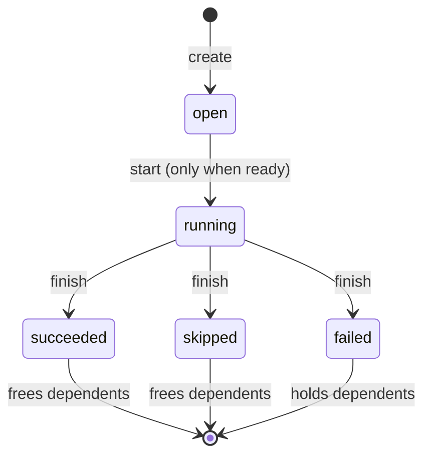
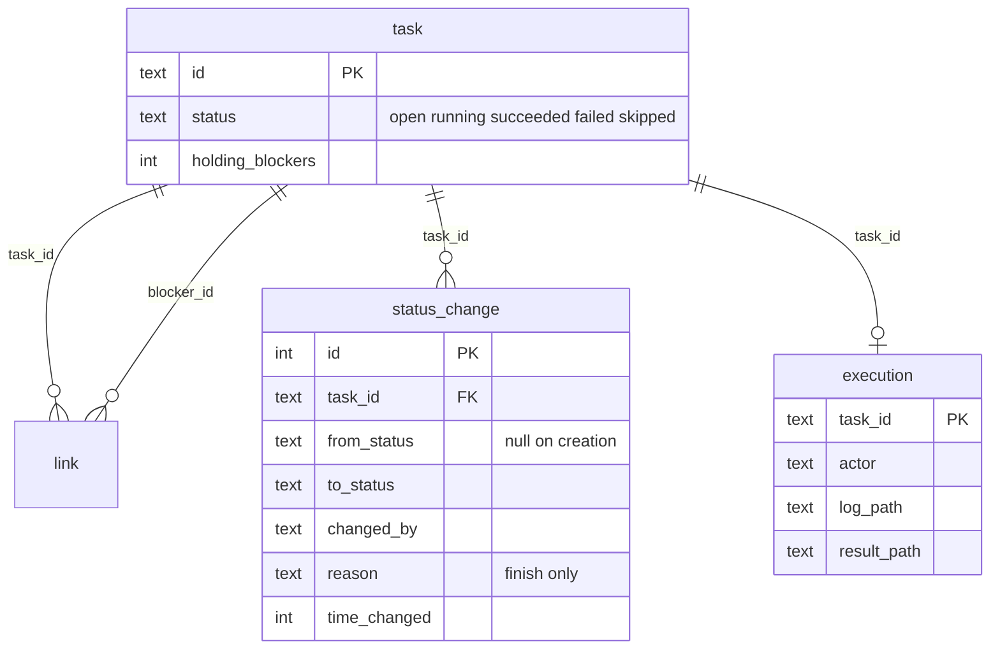

# Task States - Plan

## Goal Capsule

- **Objective:** For every task in an organization's task graph, it is known whether the task is waiting, running or finished, and how it finished: it succeeded, it failed or it was skipped. It is also known how the task got there, who ran it and where its log and result are, so the actors that take work (#41) and the retry of failed steps (#43) can build on these facts.
- **Means:** five states in `@sextou/tasks` in place of `open` and `closed`, a record of each state change and a record of the task's execution, all written by the library and read by none of its operations yet.
- **Product authority:** the repository owner. Only the states, their transitions, the record of state changes and the execution record are in scope. Reading them, cost and HTTP routes are not.
- **Open blockers:** none.
- **Execution profile:** one package, `packages/tasks`, plus two documentation paragraphs. No server, core or contract change. Done when U1–U3 are in, the unit suite passes with every `packages/tasks` file at 90% coverage or more, and lint and typecheck are clean.
- **Stop conditions:** stop and ask if a requirement turns out to need a read of the history or execution (KD9), a field outside tasks (KD8), or a second schema step (KD10).

---

## Product Contract

Product Contract unchanged.

### Summary

A task moves from `open` to `running`, then to `succeeded`, `failed` or `skipped`. Only `succeeded` and `skipped` free the tasks it blocks. Each state change is recorded with when it happened, who made it and an optional reason at the end. Starting a task records its execution: who runs it and where its log is. Finishing it records where its result is.

### Problem Frame

Today a task is `open` or `closed`, and closed is final. The graph cannot tell a task someone is working on from one nobody has taken. It cannot tell a task that did its work from one that failed, or from one judged unnecessary. Closing a task frees everything after it whatever happened, so a run whose middle step failed can look finished. The graph also keeps no trace of how a task changed: not when it started or ended, who ran it, or where its log is. That leaves an actor that took a task, or a person debugging a run, with nothing to read later.

### Key Decisions

- KD1. **A task has five states: `open`, `running`, `succeeded`, `failed` and `skipped`.** `closed` goes away. (session-settled: user-directed — chosen over `open`/`in_progress`/`closed`, over the same plus `cancelled`, and over adding a manual `blocked` and a `deferred` state: the user named the initial, intermediate and final states.) Governs R1, R2.
- KD2. **Only `succeeded` and `skipped` free the tasks a task blocks; `failed` holds them.** A failure stops what depends on it instead of letting the run move on. (session-settled: user-directed — chosen over only `succeeded` freeing them, and over every final state freeing them with stopping on failure left to whoever creates the tasks.) Governs R7, R8, R9.
- KD3. **Every final state is reached from `running`.** No task is skipped or failed without first being started. (session-settled: user-directed — chosen over skipping from `open` even while blocked, and over skipping or failing from `open`.) Governs R3, R4, R8.
- KD4. **`running` never returns to `open`.** Work left by an actor that stopped ends as `failed`, and running it again belongs to #43's retry. (session-settled: user-directed — chosen over a return to `open` in this work, and over adding it with #41's reservations.) Governs R4.
- KD5. **The state stays on the task; the history and the execution sit beside it, each in its own place pointing to the task.** The execution's start and end are the times of its moves into and out of `running`, stored only once, in the history. (session-settled: user-directed — chosen over two records with the execution keeping its own start and end, over one history whose move into `running` carries the actor and log, and over more than two.) Governs R10, R14, R15.
- KD6. **The execution keeps its own actor, apart from who made each move.** The two names need not be the same. (session-settled: user-directed — chosen over reading the actor from the move into `running`: "Não necessariamente é o mesmo. Salva os dois.") Governs R10, R14.
- KD7. **The history starts at creation, records who made each move, and takes an optional reason when a task finishes; the execution records where the task's result is.** (session-settled: user-directed — chosen by the user from a list of extras, which also offered cost and the rung that ran; see KD8.) Governs R10, R11, R12, R14.
- KD8. **Cost, tokens, the rung of the ladder and the model that ran are not the task graph's.** The library knows only tasks; sextou will keep those facts itself. (session-settled: user-directed — chosen over a cost record per model or a cost total on the execution: "Ela é burra. Ela só sabe coisa de task. O sextou que vai ter isso.")
- KD9. **The library writes the history and the execution, and no operation reads them yet.** Reading arrives with whoever needs it (routes, #41). (session-settled: user-directed — chosen over reading one task with its history and execution, and over also listing tasks by state.) Governs R17.
- KD10. **The schema is still version 1: the change is written into its first step, with no migration.** No route writes tasks, so no tasks file holds data. (session-settled: user-directed — chosen over a second schema step: "E sem migration. Não precisa. Versão 1 ainda.") Governs R18.
- KD11. **The log path is given when a task starts and the result path when it finishes, both optional.** The log exists from the start, and a result exists only at the end. Governs R14.

### Requirements

**States and moves**

- R1. A task is in exactly one of `open`, `running`, `succeeded`, `failed` and `skipped`. A new task is `open`.
- R2. `succeeded`, `failed` and `skipped` are final: a task in one never changes state again.
- R3. Starting moves a ready task from `open` to `running`. Starting a task that is not ready, or not `open`, is refused.
- R4. Finishing moves a `running` task to `succeeded`, `failed` or `skipped`. Finishing a task in any other state is refused, including one already in the same final state. No other move exists.
- R5. When two callers start the same task, one succeeds and the other is refused.
- R6. A refused operation changes nothing and records nothing.

**Readiness**

- R7. A task is ready when it is `open` and each of its blockers is `succeeded` or `skipped`.
- R8. A blocker in `open`, `running` or `failed` holds the task it blocks. A task behind a `failed` blocker stays `open` until that link is removed. Nothing changes the task on its own.
- R9. Linking a task to a blocker already `succeeded` or `skipped` does not hold it. Linking it to an `open`, `running` or `failed` blocker does. Linking still requires the task to be `open`, and a link that would close a cycle is still refused.

**History of state changes**

- R10. Each state change is recorded with the state before, the state after, when it happened and who made it.
- R11. Creating a task records the first change, with no state before. Creating a task therefore names who creates it.
- R12. Finishing may carry a reason, a free text, in any of the three final states.
- R13. The record is written in the same write as the change it describes.

**Execution**

- R14. Starting a task records its execution: who runs it and, optionally, the path of its log. Finishing may add, optionally, the path of its result. A task has at most one execution.
- R15. The execution's start and end are the times of its moves into and out of `running`. They are not stored a second time.
- R16. Every name (who runs a task, who makes a change) is a free string that the library trims and never checks. The one who finishes a task need not be the one who started it. Paths are stored as given.

**Scope of the library**

- R17. The library records the history and the execution; none of its operations reads them.
- R18. The schema stays at version 1. The change goes into its first step, as if the database were being created now.

### State Diagram

### Acceptance Examples

- AE1. **Covers R3, R4, R7.** A blocks B. A starts and finishes as `succeeded`: B is ready. The same with `skipped`: B is ready.
- AE2. **Covers R8.** A blocks B. A starts and finishes as `failed`: B is not ready and stays `open`. B is unlinked from A, and has no other blocker: B is ready.
- AE3. **Covers R3, R6.** B is blocked by A, which is `running`. Starting B is refused, and B's history still has only its creation.
- AE4. **Covers R5.** Two callers start the same ready task: one gets it `running`, the other is refused, and the task has one execution.
- AE5. **Covers R3, R4.** Finishing an `open` task as `skipped` is refused: it must be started first.
- AE6. **Covers R2, R4, R10, R11.** A task is created, started and finished as `succeeded`. Finishing it again, as `succeeded` or as `failed`, is refused. Its history has three changes: none to `open`, `open` to `running`, `running` to `succeeded`.
- AE7. **Covers R9.** A is `succeeded`. Linking B to A leaves B ready. C is `failed`. Linking B to C makes B not ready.
- AE8. **Covers R14, R15, R16.** `orchestrator` starts a task for actor `bot-dev-1` with log path `logs/run-1.txt`, and `bot-dev-2` finishes it as `failed` with reason `tests failed` and result path `out/run-1`. The execution names `bot-dev-1` with both paths. The history names `orchestrator` on the start and `bot-dev-2` on the finish, with the reason. The execution's start and end match those two changes.

### Scope Boundaries

- Reading a task, its history or its execution, and listing tasks by state (KD9).
- Moving a `running` task back to `open`, by a call or by a deadline, lease or heartbeat (KD4).
- Marking the dependents of a `failed` task in any way (R8).
- Cost, tokens, the rung that ran and the model; sextou keeps those outside the library (KD8).
- Checking that a name is an actor or a role, or that the finisher is the starter.
- A schema step or migration for existing tasks files (KD10).
- HTTP routes, and editing a task's fields.

<!-- ce-section: work-relationships -->

### How This Work Fits Together

This plan covers task states in the task graph. The areas below are the current understanding, not a committed roadmap.

- Actors that claim and close steps (#41).
  - Depends on this plan: starting a task is the claim, and finishing it is the close.
  - Still to decide: #41's text says work left by an actor that stopped goes back to the queue. With KD4, that work ends as `failed`, so #41's text needs to change.
- Retry and check of a flow's steps (#43).
  - Depends on this plan's `failed` state, which holds dependents (KD2) and never reopens (KD4).
  - Still to decide: how a retry frees the dependents of the failed task, for example by linking them to the new attempt.
  - #43's text says retry and check steps are created when the flow is instantiated. No state readies a task on its blocker's failure, so a retry attempt cannot be created ahead of time; it is added after the failure. #43's text needs to change.
- Sextou's record of cost, tokens and the rung that ran.
  - Can proceed independently of this plan. It points at a task from outside the library (KD8).

### Sources / Research

- `packages/tasks/src/graph.ts`: today's `open`/`closed` states, `closeTask`, `unlink` allowed only on an open task, and the open-blocker counter that readiness reads.
- `packages/tasks/src/migrations.ts`: the schema's first step, which KD10 rewrites.
- `.compound-engineering/artifacts/plans/2026-10-20-2017-feat-task-assignee-and-description-plan.md`: the previous one-time rewrite of the first step, and the deferral of close time and outcome.
- `.compound-engineering/artifacts/plans/2026-10-20-1830-feat-sqlite-task-graph-plan.md`: claiming and reservations left to #41.

---

## Planning Contract

### Key Technical Decisions

- KTD1. **The readiness counter counts the blockers that still hold a task, renamed from `open_blockers` to `holding_blockers`.** A blocker holds while it is `open`, `running` or `failed` (R7, R8). Every write that changes the count moves it in the same transaction, as today, so the ready list still reads only the partial index `task_ready`, now `WHERE status = 'open' AND holding_blockers = 0`.
- KTD2. **A task that is not `open` has no blocker that holds it, and the graph keeps it that way.** Starting needs a count of zero (R3), and link and unlink refuse a task that is not `open` (R9). Two consequences follow:
  - When a task finishes, every task it blocks is `open`, so finishing as `succeeded` or `skipped` lowers each dependent's count by one with one statement, as `closeTask` does today. Finishing as `failed` touches no counter.
  - A blocker that is not `open` reaches no `open` task through its own blockers, so the cycle check keeps walking only `open` tasks.
- KTD3. **`closeTask` gives way to `startTask` and `finishTask`.** `startTask` takes the task, who makes the move, the actor and an optional log path. `finishTask` takes the task, who makes the move, the final state, an optional reason and an optional result path. Exact field names are the implementer's.
- KTD4. **Starting a task that still has a blocker holding it is refused as `blocked`, not as `not_open`.** A caller can tell work someone already took (`not_open`) from work still waiting (`blocked`). Finishing a task that is not `running` is refused as `not_running` (R4). The `open_blockers` reason goes away with `closeTask`. (session-settled: user-approved — chosen over reusing `not_open` for both: the two refusals mean different things to an actor deciding what to do next.)
- KTD5. **Two side tables, `status_change` and `execution`, each pointing to `task (id)`.** `status_change` has its own integer key, so changes in the same millisecond keep their order. `execution` is keyed by the task id, which gives R14's at most one execution per task. Neither gets an index beyond its key: nothing reads them yet (KD9). Governs R10, R14.
- KTD6. **The creation time lives only in the history: `task.time_created` and `Task.timeCreated` go away.** The creation change already records it (R11), and the ready list orders by rowid, not by that column. (session-settled: user-approved — chosen over keeping the column beside the creation change: the same fact would be stored twice.)
- KTD7. **Names (`createdBy`, who moves, the actor) are trimmed, and blank is `invalid`, as `assignee` is today. Reason and paths go through the same rule as `description` and `sourcePath`: trimmed, and blank is stored as null.** R16. "Stored as given" in R16 means stored without being interpreted, the sense `Task.sourcePath`'s comment in `packages/tasks/src/graph.ts` already gives it for a trimmed field.

### High-Level Technical Design

The tables after the change, in the one schema step (KD10):

What each write does to the counters and the side tables (directional):

| Operation                      | Allowed when           | Counter effect                              | Rows written                                                             |
| ------------------------------ | ---------------------- | ------------------------------------------- | ------------------------------------------------------------------------ |
| create                         | parent, if any, exists | new task at 0                               | task, `status_change` (null to `open`)                                   |
| link                           | task `open`, no cycle  | task +1 when the blocker holds              | link                                                                     |
| unlink                         | task `open`            | task −1 when a removed link's blocker holds | none besides the link delete                                             |
| start                          | task `open`, count 0   | none                                        | `status_change` (`open` to `running`), `execution`                       |
| finish `succeeded` / `skipped` | task `running`         | each dependent −1                           | `status_change` (`running` to final), `execution.result_path` when given |
| finish `failed`                | task `running`         | none                                        | same as above                                                            |

---

## Implementation Units

### U1. Five states and the readiness they drive

- **Goal:** replace `open`/`closed` with the five states, add starting and finishing, and keep readiness right for every state.
- **Requirements:** R1–R9 (KD1–KD4); KTD1–KTD4.
- **Dependencies:** none.
- **Files:**
  - `packages/tasks/src/migrations.ts`
  - `packages/tasks/src/graph.ts`
  - `packages/tasks/src/index.ts`
  - `packages/tasks/src/graph.test.ts`
- **Approach:**
  1. In step 1, widen the `status` check to the five states and rename the counter (KTD1), with its comment and `task_ready`'s condition.
  2. In `graph.ts`, widen `Task.status`, swap `closeTask` for `startTask` and `finishTask` (KTD3), and update `Reason` (KTD4).
  3. Make `link` and `unlink` move the counter on "the blocker holds" instead of "the blocker is open" (KTD1). Keep the cycle check limited to `open` tasks (KTD2), and keep the `Graph` comments in step.
  4. Export any new public type, such as the final-state union, from `index.ts`.
- **Patterns to follow:** `closeTask`'s shape in `graph.ts` (validate outside `write`, read with `find`, refuse or write inside `write`); the `refuse` helper; the prepared statements created once in `createGraph`.
- **Test scenarios:**
  - Covers AE1. A blocks B. Start A, finish it `succeeded`: B is in the ready list. Same with `skipped`.
  - Covers AE2. A blocks B. Start A, finish it `failed`: B is not ready and its status is `open`. Unlink B from A: B is ready.
  - Covers AE3. B blocked by A, A `running`: starting B is refused as `blocked`, and B stays `open`.
  - Covers AE4. Start a ready task twice: the first succeeds, the second is refused as `not_open`.
  - Covers AE5. Finishing an `open` task as `skipped` is refused as `not_running`.
  - Covers AE6. A finished task refuses a second finish, in the same state and in another, as `not_running`.
  - Covers AE7. Linking B to a `succeeded` A leaves B ready. Linking B to a `failed` C makes B not ready. Linking B to a `running` D makes B not ready.
  - Unlinking B from a `running` blocker frees it; unlinking from a `succeeded` blocker leaves the counter alone.
  - A `running` task leaves the ready list.
  - `finishTask` with a state outside the three final ones, or with `open` or `running`, is `invalid`. A missing id is `not_found`. A non-string id is `invalid`.
  - Link and unlink still refuse a task that is `running` or final as `not_open`.
  - A cycle through `open` tasks is still refused.
  - The query-plan test still finds a single search of `task_ready` by assignee.
  - Random operations (create, link, unlink, start, finish in each final state): every `open` task's counter equals its count of blockers in `open`, `running` or `failed`; no task outside `open` has such a blocker; the run starts and finishes enough tasks to mean something.
- **Verification:** the `packages/tasks` unit suite passes with `closeTask` gone from the code and the tests.

### U2. History of state changes and the execution record

- **Goal:** record each state change and the task's execution, in the same write as the change.
- **Requirements:** R10–R17 (KD5–KD9, KD11); KTD5–KTD7.
- **Dependencies:** U1.
- **Files:**
  - `packages/tasks/src/migrations.ts`
  - `packages/tasks/src/graph.ts`
  - `packages/tasks/src/graph.test.ts`
- **Approach:**
  1. In step 1, add `status_change` and `execution` (KTD5), and drop `time_created` (KTD6). The status columns of `status_change` take the same check as `task.status`, with `from_status` nullable.
  2. Give `NewTask` a `createdBy`. Insert the creation change in `createTask`'s write and remove `timeCreated` from `Task` and `toTask`.
  3. In `startTask`, insert the change and the execution row. In `finishTask`, insert the change with the reason and set the result path when one is given.
  4. Read the clock once per write, as `createTask` does today.
- **Patterns to follow:** `optional` and `trimmed` for input (KTD7); the fake-timer setup the existing `createTask` test uses to pin `Date.now()`.
- **Test scenarios:**
  - Covers AE6. Create, start, finish `succeeded`: three changes in order, null to `open`, `open` to `running`, `running` to `succeeded`, each with its time and who made it.
  - Covers AE8. `orchestrator` starts with actor `bot-dev-1` and log `logs/run-1.txt`; `bot-dev-2` finishes `failed` with reason `tests failed` and result `out/run-1`. The execution holds `bot-dev-1` and both paths. The start change names `orchestrator`, the finish change names `bot-dev-2` with the reason. The two change times are the start and end.
  - Covers AE3. A refused start leaves the task with only its creation change and no execution row.
  - Covers AE4. Two starts of one task leave one execution row and two changes.
  - A start with no log path stores null. A finish with no result path leaves the result null.
  - A finish with a blank reason stores null. A reason that is not a string is `invalid`.
  - Blank `createdBy`, blank mover or blank actor is `invalid`, and nothing is written.
  - Names and paths come back trimmed.
  - An SQLite error during start (for example, a trigger that fails the execution insert) is thrown, leaves the task `open`, and leaves no change row.
  - Random operations: every task's last change ends in its current state, and every task that is not `open` has exactly one execution row.
- **Verification:** the `packages/tasks` unit suite passes, with every file in the package at 90% coverage or more.

### U3. Documentation

- **Goal:** the shared vocabulary and the agent guide describe the five states.
- **Requirements:** R1, R7, R8, R10, R14.
- **Dependencies:** U1, U2.
- **Files:**
  - `CONCEPTS.md`
  - `AGENTS.md`
- **Approach:**
  1. In `CONCEPTS.md`'s task graph entry, replace the open and closed sentences with the five states, what frees a dependent and that a final state never changes. Add one sentence on the history and the execution.
  2. In `AGENTS.md`'s `packages/tasks` paragraph, change "count of open blockers" to the count of blockers that still hold the task.
- **Test expectation:** none -- documentation only.
- **Verification:** neither file mentions `closed` as a task state or `closeTask`.

---

## Verification Contract

| Check                   | Command          | Proves                                                                                            |
| ----------------------- | ---------------- | ------------------------------------------------------------------------------------------------- |
| Unit tests and coverage | `pnpm test:unit` | U1–U2 behavior; 90% or more in every `packages/tasks` file                                        |
| Types                   | `pnpm typecheck` | the `Task` and `Graph` changes compile across the workspace, the server's `main.test.ts` included |
| Lint and format         | `pnpm lint`      | oxlint and oxfmt are clean                                                                        |

The integration suite is unaffected: no component or story changes. Knip runs in CI and fails on an unused export, so export only types that a caller of the library needs.

---

## Definition of Done

- U1–U3 are in, and every command in the Verification Contract passes.
- No reference to `closed` as a task state, `closeTask`, `open_blockers` or `timeCreated` remains in `packages/tasks`, `CONCEPTS.md` or `AGENTS.md`.
- `migrations.ts` still has exactly one step (KD10).
- Code from abandoned attempts is removed from the diff.
