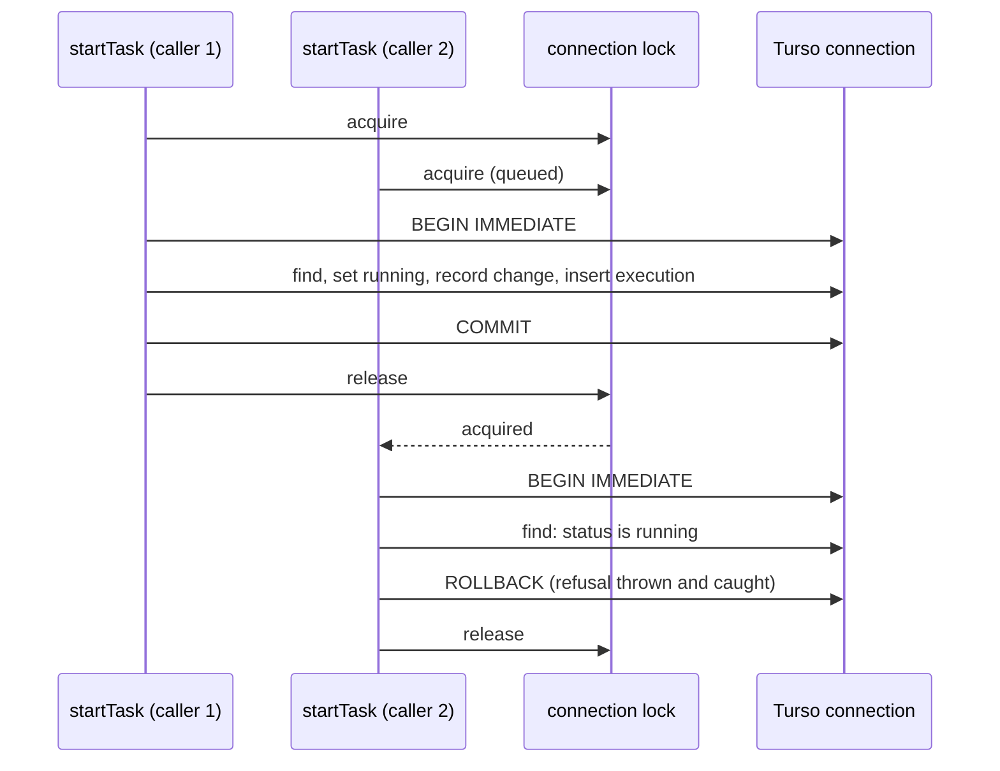

# Turso Database Engine - Plan

## Goal Capsule

- **Objective:** sextou's two databases, `sextou.db` and the default organization's task graph, run on Turso, so later work can turn on Turso's native features (concurrent writes, encryption at rest, sync, CDC) without another engine change. Everything the server and the task graph do today keeps working the same way.
- **Means:** `@sextou/data` and `@sextou/tasks` open their files through Turso's embedded library (`@tursodatabase/database`) in WAL mode instead of `node:sqlite`, through its async API (KTD1), and the server's build ships that library beside its bundle (KTD7).
- **Product authority:** the repository owner. Only the engine swap is in scope. MVCC, encryption, sync, CDC and Turso's asynchronous I/O engine are later work and not active scope here.
- **Base:** stacked on PR #46 (task states). The task graph's units are written against its schema and operations.
- **Stop conditions:** stop and report to the owner when Turso 0.8.3 refuses a statement the schema or the graph needs and no rewrite keeps the same rule, or when the ready list can't reach `task_ready` by a search.
- **Open blockers:** none.

---

## Product Contract

Product Contract preservation: changed R2 and two Key Decisions. R2 now names the task graph's rules as PR #46 left them (start and finish, holding blockers, status history), with the same meaning: every rule holds unchanged. "Operations may become asynchronous" is now settled as both packages going async. "Only the server process opens each file" now states that a second process is refused when it opens a file.

### Summary

Both databases open through Turso in WAL mode, with the same schema, migrations, rules and refusals they have today. Opening, querying and closing each database becomes asynchronous. The files stay standard SQLite files. The server runs from its bundle plus Turso's installed package for the platform.

### Problem Frame

Both of sextou's databases use the SQLite built into Node: `@sextou/data` through drizzle's `node-sqlite` driver (`packages/data/src/database.ts`), and `@sextou/tasks` through raw SQL on `DatabaseSync` (`packages/tasks/src/open-tasks.ts`). That SQLite offers one writer at a time and none of the features the owner wants sextou to grow into: concurrent writes, encryption at rest, sync with another copy, and a change feed.

Turso, the Rust rewrite of SQLite, ships those as native features. `node:sqlite` cannot reach them: Turso offers no extension, VFS or server mode that upstream SQLite can use, and a file with Turso's MVCC or encryption turned on is refused by `node:sqlite` as "file is not a database". Each feature therefore needs Turso as the engine first. Swapping the engine now, with no feature turned on, turns each later feature into a small change on top of it instead of an engine migration.

<!-- ce-section: work-relationships -->
### How This Work Fits Together

This plan covers only the engine swap. The areas below are the current understanding of what follows, not a committed roadmap; each would get its own brainstorm.

- **Concurrent writes (MVCC)** for the task graph. Depends on this work. Still to decide: how the graph's rules (no cycle, start only with no holding blocker) hold under snapshot isolation, where two links written at once can form a cycle without a write conflict.
- **Encryption at rest.** Depends on this work. Still to decide: where the key comes from.
- **Sync with another copy.** Depends on this work.
- **Change feed (CDC).** Depends on this work. Can proceed independently of the others.

### Key Decisions

- **Turso replaces `node:sqlite` in both databases.** (session-settled: user-directed — chosen over keeping `node:sqlite`: Turso has more native features for the long term, and `node:sqlite` can use none of them.) Governs R1, R2.
- **Both files stay in WAL mode; MVCC is later work.** WAL keeps one writer at a time, which the task graph's benchmark of 2026-10-20 showed handles concurrent claims, and keeps the files readable by standard SQLite tools. (session-settled: user-directed — chosen over turning on MVCC in this work, after seeing that MVCC makes the files unreadable to SQLite tools, that snapshot isolation lets two concurrent links form a cycle, and that Turso's manual still calls MVCC not production ready.) Governs R3.
- **The server keeps running on Node, with Turso installed beside the bundle.** Turso is a native addon, and a native binary cannot be inlined into `server.mjs`. (session-settled: user-directed — chosen over a single executable built with Bun's compiler: importing the library is enough.) Governs R7.
- **The server runs only where Turso publishes a prebuilt binary.** Turso 0.8.3 ships Linux x64 and arm64 with glibc, macOS on Apple silicon and Windows x64; Intel Macs and musl Linux (Alpine) are not supported. (session-settled: user-approved — stated with the platform list in the scope synthesis; the user confirmed.) Governs R7.
- **`@sextou/tasks` gains Turso as its first runtime dependency.** It still imports no sextou package and knows nothing of organizations. (session-settled: user-approved — stated in the scope synthesis; the user confirmed.) Governs R2.
- **Only the server process opens each file.** Turso refuses a second process when it opens a file ("File is locked by another process") instead of making it wait, as `node:sqlite` with `busy_timeout` did. The server is already the only process that opens them, so a second server on the same data directory exits with 1. (session-settled: user-approved — stated in the scope synthesis; the user confirmed.) Governs R6.
- **Both packages' operations become asynchronous.** Opening, every query and write, and closing return promises; what each operation does stays the same. (session-settled: user-approved — chosen over keeping the task graph synchronous on Turso's compat API: no route calls the graph yet, so changing its signature now breaks no caller, and both packages then use one Turso API.) Governs R1, R2, R5.

### Requirements

**Databases**

- R1. `sextou.db` opens through Turso, and `@sextou/data` queries it through drizzle with migrations applied exactly as today: pending ones in one transaction, and a refusal that leaves the file as it was when the file records a migration this server doesn't ship.
- R2. The task graph opens through Turso, and every behavior `@sextou/tasks` has today holds unchanged: its schema steps and refusal of a newer file, one transaction per write that keeps each task's count of holding blockers in step, cycle refusal, the start and finish rules, the status history and execution records, the ready list by assignee, refusals returned as results and storage errors thrown.
- R3. Both files run in WAL mode with one writer at a time, and stay files that standard SQLite can open.
- R4. The data directory, both files and every sidecar file Turso writes are readable only by their owner, and an acknowledged task graph write survives a power cut, as today.
- R5. The health endpoint still reports the database as `up` or `down` and never throws.

**Server and build**

- R6. The server opens both databases before listening, exits with 1 without listening when either fails to open, and closes both on SIGINT or SIGTERM, as today.
- R7. The built server runs with Node and Turso's installed package for its platform; the bundle keeps inlining every other dependency, so no other native dependency appears.

**Docs**

- R8. AGENTS.md describes both packages on Turso instead of `node:sqlite`, including that the bundle needs Turso's package beside it and the platforms the server runs on.

### Success Criteria

- `pnpm lint`, `pnpm typecheck`, `pnpm test` and `pnpm build` pass, with every source file at 90% coverage or more in each suite.
- The existing tests for both packages' rules pass on Turso without loosening any assertion. A test that depends on `node:sqlite` itself changes only to reach Turso.
- No source file outside tests imports `node:sqlite`.
- The built `server.mjs`, started on an empty data directory, answers `/health` with the database `up` and stops on SIGTERM.

### Scope Boundaries

- MVCC and concurrent writes, encryption at rest, sync, CDC, Turso's asynchronous I/O engine and vector search are later work (see How This Work Fits Together).
- Backups. Turso is pre-1.0 and recommends keeping them; this work adds none.
- Platforms Turso does not publish binaries for, and building Turso from source.
- Running the server on Bun or as a compiled executable.

### Dependencies / Assumptions

- Turso's embedded package for Node is `@tursodatabase/database`, at 0.8.3 (2026-10-12) on npm; it is pre-1.0. It and its platform packages carry npm provenance and have no install scripts, so the organization's pnpm policy accepts them with no `allowBuilds` entry.
- drizzle-orm `1.0.0-rc.4`, already pinned in `@sextou/data`, ships the `drizzle-orm/tursodatabase/database` driver, which takes Turso's async `Database`, with `@tursodatabase/database >=0.6.0-pre.28` as a peer.
- Turso 0.8.3 runs what the task graph needs: `WITH RECURSIVE` (since 0.8.0), partial indexes, CHECK constraints, triggers with `RAISE(ABORT)`, `BEGIN IMMEDIATE`, `PRAGMA user_version`, and foreign keys once `PRAGMA foreign_keys` is on. These were probed against 0.8.3 on 2026-10-21; Turso's COMPAT.md still lists `WITH RECURSIVE` as unsupported and is out of date on that point.
- Turso's errors carry no SQLite result code (a compat error has `code = "GenericFailure"` and a message such as "step failed: FOREIGN KEY constraint failed"). No sextou source reads SQLite error codes today.

### Sources / Research

- Turso README FAQ, on Turso Database replacing libSQL as the main direction and being pre-1.0: https://github.com/tursodatabase/turso#faq
- Turso SQL compatibility: https://github.com/tursodatabase/turso/blob/main/COMPAT.md, and the changelog entry for `WITH RECURSIVE` in 0.8.0: https://github.com/tursodatabase/turso/blob/main/CHANGELOG.md
- Turso manual, on journal modes, MVCC's status and multi-process access: https://github.com/tursodatabase/turso/blob/main/docs/manual.md
- Turso JavaScript API: https://github.com/tursodatabase/turso/blob/main/docs/javascript-api-reference.md and https://docs.turso.tech/connect/javascript
- Turso concurrent writes: https://docs.turso.tech/tursodb/concurrent-writes
- drizzle's Turso driver: https://orm.drizzle.team/docs/connect-turso-database
- Probes of `@tursodatabase/database` 0.8.3 on Node 26.8.1, linux-x64, on 2026-10-21: Turso and `node:sqlite` each read and wrote a WAL file the other made, with `integrity_check` ok; `node:sqlite` refused a file with Turso's MVCC or encryption on; the WASM build fails in Node (it needs a browser `Worker` and OPFS).
- Prior plans: `.compound-engineering/artifacts/plans/2026-10-19-1641-feat-sqlite-data-access-plan.md` (KD7 chose `node:sqlite` so `server.mjs` needs only Node, which R7 replaces), `.compound-engineering/artifacts/plans/2026-10-20-1830-feat-sqlite-task-graph-plan.md` (the 2026-10-20 benchmark and the task graph's pragmas) and `.compound-engineering/artifacts/plans/2026-10-21-0051-feat-task-states-plan.md` (PR #46, the schema and operations this work ports).

---

## Planning Contract

### Key Technical Decisions

- KTD1. **Both packages use Turso's async API (`connect` from `@tursodatabase/database`), not the synchronous `/compat` API.** drizzle's Turso driver accepts only the async `Database`, and the task graph follows it per the async Key Decision (R1, R2, R5). On Node, Turso 0.8.3 still runs its I/O synchronously on the main thread (`ioStep` is a no-op there), so the change buys no speed today; it fixes the signatures before the graph has callers.
- KTD2. **Each task graph write runs in `transactionAsync(...).immediate`, with every statement prepared on the transaction handle.** The wrapper holds the connection's lock from `BEGIN IMMEDIATE` to `COMMIT` or `ROLLBACK`, so a concurrent call queues instead of interleaving its statements into the transaction. A statement prepared on the connection inside the callback would wait on that same lock and deadlock, so writes keep SQL text as constants and prepare it on the transaction handle each time. A refusal inside the callback throws a private value that the graph's `write` catches and returns as the result, so a refusal rolls back by construction rather than committing an empty transaction. Reads (`listReady`) use the connection and queue behind a running write. (session-settled: user-approved — chosen over a hand-written mutex around plain `BEGIN IMMEDIATE`: Turso's own wrapper already serializes the connection.) Governs R2.
- KTD3. **`link` and `execution` become plain rowid tables in schema step 1, Turso's native table shape, keeping their primary keys.** `WITHOUT ROWID` was a storage optimization: it stores a table in its primary key's order and saves the separate index that key otherwise gets. In Turso 0.8.3 it is experimental, behind a flag, and such a table takes no `DELETE`, `UPDATE`, foreign key or secondary index, which `unlink`, `finishTask` and `link_blocker` need. The rowid form costs one index on tables of one or two ids. As a rowid table with `PRIMARY KEY (task_id, blocker_id)`, `link` was probed to refuse duplicates, take deletes, enforce foreign keys and use `link_blocker`. Step 1 is on `main` since PR #44, so this edits a merged step against AGENTS.md's rule, as PR #46 itself does; nothing is released, so no file holds step 1 as it was. (session-settled: user-approved — chosen over a new step 2 that rebuilds both tables: no file in use needs the rebuild.) Governs R2.
- KTD4. **The ready list binds one placeholder per assignee, `assignee IN (?, ?, …)`, prepared per call.** On Turso, `IN (SELECT value FROM json_each(?))` and a join on `json_each` both scan the whole `task_ready` index (about 60 to 84 ms at 50,000 tasks), while the bound list searches it once per assignee (`SEARCH task USING INDEX task_ready (assignee=?)`, then `USE SORTER FOR ORDER BY`, about 0.5 ms) with identical rows. The index, its `WHERE` and the order stay as they are. (session-settled: user-approved — chosen over keeping the JSON array: Turso's planner doesn't search the index through `json_each`.) Governs R2.
- KTD5. **Pragmas:** both packages run `PRAGMA foreign_keys = ON` after opening, since Turso leaves foreign keys off by default where `DatabaseSync` turned them on. The task graph keeps `PRAGMA synchronous = FULL`; `sextou.db` takes Turso's default, which is also FULL (Turso supports only OFF and FULL). Neither sets `journal_mode`, since Turso opens every file, in-memory ones included, in WAL. `busy_timeout` goes: no second connection opens either file. Governs R3, R4.
- KTD6. **`restrictToOwner` pre-creates `<path>` and `<path>-wal` at 0600 and no longer touches `-shm`.** Turso writes only a `-wal` sidecar, keeps it after close, and creates it with the umask's mode unless it already exists; a pre-created 0600 `-wal` kept 0600 through writes, `wal_checkpoint(TRUNCATE)` and close, with `integrity_check` ok. The function stays duplicated in each package, which share no code. Governs R4.
- KTD7. **The server's Vite build leaves `@tursodatabase/database` external (`ssr.external`), and everything else stays inlined.** An explicit `ssr.external` entry wins over `noExternal: true`. `server.mjs` then imports Turso at run time from `node_modules`, which `nodeLinker: hoisted` places at the repository's root. `@sextou/server` doesn't declare the package: it reaches it through `@sextou/data` and `@sextou/tasks`, and its source imports nothing from it, which knip checks. Governs R7.
- KTD8. **`@sextou/data` and `@sextou/tasks` pin `@tursodatabase/database` to exactly `0.8.3`.** It is pre-1.0, and the probes behind KTD3 to KTD6 ran against that release, as drizzle is pinned to its release candidate.
- KTD9. **A refused file is checked by its content, not by a missing `-wal`.** With the `-wal` pre-created (KTD6), "the file is left unchanged" is asserted as the main file's bytes and its `user_version`, or its migration table, being as they were before the open.

### High-Level Technical Design

Two calls on one task graph connection, as KTD2 serializes them. This illustrates the intended approach and is not a specification.

### Risks

- **Turso is pre-1.0.** A release can change behavior the probes relied on. The exact pin (KTD8) holds the engine until an upgrade is its own change, rerunning both packages' tests.
- **drizzle's Turso session runs its transactions through Turso's deprecated `transaction()`**, which doesn't hold the connection, so concurrent statements can interleave into it. `@sextou/data` has no tables and no writes yet, and its migration runner uses `transactionAsync` directly (U3), so nothing hits this now. The first feature that writes through drizzle must serialize its transactions.
- **Turso may rewrite a refused file's header on open.** The tests that refuse a newer file create it with Turso, so it is already in WAL. If Turso still changes the main file's bytes on open, stop and report rather than drop the assertion (KTD9).

---

## Implementation Units

### U1. Task graph on Turso

- **Goal:** the task graph's schema steps, `openTasks`, every graph operation and `close` run on Turso and return promises, with every rule unchanged.
- **Requirements:** R2, R3, R4, R6.
- **Dependencies:** none.
- **Files:** `packages/tasks/package.json`, `packages/tasks/src/migrations.ts`, `packages/tasks/src/open-tasks.ts`, `packages/tasks/src/graph.ts`, `packages/tasks/src/owner-only.ts`, and their tests `migrations.test.ts`, `open-tasks.test.ts`, `graph.test.ts`, `owner-only.test.ts`.
- **Approach:**
  - Add `@tursodatabase/database` at `0.8.3` (KTD8).
  - Step 1 follows KTD3; update the step's comment. `migrate` becomes async on Turso's `Database` and runs its steps in one `transactionAsync(...).immediate` (KTD2), keeping the newer-file refusal and its message.
  - `openTasks` awaits `connect(path)` after `restrictToOwner`, sets the pragmas in KTD5, awaits `migrate`, and closes the connection when any of it fails. `close` does nothing once the connection is closed.
  - `createGraph` takes Turso's `Database`. `write` follows KTD2. The ready list follows KTD4. `toTask` and `nullable` read Turso's row values in place of `SQLOutputValue`.
  - `restrictToOwner` follows KTD6.
  - `Graph` and `Tasks` change only their return types to promises.
- **Test scenarios:**
  - Every existing scenario in the four test files passes with `await`, assertions unchanged except the busy timeout assertion and the `-shm` checks, which go (KTD5, KTD6). That covers the schema steps and the newer-file refusal, each move and refusal, the history and execution rows, the random-operations check of every counter and status, and the rollback of a failing step and of `link`, start and finish after a trigger raises.
  - `link` refuses a duplicate pair, takes a `DELETE` and refuses a blocker that doesn't exist; `execution` takes an `UPDATE` of `result_path`.
  - The tests reach the graph's connection through a spy on Turso's `Database` prototype, as they do today on `DatabaseSync`.
  - Two `startTask` calls on the same ready task, made together (`Promise.all`), give one `{ ok: true }` and one `not_open`, and one execution row.
  - A refusal inside a write (a `cycle` link) leaves `inTransaction` false and the counters as they were.
  - After a trigger raises in a write, the connection is no longer in a transaction and accepts the next write.
  - The ready list's `EXPLAIN QUERY PLAN` for two assignees is `SEARCH task USING INDEX task_ready (assignee=?)` then `USE SORTER FOR ORDER BY`, and it returns the same rows, in the same order, for one, two and three assignees.
  - A file opened, written and closed by `openTasks` opens in `node:sqlite` in the test, with `integrity_check` ok and the tasks readable (R3).
  - On a file, `journal_mode` is `wal`, `synchronous` is 2 and `foreign_keys` is 1.
  - A new file and its `-wal` are 0600 after open and after close. An existing file and `-wal` at 0644 become 0600.
  - A file a newer version migrated is refused with the current message, and its bytes and `user_version` are as they were (KTD9).
  - A file that isn't a database, and a folder that is a regular file, each reject the open.
  - While the test holds a file open through `openTasks`, a child Node process that opens it through Turso fails with "File is locked by another process", and the test's graph still reads and writes.
  - Once closed, an operation rejects, and a second `close` doesn't.
- **Verification:** `pnpm --filter @sextou/tasks test:unit` passes at 90% coverage or more per file, and no source file in `packages/tasks/src` imports `node:sqlite`.
### U3. Data database opens through Turso

- **Goal:** `openDatabase`, `ping` and `close` run on Turso through drizzle's Turso driver and return promises, with migrations applied as today.
- **Requirements:** R1, R3, R4, R5.
- **Dependencies:** none.
- **Files:** `packages/data/src/database.ts`, `packages/data/src/migration.ts`, `packages/data/package.json`, and the tests `database.test.ts`, `migration.test.ts`.
- **Approach:**
  - Add `@tursodatabase/database` at `0.8.3` (KTD8).
  - `openDatabase` awaits `connect(path)` after `restrictToOwner` (KTD6), sets `foreign_keys` (KTD5), awaits `migrateDatabase`, and closes the connection when either fails. Turso rejects a file that isn't a database at `connect`, so the `select 1` probe goes.
  - `db` becomes drizzle's Turso database type. `ping` awaits `select 1` and resolves `false` on any error. `close` does nothing once closed.
  - `migrateDatabase` runs in one `transactionAsync` with statements prepared on the transaction handle (KTD2), keeping its messages, the unknown-migration refusal and the returned ids.
- **Test scenarios:**
  - Every existing scenario in both test files passes with `await`, assertions unchanged except the `-wal` and `-shm` mode checks, which become `-wal` only (KTD6).
  - `journal_mode` is `wal`, `synchronous` is 2 and `foreign_keys` is 1.
  - `ping` resolves `true` while open and `false` once closed, without rejecting.
  - A database a newer sextou migrated is refused with the current message, and its bytes and migration rows are as they were (KTD9).
  - A failing migration leaves no `migration` table on a fresh file.
- **Verification:** `pnpm --filter @sextou/data test:unit` passes at 90% coverage or more per file, including `drift.test.ts` and `migration-files.test.ts` unchanged.

### U4. Server awaits both databases and bundles beside Turso

- **Goal:** the server opens, pings and closes both databases asynchronously, and its bundle runs with Turso's package beside it.
- **Requirements:** R5, R6, R7.
- **Dependencies:** U1, U3.
- **Files:** `apps/server/src/main.ts`, `apps/server/src/app.ts`, `apps/server/src/modules/health/health.routes.ts`, `apps/server/vite.config.mts`, and the tests `main.test.ts`, `app.test.ts`, `server.test.ts`, `modules/health/health.routes.test.ts`.
- **Approach:**
  - `main.ts` awaits `openDatabase`, then `openTasks`, keeping the order and the messages, and awaits each close in every path that closes today.
  - `pingDatabase` becomes `() => Promise<boolean>` in `AppOptions` and `HealthRoutesOptions`, and the health handler awaits it.
  - `vite.config.mts` follows KTD7 and its comment says the bundle needs Turso's package beside it.
- **Test scenarios:**
  - Every existing scenario in the four test files passes, with mocked results awaited.
  - `main.test.ts` writes its "newer" task graph through Turso instead of `node:sqlite`.
  - The data directory's file check matches `-wal` sidecars only.
  - The health route answers `down` with 503 when the ping resolves `false`, and `up` with 200 on an open in-memory database.
  - On SIGTERM, the server stops listening, closes the task graph, then the database, then exits with 0.
- **Verification:** `pnpm --filter @sextou/server test:unit` passes at 90% coverage or more per file, and the bundle smoke check in the Verification Contract passes.

### U5. AGENTS.md describes Turso

- **Goal:** AGENTS.md describes both packages on Turso.
- **Requirements:** R8.
- **Dependencies:** U1, U3 and U4.
- **Files:** `AGENTS.md`.
- **Approach:** in the `@sextou/server`, `@sextou/data` and `@sextou/tasks` entries:
  - Replace `node:sqlite` with Turso's async API.
  - Say the bundle needs Node and Turso's installed package, and name the platforms (Key Decisions).
  - Replace "no runtime dependency" with Turso as the task graph's one runtime dependency.
  - Say each task graph write is one immediate `transactionAsync` (KTD2).
  - Say a second process is refused at open.
- **Test expectation:** none, documentation only.
- **Verification:** `pnpm lint` passes, and AGENTS.md no longer names `node:sqlite` for either package.

---

## Verification Contract

| Gate | Command | Proves |
|---|---|---|
| Lint and format | `pnpm lint` | oxlint and oxfmt pass |
| Types | `pnpm typecheck` | every package checks with the async signatures |
| Tests | `pnpm test` | both suites, every source file at 90% or more; the stories still pass in Chromium |
| Build | `pnpm build` | the desktop package, web app, Storybook and `server.mjs` build |
| No `node:sqlite` in sources | `rg -l "node:sqlite" apps packages --glob '!*.test.ts'` | prints nothing |
| Bundle smoke | see below | R7 |

Bundle smoke, run once after `pnpm build` from the repository root:
- Start `node apps/server/dist/server.mjs --port 0 --data-dir <new temp dir>`.
- `GET /health` at the printed address answers 200 with `"database":"up"`.
- SIGTERM ends the process with 0.
- The temp dir holds `sextou.db`, `default.tasks.db` and their `-wal` files, all 0600.

---

## Definition of Done

- Every gate in the Verification Contract passes.
- U1, U3, U4 and U5 meet their own verification.
- `@tursodatabase/database` is pinned at `0.8.3` in `@sextou/data` and `@sextou/tasks` only, and `pnpm-lock.yaml` is committed.
- No test assertion was loosened. A test that changed did so only to reach Turso instead of `node:sqlite`, or to await.
- Probe scripts, abandoned approaches and debugging code are gone from the diff.
