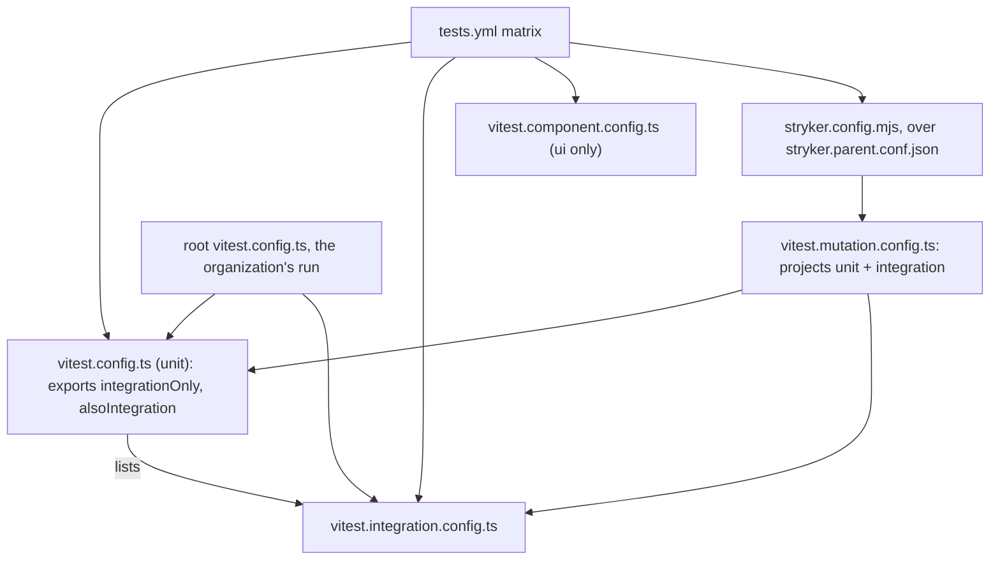
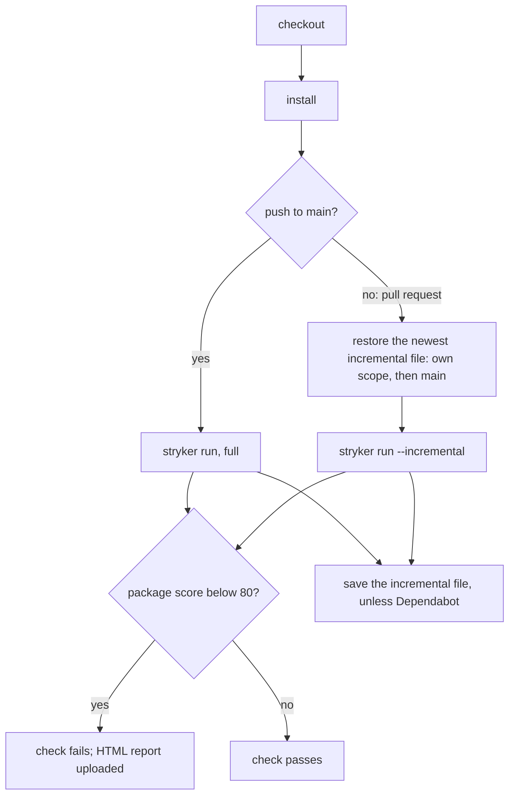

# Test Levels and Coverage Gate - Plan

## Goal Capsule

- **Objective:** Every pull request on sextou shows, for each package and test level, whether each source file reaches 90% coverage, and, for each package, whether its unit and integration tests catch at least 80% of its mutants, so code that is untested, or covered by tests that check nothing, shows up before merge.
- **Means:** A workflow of sextou's own runs each package's levels as separate checks, plus a StrykerJS mutation check for each package run the way Stryker's own project runs it (KTD1, KTD6, KTD10). The organization's workflow stays as it is until this moves there.
- **Product authority:** This brainstorm's dialogue and the planning dialogue of 2026-10-21; no issue yet. Issue #54 tracks bringing `describe` back.
- **Execution profile:** `packages/tasks` goes first and sets the pattern; `packages/data` and `apps/server` follow it (KTD12).
- **Stop conditions:** Stop and report if a test at the top level of its file still runs for no mutant under Stryker (U5), or if a package's mutation dry run cannot pass in Stryker's sandbox after the fixes this plan names.
- **Open blockers:** None.

---

## Product Contract

### Summary

Tests are organized by package, then by level: unit, integration, component and, later, e2e, each with written criteria. Each package has only the levels its code needs, and each pair of package and level runs on its own, with 90% coverage required in every file that level answers for. A workflow of sextou's own runs every pair as a check on each pull request, plus a mutation-testing check per package that requires 80% of its mutants killed by its suites that run without a browser. A lint rule keeps modules independent, and AGENTS.md says how to classify, run and write tests.

Each suite is its own Vitest config file, so each run is the root of its own coverage and judges only the files its config lists. Tests sit at the top level of their file, with no `describe`, so StrykerJS 10.0.0 runs them under Vitest 5 unpatched. Mutation runs in full on every push to `main` and incrementally on pull requests, as in Stryker's own CI, and Stryker's `thresholds.break` fails the run below 80%.

### Problem Frame

AGENTS.md states that every source file must reach 90% coverage in each suite. That rule only holds on the machine of whoever runs the tests. In CI, the organization's `typescript.yml` runs `vitest run` at the root with no floor, because sextou has no `.github/typescript.yml`. Even with one, that workflow checks only the merged total of lines, overrides each package's coverage `include` from the command line, and ignores the thresholds in Vitest configs. Vitest 5.0.5 also reads `coverage` only from the root config, so the root run applies none of the packages' per-file thresholds.

The browser suite of `packages/ui` runs in neither CI nor the pre-push hook. The suite names mix two things: the stories that render in Chromium are called "integration", while tests that really combine parts, such as the server's tests against the real `@sextou/data` and `@sextou/tasks` or the task graph's tests on a SQLite file on disk, sit in the unit suite.

Coverage also can't tell a test that checks behavior from one that only runs the line. A test with no assertion reaches 100%.

### Key Decisions

- **The 90% floor applies per file in CI too, not as a merged total.** (session-settled: user-directed — chosen over the organization's total floor as in corvo and over both together: a total lets a poorly tested file pass when the rest compensates, and leaves CI weaker than the local rule.) Governs R10, R11.
- **Hierarchy is package, then level; modules are picked by path filter, not by configuration.** (session-settled: user-directed — chosen over package > level > module configured as named projects and over level > package: the package is the unit of caching, selective runs and extraction, and no surveyed project defines a test project per module.) Governs R8, R9.
- **Each package has only the levels its code needs; levels are not a grid every package fills.** (session-settled: user-directed — raised by the user: a browser component level means nothing for `packages/tasks` or `apps/server`, while integration applies to any package.) Governs R5.
- **Level criteria follow the scope and size axes of Google's testing chapters and Fowler's sociable unit tests.** (session-settled: user-approved — proposed with sources after the user asked for established practice instead of an unexplained choice.) Governs R1, R2, R3, R4.
- **The levels are named unit, integration, component and e2e; the stories become component.** (session-settled: user-directed — chosen over keeping "integration" for the stories and over naming levels by environment: a level says what the test validates, and the browser is where it runs.) Governs R1–R4, R7.
- **The component suite runs in CI through a job of sextou's own.** (session-settled: user-directed — chosen over teaching the organization's workflow to run browser suites and over keeping it local.) Governs R12.
- **A workflow of sextou's own runs the hierarchy; it moves to the organization's workflow later.** (session-settled: user-directed — chosen over changing the organization's `typescript.yml` now and over using both: it applies the exact rule now and touches only sextou.) Governs R11, R12, R14.
- **The checks are not made required in this work.** (session-settled: user-directed — chosen over a pull request to `admin`'s ruleset now: "Importante é ver ele funcional aqui"; blocking comes with the move to the organization's workflow.) Governs R13.
- **Mutation testing gates the pull request, with StrykerJS's Vitest runner and an 80% floor.** (session-settled: user-directed — chosen over reporting only and over written rules only, and 80% over 90% and over measuring first: 80 is Stryker's own "high" mark and leaves room for equivalent mutants.) Governs R14–R17.
- **Mutation is judged the way Stryker judges it: `thresholds.break` at 80 on the package's total score, with no floor per file.** (session-settled: user-directed — chosen during implementation over a per-file floor script: Stryker has no per-file threshold, its documentation and its own repository use `break` alone, and the script, its package and the drift test came to 520 lines for what one setting does.) Governs R14, AE4.
- **Mutation runs the way Stryker's own project runs it: in full on every push to `main`, incrementally on pull requests.** (session-settled: user-directed — "Modelo do Stryker", chosen over a full run of a pull request's dependent packages and a weekly full run: the per-package decision was a mechanism of this plan's own, and Stryker's project does without it.) Governs R15.
- **Tests sit at the top level of their file, with no `describe`.** (session-settled: user-directed — chosen over keeping `describe` with a pnpm patch of Stryker's runner: here `describe` mostly repeats what the file already groups, and without it the official release runs under Vitest 5.) Governs R25.
- **Each level judges only the source files it answers for, every file belonging to at least one level.** (session-settled: user-directed — chosen over every file in every level: after the tests move to their levels, that rule forces mocks of the disk and HTTP into unit tests and copies of pure tests into integration.) Governs R10, R23.
- **A source whose only branch is in memory versus on disk is answered for by integration, whose test keeps both sides, with a comment saying why.** (session-settled: user-approved — chosen over splitting the test file by level: `open-tasks.ts` and `database.ts` reach 90% in neither half alone; the user required a clear comment so no one reads the absent unit test as a gap.) Governs R6, R24.
- **A test is integration when it reaches another sextou package for real, directly or through the code under test; `apps/server`'s unit suite keeps only `config` and `data-directory`, with a comment saying why.** (session-settled: user-approved — chosen over counting only the test's own imports; the user required the same clear comment as for the in-memory case.) Governs R2, R24.
- **`apps/web` is left as it is; it only gets its checks.** (session-settled: user-directed — "Esquece web. Nem existe. O mais importante tá no task.": its `App.test.tsx` stays unit although it renders `@sextou/ui` for real.) Governs R5, R6.
- **Module independence is enforced by lint in this work.** (session-settled: user-directed — chosen over deferring it until there are more modules.) Governs R18.
- **AGENTS.md carries the test-writing instructions, drawn from Vitest's own guides.** (session-settled: user-directed — the user asked for instructions on how to write tests, including what Vitest's docs suggest for agents writing tests.) Governs R19, R20.

### Requirements

**Levels and their criteria**

- R1. A unit test validates one unit of a package through its public API, in one process, touching neither the disk nor the network; real in-memory collaborators are allowed, an in-memory SQLite database included.
- R2. An integration test validates real parts working together: the package with a real resource (a file on disk, an HTTP server listening on localhost, a child process), or two or more sextou packages used for real, whether the test imports the other package or the code under test does.
- R3. A component test validates a UI component rendered in a real browser.
- R4. An e2e test validates a flow the way a person uses sextou: the web app in a browser, or the desktop window, talking to a real server process, with the test acting only through the interface and replacing no part with a test double. No e2e suite is created in this work; R4 is the criterion the first one must meet.
- R5. Every package with source code has a unit suite, has an integration suite wherever its code reaches a real resource or another sextou package, and has a component suite only where it has UI to render in a browser; `apps/web` keeps the unit suite it has.
- R6. Existing tests that meet R2 move out of the unit suites into their package's integration suite, including the server's tests that use the real `@sextou/core`, `@sextou/data` and `@sextou/tasks` and the tests of `packages/data` and `packages/tasks` that open a file on disk.
- R7. The story suite of `packages/ui` is called component everywhere it is named: scripts, Vitest project names, check names and AGENTS.md.
- R24. Where a package's unit suite answers for none of a source file, or a test file holds in-memory cases at the integration level, a comment beside the suite's file list and at the top of the test file says why, so the absence of a unit test does not read as a gap.
- R25. Tests sit at the top level of their file, with no `describe` block, so Stryker's Vitest runner runs each test for its mutants; every existing test is rewritten that way, and AGENTS.md says why, citing issue #54.

**Running the hierarchy**

- R8. A developer can run one level of one package, every level of one package, or one level across every package, each with one command from the repository root.
- R9. A module inside a package runs by filtering on its path; a filtered run reports test results but never fails on coverage, which only the full run of a package's level judges.

**Coverage floor**

- R10. Each package's unit, integration and component suite declares the source files it answers for, and every file a suite answers for reaches 90% of lines, branches, functions and statements in that suite on its own.
- R23. Every source file not excluded from coverage belongs to at least one suite of its package, and may belong to more than one; the files excluded from coverage today stay excluded.
- R11. On every pull request and every push to `main`, CI runs each existing pair of package and level as its own check named after both (such as `core / unit` or `ui / component`), and a pair below R10's floor fails its check.
- R12. Only the checks of component suites install a browser.
- R13. The checks show on every pull request; making them required in the ruleset is not part of this work.

**Mutation testing**

- R14. CI runs StrykerJS with its Vitest runner on every package's unit and integration suites, as one check per package named after it (such as `tasks / mutation`), and the check fails when the package scores below 80%; a mutant that changes no behavior is marked with Stryker's comment for disabling it, never by lowering the floor.
- R15. Every push to `main` runs all of each package's mutants; a pull request runs incrementally, reusing the results of its own last run or, failing that, of `main`'s.
- R16. A package whose mutation score is below 80% when the gate lands gets, in this work, the tests that bring it to 80%.
- R17. Code excluded from coverage is excluded from mutation testing too.

**Module independence**

- R18. Code in one module of a package imports another module of the same package only through that module's entry point, and lint fails on any other import between modules.

**Instructions in AGENTS.md**

- R19. AGENTS.md's Tests section states the level criteria of R1 to R5, the hierarchy with the command for each kind of run of R8 and R9, and the floors of R10 and R14.
- R20. AGENTS.md has instructions on how to write tests, for people and for agents, covering every point listed under Test-Writing Instructions below.
- R21. The pre-push hook keeps running the type check and the unit suites only; integration, component and mutation runs belong to CI.

**Keeping today's gate**

- R22. The root Vitest config points at every package's unit and integration suites, but not the component suite, so the organization's run, which already blocks merges, keeps running every test that blocks a merge today.

### Levels per Package Today

R5 and R6 applied to each of the eight packages as they stand. Every package also gets its own mutation check (R14), so the pull request shows `<package> / mutation` for all eight.

| Package             | unit                                                                        | integration                                                                                                                                                      | component               | Checks on a pull request                |
| ------------------- | --------------------------------------------------------------------------- | ---------------------------------------------------------------------------------------------------------------------------------------------------------------- | ----------------------- | --------------------------------------- |
| `apps/desktop`      | the main process's pure modules (`link-policy`, `error-page`)               | none yet; launching the window waits for e2e                                                                                                                     | none                    | `desktop / unit`                        |
| `apps/server`       | `config`, `data-directory`                                                  | `app`, `modules/health/health.routes`, `server`, `main`: each reaches `@sextou/core`, `@sextou/data` or `@sextou/tasks` for real, the disk or a listening server | none                    | `server / unit`, `server / integration` |
| `apps/web`          | `platform`, `App` in jsdom, as today                                        | none in this work                                                                                                                                                | none in this work       | `web / unit`                            |
| `packages/contract` | the schemas                                                                 | none                                                                                                                                                             | none                    | `contract / unit`                       |
| `packages/core`     | the domain services                                                         | none                                                                                                                                                             | none                    | `core / unit`                           |
| `packages/data`     | `migration`, `schema`, `migration.gen`                                      | `database` (in memory and on a file), `migration-files`; the drift test, which reads `migration/` and `src/schema.ts` from disk                                  | none                    | `data / unit`, `data / integration`     |
| `packages/tasks`    | the task graph and states on `':memory:'` (`graph`, `status`, `migrations`) | `open-tasks` (in memory and on a file), `owner-only`                                                                                                             | none                    | `tasks / unit`, `tasks / integration`   |
| `packages/ui`       | the components in jsdom                                                     | none                                                                                                                                                             | the stories in Chromium | `ui / unit`, `ui / component`           |

A test file that mixes both levels is split, except where the file under test branches only between in memory and on disk: then the integration suite answers for that file and its test keeps both sides, with the comment R24 requires.

### Test-Writing Instructions

R20's instructions cover these points, taken from Vitest's guides "Testing in Practice" and "Writing Tests with AI", Google's chapters on testing, and the guidance on testing behavior rather than implementation. The planner may word them for AGENTS.md but drops none.

- Test the contract: inputs, return values, side effects and errors, through the public API. A test that breaks when the internals change but the result stays the same tests implementation.
- One behavior per test, with a name that states it and its subject ("openTasks refuses a file from a newer version"); an "and" in the name means two tests.
- Tests sit at the top level of the file, with no `describe` (R25): the file groups them, `test.each` runs one test over several values, `test.skipIf` skips a test on a platform, and a helper the test calls sets up what only some tests need.
- Arrange, act, assert.
- Every assertion checks a real result. A test that only checks that nothing throws, that something is defined, or what a mock received does not count.
- Cover the boundaries, the error paths and every side of each condition: empty input, `null` and `undefined`, limits, failed requests, empty lists. If a real caller can trigger it, test it.
- Prefer real implementations when they are fast and reliable. Mock only what is slow, flaky or has side effects the test can't control, and never the thing under test. Use fake timers for time.
- Each test sets up its own state and passes in any order; mocks are restored after each test.
- Use Vitest's APIs (`vi.fn`, `vi.mock`), with the typed form `vi.mock(import('./module'))`.
- A bug fix starts with a failing test that reproduces the bug, so the fix changes the code, not the test.
- Before writing tests, read the source file, the tests beside it and the package's Vitest config, and follow their conventions.
- Run the tests with `vitest run`, never in watch mode, and read the coverage and mutation results before finishing.
- Property-based tests are an option for functions with wide input ranges.

### Acceptance Examples

- AE1. **Covers R10, R11.** **Given** a file in `packages/data` that its unit suite answers for, at 85% of branches there, **when** a pull request changes it, **then** the `data / unit` check fails and names the file.
- AE2. **Covers R10.** **Given** `packages/tasks`'s `owner-only.ts`, which only the integration suite answers for, at 95% there, **then** `tasks / integration` passes and `tasks / unit` does not judge it; a file both suites answer for, at 95% in unit and 60% in integration, fails `tasks / integration`.
- AE9. **Covers R23.** **Given** a new source file in `apps/server` that no suite of the package answers for, **then** a check of that package fails and names the file.
- AE3. **Covers R5, R11, R12.** **Given** `packages/tasks`, which has no UI, **then** the pull request shows no `tasks / component` check and no job of it installs a browser.
- AE4. **Covers R14.** **Given** a new file in `packages/tasks` covered at 100% by tests with no assertion, **then** the coverage checks pass and Stryker reports that file's mutants as survived; `tasks / mutation` fails when they bring the package below 80%.
- AE8. **Covers R15.** **Given** a pull request that changes only `packages/data`, **then** `server / mutation` runs incrementally on that pull request, and the push to `main` after it merges runs all of `apps/server`'s mutants.
- AE5. **Covers R9.** **Given** a developer filtering a run to one module of `apps/server`, **then** the tests of that module run and the run does not fail on the coverage of the files it left out.
- AE6. **Covers R18.** **Given** code in one module importing a file from inside another module of the same package, **then** lint fails.
- AE7. **Covers R2, R6.** **Given** a test in `packages/tasks` that opens a SQLite file in a temporary directory, **then** it belongs to the integration suite; the same test on `':memory:'` belongs to the unit suite, unless it tests the in-memory side of `openTasks`, which the integration suite answers for.
- AE10. **Covers R25.** **Given** a test of `packages/tasks` wrapped in a `describe`, **then** Stryker runs it for none of its mutants and `tasks / mutation` fails for the files only it tests.

### Success Criteria

- From a pull request's checks alone, a reader can tell which package and which level failed, and why.
- An agent following AGENTS.md can decide a new test's level and write it without asking.

### Scope Boundaries

- No change to `admin`: the checks are not made required (R13).
- No change to the organization's `typescript.yml`. Its run stays, so the unit and integration suites run twice on each pull request until this moves to the organization's workflow (R22).
- No e2e suite; R4 only defines one.
- No component suite for `apps/web` or any package other than `packages/ui`.
- No reclassification in `apps/web`: `App.test.tsx` stays unit until web has real work; AGENTS.md names it as the one exception to R2. Its tests still lose their `describe` (R25), or `web / mutation` fails.
- No mutation testing of component suites: StrykerJS's Vitest runner does not support Vitest's browser mode.
- No test project or check per module.
- No coverage rule for e2e; it is decided when the first e2e suite arrives, since its coverage spans several processes.
- No name of a test tool sextou does not use, in this plan or in the files it changes.
- Not built: a lint rule against `describe`. A test inside one runs for no mutant, so its package's mutation check already fails (AE10).
- Not built: a full mutation run on a pull request whose sextou dependencies changed. Stryker's own CI does without it; the push to `main` after the merge runs everything (R15).
- Not built: a lint check of imports from a package's top-level files into a module's internals (`apps/server/src/app.ts` reaches `./modules/health/health.routes`). R18 covers module-to-module imports only; this changes if top-level files start to depend on module internals other than routes and services.
- Not built: Stryker's TypeScript checker. It needs TypeScript 6 installed under the normal name beside TypeScript 7; mutants that would not compile are judged at runtime instead. This changes when the checker supports TypeScript 7 as installed here.
- Not built: caching Playwright's Chromium in CI. Playwright advises against it, since restoring takes as long as downloading.

#### Deferred to Follow-Up Work

- Bringing `describe` back once a Stryker release fixes its Vitest 5 test names: issue #54.

### Dependencies / Assumptions

- R1 treats an in-memory SQLite database as unit because it runs in one process without disk or network, the size criterion of Google's chapter; the chapter's text on in-memory resources was not verified.
- StrykerJS's Vitest runner 10.0.0 runs under Vitest 5.0.5 only for tests outside a `describe`: inside one, it joins the test's name with a space where Vitest 5 expects `>`, so the test runs for no mutant (stryker-js issue #6210, fixes in pull requests #6214 and #6220, unmerged on 2026-10-21). Top-level tests scored normally in a local reproduction.

### Sources / Research

- `vitest.config.ts`: the root projects list, with no coverage block.
- `packages/ui/vitest.integration.config.ts`: the story suite in Chromium, "runs locally only".
- `.husky/pre-push`: runs `pnpm typecheck` and `pnpm test:unit`.
- `.github/workflows/ci.yml`: calls thatsnotmynameio/github-actions' `typescript.yml` at v0.4.0, whose coverage job checks only a merged total of lines and states "A threshold in the project's Vitest configuration plays no part."
- corvo's `.github/python.yml`: `coverage: 90` and test collections per directory, the organization's current model.
- Test scope and size: https://abseil.io/resources/swe-book/html/ch11.html
- Sociable unit tests: https://martinfowler.com/bliki/UnitTest.html
- Narrow integration tests against local real dependencies: https://martinfowler.com/articles/practical-test-pyramid.html
- Vitest projects, coverage at the root only, nested projects in Vitest 5: https://vitest.dev/guide/projects and https://vitest.dev/guide/migration
- Vitest coverage thresholds: https://vitest.dev/config/coverage
- Vitest, Testing in Practice: https://vitest.dev/guide/learn/testing-in-practice
- Vitest, Writing Tests with AI: https://vitest.dev/guide/learn/writing-tests-with-ai
- StrykerJS Vitest runner: https://stryker-mutator.io/docs/stryker-js/vitest-runner/
- StrykerJS incremental mode: https://stryker-mutator.io/docs/stryker-js/incremental/
- StrykerJS disable comments: https://stryker-mutator.io/docs/stryker-js/disable-mutants/
- Stryker's own CI: full runs on each push to `master` (https://github.com/stryker-mutator/stryker-js/blob/master/.github/workflows/mutation-testing.yml), incremental runs on pull requests from the branch's report or `master`'s, which Renovate branches always use (https://github.com/stryker-mutator/stryker-js/blob/master/.github/workflows/ci.yml, https://github.com/stryker-mutator/stryker-js/blob/master/tasks/download-incremental-reports.sh)
- The runner's Vitest 5 bug: https://github.com/stryker-mutator/stryker-js/issues/6210
- Per-file scores from Stryker's JSON report: https://github.com/stryker-mutator/mutation-testing-elements/tree/master/packages/metrics
- Playwright in CI: https://playwright.dev/docs/ci
- oxlint `no-restricted-imports`: https://oxc.rs/docs/guide/usage/linter/rules/eslint/no-restricted-imports.html
- GitHub Actions cache scope across branches: https://docs.github.com/en/actions/reference/workflows-and-actions/dependency-caching

---

## Planning Contract

**Product Contract preservation:** changed: R2 (a sextou package reached through the code under test counts), R5 and R6 (`apps/web` kept as it is; the server's tests using `@sextou/core` named), R15 (Stryker's model: full on every push to `main`, incremental on pull requests, with no dependents rule), AE7 (the in-memory side of `openTasks` belongs to integration), AE8 (rewritten for R15), the Levels per Package table and its split rule, and a Test-Writing Instructions point (no `describe`) — all decided in the planning dialogue. Added: R24 (explaining comments), R25 (tests without `describe`), AE10. Outstanding Questions resolved into KTDs below.

### Key Technical Decisions

- KTD1. **Each suite is its own Vitest config file; each package's levels run separately, never through `--project`.** A package's `vitest.config.ts` stays the unit suite, beside `vitest.integration.config.ts` and, in `packages/ui`, `vitest.component.config.ts` (`.mts` in `apps/server`). Vitest reads `coverage` only from the config at the root of a run, and two inline projects of one config share one `coverage.include`, so a file only the other suite tests fails at 0% (verified in research). No package config declares `projects`: Vitest 5 runs a referenced config's nested projects, which would pull the component suite into the organization's root run. Governs R8, R10.
- KTD2. **The unit config owns the list of files the integration suite answers for, in two exported lists.** `integrationOnly` is excluded from the unit suite's coverage; `alsoIntegration` stays in unit too; the integration config's coverage include is the union of both. Every other source file falls to unit by default, so R23 holds by construction: a new file no test covers fails `<pkg> / unit` at 0% and is named (AE9). The second list is what lets a file answer to both suites (AE2). The comment R24 requires sits beside `integrationOnly`. The import runs one way (integration imports from unit), the pattern `packages/ui` already uses for its shared `coverage` object. Governs R10, R23, R24.
- KTD3. **Integration test files are named `*.integration.test.ts`.** The unit config excludes the suffix; the integration config includes only it. The level is readable from the file name and from `git ls-files`. Governs R6.
- KTD4. **Vitest project names are `<pkg>/unit`, `<pkg>/integration`, `ui/component`, `scripts/unit`, `scripts/integration`.** The root run needs unique names, and `packages/ui`'s current `unit` and `integration` would clash. Check names (`tasks / unit`) are the job names, not the project names. Governs R7, R11.
- KTD5. **A module filter runs through the root config, which has no coverage.** `pnpm exec vitest run --project '<pkg>/*' <path>` from the root runs a module's unit and integration tests with no verdict on coverage; the root `package.json` declares `vitest` so the bin is its own. A path passed to a `test:<level>` script fails on every file left out, because those scripts pass `--coverage` (verified), and AGENTS.md says so. A component filter runs inside `packages/ui` with its config and no `--coverage`. Governs R9.
- KTD6. **One workflow, `.github/workflows/tests.yml`, with two matrix jobs: one per pair of package and level, one per package for mutation.** A static matrix names every pair, and its job names are the check names (`<pkg> / <level>`, `<pkg> / mutation`). Both jobs run on pull requests, pushes to `main` and manual dispatch. Setup copies the organization's pinned steps (checkout v7.0.1 with `persist-credentials: false`, setup-node v7.1.0 from `.node-version`, pnpm/action-setup v6.1.0 with pnpm 12.10.1, the pnpm policy env, `pnpm install --frozen-lockfile`). Only a `component` row installs Chromium, with `playwright install --with-deps chromium`. Pull-request runs cancel superseded runs of the same branch; runs on `main` never cancel, as in `ci.yml`. Every expression a `run:` step uses goes through `env:`, as zizmor (`security-main.yml`) requires. Governs R11, R12, R13.
- KTD7. **Dropped during implementation:** there is no CI-tooling package. Its two parts went with the switch to `thresholds.break` (KTD9, KTD11).
- KTD8. **`@stryker-mutator/core` and `@stryker-mutator/vitest-runner` 10.0.0 are installed as released; tests carry no `describe`, which keeps the runner's Vitest 5 bug out of reach.** Each package declares both as dev dependencies, the way each declares `vitest`. Rewriting the tests is mostly mechanical: `describe.each` becomes `test.each` on each test of the group, `describe.skipIf` becomes `test.skipIf`, and a `beforeEach` scoped to a group becomes a helper its tests call. Governs R14, R25.
- KTD9. **The 80% floor is Stryker's `thresholds.break`, on the package's total score.** It sits in `stryker.parent.conf.json` (KTD13). Stryker has no threshold per file; a per-file script over its JSON report was built and removed in favor of the documented setting. Governs R14.
- KTD10. **Mutation runs follow Stryker's own CI.** A push to `main` runs Stryker in full and saves each package's `reports/stryker-incremental.json` to the Actions cache. A pull request restores the newest entry for the package, which GitHub looks up in the pull request's own scope first and then in `main`'s, runs Stryker with `--incremental`, and saves its result for its own next run; a Dependabot pull request does not save, so it always starts from `main`, as Renovate branches do in Stryker's CI. The floor runs as its own step after the save. The cache is restored and saved as separate steps, saving on success or failure, under a key carrying the package, the run id and the attempt. Governs R15. (session-settled: user-directed — chosen over a per-package script deciding full runs from the base commit, and over a weekly full run.)
- KTD11. **Dropped during implementation:** no drift test. Wiring a new suite into the root `projects` and `tests.yml` is checked in review, as in the projects surveyed.
- KTD12. **`packages/tasks` is the pilot: its levels, then its mutation run, land and pass before the same pattern goes to the other packages.** (session-settled: user-directed — "O mais importante tá no task.")
- KTD13. **Stryker runs per package, in Stryker's sandbox, with one Vitest config.** As in Stryker's own monorepo, `stryker.parent.conf.json` at the root holds what every package shares (the runner, the base `mutate` patterns, the reporters, `thresholds`, and a `tsconfigFile` that doesn't exist, which skips the sandbox's tsconfig rewrite that needs TypeScript 6's API, stryker-js#6111), and each package's `stryker.config.mjs` adds only its Vitest config and the files it leaves out. A package with an integration suite points `vitest.configFile` at `vitest.mutation.config.ts` (`.mts` in `apps/server`), whose `projects` list the unit and integration configs; the name avoids `vitest.config.*`, which the root's directory lookup would pick up. A package with only a unit suite points at its `vitest.config.ts`. `mutate` covers `src/` minus the coverage excludes (R17) and minus `packages/data`'s generated `src/migration.gen.ts`, which a disable comment could not survive. `packages/data` sets `vitest.related` to false, because its drift test reaches `src/schema.ts` through drizzle-kit, not an import. `.github/scripts`'s mutation config leaves the drift test out: it kills no mutant and reads the whole repository, which the sandbox does not hold. Governs R14, R15, R17.
- KTD14. **Module independence is `no-restricted-imports` in `.oxlintrc.json` overrides, one per nesting depth.** oxlint 1.88 has no internal-modules or boundaries rule, and the organization's oxlint 1.87 run allows built-in rules only, so no JS plugin. For a file at `src/modules/<a>/x.ts` the group patterns forbid `../*/**` and allow `../*/index` and `../../**`; a second override does the same one level deeper. Gitignore-style groups with `!` were verified; a regex with lookahead is silently ignored. A module's entry point is its `index.ts`, created when another module first needs it. Governs R18.

### High-Level Technical Design

How the suites, the root run and CI fit together.

One `<pkg> / mutation` job (KTD10):

### Risks

| Risk                                                                                                                                         | Treatment                                                                                                                                                                                                                                                            |
| -------------------------------------------------------------------------------------------------------------------------------------------- | -------------------------------------------------------------------------------------------------------------------------------------------------------------------------------------------------------------------------------------------------------------------- |
| A test at the top level still runs for no mutant in some case the reproduction did not cover                                                 | U5 checks the tests run per mutant on `packages/tasks` before going further (Goal Capsule stop condition).                                                                                                                                                           |
| A Stryker run over a config whose `projects` list two suites was read from Stryker's source, not run                                         | U5 proves it on `packages/tasks` first; per-test coverage merging across projects is what the run must show.                                                                                                                                                         |
| Stryker forces Vitest's threads pool with one worker                                                                                         | Run on 7cbe9f6 with `--pool threads --maxWorkers 1`: the Turso suites of `packages/tasks` and `packages/data` pass; `apps/server` fails one test, the `HOME` case U2 fixes. Any other test that depends on process state fails the dry run in U5 and is fixed there. |
| A pull request reuses results Stryker computed before a dependency changed, since incremental mode does not see dependencies                 | Accepted, as in Stryker's own CI: the push to `main` after the merge runs everything (R15).                                                                                                                                                                          |
| A red mutation check on `main` turns pull requests red for that package                                                                      | Accepted, since the checks are not required (R13); AGENTS.md says the next pull request on that package fixes `main` (U8).                                                                                                                                           |
| Stryker 10.0.0's dependencies have not been installed under the organization's pnpm policy (versions at least a day old, no trust downgrade) | U5's first install shows it; an exception in `pnpm-workspace.yaml` applies in the organization's checks only after it merges, so it would go in a pull request of its own first.                                                                                     |
| KTD14's patterns were verified on oxlint 1.88; the organization's check runs 1.87                                                            | U7 runs the rule locally; if 1.87 reads it differently, the organization's lint run shows it after merge and the patterns are adjusted there.                                                                                                                        |
| A first run on `main`, or a pull request after the cache's 7-day eviction, runs every mutant                                                 | Each mutation job has its own timeout (U6) and runs in parallel with the others.                                                                                                                                                                                     |

### Sequencing

U1 is the pilot (KTD12). U2, U3 and U9 follow its pattern and can land in any order. U4 was dropped. U5 needs U1 to U3 and U9. U6 needs U5. U7 is independent. U8 comes last, once commands and names are final.

---

## Implementation Units

### U1. Levels in `packages/tasks`

**Goal:** `packages/tasks` has a unit and an integration suite, each judging only its own files at 90%, with every test at the top level of its file.

**Requirements:** R2, R5, R6, R10, R23, R24, R25, AE2, AE7, AE9; KTD1, KTD2, KTD3, KTD4, KTD8.

**Dependencies:** none.

**Files:**

- `packages/tasks/vitest.config.ts` (modify: name `tasks/unit`, exclude `*.integration.test.ts`, export the two lists with the R24 comment, exclude `integrationOnly` from coverage)
- `packages/tasks/vitest.integration.config.ts` (create)
- `packages/tasks/src/open-tasks.test.ts` → `packages/tasks/src/open-tasks.integration.test.ts` (rename, add the R24 comment)
- `packages/tasks/src/owner-only.test.ts` → `packages/tasks/src/owner-only.integration.test.ts` (rename)
- `packages/tasks/src/graph.test.ts`, `status.test.ts`, `migrations.test.ts` (rewrite without `describe`)
- `packages/tasks/package.json` (add `test:integration`; `test` runs unit then integration)
- `vitest.config.ts` (root: add `packages/tasks/vitest.integration.config.ts`)

**Approach:**

1. `integrationOnly` is `src/open-tasks.ts` and `src/owner-only.ts`; `alsoIntegration` starts empty.
2. The integration config is a Node config like the unit one, with coverage reports in `coverage/integration`.
3. The comment in `open-tasks.integration.test.ts` says the in-memory cases are here because `openTasks` branches on `':memory:'` versus a file, and neither half reaches 90% alone.
4. Every test moves to the top level (KTD8): each name carries what the `describe` said; `describe.skipIf` in `owner-only` becomes `test.skipIf` on each test; the `beforeEach` scoped inside `migrations.test.ts` becomes a helper its tests call. File-level `beforeEach` and `afterEach` stay.

**Patterns to follow:** `packages/ui/vitest.config.ts` and `packages/ui/vitest.integration.config.ts` (a config importing a shared object from the unit config).

**Test scenarios:**

- Covers AE2. `pnpm --filter @sextou/tasks test:integration` judges `open-tasks.ts` and `owner-only.ts` and no other file.
- Covers AE2. `test:unit` does not report `owner-only.ts`.
- Covers AE9. A temporary new `src/x.ts` with no test makes `test:unit` fail at 0%, naming `src/x.ts`.
- Covers AE7. `graph.test.ts`, on `':memory:'`, still runs in the unit suite.
- The rewritten files hold the same number of tests as before, each passing, and no `describe` is left in `packages/tasks`.

**Verification:** Both suites pass at 90% per file; the root `vitest run` runs both; the in-memory cases of `openTasks` run in the integration suite only.

### U2. Levels in `packages/data` and `apps/server`

**Goal:** `packages/data` and `apps/server` follow U1's pattern, and the server's `main` tests no longer depend on `HOME`.

**Requirements:** R2, R5, R6, R10, R23, R24, R25; KTD1–KTD4, KTD8, KTD12.

**Dependencies:** U1.

**Files:**

- `packages/data/vitest.config.ts`, `packages/data/vitest.integration.config.ts` (create), `packages/data/package.json`
- `packages/data/src/database.test.ts`, `migration-files.test.ts`, `drift.test.ts` → `*.integration.test.ts` (rename; R24 comment in the first)
- `packages/data/src/migration.test.ts` (rewrite without `describe`)
- `apps/server/vitest.config.mts`, `apps/server/vitest.integration.config.mts` (create), `apps/server/package.json`
- `apps/server/src/app.test.ts`, `server.test.ts`, `main.test.ts`, `modules/health/health.routes.test.ts` → `*.integration.test.ts` (rename)
- `apps/server/src/config.test.ts`, `data-directory.test.ts` (rewrite without `describe`)
- `vitest.config.ts` (root: add both integration configs)

**Approach:**

1. `packages/data`'s `integrationOnly` is `src/database.ts` and `src/migration-files.ts`, with the same in-memory comment as U1.
2. `apps/server`'s `integrationOnly` is `src/app.ts`, `src/modules/health/health.routes.ts`, `src/server.ts` and `src/main.ts`. The comment says each reaches another sextou package for real, the disk or a listening server, so unit answers only for `config` and `data-directory`.
3. In `main.integration.test.ts`, every test passes `--data-dir` to a temporary directory. The tests of the default data directory mock `homedir` from `node:os` instead of stubbing `HOME`: in a worker thread, `os.homedir()` ignores a changed `HOME` (verified on Node 26): run under `--pool threads` on 7cbe9f6, "creates the database in the data directory when no path is given" fails and writes `sextou.db` and `default.tasks.db` into the real `~/.local/share/sextou`.
4. Every test moves to the top level as in U1; the `describe.each` groups in `config.test.ts` and `main.integration.test.ts` become `test.each` on each test of the group.

**Patterns to follow:** U1.

**Test scenarios:**

- `pnpm --filter @sextou/data test:integration` judges `database.ts` and `migration-files.ts` only, at 90%.
- `pnpm --filter @sextou/server test:unit` judges `config.ts` and `data-directory.ts` only.
- The default-data-directory tests assert the path built from the mocked home, on Linux.
- No `main` test writes outside its temporary directory; the test asserts the database and the task graph land under it.
- Each signal and each invalid port the `describe.each` groups covered still has its tests, and no `describe` is left in either package.

**Verification:** Every suite of both packages passes at 90% per file; running the server's integration suite with `--pool threads` passes and leaves the real data directory untouched.

### U3. Component level and names across packages

**Goal:** The story suite is called component everywhere, every Vitest project has a `<pkg>/<level>` name, and root scripts run each level across packages.

**Requirements:** R7, R8, R22; KTD4, KTD5.

**Dependencies:** U1.

**Files:**

- `packages/ui/vitest.integration.config.ts` → `packages/ui/vitest.component.config.ts` (rename; name `ui/component`; comment no longer says "runs locally only")
- `packages/ui/vitest.config.ts` (name `ui/unit`, comment), `packages/ui/package.json` (`test:component`, reports in `coverage/component`)
- `apps/desktop/vitest.config.mts`, `apps/web/vitest.config.ts`, `packages/contract/vitest.config.ts`, `packages/core/vitest.config.ts` (names `<pkg>/unit`)
- `package.json` (root: `test:integration` and `test:component` over `pnpm -r`; declare `vitest`)
- `vitest.config.ts` (root comment: unit and integration suites)

**Approach:** `pnpm test` in each package runs its levels in order (unit, integration, component); mutation stays out of `test`. The web app's config changes only its name.

**Test expectation:** none -- renames and scripts; the passing suites prove them.

**Verification:** `pnpm test:unit`, `pnpm test:integration` and `pnpm test:component` each run the right suites; `pnpm exec vitest run --project 'server/*' apps/server/src/modules/health` runs that module with no coverage verdict (AE5).

### U9. Tests without `describe` in the other packages

**Goal:** Every remaining test file sits at the top level, so each package's mutation run sees its tests.

**Requirements:** R25; KTD8.

**Dependencies:** none.

**Files:** `apps/desktop/src/main/*.test.ts`, `apps/web/src/App.test.tsx`, `apps/web/src/platform.test.ts`, `packages/contract/src/modules/health/health.schema.test.ts`, `packages/core/src/modules/health/health.service.test.ts`, `packages/ui/src/*/*.test.tsx`.

**Approach:** As in U1 step 4. The `beforeEach` scoped inside `App.test.tsx` becomes a helper. `apps/web` changes only this (R5).

**Test scenarios:**

- Each rewritten file holds the same tests as before, each passing.
- No `describe` is left in the repository's tests.

**Verification:** `pnpm test:unit` passes at 90% per file with no `describe` left.

### U4. CI tooling in `.github/scripts` (dropped)

Built, then removed during implementation: Stryker's `thresholds.break` replaces the per-file floor (KTD9), and there is no drift test (KTD11).

### U5. Mutation testing per package

**Goal:** Every package runs Stryker over its unit and integration suites and fails below 80%, `packages/tasks` first.

**Requirements:** R14, R16, R17, R25, AE4, AE10; KTD8, KTD9, KTD12, KTD13.

**Dependencies:** U1, U2, U3, U9.

**Files:**

- `stryker.parent.conf.json` at the root, and `<pkg>/stryker.config.mjs` for the eight packages
- `packages/tasks/vitest.mutation.config.ts`, `packages/data/vitest.mutation.config.ts`, `apps/server/vitest.mutation.config.mts` (create)
- each package's `package.json` (`@stryker-mutator/core` and `@stryker-mutator/vitest-runner` 10.0.0; `test:mutation` runs Stryker, then the floor)
- `apps/web/vite.config.ts` (import the Lingui macros plugin by package name; the relative `../../packages/ui/lingui-macros` resolves to nothing from the sandbox)
- `packages/ui/package.json` (export the macros plugin, if it isn't exported yet)
- `.gitignore` (`reports/`, `.stryker-tmp/`)
- tests added where a package scores below 80% (R16), beside the files they test

**Approach:**

1. On `packages/tasks`: run once and confirm the report shows tests run per mutant for every test file.
2. Raise `packages/tasks` to 80% with tests that follow the Test-Writing Instructions; an equivalent mutant gets a disable comment naming the mutator and the reason (R14).
3. Repeat for the other packages. `packages/ui` mutates its jsdom unit suite only; check its dry run passes with the Lingui macros before relying on it.

**Execution note:** Stop at step 1 if a top-level test still runs for no mutant (Goal Capsule stop condition).

**Patterns to follow:** U1's config shape; Stryker's disable-comment syntax (`// Stryker disable next-line <mutator>: <reason>`).

**Test scenarios:**

- Covers AE4. A temporary test with no assertion over a new file passes coverage and fails `test:mutation`, naming the file.
- Covers AE10. A temporary `describe` around a `packages/tasks` test makes `test:mutation` fail for the file only it tests.
- `pnpm --filter @sextou/data test:mutation` mutates neither `src/index.ts` nor `src/migration.gen.ts`.
- Running Stryker with `--incremental` a second time with no change reuses every result from `reports/stryker-incremental.json`.

**Verification:** `pnpm --filter <pkg> test:mutation` passes for every package, at 80% or more.

### U6. The tests workflow

**Goal:** Every pair of package and level and every package's mutation run shows as its own check on each pull request.

**Requirements:** R11, R12, R13, R15, R22, R23, AE1, AE3, AE8; KTD6, KTD10, KTD11, KTD13.

**Dependencies:** U5.

**Files:**

- `.github/workflows/tests.yml` (create)

**Approach:**

1. Matrix rows: `desktop`, `server`, `web`, `contract`, `core`, `data`, `tasks`, `ui`, `scripts` × their levels from the Levels per Package table, plus one mutation row each.
2. The mutation job runs Stryker directly (`exec stryker run`, adding `--incremental` on pull requests), saves the cache, then runs the floor and uploads Stryker's HTML report, as KTD10 orders them.
3. Every job sets `timeout-minutes`; mutation jobs get the longest, for a run with no cache.

**Patterns to follow:** `.github/workflows/security.yml` and `ci.yml` (`permissions: {}` at the top, `contents: read` per job, actions pinned by SHA with the version as a comment); the organization's `typescript.yml` v0.4.0 setup steps.

**Test scenarios:**

**Verification:** A draft pull request shows each check of the Levels per Package table and no `tasks / component` (AE3); a deliberate branch-coverage drop in a `packages/data` unit file fails `data / unit`, naming the file (AE1); on that pull request `server / mutation` runs incrementally, and the push to `main` after merge runs it in full (AE8); zizmor passes on `main` after merge.

### U7. Module boundaries in lint

**Goal:** Lint fails when one module imports another module's internals.

**Requirements:** R18, AE6; KTD14.

**Dependencies:** none.

**Files:** `.oxlintrc.json`.

**Approach:** Two overrides on `**/src/modules/*/*.ts` and `**/src/modules/*/*/*.ts`, with a message naming the entry-point rule. The existing `electron` override covers other files, so the two never apply to the same file.

**Test expectation:** none -- lint configuration; verification below proves the rule fires.

**Verification:** A temporary `apps/server/src/modules/other/x.ts` importing `../health/health.routes` fails `pnpm lint` (AE6), and importing `../health` passes the rule; the temporary file is removed. The organization's oxlint run reads `.oxlintrc.json` from the base commit, so the rule applies in its checks after merge.

### U8. AGENTS.md

**Goal:** AGENTS.md says how to classify, run and write tests, and where the gates live.

**Requirements:** R19, R20, R21, R24, R25; KTD5, KTD7, KTD8, KTD10.

**Dependencies:** U1–U7, U9.

**Files:** `AGENTS.md`.

**Approach:**

1. Commands: `test:unit`, `test:integration`, `test:component`, `test:mutation`, `test`, and the module filter of KTD5.
2. Tests: the criteria of R1 to R5, with the two R24 cases and `apps/web`'s `App.test.tsx` as the one exception to R2; the hierarchy; the floors; the file naming of KTD3 and the two lists of KTD2; the Test-Writing Instructions; no `describe`, why, and issue #54; that mutation runs execute code in worker threads, where `os.homedir()` ignores a changed `HOME`.
3. CI: `tests.yml` and its check names; the checks are not required yet; mutation runs in full on `main` and incrementally on pull requests; a red mutation check on `main` turns pull requests red for that package until someone fixes `main`.
4. Drop the sentence saying CI does not install Chromium.

**Test expectation:** none -- documentation.

**Verification:** Every command in AGENTS.md runs as written; every point under Test-Writing Instructions appears.

---

## Verification Contract

| Gate          | Command or place                    | Proves                                                                   |
| ------------- | ----------------------------------- | ------------------------------------------------------------------------ |
| Lint          | `pnpm lint`                         | oxlint (including KTD14) and oxfmt pass                                  |
| Types         | `pnpm typecheck`                    | every package                                                            |
| Unit          | `pnpm test:unit`                    | every unit suite at 90% per file (also run by pre-push, R21)             |
| Integration   | `pnpm test:integration`             | `tasks`, `data` and `server` integration suites at 90% per file          |
| Component     | `pnpm test:component`               | `packages/ui` stories in Chromium at 90% per file                        |
| Mutation      | `pnpm --filter <pkg> test:mutation` | the package at 80% or more                                               |
| No `describe` | a search of the tests               | none left (R25)                                                          |
| Root run      | `pnpm exec vitest run`              | the organization's run still finds every unit and integration test (R22) |
| CI            | the draft pull request's checks     | U6's verification                                                        |

---

## Definition of Done

- Every unit's verification holds.
- Every check of the Levels per Package table appears on a pull request and passes.
- No package's mutation floor was lowered and no file was excluded to pass; each disable comment names its mutator and reason.
- Temporary files used for verification (U1, U5, U6, U7) are removed, and no abandoned-attempt code stays in the diff.

---

## Deferred to Implementation

- The version of each action not yet pinned in the repository (`actions/cache/restore`, `actions/cache/save`, `actions/upload-artifact`), at a release at least a day old, pinned by SHA.
- Each package's mutation score before U5, which decides how many tests R16 adds.
- Whether the Lingui macros leave mutants in `packages/ui` that only a disable comment can settle.
