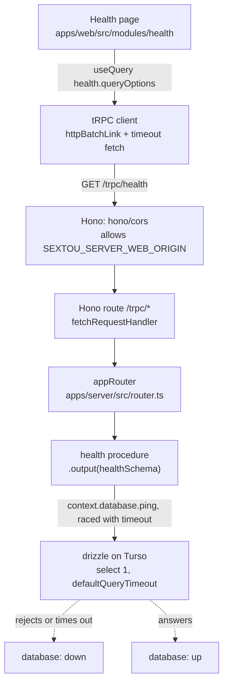

# Composable Framework - Plan

## Goal Capsule

- **Objective:** sextou has a web app and a remote server built on the stack it chose, proven by a health check that crosses every layer of that stack on its read path, so the first real feature builds on a working stack and adds only what reading doesn't need: migrations with its first table, and writes.
- **Means:** Rewrite `apps/web` and `apps/server` from scratch on Vite, TanStack Router, TanStack Query, Hono, tRPC, zod and drizzle on Turso, with health as their only feature, record their folder structure and the way a feature is built in AGENTS.md, and move `packages/tasks`' input checks to zod (KTD1–KTD11).
- **Product authority:** This brainstorm's dialogue of 2026-10-21 and the planning dialogue that followed, in draft PR #56, stacked on #55. The move to drizzle-orm 1.0.0-rc.5 and Vite 8.3.5 is issue #59, not this plan.
- **Execution profile:** U1 can go first and alone. U2 to U7 follow their dependencies; U3 only after U2 stops importing the removed packages.
- **Stop conditions:** Stop and report if the web app's typecheck cannot follow the router's type without Node's types (KTD2), if Turso's query timeout does not interrupt a statement through drizzle (KTD6), or if the router plugin cannot run inside Vitest 5 under the web's Vite config (KTD3).
- **Ships as:** commits on `plan/composable-framework`, PR #56, which `ce-work` finishes and pushes with `gh stack`.
- **Open blockers:** None.

---

## Product Contract

### Summary

The web app and the server are rebuilt from nothing on the chosen stack, and the only thing they do is health. A page of the web app, routed by TanStack Router, fetches the server's health through TanStack Query and the tRPC client. The server answers from a tRPC procedure whose output a zod schema validates, after asking its database, a SQLite file opened through Turso and queried through drizzle, whether it answers. AGENTS.md records the folder structure and the pattern for building, testing and importing, so the next feature follows it. Separately, `packages/tasks` validates its operations' inputs with zod instead of its hand-written checks.

**Product Contract preservation:** changed: R2 (Vite 8.3.4 until #59), R17 and R21 (a default in code is allowed when an environment variable can change it, per the user's clarification), Scope Boundaries (the desktop's development URL); the Outstanding Questions were answered by KTD1, KTD3 and KTD5.

### Problem Frame

The current `apps/web` and `apps/server` were built for a server that runs on the user's machine, and neither does real work: the web app shows a counter stand-in, and the server answers one health route. That direction is dropped. The server runs remotely, and the web app talks to the one server whose URL it was built with. Using a server started locally means running or building the web app with that server's URL.

No library for routing, data fetching or a typed client is installed, and the web app has no way to find a server: it has no server URL setting, and its Content Security Policy allows connections only to its own origin. Building the first feature on this base would mean choosing and wiring the stack inside that feature.

A study in an earlier session chose the libraries for each layer. This work assembles them and proves they hold together before any feature depends on them.

### Key Decisions

- **Web and server are rewritten from scratch, with health as their only feature.** (session-settled: user-directed — chosen over a first real feature end to end, a skeleton over the current code and a decisions-only document: the current code is not a reference.) Governs R1, R4.
- **Health crosses every layer, the database included.** (session-settled: user-approved — chosen over leaving the database out and over a server-only check, so each library of the stack is used at least once.) Governs R4, R5, R6.
- **The typed client is tRPC.** (session-settled: user-directed — chosen over oRPC contract-first and over fetch functions validated with zod: in a monorepo the web importing the server router's type is tRPC's standard shape, and tRPC is the most mature of the three.) Governs R3, R7.
- **Validation is zod.** (session-settled: user-directed — chosen over valibot; tRPC reads either through Standard Schema.) Governs R5, R13.
- **The database is SQLite through Turso, for now.** (session-settled: user-directed — chosen over Postgres and over another SQLite driver; sextou will support more than one database engine later.) Governs R2, R6.
- **drizzle is the 1.0 release candidate, not 0.45.4.** Turso's drizzle driver exists only in the 1.0 pre-releases. Governs R2.
- **The server is remote; a local server is one the user starts.** (session-settled: user-directed — replaces the earlier decision that the server runs on the user's machine.) Governs R10, R12.
- **The tRPC router lives in the server, and `packages/contract`, `packages/core` and `packages/data` go away.** (session-settled: user-approved — proposed in the scoping synthesis and accepted.) Governs R7, R8.
- **The web app keeps Lingui, Tailwind and `@sextou/ui`.** (session-settled: user-approved — proposed in the scoping synthesis and accepted; they sit outside the study's table and already serve the web app.) Governs R1.
- **`packages/tasks` takes zod and nothing else from the stack.** (session-settled: user-directed — zod replaces its hand-written checks; drizzle stays out because rc.4's Turso driver runs transactions that don't hold the connection, which would let two of the task graph's writes interleave. #59 reopens this with rc.5.) Governs R13, R14, R15.
- **This work sets the pattern for building on the stack; #55 set only the pattern for tests.** (session-settled: user-directed — the structure and the way a feature is built are recorded in AGENTS.md as this work's output, not left to be read from the health code.) Governs R18, R19, R20.
- **Every setting can be changed through an environment variable.** (session-settled: user-directed — "Tudo é env var… Não pode é ter default que eu precise mudar o código pra trocar": chosen over values only a code change can alter; a default in code is fine.) Governs R10, R17, R21.
- **The import rules stay strict.** (session-settled: user-directed — "Vamos manter rígido": the entry-point rule #55 tightened is kept as it is and applies to the web app too.) Governs R20.

### Requirements

**Stack**

- R1. `apps/web` and `apps/server` are rebuilt on Vite, TanStack Router, TanStack Query, Hono, tRPC, zod and drizzle, with no code carried over from their current versions except the web app's Lingui and Tailwind setup and its use of `@sextou/ui`.
- R2. The versions are those of the earlier study, except Vite and drizzle-orm stay on what installs today until #59: Vite 8.3.4, TanStack Router 1.170.45, TanStack Query 5.104.5, Hono 4.13.13, tRPC 11.19, zod 4.6.7, drizzle-orm 1.0.0-rc.4. drizzle-kit, on the same release candidate, arrives with the first table.
- R3. The server serves its tRPC router through Hono.

**Health, end to end**

- R4. Health is the only procedure the server offers and the only page the web app has.
- R5. The health procedure's output is validated by a zod schema before the server sends it.
- R6. Health reports the server's version and whether its database answers a query made through drizzle on Turso. The server starts and serves health even when its database can't be opened, and health then reports the database as down.
- R7. The web app gets the server's types only by importing the type of the server's router, and no server code reaches the web app's bundle.
- R8. The server holds its router and its database access itself, with no separate contract, domain or data package.
- R9. The health page shows the server's version and its database state, and says so plainly when the server can't be reached or answers with an error.

**Reaching the server**

- R10. The web app reads the server's URL from an environment variable at build time, which in development points at a server running locally.
- R11. The server accepts requests from the web app's origin, and the web app's Content Security Policy allows connections to the server's URL.
- R12. Neither the web app nor the desktop app starts a server.

**Task graph**

- R13. `packages/tasks` validates its operations' inputs with zod schemas, which it exports.
- R14. An input `packages/tasks` rejects is still a refusal with the reason `invalid`, and every other behavior of the task graph is unchanged.
- R15. `packages/tasks` keeps Turso with raw SQL and its own migrations in `PRAGMA user_version`, with no drizzle.

**Project rules**

- R16. AGENTS.md and CONCEPTS.md describe the new web app and server, and drop what they say about the removed packages and the server running on the user's machine.
- R17. Every call that waits on the network or on another process has a timeout, including the web app's requests to the server and the server's database queries. Each timeout is a setting (per R21), 30 seconds by default for the web app's request, and the server's database timeout stays below the web app's request timeout, so a database that hangs shows as down rather than unreachable.
- R18. AGENTS.md draws the folder structure of `apps/web` and `apps/server` as a tree and says what each folder holds.
- R19. AGENTS.md states the pattern for building a feature on this stack, across the server and the web app, including how each part is tested and which imports are allowed, so the next feature follows it without reading the health code first.
- R20. Lint enforces the import rules: a module reaches another module only through its entry point, in `apps/web` as in `apps/server`, with no exception, and the web app imports from the server only types.
- R21. Every setting of the web app, the server and the desktop's development URL can be changed through an environment variable, with no value that only a code change can alter: URLs, origins, hosts, ports, paths and timeouts. A default in code is allowed, and a committed `.env.example` beside each app lists its variables with their defaults.

### Acceptance Examples

- AE1. **Covers R6, R9.** Given the server is up and its database answers, when the health page loads, it shows the server's version and that the database is up.
- AE2. **Covers R6, R9.** Given the server is up but its database doesn't answer, when the health page loads, it shows the server's version and that the database is down.
- AE3. **Covers R9, R17.** Given no server answers at the URL the web app was built with, whether the connection is refused or never answered, when the health page loads, it says the server can't be reached as soon as the connection fails or the request's timeout expires, instead of staying blank or loading.
- AE4. **Covers R5.** Given the health procedure returns a value its output schema rejects, the server answers with an error instead of the value.
- AE5. **Covers R13, R14.** Given a task created with priority 7, `packages/tasks` refuses it with the reason `invalid` and writes nothing, as it does today.
- AE6. **Covers R9.** Given the server answers the health request with an error, when the health page loads, it says the server answered with an error and couldn't report its health, distinct from the unreachable message, and shows no version or database state.

### Success Criteria

- Someone who has read only AGENTS.md can say where a new feature's server and web code go and which steps build it.
- `pnpm lint`, `pnpm typecheck`, `pnpm test` and `pnpm build` pass, with every source file of the rewritten packages at the 90% coverage AGENTS.md requires in each suite, and each package at the 80% mutation score.
- A web app built against a locally started server shows AE1, and shows AE2 when that server is started with a database path it can't open.

### Scope Boundaries

- Authentication and any notion of who is calling the server.
- Deploying the remote server, and its hosting, domain and production URL.
- How a remote server keeps user data private from its operator.
- Every feature beyond health, including any route that reaches the task graph; the server doesn't open the task graph.
- Database engines other than Turso, and any layer for swapping engines.
- drizzle in `packages/tasks` (#59 reopens it).
- Choosing the server from inside an already-built web app.
- Serving the API as plain REST or OpenAPI for agents and scripts.
- Changes to `apps/desktop` beyond reading its development URL from `SEXTOU_WEB_URL`, and to `packages/ui`.

**Considered and not built:**

- Owner-only modes on the server's database file, and a loopback-only listen address: sextou runs only on the development machine for now, and the user skipped both in review. A first deploy or a shared machine changes that call.
- An error formatter that masks tRPC error messages: health catches its database errors and throws nothing of its own, so no message reaches the client. The first procedure that can throw an unexpected error brings one.

<!-- ce-section: work-relationships -->

### How This Work Fits Together

This plan covers the rewrite of the web app and the server and the move of `packages/tasks` to zod. This breakdown is the current understanding, not a committed roadmap.

- The move of `packages/tasks` to zod (R13–R15) can proceed independently of the rewrite (R1–R12): the server doesn't open the task graph, and no procedure uses its schemas yet.
- PR #55, beneath this one in the stack, set the pattern for tests: it implements test levels, per-file coverage and StrykerJS mutation checks in every current package. This work sets the pattern for building on the stack (R18, R19). This work deletes `packages/contract`, `packages/core` and `packages/data` with their suites and checks, and the rewritten `apps/web` and `apps/server` meet #55's test levels and checks.
- Issue #59 moves drizzle-orm to 1.0.0-rc.5 and Vite to 8.3.5 once they install, and with rc.5 reopens drizzle for the task graph and the handling of writes.
- The first feature that adds a table to the server's database brings migrations: its schema for drizzle-kit and applying the generated migrations on start.
- The first feature that writes to the server's database depends on handling drizzle's Turso transactions, which don't hold the connection on rc.4 (see Dependencies / Assumptions).

### Dependencies / Assumptions

- drizzle 1.0.0-rc.4's Turso driver runs a transaction through Turso's older `transaction()` and ignores the configuration that would make it immediate (`node_modules/drizzle-orm/tursodatabase/session.js:64`), so concurrent statements can interleave into it. Health only reads, so this work isn't affected. rc.5 fixes it (#59).
- "More than one database" is read as other database engines later, not more database files now. If it means something else, the Turso decision may need revisiting.
- Turso refuses a second process on the same file, so the remote server runs as one instance on one machine.
- The web app trusts the router's types and doesn't validate responses at runtime, since R7 and R8 keep the schemas in the server. A web build can call a server of another version, so a procedure's input and output stay backward compatible once released.
- CI's pnpm policy refuses versions under a day old even from a frozen lockfile. Every new dependency this plan adds was published before 2026-10-20.

### Sources / Research

- tRPC validators, Standard Schema and output validation: https://trpc.io/docs/server/validators
- drizzle with Turso, available only in the 1.0 pre-releases: https://orm.drizzle.team/docs/connect-turso-database
- Version skew is the same for any separately deployed client, and the shared fix is keeping endpoints backward compatible: https://dev.to/hirodeath/sharing-trpc-v11-types-between-nextjs-and-expo-a-real-world-indie-web-ios-setup-3067
- Why `packages/tasks` has no drizzle: `.compound-engineering/artifacts/plans/2026-10-20-1830-feat-sqlite-task-graph-plan.md` (KTD3) and `.compound-engineering/artifacts/plans/2026-10-21-0140-refactor-turso-database-plan.md` (drizzle's Turso transactions).
- Turso's differences from SQLite: `.compound-engineering/artifacts/solutions/best-practices/turso-behaves-differently-from-sqlite.md`
- The web app's current Content Security Policy: `apps/web/content-security-policy.ts`

---

## Planning Contract

### Key Technical Decisions

- KTD1. **The server is a Hono app that mounts tRPC's fetch handler at `/trpc`, with no adapter package.** `fetchRequestHandler` from `@trpc/server/adapters/fetch` is what `@hono/trpc-server` wraps in about 30 lines; calling it from a Hono route saves a dependency, and no middleware reads the body first. `hono/cors` sits before it on the same path. `trpc.ts` creates the tRPC instance once, at module level, with `isDev: false`, because the default reads `NODE_ENV`, which the bundle doesn't set, and because KTD2 keeps configuration out of that file. An `errorFormatter` adds the stack to an error's shape only when the context's `isDev` is true; `main.ts` sets it from `SEXTOU_SERVER_DEV`, `false` by default, so feature routers stay module-level (KTD9). Governs R3, R11.
- KTD2. **The router's import graph holds no Node code; the version, the clock and the database reach procedures through the tRPC context.** The web app's typecheck follows `type AppRouter` into the server's sources under the web's compiler options, and TypeScript 7 loads no `@types/node` there (probed), so a `process` or `node:fs` anywhere in that graph fails `pnpm typecheck` in `apps/web`. `main.ts` and `config.ts` hold the Node code and build the context. Governs R7, R8.
- KTD3. **TanStack Router uses file-based routing through `@tanstack/router-plugin`, with `routeTree.gen.ts` committed.** (session-settled: user-directed — chosen over code-based routing after seeing that TanStack's own site and large apps such as shadcn-admin use the plugin, that it ships nothing to production and that every package it brings is permissively licensed.) The plugin comes before `react()` in the Vite config, with `autoCodeSplitting` on. The generated file is excluded from oxfmt, oxlint, coverage and Stryker's `mutate`, and the web's Vitest configs merge the Vite config so the plugin runs in tests. Governs R1, R4.
- KTD4. **The web app's client is `createTRPCClient` with `httpBatchLink` and a `fetch` that adds the request timeout, consumed through `@trpc/tanstack-react-query`'s `createTRPCOptionsProxy`.** The proxy needs no provider, which suits a single-page app with no server rendering. The link's `fetch` combines its own signal with `AbortSignal.timeout(requestTimeout)`, since `httpBatchLink` has no timeout option. The QueryClient sets `retry: false` and `networkMode: 'always'`, so an unreachable server or an offline browser reaches the error state when the connection fails or the timeout expires (AE3) instead of retrying or pausing. Governs R9, R17.
- KTD5. **Every setting is read from an environment variable with a default in one module per app, and each app has a committed `.env.example`.** The server reads `process.env` only in `config.ts`, with the existing pattern of a parse per value that names the variable when the value is invalid; the CLI flags go. The web reads its variables in `vite.config.ts` with `loadEnv` and injects them with `define`, as `apps/desktop/vite.main.config.mts` does for `SEXTOU_WEB_URL`, so the client URL and the CSP's `connect-src` come from the same value; a `VITE_` prefix is not used, because it would expose every such variable to the bundle. Development loads `.env` files: Vite on its own, the server through Node's `--env-file-if-exists` in its `dev` and `start` scripts. The variables:

  | App     | Variable                            | Default                                | Meaning                                      |
  | ------- | ----------------------------------- | -------------------------------------- | -------------------------------------------- |
  | server  | `SEXTOU_SERVER_HOST`                | `127.0.0.1`                            | Address it listens on                        |
  | server  | `SEXTOU_SERVER_PORT`                | `4310`                                 | Port it listens on                           |
  | server  | `SEXTOU_SERVER_DATA_DIR`            | `sextou` in the user's data directory  | The data directory                           |
  | server  | `SEXTOU_SERVER_DATABASE`            | `sextou.db` in the data directory      | Database file, or `:memory:`                 |
  | server  | `SEXTOU_SERVER_WEB_ORIGIN`          | `http://localhost:5173`                | The web app's origin, for CORS               |
  | server  | `SEXTOU_SERVER_DATABASE_TIMEOUT_MS` | `20000`                                | Database query timeout                       |
  | server  | `SEXTOU_SERVER_DEV`                 | `false`                                | Whether error responses carry the stack      |
  | web     | `SEXTOU_WEB_SERVER_URL`             | `http://127.0.0.1:4310`                | The server's URL, for the client and the CSP |
  | web     | `SEXTOU_WEB_REQUEST_TIMEOUT_MS`     | `30000`                                | Request timeout to the server                |
  | web     | `SEXTOU_WEB_PORT`                   | `5173`                                 | The dev server's port                        |
  | desktop | `SEXTOU_WEB_URL`                    | `http://localhost:5173` in development | The web app the window loads                 |

  Each `.env.example` also names the settings that must move together across apps, with a comment beside them: the server's database timeout stays below the web's request timeout; `SEXTOU_WEB_PORT`, `SEXTOU_SERVER_WEB_ORIGIN` and the desktop's `SEXTOU_WEB_URL` name the same origin; `SEXTOU_SERVER_HOST` and `SEXTOU_SERVER_PORT` match `SEXTOU_WEB_SERVER_URL`. A mismatched origin shows on the page as "the server can't be reached", and the comment says so. (session-settled: user-approved — proposed in review because no app can check another app's values, and accepted.) Governs R10, R11, R17, R21.

- KTD6. **The database is drizzle on Turso, opened lazily with Turso's `defaultQueryTimeout`, and health races its query against the same timeout.** `drizzle({ connection: { path, defaultQueryTimeout } })` never throws when constructed: a path it can't open fails each query (probed), so the server starts and listens whatever the file's state (R6). `defaultQueryTimeout` interrupts a running statement (probed at about 100 ms), but not a wait on Turso's lock or on the lazy connect, so the health check also races a timer that clears itself. Any rejection or timeout reports the database as down. `main.ts` closes the client on SIGINT and SIGTERM. Foreign keys aren't turned on: there are no tables yet. Governs R6, R17.
- KTD7. **The server exposes its router type through an `exports` entry, and the web declares the server as a dev dependency.** `apps/server/package.json` gains `exports` with `"./router"` pointing at the router module; `apps/web/package.json` gains `"@sextou/server": "workspace:*"` in `devDependencies`, which knip needs for the type import. The web writes the whole statement as `import type`, never `import { type … }`, which keeps a side-effect import under `verbatimModuleSyntax`. Governs R7.
- KTD8. **The lint rules for imports become one complete override per file scope, so no rule's options replace another's.** In oxlint, two overrides that set `no-restricted-imports` for the same file replace each other's options, and the module patterns are relative to a file's depth (`../*/**` is right only directly under `src/modules/<m>/`). So the web gets three overrides, placed after the generic module overrides: `apps/web/**` with the `electron` ban and the server allowed only as types, with no module patterns; then `apps/web/src/modules/*/*.{ts,tsx}` and `apps/web/src/modules/*/*/*.{ts,tsx}`, each with the `electron` ban, the server allowed only as types and that depth's module patterns. "The server allowed only as types" is a `paths` entry `@sextou/server` and a `patterns` group `@sextou/server/*`, both with `allowTypeImports`, because the web imports `@sextou/server/router`. The generic module overrides' globs extend to `.tsx`, and their patterns stay as #55 set them. The `electron` ban's message no longer names `platform.ts`. Governs R7, R20.
- KTD9. **A procedure lives in its feature module as a router plus its schemas, and `router.ts` merges the modules' routers.** `src/modules/health/` holds `health.router.ts` (the procedure, its `.output()` schema and the logic that turns the context into the answer), `health.schema.ts` (the zod schema) and `index.ts` (the entry point the lint rule requires). `src/router.ts` imports each module's router through its `index.ts`. The web mirrors this: a feature's UI sits in `src/modules/<feature>/`, and a route file in `src/routes/` only wires the route to the module. Governs R8, R18, R19.
- KTD10. **Test levels follow #55's criteria with the code now inside the server.** A procedure run through `createCaller` and the Hono app run through `app.request`, both in one process with an in-memory database or a context stub, are unit tests. The database module's cases on a file, `server.ts` (a listening port) and `main.ts` are integration, listed in `integrationOnly` with the comment #55's pattern asks for. The web's unit tests render routes in jsdom with a memory history, a fresh QueryClient and a stubbed `fetch` for each response the page handles. The web's integration test starts the server as a child process with an in-memory database on a free port, then renders the health page with its client pointed at that server's URL: a server listening on localhost, with no import from the server, so R20 holds with no exception. (session-settled: user-directed — chosen over a value import of the server's app allowed only in the web's integration tests, and over a web with no integration suite.) Each package's mutation score stays at 80% (`thresholds.break`). Governs R4–R9.
- KTD11. **`packages/tasks` validates each operation's input with one zod object schema and `safeParse`, keeping today's results.** Integer checks use `refine(Number.isInteger)`, not `.int()`, which accepts only safe integers and would refuse `limit: 1e20`; ids stay plain `z.string()`; a blank optional text becomes `null` as today. A `null` or non-object input becomes a refusal with `invalid` instead of a thrown `TypeError` (user-approved in the scoping synthesis). The schemas are exported from `src/index.ts`. Governs R13, R14.

### High-Level Technical Design

One health request, from the page to the database and back:



What the page shows, by how the request ends (KTD4):

| The request ends with                                                                    | Page state                          | Acceptance example |
| ---------------------------------------------------------------------------------------- | ----------------------------------- | ------------------ |
| Data with `database: 'up'`                                                               | Version and "database up"           | AE1                |
| Data with `database: 'down'`                                                             | Version and "database down"         | AE2                |
| A tRPC error with `data` (the server answered with an error, output validation included) | "The server answered with an error" | AE4, AE6           |
| A tRPC error without `data` (refused, timeout, or a response that isn't tRPC's)          | "The server can't be reached"       | AE3                |
| Still pending                                                                            | A loading state                     | —                  |

### Output Structure

The layout this work leaves, which AGENTS.md draws and explains (R18):

```text
apps/server/
  .env.example                 every variable, with its default
  src/
    main.ts                    reads config, opens the database, listens, shuts down
    config.ts                  the one place that reads process.env
    data-directory.ts          the data directory's default per platform
    server.ts                  starts @hono/node-server and resolves once listening
    app.ts                     the Hono app: CORS, then tRPC at /trpc
    trpc.ts                    initTRPC with the context type
    router.ts                  merges each module's router; exports type AppRouter
    database.ts                drizzle on Turso, the ping with its timeout
    modules/
      health/
        index.ts               the module's entry point
        health.router.ts       the procedure
        health.schema.ts       its zod output schema
apps/web/
  .env.example
  vite.config.ts               reads the variables, router plugin, CSP
  content-security-policy.ts   the CSP plugin, given the server's origin
  src/
    main.tsx                   mounts the router inside the providers
    trpc.ts                    the client, the timeout fetch, the QueryClient
    routeTree.gen.ts           generated by the router plugin, committed
    routes/
      __root.tsx               the layout every page shares
      index.tsx                wires / to the health module
    modules/
      health/
        index.ts
        health-page.tsx        the states in the table above
```

### Assumptions

- TanStack Router's plugin, 1.168.47, runs under Vite 8.3.4 and inside Vitest 5 through the merged Vite config.
- `tsx watch` passes `--env-file-if-exists` to Node, as Node 24's flag.
- An integration suite whose `integrationOnly` list is empty still runs, judging coverage on no file. If Vitest's per-file thresholds fail on an empty include, the web's client module moves to `integrationOnly` instead.

### Deferred to Implementation

- The exact wording of each page state, through Lingui.
- Whether the oxfmt and oxlint exclusions for `routeTree.gen.ts` go in their config files or in an ignore file each reads.

---

## Implementation Units

### U1. Validate the task graph's inputs with zod

- **Goal:** Replace the hand-written input checks in `packages/tasks` with exported zod schemas, with every result unchanged except `null` input.
- **Requirements:** R13, R14, R15; AE5; KTD11.
- **Dependencies:** none.
- **Files:**
  - `packages/tasks/package.json` (add `zod` 4.6.7)
  - `packages/tasks/src/schemas.ts` (new)
  - `packages/tasks/src/schemas.test.ts` (new)
  - `packages/tasks/src/graph.ts`
  - `packages/tasks/src/graph.test.ts`
  - `packages/tasks/src/index.ts`
- **Approach:**
  1. One object schema per operation (`createTask`, `link`, `unlink`, `startTask`, `finishTask`, `listReady`) in `schemas.ts`, mirroring the helpers in `graph.ts` (`isId`, `trimmed`, `optional`, the priority and limit checks); `finishTask`'s status is built from `finalStatuses` in `status.ts`.
  2. Each operation in `graph.ts` runs `safeParse` first and refuses with `Reason.invalid` on failure, then uses the parsed, trimmed values; the helpers go.
  3. `index.ts` exports the schemas beside the existing types.
- **Patterns to follow:** the existing refusal path and its tests in `packages/tasks/src/graph.test.ts`; top-level `test`/`test.each`, no `describe`.
- **Test scenarios:**
  - Every existing invalid-input case in `graph.test.ts` (blank and whitespace titles, `priority` 5, -1 and 1.5, `parentId: 7`, non-final statuses, empty or non-string assignees, `limit` 0, -1, 1.5 and NaN) still returns `{ ok: false, reason: invalid }` and writes nothing. Covers AE5.
  - `listReady` with `limit: 1e20` still succeeds.
  - `createTask` with `parentId: null` and with `description: null` is refused with `invalid`, as today.
  - `createTask` with `description: ''` stores the description as `null`, as today.
  - `link` with an id of `''` still answers `not_found`, not `invalid`.
  - Each operation called with `null` returns a refusal with `invalid` instead of rejecting.
  - Titles, kinds and assignees are stored trimmed.
  - Each exported schema accepts a valid input and outputs the trimmed values.
- **Verification:** `packages/tasks`' unit and integration suites pass with 90% per file, and its mutation score stays at or above 80%.

### U2. Rebuild the server on Hono, tRPC and drizzle

- **Goal:** Replace `apps/server` with the Hono app that serves the health procedure through tRPC, reads every setting from the environment, and starts whatever the database's state.
- **Requirements:** R1–R8, R11, R12, R17, R21; AE2, AE4; KTD1, KTD2, KTD5, KTD6, KTD7, KTD9, KTD10.
- **Dependencies:** none.
- **Files:**
  - `apps/server/package.json` (add `@trpc/server` 11.19.0, `drizzle-orm` 1.0.0-rc.4, `@tursodatabase/database` 0.8.3, `zod` 4.6.7; drop the four `@sextou/*` dependencies; add `exports`; scripts load `.env`)
  - `apps/server/.env.example` (new)
  - `apps/server/src/config.ts`, `config.test.ts`
  - `apps/server/src/data-directory.ts`, `data-directory.test.ts`
  - `apps/server/src/database.ts`, `database.test.ts`, `database.integration.test.ts` (new)
  - `apps/server/src/trpc.ts`, `router.ts`, `router.test.ts` (new)
  - `apps/server/src/modules/health/index.ts`, `health.router.ts`, `health.schema.ts`, `health.router.test.ts` (new)
  - `apps/server/src/app.ts`, `app.test.ts`
  - `apps/server/src/server.ts`, `server.integration.test.ts`
  - `apps/server/src/main.ts`, `main.integration.test.ts`
  - Removed: `apps/server/src/modules/health/health.routes.ts`, `health.routes.integration.test.ts`, `app.integration.test.ts`
  - `apps/server/vitest.config.mts` (the `integrationOnly` list and its comment)
  - `apps/server/vite.config.mts` (keep Turso external; drizzle is inlined)
- **Approach:**
  1. `config.ts` reads the six server variables of KTD5 from `process.env`, each with its default and a parse that names the variable on an invalid value; the CLI flags and `tasks` go.
  2. `database.ts` builds the drizzle client per KTD6 and exposes `ping()` (never rejects; `false` on error or timeout) and `close()`.
  3. `trpc.ts` creates the tRPC instance with the context type (`version`, `database.ping`); `health.router.ts` defines `health` with `.output(healthSchema)`; `router.ts` merges it and exports `type AppRouter`.
  4. `app.ts` builds the Hono app from injected dependencies: `cors` for `SEXTOU_SERVER_WEB_ORIGIN`, then `/trpc/*` to `fetchRequestHandler` with a context from those dependencies.
  5. `main.ts` loads the config, creates the database file's parent directory (recursively, skipped for `:memory:`), creates the database client without awaiting an open, starts the server, prints the URL, and on SIGINT or SIGTERM stops listening and closes the client. A failed directory creation is logged and the server still starts, reporting the database down (R6). An invalid variable exits with 1 before listening.
- **Patterns to follow:** every file here is written new (R1); the behaviors to rebuild are a parse per value whose error names the variable, `startServer` resolving once listening and rejecting when the port is taken, shutdown that stops listening before closing the database, the version read from `../package.json`, and the data directory's per-platform default. Tests mock `homedir` from `node:os`, never `HOME` (AGENTS.md, Mutation).
- **Test scenarios:**
  - `config` uses each default when its variable is unset, takes each variable when set, and throws naming the variable for an invalid port, an empty host and a non-numeric timeout.
  - `health` through `createCaller` with a ping that resolves `true` returns the version and `database: 'up'`. Covers AE1.
  - `health` with a ping that resolves `false` returns `database: 'down'`. Covers AE2.
  - `health` with a context whose version breaks the output schema fails with `INTERNAL_SERVER_ERROR`. Covers AE4.
  - `database.ping` on `':memory:'` resolves `true`.
  - `database.ping` on a path inside a missing directory resolves `false` without throwing (integration).
  - `database.ping` resolves `false` when the query outlasts the timeout, with a timeout of a few milliseconds and a slow query (integration).
  - The app answers `GET /trpc/health` with tRPC's response shape through `app.request`.
  - A preflight from `SEXTOU_SERVER_WEB_ORIGIN` gets that origin in `access-control-allow-origin`; a request from another origin gets no such header.
  - `startServer` resolves with the address it listens on and rejects when the port is taken (integration).
  - `main` with a mocked `homedir` and no data directory yet creates it and reports the database up (integration). Covers AE1.
  - `main` listens and serves health with a database path that stays unopenable after the directory step, such as one whose parent is a regular file, reporting it down (integration). Covers AE2.
  - An error response carries the stack only when `SEXTOU_SERVER_DEV` is `true`.
  - `main` exits with 1 and names the variable when one is invalid (integration).
  - `main` closes the listener and the client on SIGTERM (integration).
- **Verification:** the server's unit and integration suites pass at 90% per file, its mutation score is at least 80%, `pnpm --filter @sextou/server build` produces `dist/server.mjs`, and `node dist/server.mjs` answers `/trpc/health`.

### U3. Remove the contract, core and data packages

- **Goal:** Delete the three packages the new server no longer uses, with everything that names them.
- **Requirements:** R8.
- **Dependencies:** U2.
- **Files:**
  - Removed: `packages/contract/`, `packages/core/`, `packages/data/`
  - `vitest.config.ts` (root projects list)
  - `.github/workflows/tests.yml` (the level rows for contract, core and data, and their mutation rows)
  - `pnpm-lock.yaml` (regenerated)
- **Approach:** delete the folders, drop their four entries from the root projects list and their rows from `tests.yml`, and run `pnpm install` so the lockfile drops their importers.
- **Patterns to follow:** the row shapes in `tests.yml`.
- **Test expectation:** none -- removal only; the remaining suites and `pnpm build` passing is the check.
- **Verification:** `git grep` finds no `@sextou/contract`, `@sextou/core` or `@sextou/data` outside `.compound-engineering/`, and `pnpm typecheck`, `pnpm test:unit` and `pnpm build` pass.

### U4. Rebuild the web app on TanStack Router, TanStack Query and the tRPC client

- **Goal:** Replace `apps/web` with the health page, routed by file, fetching through the tRPC client, with every setting from the environment.
- **Requirements:** R1, R4, R7, R9, R10, R11, R17, R21; AE1, AE2, AE3, AE6; KTD3, KTD4, KTD5, KTD7, KTD9, KTD10.
- **Dependencies:** U2.
- **Files:**
  - `apps/web/package.json` (add `@tanstack/react-router` 1.170.45, `@tanstack/react-query` 5.104.5, `@trpc/client` and `@trpc/tanstack-react-query` 11.19.0; dev: `@tanstack/router-plugin` 1.168.47, `@trpc/server` 11.19.0 if the client's types need it, `@sextou/server` `workspace:*`)
  - `apps/web/.env.example` (new)
  - `apps/web/vite.config.ts`
  - `apps/web/content-security-policy.ts` (written new, per R1; takes the server's origin)
  - `apps/web/src/main.tsx`, `src/trpc.ts`, `src/trpc.test.ts`
  - `apps/web/src/routes/__root.tsx`, `src/routes/index.tsx`, `src/routeTree.gen.ts`
  - `apps/web/src/modules/health/index.ts`, `health-page.tsx`, `health-page.test.tsx`, `health-page.integration.test.tsx`
  - `apps/web/src/env.d.ts` (declares the injected constants)
  - Removed: `apps/web/src/App.tsx`, `App.test.tsx`, `platform.ts`, `platform.test.ts`
  - `apps/web/vitest.config.ts`, `vitest.integration.config.ts` (new), `vitest.mutation.config.ts` (new), `stryker.config.mjs`
  - `vitest.config.ts` (root: add the web's integration config)
  - `.github/workflows/tests.yml` (add the web's integration row)
  - `.oxfmtrc.json` and `.oxlintrc.json` (exclude `routeTree.gen.ts`)
- **Approach:**
  1. `vite.config.ts` reads the web variables of KTD5 with `loadEnv`, validates the server URL, injects the URL and the timeout with `define`, passes the server's origin to `contentSecurityPolicy`, sets the dev port from `SEXTOU_WEB_PORT`, and puts `tanstackRouter` before `react()`.
  2. `trpc.ts` builds the client and the options proxy per KTD4, from the injected constants, with a factory the tests call with their own `fetch` and timeout.
  3. `health-page.tsx` reads `health.queryOptions()` and renders the states in the table of the High-Level Technical Design, with every text through Lingui. `routes/index.tsx` wires `/` to it.
  4. `main.tsx` mounts `RouterProvider` inside `QueryClientProvider` and the existing `I18nProvider`.
- **Patterns to follow:** `apps/desktop/vite.main.config.mts` (`define` from an environment variable); `apps/web/vitest.config.ts` (`mergeConfig` with the Vite config, jsdom, the setup file); the levels' configs in `apps/server`; `@sextou/ui` components take data as props (pack: sextou, sextou-ui-components-never-touch-electron.md), shown text goes through Lingui (pack: sextou, sextou-ui-text-goes-through-lingui.md), colors and fonts come from `theme.css` tokens (pack: sextou, sextou-ui-colors-and-fonts-come-from-theme-css.md).
- **Execution note:** Prove first that the router plugin runs inside the web's Vitest config, that the web's typecheck passes with `import type { AppRouter }` (stop conditions in the Goal Capsule), and that the timeout `fetch`'s combined signal works in jsdom against a real server.
- **Test scenarios:**
  - The page shows the version and "database up" for a stubbed response with `database: 'up'`. Covers AE1.
  - The page shows the version and "database down" for `database: 'down'`. Covers AE2.
  - The page shows "the server can't be reached" when `fetch` rejects with a `TypeError`, and when it rejects with a `TimeoutError`. Covers AE3.
  - The page shows "the server can't be reached" for a non-tRPC response (an HTML 404).
  - The page shows "the server answered with an error", with no version, for a tRPC error with `INTERNAL_SERVER_ERROR`. Covers AE6.
  - The page shows a loading state while the response is pending.
  - The timeout `fetch` aborts a request that outlasts a short injected timeout, with real timers (fake timers don't fire `AbortSignal.timeout`).
  - The timeout `fetch` keeps the caller's abort signal.
  - The page against a server started as a child process, with `SEXTOU_SERVER_DATABASE=:memory:` and a free port, shows the version and "database up" (integration). Covers AE1.
  - The page against a child-process server started with an unopenable database path shows "database down" (integration). Covers AE2.
  - The CSP plugin writes the server's origin, without a path, into `connect-src`.
- **Verification:** the web's unit and integration suites pass at 90% per file, its mutation score is at least 80%, `pnpm --filter @sextou/web build` succeeds with no `.env`, and no source map of the build lists a file under `apps/server/`.

### U5. Enforce the import rules in lint

- **Goal:** Make lint fail on any import that crosses a module boundary except through its entry point, in the web as in the server, and on any value import from the server in the web.
- **Requirements:** R7, R20; KTD8.
- **Dependencies:** U4.
- **Files:** `.oxlintrc.json`
- **Approach:** extend the generic module overrides' globs to `.tsx`; split the `apps/web/**` override into the three overrides of KTD8, after the generic ones; keep `packages/ui/**` on the `electron` ban alone; reword the `electron` message so it names no file.
- **Patterns to follow:** the module override #55 set, its patterns and its message.
- **Test scenarios:**
  - A value import from `@sextou/server/router` in `apps/web` fails lint; `import type { AppRouter } from '@sextou/server/router'` passes.
  - `src/routes/index.tsx` importing `../modules/health/index` passes.
  - A `.tsx` file in `apps/web/src/modules/a/` importing `../b/file` fails; importing `../b/index` passes.
  - A file in `apps/server/src/modules/a/` importing `../../modules/b/file` still fails.
  - An `electron` import in a web module file still fails.
- **Verification:** `pnpm lint` passes on the tree, and each scenario above, tried on a scratch file and reverted, gives the expected result.

### U6. Read the desktop's development URL from the environment

- **Goal:** Let `SEXTOU_WEB_URL` change the URL the desktop window loads in development, which today is fixed in code.
- **Requirements:** R21; KTD5.
- **Dependencies:** none.
- **Files:** `apps/desktop/vite.main.config.mts`, `apps/desktop/.env.example` (new)
- **Approach:** read `SEXTOU_WEB_URL` through Vite's `loadEnv` for the desktop's folder over `process.env`, as the web's `vite.config.ts` does, because Vite and Forge's plugin load no `.env` into `process.env` for a config file; in development, use it when set and `http://localhost:5173` otherwise; the packaged build keeps its https check and its error page for an unset URL.
- **Patterns to follow:** the file's current shape.
- **Test expectation:** none -- the config is outside the desktop's test suite, which covers the main process's pure modules; `pnpm start` with and without the variable is the check.
- **Verification:** `pnpm start` opens the web app at a `SEXTOU_WEB_URL` set only in `apps/desktop/.env`, at port 5173 when it is unset, and `pnpm package` still refuses an http URL.

### U7. Record the structure and the pattern in AGENTS.md

- **Goal:** AGENTS.md, CONCEPTS.md and README.md describe the new web app and server and how a feature is built, tested and imported on them.
- **Requirements:** R16, R18, R19.
- **Dependencies:** U1–U6.
- **Files:**
  - `AGENTS.md`
  - `CONCEPTS.md`
  - `README.md`
  - `.compound-engineering/artifacts/solutions/best-practices/turso-behaves-differently-from-sqlite.md` (paths into the deleted `packages/data`)
- **Approach:**
  1. Architecture: replace the five-package description with the server, the web app and `packages/tasks`; drop `platform.ts`, the migration commands and rules, the task graph opened by the server, and "on the user's machine".
  2. Add the folder trees of the Output Structure and what each folder holds (R18).
  3. Add "Building a feature", in steps: the zod schema and the procedure in `src/modules/<feature>/` of the server; the router merged in `router.ts`; the route file in the web's `src/routes/` wiring to `src/modules/<feature>/`; the query through `trpc.<feature>.<procedure>.queryOptions()`; the settings it needs, as variables with defaults in `config.ts` or `vite.config.ts` and `.env.example`, where every web variable is public because `define` writes it into the bundle, so a secret is read only by the server's `config.ts`, has no default in code and appears in `.env.example` with an empty value; the timeout on every call that waits; the tests at each level, per KTD10; the import rules, per KTD8 (R19).
  4. Tests: update the list of packages with an integration suite and the files with no unit test on purpose.
  5. CONCEPTS.md: the data directory holds the server's database, and the organization's task graph is no longer opened by the server.
  6. README.md: the layout table, the dev commands with `.env`, and the server's behavior.
- **Patterns to follow:** AGENTS.md's existing voice and its Tests section from #55.
- **Test expectation:** none -- documentation.
- **Verification:** a reader of AGENTS.md alone can say where a new feature's server and web code go and which steps build it, and no text names a removed package, `platform.ts` or a server on the user's machine.

---

## Verification Contract

| Gate            | Command                                                                                                            | Proves                                                                                             |
| --------------- | ------------------------------------------------------------------------------------------------------------------ | -------------------------------------------------------------------------------------------------- |
| Format and lint | `pnpm lint`                                                                                                        | oxlint (with the import rules of U5) and oxfmt                                                     |
| Types           | `pnpm typecheck`                                                                                                   | every package, including the web following `AppRouter`                                             |
| Unit            | `pnpm test:unit`                                                                                                   | each package's unit suite at 90% per file                                                          |
| Integration     | `pnpm test:integration`                                                                                            | each integration suite at 90% per file                                                             |
| Component       | `pnpm test:component`                                                                                              | `packages/ui`'s stories, unchanged                                                                 |
| Mutation        | `pnpm --filter @sextou/tasks test:mutation`, then `@sextou/server` and `@sextou/web`                               | each package at 80%                                                                                |
| Build           | `pnpm build`                                                                                                       | desktop package, web build with no `.env`, Storybook, server bundle                                |
| Bundle          | build the web with `vite build --sourcemap` and check that no source map's `sources` entry contains `apps/server/` | R7: no server code in the web bundle                                                               |
| Manual          | start the server and the web dev server from their `.env.example` values                                           | AE1; then a server with an unopenable `SEXTOU_SERVER_DATABASE` shows AE2; then no server shows AE3 |

`git push` runs `pnpm typecheck` and `pnpm test:unit` through the pre-push hook; CI's `tests.yml` runs each level and mutation as its own check.

## Definition of Done

- Every unit's Verification holds, and every gate in the Verification Contract passes.
- No code names `@sextou/contract`, `@sextou/core`, `@sextou/data` or `platform.ts`.
- Each app's `.env.example` lists every variable its config reads, with the default the code uses.
- AGENTS.md's trees match the files on disk.
- Code from abandoned attempts is removed from the diff.
