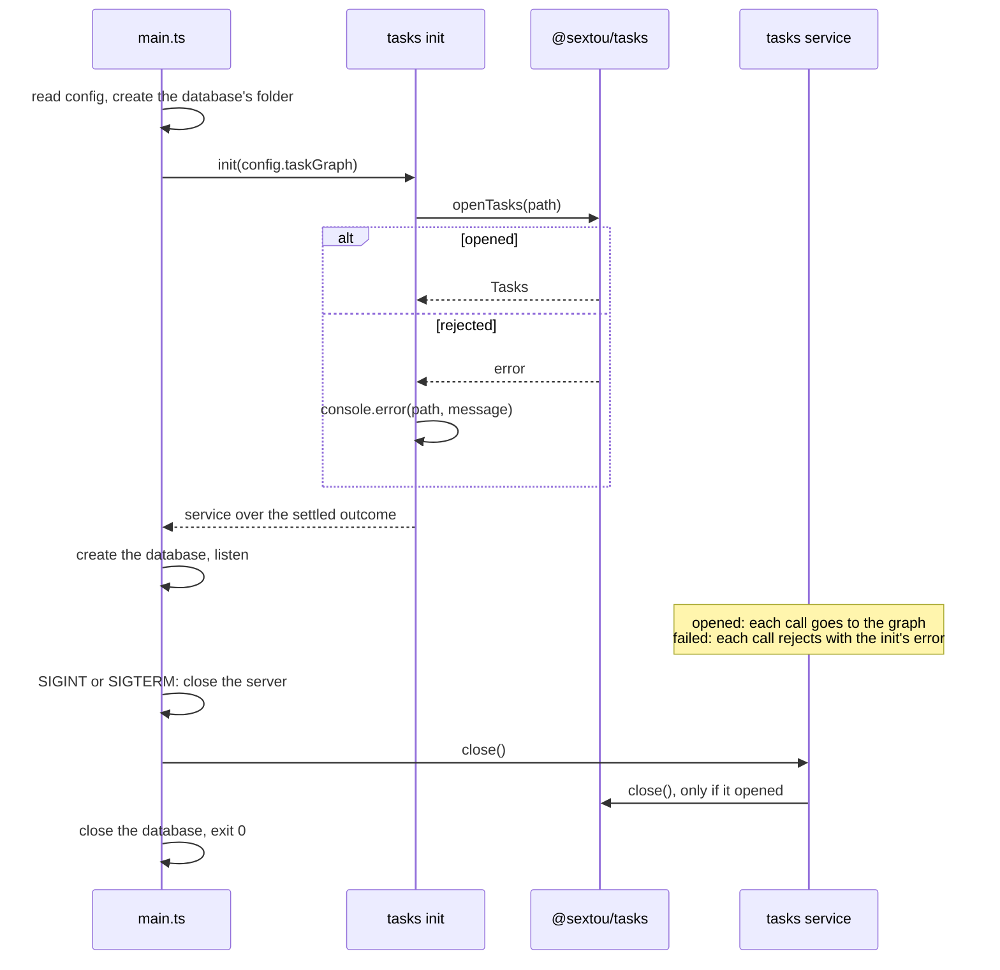

# Server Tasks Module - Plan

## Goal Capsule

- **Objective:** The sextou server holds a task graph behind a module of its own. Server code can create a task for a name, get the next ready task for a list of names, start a task and finish it, all without touching `@sextou/tasks`. The rules sextou will add later (actors, groups, trust) get one place to live.
- **Means:** a `tasks` module in `apps/server`, made of an init the server calls at startup and a service that calls `@sextou/tasks` as it is today (KD1, KD4, KTD3).
- **Product authority:** the repository owner. In scope: the init, its shutdown, the service's four operations, the setting that places the task graph's file, and the documentation lines this work makes stale. Out of scope: procedures, any change to `@sextou/tasks`, and actors, groups and trust.
- **Open blockers:** none.
- **Execution profile:** one package, `apps/server`, plus `AGENTS.md`, `CONCEPTS.md` and `README.md`. One pull request: no change to `@sextou/tasks`, so no stack.
- **Who finishes:** `ce-work` implements U1–U4 in order and opens the one pull request.
- **Stop conditions:** stop and ask if a requirement turns out to need a change to `@sextou/tasks` (KD1), a procedure (KD5) or a table in the server's database (KD3).

---

## Product Contract

### Summary

A `tasks` module in the server. The server calls the module's init at startup and asks the module to close at shutdown. The module opens the task graph and is the only code that talks to `@sextou/tasks`. Its service creates a task for a name, gets the next ready task for a list of names, starts a task and finishes it. If the init fails, the server still starts, and each call to the service fails.

The graph lives in `tasks.db` beside the server's database in its data folder, and a new setting moves it. Startup waits for the graph to open before listening. Service calls carry no timeout until procedures bring an HTTP answer to deliver in time.

### Problem Frame

`@sextou/tasks` is deliberately simple. It knows tasks, their links and their states, and it treats every name it gets (assignee, actor, who made a change) as an unchecked string. sextou will add its own rules on top: who an actor is, which group they belong to, whom to trust. Today the server does not use the task graph at all. `apps/server` neither declares nor imports `@sextou/tasks`, and `main.ts` opens only the server's own database. Without a sextou layer between the server and the library, those rules would end up either inside the library, which must not know sextou's domain, or scattered across the server.

### Key Decisions

- KD1. **The module calls `@sextou/tasks` as it is, and the library does not change.** Each of the four operations maps to an existing library call: `createTask`, `listReady`, `startTask` and `finishTask`. (session-settled: user-directed — chosen over adding an operation that changes a task's assignee, in a stack of pull requests on the library: "tasks não pode mudar assignee por enquanto.") Governs R6–R9.
- KD2. **A task's assignee is set only at creation. Whoever takes the task is recorded as its executor when it starts, and the assignee stays as it was.** (session-settled: user-directed — chosen over a reassign operation, and over starting a task setting its assignee to the actor, which would need a library change.) Governs R8.
- KD3. **The next-task operation takes a list of names from its caller. The service knows no actors, groups or membership.** Which groups an actor belongs to is the caller's knowledge until sextou models actors. (session-settled: user-directed — chosen over the service storing membership in a table of the server's database, and over matching one name only: "hoje a gente chama passando uma lista direto. sem se preocupar com banco, atores, etc.") Governs R7.
- KD4. **The server calls the module's init with what the module needs to run. The module opens the task graph and keeps it.** No server code outside the tasks module imports or calls `@sextou/tasks`. (session-settled: user-directed — chosen over `main.ts` opening the graph and handing it to the service: "tirar essa responsabilidade do server.") Governs R1–R3.
- KD5. **This work is the init and the service only, with no procedures.** Nothing outside the server calls the service yet; only tests do. (session-settled: user-directed — chosen over adding `tasks.*` procedures registered in `router.ts`: "init mais service apenas.")
- KD6. **A failed init does not stop the server.** The server listens, and each call to the service fails. (session-settled: user-directed — chosen over exiting with code 1 without listening, as the server does for an invalid setting; the agent had recommended exiting.) Governs R4.
- KD7. **The module does not retry a failed init. A restart is needed once the cause is fixed.** (session-settled: user-approved — proposed with the consequence shown: since health is out of scope, the console line is the only sign of the failure.) Governs R5.
- KD8. **The service hands back the library's results as they are: refusals as results, errors as rejections.** It adds no refusal of its own and checks no name. (session-settled: user-approved — proposed as a call-out and confirmed.) Governs R10, R11.

### Requirements

**Init and lifecycle**

- R1. At startup, the server calls the tasks module's init and passes it what the module needs to run. No server code outside the tasks module imports `@sextou/tasks`.
- R2. The init opens the task graph in a file inside the server's data directory by default. A setting can move the file, like every other server setting (`SEXTOU_SERVER_*`, listed in `apps/server/.env.example`).
- R3. When the server shuts down on SIGINT or SIGTERM, it asks the module to close, and the module closes the task graph.
- R4. When the init fails, the server still listens. It prints the error the way `main.ts` reports other startup failures today, and every later call to the service rejects.
- R5. After a failed init, the module stays unavailable until the server restarts.

**Service operations**

- R6. Create a task: given a title, kind, priority, optional parent, assignee name, optional description and source path, and the name of who creates it, the service creates the task and returns it.
- R7. Next task: given a non-empty list of names, the service returns the one ready task whose assignee exactly matches one of the names, picking the most urgent and, among equals, the oldest. It returns nothing when no such task exists.
- R8. Start a task: given a ready, open task, the name of who runs it, the name of who starts it and an optional log path, the service moves the task to `running` and records its executor. The task's assignee does not change.
- R9. Finish a task: given a running task, a final state (`succeeded`, `failed` or `skipped`), the name of who finishes it, an optional reason and an optional result path, the service moves the task to that state.
- R10. When the library refuses an operation (`invalid`, `not_found`, `not_open`, `blocked`, `not_running`), the caller receives that refusal unchanged. When the library rejects, the service rejects.
- R11. Every name the service takes (assignee, executor, who made the change) is any string the caller passes, and the service checks none of them.

**Documentation**

- R12. Every line in `AGENTS.md`, `CONCEPTS.md`, `README.md` and `apps/server/.env.example` that this work makes stale describes the new state. That includes the lines saying the server doesn't open a task graph or imports nothing from `@sextou/tasks`, and the shutdown line saying the server closes only its database.

### Acceptance Examples

- AE1. **Covers R4, R5.** Given a task graph file written by a newer version of `@sextou/tasks`, when the server starts, it listens, prints the init's error, and a call to create a task fails. Once the server restarts with a file it can open, the call succeeds.
- AE2. **Covers R7.** Given a ready task for `dev` at priority 0 and a ready task for `alice` at priority 2, when the caller asks for the next task for `["alice", "dev"]`, it gets the `dev` task.
- AE3. **Covers R7.** Given no ready task for `alice`, and a ready task for `dev`, when the caller asks for the next task for `["alice"]`, it gets nothing.
- AE4. **Covers R8.** Given a ready task assigned to `dev`, when `alice` starts it, the task is `running`, its assignee is still `dev`, and its executor is `alice`.
- AE5. **Covers R8, R10.** Given a task blocked by an open task, when someone starts it, the caller receives the library's `blocked` refusal, and the task stays `open`.

### Scope Boundaries

- Changing a task's assignee after creation (KD2).
- Actors, groups, which actor belongs to which group, and whom to trust (KD3).
- Procedures, and any way to reach the service over HTTP (KD5).
- Reporting the task graph's state in health.
- A logger: the user is opening a separate issue for it. Until then, R4 uses the console output `main.ts` already uses.
- Retrying a failed init (KD7).
- Linking and unlinking tasks. The library has `link` and `unlink`, but they are not among this work's operations.
- More than one task graph. Organizations are not a feature yet, so the server opens one.

Considered and not built:

- A lint rule that stops server code outside the module from importing `@sextou/tasks`. KD4 stays a convention, written in `AGENTS.md`, and review catches a stray import. A second module that needs the library would change the call.
- Refusing a config where `SEXTOU_SERVER_TASK_GRAPH` and `SEXTOU_SERVER_DATABASE` name the same file. Health then reports the database down, which surfaces it. Evidence that the shared file corrupts either database silently would change the call.
- A timeout on service calls (KTD7).
- Setting the shared data folder's mode. `main.ts` creates it with the default mode before `openTasks` would create it as 0700. The server runs only on developer machines for now.
- Removing the `-wal` file a failed init leaves beside the task graph.

### Sources / Research

- `packages/tasks/src/graph.ts`: the `Graph` interface, its refusal reasons, and `startTask` writing the executor to `task_executions` without touching `tasks.assignee`.
- `packages/tasks/src/schemas.ts`: `listReadySchema` takes `assignees`, a non-empty array of non-blank names, and a `limit` of at least 1. The library itself refuses an empty list as `invalid`.
- `packages/tasks/src/open-tasks.ts`: `openTasks` applies migrations when called, rejects on a file migrated by a newer version, and Turso refuses a second process on the same file. Every failure, its synchronous folder creation included, arrives as one rejection.
- `packages/tasks/src/index.ts`: the public types are `Tasks` (the graph plus `close`), `Task`, `NewTask`, `Refused` and `Reason`. `Graph` is not exported.
- `apps/server/src/main.ts`: startup reports failures with `console.error`, exits with 1 only for an invalid setting, and on SIGINT or SIGTERM stops listening, then closes the database.
- `apps/server/src/config.ts` and `apps/server/src/data-directory.ts`: only the server resolves the data directory, and only when the database's path is unset.
- `CONCEPTS.md`: task graph, organization and data directory.
- `.compound-engineering/artifacts/solutions/best-practices/turso-behaves-differently-from-sqlite.md`: Turso refuses a second process at once with no busy timeout, and its error text differs from SQLite's, so tests compare the error passed through, not its message.
- `.compound-engineering/artifacts/solutions/developer-experience/stryker-10-with-vitest-5-and-typescript-7.md`: tests stay at the top level of their file, and `homedir` is mocked rather than `HOME` changed.
- The Gas City POC's `Funcionalidades desejadas.md`, lines 49 and 69: a group is a role ("papel"), and "a fila de cada ator é a fila da organização, filtrada pelo papel dele". KD3 leaves this for later.

---

## Planning Contract

Product Contract preservation: changed: R12 — it also names `README.md` and `apps/server/.env.example`, which carry the same stale lines (confirmed at plan scoping). Restructured, no scope change: R1 and KD4 now say "no server code outside the tasks module" instead of "the server", since the module lives in `apps/server`. The two deferred questions are resolved by KTD1, KTD2 and KTD4.

### Key Technical Decisions

- KTD1. **The task graph's file is `SEXTOU_SERVER_TASK_GRAPH`, by default `tasks.db` in the data folder.** It is parsed like `SEXTOU_SERVER_DATABASE`: a path resolved against the working directory, or `:memory:`, and an empty value is invalid. `Config` gains a `taskGraph` field. The data folder is still read only when a default needs it, and at most once, so a config that gives both paths never reads the home directory. Governs R2.
- KTD2. **The init receives the resolved path and nothing else.** The module never reads the environment or the config, the same way `createDatabase` takes a path and `openTasks` takes a path from its caller. Governs R1.
- KTD3. **One promise carries the init's outcome.** The init awaits `openTasks(path)` once. It never rejects: on failure it prints one `console.error` line naming the task graph's path and the error's message, in the shape of `main.ts`'s folder error, and still returns the service. The service is built over that settled promise, so every operation after a failed init rejects with the very error `openTasks` rejected with, and `close` resolves without doing anything. Governs R4, R5.
- KTD4. **The next task is `{ ok: true, task }`, with `task` null when none is ready, or the library's `invalid` refusal.** It calls `listReady` with the caller's names and a limit of 1, and maps only the success case: the list's first task, or null. A refusal keeps the library's `{ ok: false, reason }` shape, so R10's refusals pass through without translation. Governs R7, R10.
- KTD5. **The service takes and returns the library's own types.** Its inputs are the library's input shapes and, except for the next task's success case (KTD4), its results are the library's results, so the service adds no schema and no check (KD8). Governs R6, R8–R11.
- KTD6. **Startup opens the graph before listening, and shutdown closes it between the server and the database.** Startup order:
  1. Create the database's folder.
  2. Await the init.
  3. Create the database.
  4. Listen.

  Shutdown is server, then task graph, then database. When listening fails, both the task graph and the database close before the error rethrows. Governs R1, R3.

- KTD7. **Service calls carry no timeout.** The task graph is a local file in the server's own process, so no call waits on the network or on another process, the case AGENTS.md's timeout rule covers. `withTimeout` does not cancel: a timed-out write could still commit, and the caller would see an error for a task that exists. Procedures bring an HTTP answer to deliver before the web's timeout, and the timeout comes with them. (session-settled: user-approved — chosen over wrapping each call in `withTimeout`: proposed with the false-failure tradeoff shown and confirmed at plan scoping.)
- KTD8. **The module's tests are integration tests on the real library.** AGENTS.md's levels make any test that runs two sextou packages for real an integration test, even on `:memory:`. The module's files join `integrationOnly` in `apps/server/vitest.config.mts`, with a reason comment, rather than being unit-tested over a mocked library.
- KTD9. **Neither `router.ts` nor `trpc.ts` imports the tasks module, not even a type.** `@sextou/tasks` imports `node:crypto` and `node:fs`, and the web app's typecheck follows `AppRouter` into those two files. AGENTS.md's Structure line that says the modules need no Node types gets reworded to name the tasks module as the exception, reached only from `main.ts`.

### High-Level Technical Design

The lifecycle across `main.ts`, the module and the library:



### Output Structure

```text
apps/server/src/modules/tasks/
  index.ts                     the module's entry point: the init and the service's type
  init.ts                      opens the task graph and reports a failure
  service.ts                   the four operations and close, over the init's outcome
  init.integration.test.ts
  service.integration.test.ts
```

The split between `init.ts` and `service.ts` is a starting point. `service.ts` is the name the request gave and stays.

### Risks

- Stryker's sandbox resolves `@sextou/tasks` through the hoisted root `node_modules` (`pnpm-workspace.yaml`'s `nodeLinker: hoisted`). Nothing was installed in this worktree, so the resolution was not verified. The first mutation run shows it.
- The server's mutation score now includes the service's pass-through code. A test that only checks `ok` lets mutants survive, so each scenario below asserts the whole result.

---

## Implementation Units

### U1. The task graph's setting

**Goal:** `Config` carries the task graph's resolved path, and `apps/server` declares `@sextou/tasks`.

**Requirements:** R2 (KTD1).

**Dependencies:** none.

**Files:**

- `apps/server/package.json`
- `pnpm-lock.yaml`
- `apps/server/src/config.ts`
- `apps/server/src/config.test.ts`
- `apps/server/.env.example`

**Approach:**

1. Add `@sextou/tasks` as `workspace:*`, as `apps/web` declares `@sextou/ui`, and refresh the lockfile with `pnpm install`. knip in CI fails without it.
2. In `loadConfig`, turn the data folder into a read that runs at most once and only when a default needs it, then use it for both `database` and `taskGraph`.
3. Parse `SEXTOU_SERVER_TASK_GRAPH` with the database's parser, or a shared one, so its error names the variable.
4. Document the variable in `.env.example` beside `SEXTOU_SERVER_DATABASE`, commented out, with its derived default.

**Patterns to follow:** the `database` entry and `parseDatabase` in `apps/server/src/config.ts`; the `.env.example` block for `SEXTOU_SERVER_DATABASE`.

**Test scenarios:**

- With no variables set, `taskGraph` is `tasks.db` in the platform's data folder, and the "every default" test lists it.
- With every variable set, `taskGraph` is the given path resolved against the working directory, and the "every variable" test lists it.
- `SEXTOU_SERVER_TASK_GRAPH=:memory:` gives `:memory:`.
- `SEXTOU_SERVER_DATA_DIR` set and both paths unset puts `sextou.db` and `tasks.db` in that folder.
- An empty `SEXTOU_SERVER_TASK_GRAPH` throws an error naming the variable and "a file path or :memory:".
- With both paths given, `homedir` is never called. This replaces the current "does not read the home directory when the database is given" test.
- With only the database given, `homedir` is called once, for the task graph's default.

**Verification:** `config.ts` passes its unit suite at 90%, and `pnpm install` leaves the lockfile in step.

### U2. The tasks module

**Goal:** `modules/tasks` exports an init that opens the task graph and a service with `createTask`, `nextTask`, `startTask`, `finishTask` and `close`.

**Requirements:** R1, R4–R11 (KD1–KD3, KD6–KD8; KTD2–KTD5, KTD8, KTD9).

**Dependencies:** U1.

**Files:**

- `apps/server/src/modules/tasks/index.ts`
- `apps/server/src/modules/tasks/init.ts`
- `apps/server/src/modules/tasks/service.ts`
- `apps/server/src/modules/tasks/init.integration.test.ts`
- `apps/server/src/modules/tasks/service.integration.test.ts`
- `apps/server/vitest.config.mts`

**Approach:**

1. `service.ts` builds the service over the init's settled outcome (KTD3). Each operation awaits it, then calls the matching graph operation and returns its result (KTD4, KTD5). `close` closes the graph only when it opened.
2. `init.ts` takes the path (KTD2), awaits `openTasks`, prints the failure line on a rejection, and returns the service.
3. `index.ts` exports the init and the service's type, and nothing imports the module but `main.ts` and its tests (KTD9). Export only what a caller uses, or knip flags it.
4. Add the module's three source files to `integrationOnly`, with a comment saying they run `@sextou/tasks` for real (KTD8), and the same comment at the top of each test.

**Execution note:** start each operation from its failing integration test.

**Patterns to follow:**

- `apps/server/src/database.ts` for an object with `close`, built from a path.
- `apps/server/src/database.integration.test.ts` for tracking every opened instance and closing it in `afterEach`.
- `packages/tasks/src/graph.test.ts` for building tasks on `:memory:`.
- Every test sits at the top level of its file, with no `describe`.

**Test scenarios:**

- `createTask` returns `{ ok: true, task }` whose fields match the input, with `status` `open`.
- `createTask` with a blank title returns `{ ok: false, reason: 'invalid' }` unchanged.
- `createTask` with an unknown `parentId` returns `{ ok: false, reason: 'not_found' }`.
- `createTask` accepts any non-blank string as assignee and creator, such as a name no actor has.
- Covers AE2. With a ready `dev` task at priority 0 and a ready `alice` task at priority 2, `nextTask(['alice', 'dev'])` returns the `dev` task.
- Two ready tasks at the same priority for `dev`: `nextTask(['dev'])` returns the older one.
- Covers AE3. With only a ready `dev` task, `nextTask(['alice'])` returns `{ ok: true, task: null }`.
- `nextTask([])` returns `{ ok: false, reason: 'invalid' }`.
- A running task is not returned by `nextTask`.
- Covers AE4. On a file, `alice` starts a ready `dev` task. `startTask` returns `{ ok: true }`. After `close`, the stored task is `running` with assignee `dev`, and its `task_executions` row names `alice` as actor and keeps the log path.
- Covers AE5. A file seeded through `openTasks` with a task blocked by an open task, then closed, is opened by the init. `startTask` on the blocked task returns `{ ok: false, reason: 'blocked' }`. Then the blocker is started and finished as `succeeded` through the service, and `nextTask` returns the formerly blocked task with `status` `open`, which shows the refused start changed nothing.
- `startTask` on an unknown id returns `not_found`, and on a running task returns `not_open`.
- `finishTask` moves a running task to each of `succeeded`, `failed` and `skipped` (`test.each`) and returns `{ ok: true }`.
- `finishTask` on an open task returns `{ ok: false, reason: 'not_running' }`.
- After `close`, `createTask` rejects, which shows a library rejection passes through as a rejection.
- `close` twice resolves both times.
- The init on `:memory:` returns a service whose `createTask` succeeds.
- The init on a file creates the file and its missing folder.
- On a path holding a file that is not a database, the init resolves, prints one line naming the path and the error's message, and each of the four operations rejects with the same error object `openTasks` rejected with.
- After a failed init, `close` resolves and the service's operations still reject.

**Verification:** `pnpm exec vitest run --project 'server/*' apps/server/src/modules/tasks` passes, and the server's integration suite reaches 90% on the three module files.

### U3. Wiring the module into startup and shutdown

**Goal:** `main.ts` inits the module before listening and closes it on shutdown and on a failed listen.

**Requirements:** R1, R3, R4, R5 (KD4, KD6, KD7; KTD6).

**Dependencies:** U1, U2.

**Files:**

- `apps/server/src/main.ts`
- `apps/server/src/main.integration.test.ts`

**Approach:**

1. After the database's folder, await the init with `config.taskGraph`, importing it through `./modules/tasks/index`.
2. In the listen-failure handler, close the task graph and the database before rethrowing.
3. In the signal handler, close the task graph between the server and the database (KTD6).
4. In the test, wrap the init in `vi.fn(real)`, as the test already does for `./database`, so tests reach the service and `afterEach` closes it. Add `SEXTOU_SERVER_TASK_GRAPH` to the list of variables the test clears, and set it to `:memory:` in tests that don't look at the file.

**Patterns to follow:** `main.ts`'s folder-creation error and listen-failure handler; `main.integration.test.ts`'s `createDatabase` wrap, `closedAtExit` ordering test and `test.runIf(process.platform === 'linux')` default-path test.

**Test scenarios:**

- The init is called with `config.taskGraph` before `startServer`.
- On Linux with no paths set, the server creates `tasks.db` in the temporary home's data folder.
- An invalid variable exits with 1 without calling the init.
- Covers AE1. Given a `tasks.db` whose `user_version` is above the library's last step, the server still calls `startServer`, `console.error` receives the init's line, and the service's `createTask` rejects. After `vi.resetModules()` and a fresh import with a new file, `createTask` on the new service succeeds.
- On SIGTERM, the close order is server, task graph, database.
- When listening fails, the task graph and the database are both closed and the import rejects.

**Verification:** `main.integration.test.ts` passes, and `main.ts` stays at 90% in the integration suite.

### U4. Documentation

**Goal:** the docs describe the server that opens a task graph through its tasks module.

**Requirements:** R12 (KTD1, KTD6, KTD9).

**Dependencies:** U1–U3.

**Files:**

- `AGENTS.md`
- `CONCEPTS.md`
- `README.md`

**Approach:** update each stale line in place, without adding new sections:

1. `AGENTS.md`:
   - In Architecture, the server imports `@sextou/tasks` only through its tasks module.
   - The `apps/server` paragraph: startup opens the task graph before listening, shutdown closes the server, the task graph and the database in that order, and drop "It doesn't open a task graph yet".
   - The Structure tree gains `modules/tasks/`.
   - The Structure line on Node types names the tasks module as the exception (KTD9).
   - Tests > Coverage lists the tasks module's files as integration-only, with the reason.
2. `CONCEPTS.md`: the Organization and Data directory entries say the server opens one task graph, `tasks.db` in its data directory, until organizations are a feature.
3. `README.md`: the `apps/server` row and the settings paragraph name the task graph and `SEXTOU_SERVER_TASK_GRAPH`.

**Test expectation:** none -- documentation only.

**Verification:** a search of the three files for "doesn't open a task graph", "imports nothing from `@sextou/tasks`" and "then closes the database" finds no stale line.

---

## Verification Contract

| Gate               | Command                                         | Proves                                                                                                        |
| ------------------ | ----------------------------------------------- | ------------------------------------------------------------------------------------------------------------- |
| Lint and format    | `pnpm lint`                                     | oxlint, the module-boundary and import-type rules, and oxfmt                                                  |
| Types              | `pnpm typecheck`                                | the server compiles, and the web app's typecheck, which follows `AppRouter`, still needs no Node types (KTD9) |
| Server unit        | `pnpm --filter @sextou/server test:unit`        | `config.ts` at 90%, with the module's files out of the unit suite                                             |
| Server integration | `pnpm --filter @sextou/server test:integration` | the module's files and `main.ts` at 90%                                                                       |
| Server mutation    | `pnpm --filter @sextou/server test:mutation`    | at least 80% of the server's mutants killed                                                                   |
| Web integration    | `pnpm --filter @sextou/web test:integration`    | the server started as a child process still answers health, with its task graph in the test's data folder     |
| Build              | `pnpm build`                                    | the server's bundle inlines `@sextou/tasks` and keeps Turso external                                          |

knip runs only in CI, through the organization's workflow. The `@sextou/tasks` declaration in U1 and the exports kept to what callers use in U2 keep it green.

---

## Definition of Done

- Every gate in the Verification Contract passes.
- AE1–AE5 each have a passing test that names it.
- No server file outside `apps/server/src/modules/tasks/` imports `@sextou/tasks`, and neither `router.ts` nor `trpc.ts` imports the module.
- `@sextou/tasks` has no change in the diff.
- The stale lines R12 names are gone from `AGENTS.md`, `CONCEPTS.md`, `README.md` and `apps/server/.env.example`.
- No dead-end or experimental code from abandoned attempts is left in the diff.
