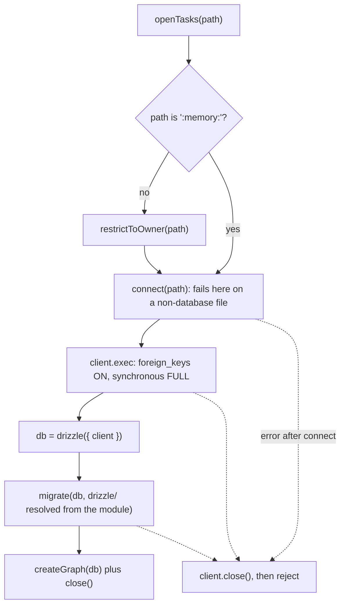
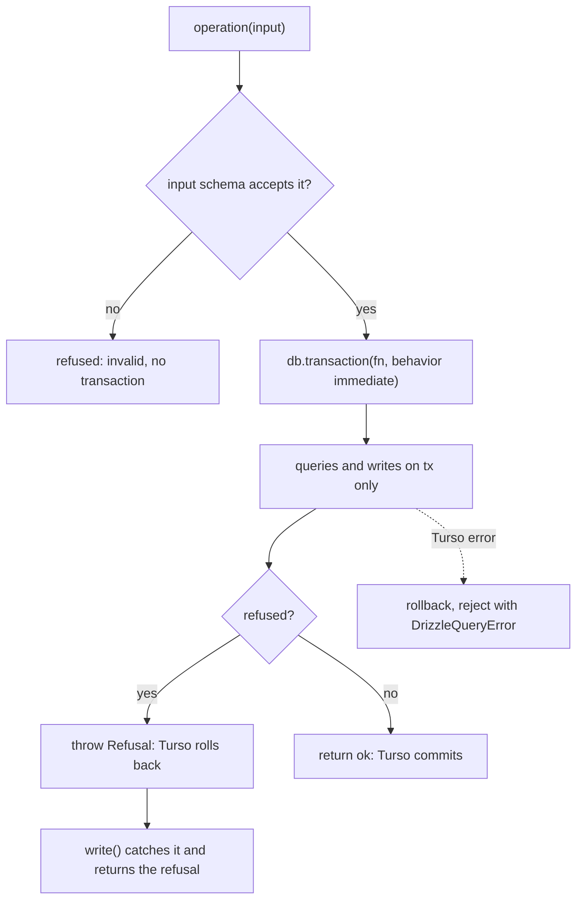

# Drizzle rc.5 and the Task Graph on Drizzle - Plan

## Goal Capsule

- **Objective:** sextou's database code uses drizzle the way drizzle documents it on Turso, now that drizzle-orm 1.0.0-rc.5 holds the connection for a whole transaction. The task graph is written as if it had started on drizzle, and its callers see the same operations, results and refusals as today. The one exception is opening a file a newer version migrated, which R11 stops refusing.
- **Means:** drizzle-orm and drizzle-kit 1.0.0-rc.5, and Vite 8.3.5 (issue #59), with the task graph fully on drizzle (Key Decisions; KTD1–KTD11).
- **Product authority:** the repository owner. Resolves issue #59. The server's first table, and the server opening a task graph, are not active scope.
- **Authority order:** the Product Contract's Requirements win on behavior, the KTDs on mechanism, and a unit overrides neither.
- **Stop conditions:** stop and report if Turso 0.8.3 refuses the DDL drizzle-kit generates, if the ready list can't reach `task_ready` by index search through the builder, or if the concurrency test (two simultaneous starts of one task start it once) fails on `db.transaction()`.
- **Execution profile:** one branch and one pull request. Units land in order, and the full Verification Contract runs before the push.
- **Open blockers:** none. drizzle-orm rc.5 (published 2026-10-21 17:59 UTC), drizzle-kit rc.5 (18:01 UTC) and Vite 8.3.5 (06:38 UTC) are all past CI's one-day minimum release age.

---

## Product Contract

### Summary

drizzle-orm moves to 1.0.0-rc.5 and Vite to 8.3.5. `@sextou/tasks` is rewritten on drizzle: its schema, its migrations generated by drizzle-kit and applied by drizzle's migrator, its queries through the builder, and its writes in drizzle's immediate transactions. The server's documented rule for transactions switches to drizzle's `db.transaction()`. Tests that open the graph read the migrations from disk, so they run in the integration suite, and the unit suite keeps what runs without the disk.

Product Contract preservation: changed: R13 — it also covers AGENTS.md's Tests section, since the graph's tests move to the integration suite. The second Success Criterion now names the error tests, which read Turso's error from `cause`. The Outstanding Questions deferred to planning are resolved in the Planning Contract and removed here.

### Problem Frame

drizzle-orm 1.0.0-rc.4 runs a transaction on Turso through Turso's older `transaction()`, which doesn't hold the connection, so concurrent statements can interleave into it. Two decisions rest on that behavior. `@sextou/tasks` was kept on raw SQL over Turso's `transactionAsync`, with its schema as DDL text in `src/migrations.ts`, counted in `PRAGMA user_version`. The server's rule (AGENTS.md, Building a feature, step 9) forbids `db.transaction()` and sends every transaction through Turso's `transactionAsync` on drizzle's `$client`.

rc.5 removes the cause. Its Turso driver runs `db.transaction()` through `transactionAsync` and honors `behavior` (`immediate`, `deferred`, `exclusive`). Until sextou moves, the task graph converts each row by hand (`String(row.title)`, `Number(row.priority)`, `as Status` in `packages/tasks/src/graph.ts`) and keeps its tables described in text that no type checks, and the server keeps a workaround it no longer needs.

### Key Decisions

- **The task graph moves fully onto drizzle, schema and migrations included.** (session-settled: user-directed — chosen over drizzle for queries and transactions only, with `migrations.ts` and `user_version` kept, and over keeping the task graph on raw SQL: one typed schema is the only description of the tables.) Governs R4, R5, R6.
- **drizzle is used the way its docs recommend, with nothing of the old scheme layered on top.** The refusal of a file a newer version migrated goes away, because drizzle's migrator runs only the migrations a file lacks and ignores any it doesn't know. (session-settled: user-directed — chosen over keeping the refusal as a check of `__drizzle_migrations` before migrating: follow drizzle's recommended way.) Governs R5, R11.
- **The task graph is written as if no database existed before.** sextou has no release, so drizzle-kit generates one initial migration, and files created by earlier builds are not supported. (session-settled: user-directed — chosen over a migration path from `user_version` files: there is no database to carry over.) Governs R5, R11.
- **The cycle check stays one recursive query in drizzle's `sql`, naming the schema's tables and columns.** drizzle rc.5's builder has no recursive CTE (drizzle-orm issue #209, open since 2023), and a walk in TypeScript would make several round trips inside the write's transaction. Naming the schema's columns makes the typecheck catch a rename. (session-settled: user-approved — stated in the scope synthesis; the user confirmed.) Governs R7.
- **drizzle-kit arrives in `@sextou/tasks` only.** The server still has no table, so it gets drizzle-kit with its first table, as step 9 already says. (session-settled: user-approved — stated in the scope synthesis; the user confirmed.) Governs R1.
- **Vite moves to 8.3.5 alone.** Plugins that depend on Vite (`@vitejs/plugin-react`, `@tailwindcss/vite`, `@electron-forge/plugin-vite`, `@storybook/react-vite`) stay on their versions. (session-settled: user-approved — stated in the scope synthesis; the user confirmed.) Governs R2.

### Requirements

**Versions**

- R1. drizzle-orm is pinned to exactly `1.0.0-rc.5` wherever it is declared, and drizzle-kit arrives pinned to exactly `1.0.0-rc.5` in `@sextou/tasks` only.
- R2. Vite is `8.3.5` in the four packages that declare it: `apps/server`, `apps/web`, `apps/desktop` and `packages/ui`.
- R3. The lockfile installs under CI's pnpm policy, with no exception added for these versions.

**The task graph on drizzle**

- R4. `@sextou/tasks` declares its tables in drizzle's schema, and that schema is the only description of them. It keeps every table, column, check, foreign key and index the current schema has, the partial index `task_ready` included.
- R5. drizzle-kit generates the task graph's migrations from that schema, and `openTasks(path)` applies them with drizzle's migrator for the Turso driver.
- R6. Every query and write in the graph goes through drizzle's query builder and gets typed rows back, so no row is converted by hand.
- R7. The cycle check is the one query written whole in drizzle's `sql`, and it names the schema's tables and columns instead of spelling them as text.
- R8. Every write runs in one drizzle `db.transaction()` with `behavior: 'immediate'`. A refusal leaves the database as it was and comes back as a result, and an error from Turso or the file system rejects.
- R9. The ready list still reads `task_ready` by an index search on assignee, as the query-plan test checks. Its `status` and `holding_blockers` terms are written as literals, through a `sql` fragment inside the builder's query.
- R10. The public API of `@sextou/tasks` stays the same: `openTasks(path)`, each operation, its input schema, its result and its refusal reasons. Opening still turns foreign keys on, sets `synchronous` to FULL and restricts a file to its owner.
- R11. `src/migrations.ts`, `PRAGMA user_version` and the refusal of a newer file are removed, with their tests.

**Transactions on the server**

- R12. A transaction on the server's database runs through drizzle's `db.transaction()`. The server writes nothing yet, so only the documented rule changes.

**Documentation**

- R13. AGENTS.md describes the new state in the backend's `packages/tasks` bullet, in step 9 of Building a feature, and in the Tests section's account of which suite answers for which file. The `db.transaction()` item of `.compound-engineering/artifacts/solutions/best-practices/turso-behaves-differently-from-sqlite.md` is rewritten for rc.5.

### Success Criteria

- `pnpm typecheck`, `pnpm lint`, `pnpm test` and `pnpm build` pass, and `@sextou/tasks` keeps 90% coverage per file in each suite and 80% of mutants killed.
- The task graph's existing behavior tests pass without changing what they assert, apart from those R11 removes and the error tests, which find Turso's message on the rejection's `cause`.

### Scope Boundaries

- The server's first table, its schema and its migrations: they arrive with the first feature that needs one.
- The server opening a task graph, and shipping the task graph's migrations folder inside the server's bundle: no caller packages `@sextou/tasks` yet.
- Upgrading Vite's plugins.
- drizzle's relational queries (RQBv2) for the task graph, unless planning finds the builder can't express a current query.
- Any change to what the task graph does: its rules, refusals and operations stay as they are, apart from the open-time check R11 removes.

Considered and not built:

- A check for orphaned rows around a migration that rebuilds a referenced table. drizzle-kit wraps a rebuild in `PRAGMA foreign_keys=OFF/ON`, which Turso honors inside the migrator's transaction. This change only creates tables, so no rebuild runs. Revisit with the first migration that rebuilds `tasks`.
- Naming the migration that failed. drizzle's migrator rejects with a `DrizzleQueryError` for the failing statement and no migration name, unlike the old `Tasks migration N failed`. Revisit if a failed open ever needs the migration to be named.
- Detecting an edited migration. drizzle's migrator compares names, not hashes. The drift test (KTD9) catches a schema change with no migration, and review catches an edited one.

### Dependencies / Assumptions

- drizzle's migrator for the native Turso driver (`drizzle-orm/tursodatabase/migrator`) reads the migration files from a folder on disk when it runs, including for `:memory:`. It records each applied migration by name in `__drizzle_migrations`, which it creates outside its own transaction. Verified in the published rc.5 package.
- Turso 0.8.3 runs `WITH RECURSIVE`, although its `COMPAT.md` (line 152, on `main` and on tag `v0.8.3`) still says it is not supported. Verified by running two recursive queries on 0.8.3 and by the cycle test `link refuses a link that closes a cycle` (`packages/tasks/src/graph.test.ts:376`).
- Turso 0.8.3 searches the partial index `task_ready` only when the query writes `status = 'open'` and `holding_blockers = 0` as literals. With those values bound as parameters, which drizzle's `eq` does, it scans `tasks`. Verified with `EXPLAIN QUERY PLAN`; today's code splices the open status into the SQL text for this reason.
- rc.5 marks some changes as breaking. Two reach this code: `.get()` and `db.get` now return `| undefined` when no row comes back, and every query error is a `DrizzleQueryError` with the driver's error on `cause`.

### Sources / Research

- Issue #59, and the decisions it reopens: `.compound-engineering/artifacts/plans/2026-10-21-1505-feat-composable-framework-plan.md` (R15, and why `packages/tasks` has no drizzle), `.compound-engineering/artifacts/plans/2026-10-20-1830-feat-sqlite-task-graph-plan.md` (KTD3), `.compound-engineering/artifacts/plans/2026-10-21-0140-refactor-turso-database-plan.md` (KTD2), `.compound-engineering/artifacts/plans/2026-10-19-1849-feat-database-migrations-plan.md` (why the former `@sextou/data` skipped drizzle's migrator).
- drizzle-orm 1.0.0-rc.5's Turso driver: `drizzle-orm/tursodatabase/session.js`, where `transaction()` calls `this.client.transactionAsync(...)` and applies `config.behavior`; nested transactions run as savepoints. Release notes: https://github.com/drizzle-team/drizzle-orm/releases/tag/v1.0.0-rc.5.
- drizzle's migrator: `drizzle-orm/tursodatabase/migrator.js` calls `readMigrationFiles` and `migrateAsync`; `getMigrationsToRun` in `drizzle-orm/migrator.utils.js` picks the local migrations whose name the file lacks. All pending migrations run in one deferred transaction (`sqlite-core/async/session.js`).
- drizzle-kit 1.0.0-rc.5: `dialect: 'sqlite'` with no driver for the native Turso driver (https://orm.drizzle.team/docs/get-started/turso-database-new); `generate` needs no connection, writes `drizzle/<YYYYMMDDHHMMSS>_<name>/{migration.sql,snapshot.json}` and takes `--name`; `drizzle-kit/cli` exports `generate`, whose `explain` dry run returns `status: 'no_changes'` when the schema matches the folder. `drizzle-kit check` on sqlite only checks branch conflicts.
- No recursive CTE in drizzle's builder: https://github.com/drizzle-team/drizzle-orm/issues/209.
- Turso's behaviors that still apply on drizzle: `.compound-engineering/artifacts/solutions/best-practices/turso-behaves-differently-from-sqlite.md` (statements on the transaction handle, rollback hiding its cause, `PRAGMA foreign_keys` inside a transaction, one parameter per value in an `IN` list).
- The former `@sextou/data` drizzle-kit setup, for its drift test, absolute config paths and Stryker `related: false`: `git show a284b60^:packages/data/`.
- Stryker and Vitest rules that still hold (no `describe`, `fsModuleCachePath` in every config): `.compound-engineering/artifacts/solutions/developer-experience/stryker-10-with-vitest-5-and-typescript-7.md`, `.compound-engineering/artifacts/solutions/developer-experience/vitest-shared-module-cache-race-under-pnpm-recursive.md`.

---

## Planning Contract

### Key Technical Decisions

- KTD1. **`openTasks` connects eagerly, sets the pragmas, then hands the connection to drizzle and migrates.** The order is: `restrictToOwner` for a path, `connect(path)`, `PRAGMA foreign_keys = ON; PRAGMA synchronous = FULL` on the client, `drizzle({ client })`, drizzle's `migrate`, then the graph. Given a path, drizzle connects lazily, so the eager connect keeps "File is not a database" failing at open. The pragmas are per connection, and the migrator's transaction doesn't set them. The tests' helper that finds the connection through the first `exec` keeps working. Any error after the connect closes the client and rejects, as today. Governs R5, R10.
- KTD2. **The migrations live in `packages/tasks/drizzle/`, and `openTasks` finds them from its own module.** That is drizzle-kit's default `out`. `drizzle.config.ts` at the package root sets `dialect: 'sqlite'` with no driver, and names the schema and the folder with absolute paths built from `import.meta.dirname`. drizzle-kit and the migrator resolve relative paths against the working directory, which is the repository root under the root `vitest run` and Stryker's sandbox under mutation. The one initial migration is generated with `--name init`. Governs R5.
- KTD3. **A test that opens the graph through `openTasks` is an integration test.** Opening reads the migrations from disk, so `graph.test.ts` becomes `graph.integration.test.ts`, and `graph.ts` and `schema.ts` join `integrationOnly`. The unit suite keeps `schemas.ts` and `status.ts`, which run without the disk. (session-settled: user-directed — chosen over keeping the graph's tests unit with an AGENTS.md exception for reading the committed migrations, over feeding the migrations from memory through drizzle's wasm-migrator and `import.meta.glob`, and over leaving the split unstated: a test is classified by what it touches.) Governs R13.
- KTD4. **A refusal is thrown inside `db.transaction()` and caught outside it, as today.** `write()` keeps the private `Refusal`: the callback returns a refused result by throwing it, so the transaction rolls back, and `write()` returns that result. drizzle's `tx.rollback()` would reject with `TransactionRollbackError` and lose the result. Inside the callback every query goes through `tx`, never `db` nor a query prepared on `db`, which would wait for the lock the transaction holds and hang. Governs R8.
- KTD5. **An error from Turso reaches the caller as drizzle's `DrizzleQueryError`, with Turso's error on `cause`.** The graph doesn't unwrap it. The error tests assert the message on `cause`. (session-settled: user-approved — stated in the scope synthesis; the user confirmed.) Governs R8.
- KTD6. **The schema writes its checks and `task_ready`'s condition as literal SQL.** drizzle-kit renders a value interpolated into `check()` or an index's `.where()` as `?` and drops it, which would break the DDL. The status checks take their list from `statusList` and the index its status from `Status.open`, both through `sql.raw`. Column names stay as today's snake_case names, mapped to the camelCase keys `Task` uses. `status`, `from_status` and `to_status` use `text({ enum })` for the `Status` type, beside the explicit checks, since `enum` writes no CHECK. Governs R4, R9.
- KTD7. **The ready list is a builder `select` with one `sql` fragment for the index's terms.** It selects the `Task` columns from `tasks` where `inArray(assignee, …)` and a fragment that writes `status = 'open' AND holding_blockers = 0` as literals, ordered by priority then `` sql`rowid` ``, with the limit. `inArray` binds one parameter per assignee, as the Turso doc's IN-list item requires. It runs on `db`, outside any transaction, so it waits for a write in progress. Governs R6, R9.
- KTD8. **The cycle check runs as `tx.get(sql…)`, with the tables unaliased.** The CTE names its recursion `reached`, and joins `task_links` and `tasks` by their schema objects. Since neither table is aliased, drizzle's table-qualified column names (`"tasks"."status"`) resolve. The open status is a literal, like the index's. Governs R7.
- KTD9. **An integration test proves the committed migrations match the schema.** It runs `generate` from `drizzle-kit/cli` with `explain` on the package's config and expects `status: 'no_changes'`. It is the only test that reaches the schema's checks, indexes and foreign keys as drizzle-kit reads them, so it is what kills their mutants. Stryker's Vitest runner gets `related: false`, because the test reaches `schema.ts` through drizzle-kit, not an import. (session-settled: user-approved — stated in the scope synthesis; the user confirmed.) Governs R4, R5.
- KTD10. **drizzle-kit's output is committed as generated, and formatted by the pre-commit hook like any file.** lint-staged runs oxfmt on staged files, so `snapshot.json` is formatted on commit, and drizzle-kit parses it as JSON either way. `migration.sql` is left as generated: its hash covers its bytes. No ignore pattern is added, since CI's oxfmt reads the base commit's config.
- KTD11. **drizzle-orm is pinned exactly, and Vite moves within its existing caret.** drizzle-orm and drizzle-kit are `1.0.0-rc.5` with no range, because they are release candidates and drizzle-kit rc.5 requires drizzle-orm rc.5 or later. Vite becomes `^8.3.5` in each of the four packages, which keep their caret. `drizzle-orm` becomes a runtime dependency of `@sextou/tasks`, and `drizzle-kit` a devDependency. Governs R1, R2.

### High-Level Technical Design

How `openTasks` and a write run after this change, as directional guidance:





### Output Structure

```text
packages/tasks/
  drizzle.config.ts              drizzle-kit's config, absolute paths
  drizzle/
    <timestamp>_init/
      migration.sql              generated, committed as is
      snapshot.json              generated, formatted on commit
  src/
    schema.ts                    the four tables, their checks and indexes
    schema.integration.test.ts   the drift test and the constraint tests
    graph.ts                     the operations, on drizzle
    graph.integration.test.ts    was graph.test.ts
    open-tasks.ts                connect, pragmas, drizzle, migrate
    (migrations.ts and migrations.test.ts removed)
```

### Implementation Constraints

- Tests sit at the top level of their file, with no `describe`, and every Vitest config keeps `fsModuleCachePath: 'node_modules/.vitest-cache'`.
- drizzle's `logger` stays off: its default logger prints parameters.
- The comments in `src/migrations.ts` that carry reasoning move to `src/schema.ts`: why `holding_blockers` exists, why `task_ready` is the only index that covers ready tasks, why the tables keep their rowid, and why `task_link_blocker` exists. The comment about never editing a merged step becomes one about never editing a generated migration.

### Sequencing

U1 is independent. U2 → U3 → U4 run in order, since each needs the previous unit's schema or graph. U5 follows U4, whose final shape it documents. The coverage verdict for `@sextou/tasks` is judged after U4: `schema.ts` and `graph.ts` change suites there.

### Risks & Dependencies

| Risk                                                                                                                                                                                                                                                                                                  | Decision                                                                                                                                                                                                                                                                                                                        |
| ----------------------------------------------------------------------------------------------------------------------------------------------------------------------------------------------------------------------------------------------------------------------------------------------------- | ------------------------------------------------------------------------------------------------------------------------------------------------------------------------------------------------------------------------------------------------------------------------------------------------------------------------------- |
| Turso 0.8.3 refuses drizzle-kit's DDL: backtick identifiers, named table-level `CONSTRAINT … CHECK` and foreign keys. Not probed.                                                                                                                                                                     | The first `openTasks` in U4 runs it. A refusal is a stop condition, since R5 can't hold without it.                                                                                                                                                                                                                             |
| drizzle-kit writes `task_ready`'s condition in a form Turso's planner doesn't match against the ready list's literal terms.                                                                                                                                                                           | KTD6 writes the condition as raw literal text, so drizzle-kit copies it verbatim. The query-plan test is the check.                                                                                                                                                                                                             |
| drizzle's table declarations run their foreign-key callbacks and extra config (checks, indexes, composite key) only when something reads the table's config, which only drizzle-kit does. drizzle-kit loads `schema.ts` through jiti, and whether V8 attributes that run to the file is not verified. | Read the integration suite's report for `schema.ts` at U4. If it falls below 90%, remove `schema.ts` from coverage and from `mutate` together, with a comment beside `integrationOnly` saying that drizzle-kit alone reads those declarations and the drift test guards them, and drop `related: false`. Never lower the floor. |
| knip's defaults misread the new files: `drizzle.config.ts`, the schema it names, and the `drizzle-kit/cli` import in a test.                                                                                                                                                                          | knip's drizzle plugin turns on with the dependency and treats the config as an entry. Run CI's knip on the branch's pull request, and add a `knip.json` entry only for what it reports.                                                                                                                                         |

---

## Implementation Units

### U1. Bump drizzle-orm and Vite

**Goal:** the repository installs drizzle-orm 1.0.0-rc.5 and Vite 8.3.5, with no code change in the server.

**Requirements:** R1, R2, R3; KTD11.

**Dependencies:** none.

**Files:**

- `apps/server/package.json`
- `apps/web/package.json`
- `apps/desktop/package.json`
- `packages/ui/package.json`
- `pnpm-lock.yaml`
- Test: `apps/server/src/database.integration.test.ts` (unchanged, must pass)

**Approach:**

1. In `apps/server`, set drizzle-orm to `1.0.0-rc.5`, and Vite to `^8.3.5` in all four packages.
2. Install, and check that the lockfile resolves `drizzle-orm@1.0.0-rc.5` and `vite@8.3.5` everywhere, with no `pnpm-workspace.yaml` exception added.
3. `apps/server/src/database.ts` needs no change: `drizzle({ connection: { path, defaultQueryTimeout } })` is unchanged in rc.5, and `ping` resolves to true whatever row `db.get` returns.

**Patterns to follow:** the existing exact pin of `@tursodatabase/database` beside drizzle-orm in `apps/server/package.json`.

**Test scenarios:**

- Test expectation: none -- a version bump with no behavior change; the server's existing database tests (ping in memory, ping on a file, nothing opens before the first query, ping false for a missing folder or once closed) prove rc.5 behaves the same.

**Verification:** `pnpm install` succeeds; `pnpm typecheck`, `pnpm --filter @sextou/server test` and `pnpm build` pass.

### U2. Declare the schema and generate the initial migration

**Goal:** `@sextou/tasks` has a drizzle schema matching today's tables, the initial migration drizzle-kit generates from it, and a test that fails when the two drift apart.

**Requirements:** R1, R4, R5; KTD2, KTD6, KTD9, KTD10.

**Dependencies:** U1.

**Files:**

- `packages/tasks/package.json` (drizzle-orm dependency, drizzle-kit devDependency, both `1.0.0-rc.5`)
- `packages/tasks/drizzle.config.ts`
- `packages/tasks/src/schema.ts`
- `packages/tasks/drizzle/<timestamp>_init/migration.sql`, `snapshot.json` (generated)
- `packages/tasks/src/schema.integration.test.ts`
- `packages/tasks/vitest.config.ts` (`schema.ts` into `integrationOnly`, with its reason)
- `packages/tasks/stryker.config.mjs` (`related: false`, with its reason)
- `pnpm-lock.yaml`

**Approach:**

1. Declare `tasks`, `task_links`, `task_status_changes` and `task_executions` in `src/schema.ts` with the columns, nullability, primary keys (`task_links`' composite, `task_status_changes.id` as the integer rowid alias, `task_executions.task_id` as both key and foreign key), foreign keys (no ON DELETE), the default on `holding_blockers`, the four checks and both indexes of `src/migrations.ts`, following KTD6.
2. Move the reasoning comments from `src/migrations.ts`, per the Implementation Constraints.
3. Write `drizzle.config.ts` per KTD2, and generate the initial migration with `--name init`.
4. Compare the generated `migration.sql` with today's DDL: the same columns, the four checks with the same conditions, `task_ready`'s condition with literal `'open'` and `0`, and the same foreign keys. Differences in quoting and constraint naming are expected.
5. Write the drift test per KTD9.

**Execution note:** read the generated `migration.sql` before going further. A `?` in a check or in `task_ready`'s condition means a value was interpolated instead of written as a literal.

**Patterns to follow:** `git show a284b60^:packages/data/drizzle.config.ts`, `src/drift.integration.test.ts` and `stryker.config.mjs` from the former `@sextou/data`.

**Test scenarios:**

- The committed migrations match the schema: `generate` with `explain` on the package's config returns `status: 'no_changes'`.
- Changing a check in the schema without generating makes the drift test fail. Check this once by hand, not as a test: it is what Stryker's mutants of `schema.ts` rely on.

**Verification:** `migration.sql` reproduces today's schema up to quoting and constraint names, and the drift test passes from the package and from the repository root.

### U3. Run the graph's queries and writes on drizzle

**Goal:** every operation of the graph runs through drizzle's builder on typed rows, and every write in one immediate `db.transaction()`.

**Requirements:** R6, R7, R8, R9, R10; KTD4, KTD5, KTD7, KTD8.

**Dependencies:** U2.

**Files:**

- `packages/tasks/src/graph.ts`
- `packages/tasks/src/open-tasks.ts` (builds `drizzle({ client })` and passes it to the graph; it still runs `src/migrations.ts` until U4)
- `packages/tasks/src/graph.test.ts`

**Approach:**

1. `createGraph` takes the drizzle database. Replace each SQL constant with a builder query on `tx`, the cycle check per KTD8 and the ready list per KTD7.
2. Remove `toTask` and `nullable`: the selects return the `Task` shape directly, with `status` typed through the schema's enum.
3. `write()` per KTD4. `unlink` reads the deleted row count from drizzle's run result (`changes`).
4. Keep the statements in each write in today's order. The error tests' triggers count on it ("after the counter has moved", "after the status and the change").
5. Keep `Date.now()` for `time_changed`, and the `tsk_` id from `randomBytes`.

**Execution note:** the existing tests are the characterization. Run them unchanged against the rewrite before touching any of them, and change only what KTD5 and the query-plan test's finder require.

**Patterns to follow:** the current `graph.ts` for the order of checks in each operation and the `Refusal` pattern; `apps/server/src/database.ts` for drizzle's `sql` import.

**Test scenarios:**

- Every existing test in `graph.test.ts` passes with the same assertions, except as the next three items say.
- The query-plan test finds the ready list's statement by a token that survives drizzle's quoting, binds the parameters in drizzle's order, and still expects exactly `SEARCH tasks USING INDEX task_ready (assignee=?)` and `USE SORTER FOR ORDER BY`.
- The three error tests (a trigger raising `disk I/O error` on inserting a link, inserting an execution and updating one) assert the rejection carries `disk I/O error` on its `cause`, that nothing was written, and that the connection is no longer in a transaction.
- Two concurrent `startTask` calls on one task still give one ok and one `not_open`, with one execution and two history rows: the proof that `db.transaction()` with `immediate` serializes writes.
- `link refuses a link that closes a cycle` still refuses with `cycle` and leaves the links and counters as they were: the proof that the `sql` cycle check names the right columns.
- `listReady returns whole tasks` still compares the listed task with `toEqual` against the one `createTask` returned: the proof that typed rows match `Task` without the hand conversion.

**Verification:** `graph.ts` has no SQL string and no cast of a row's field. The only `sql` left is the cycle check, the ready list's fragment and its `` sql`rowid` `` order term, and the `.set()` fragments that move `holding_blockers` by one against the schema's column, since the builder has no increment. The full suite of `@sextou/tasks` passes.

### U4. Apply drizzle's migrations at open, and move the tests that open the graph to integration

**Goal:** `openTasks` applies the committed migrations with drizzle's migrator, `src/migrations.ts` and `user_version` are gone, and each test sits in the suite that matches what it touches.

**Requirements:** R5, R10, R11; KTD1, KTD2, KTD3.

**Dependencies:** U3.

**Files:**

- `packages/tasks/src/open-tasks.ts`
- `packages/tasks/src/migrations.ts` (removed)
- `packages/tasks/src/migrations.test.ts` (removed; its schema tests move)
- `packages/tasks/src/graph.test.ts` → `packages/tasks/src/graph.integration.test.ts`
- `packages/tasks/src/schema.integration.test.ts` (gains the schema tests)
- `packages/tasks/src/open-tasks.integration.test.ts`
- `packages/tasks/src/status.ts`, `packages/tasks/src/status.test.ts` (keep `statusList` and its tests, now used by the schema)
- `packages/tasks/vitest.config.ts` (`graph.ts` into `integrationOnly`, and the comment's reasons)

**Approach:**

1. `openTasks` per KTD1, with the migrations folder per KTD2.
2. Delete `src/migrations.ts`. Its runner tests go with it: applying every step, applying nothing to a current database, applying only the missing steps, applying none when one fails, and refusing a newer database.
3. Move the schema tests from `migrations.test.ts` to `schema.integration.test.ts`, opening through `openTasks(':memory:')`: the four tables, the nullability, the link's key and foreign keys, the updatable result path, and the status checks.
4. Rename `graph.test.ts` to `graph.integration.test.ts`, per KTD3.
5. In `open-tasks.integration.test.ts`, remove `refuses a file a newer version migrated`. The tests that asserted `user_version` assert the applied migration in `__drizzle_migrations` instead, and the table list gains that table.
6. Update `vitest.config.ts`'s `integrationOnly` and its comment: `graph.ts` and `schema.ts` are answered for by the integration suite, because opening the graph reads the migrations from disk.

**Test scenarios:**

- `openTasks(':memory:')` opens an empty graph whose tables are the four task tables plus `__drizzle_migrations`, which records the one initial migration by name.
- Opening a new file creates the tables and records the initial migration.
- Opening a file it migrated before applies nothing, and keeps the file's rows.
- A file opened on disk is in WAL, with `synchronous` FULL and foreign keys on.
- A file that is not a database still rejects with `File is not a database`, and a folder that is a regular file with `EEXIST`.
- A failure after the connect closes the connection: a file that already holds a `tasks` table, created through Turso with no `__drizzle_migrations`, makes `openTasks` reject with the migration's error, and the connection it opened ends closed. This replaces the removed refusal test as the one that reaches `openTasks`' close-on-failure path (KTD1).
- `rejects an operation once closed` is one of KTD5's error tests: `listReady`'s rejection carries `The database connection is not open` on its `cause`, and `createTask`'s on the error itself, since drizzle's Turso session doesn't wrap the transaction call.
- The schema's constraints hold through the migration: a task's status outside the status list is refused, as is one on either side of a change, a null `from_status` is accepted, a duplicate link is refused as `UNIQUE constraint failed`, and a link to a missing task is refused by its foreign key.
- The tests already in the file still pass: the file standard SQLite reads, a second process refused while the graph is open, owner-only modes.

**Verification:** no reference to `user_version`, `migrations.ts` or the newer-file refusal remains in `packages/tasks`. Each suite of `@sextou/tasks` reaches 90% per file on the files it answers for, and `pnpm --filter @sextou/tasks test:mutation` reaches 80%.

### U5. Document the new state

**Goal:** AGENTS.md and the Turso solution doc describe drizzle rc.5 as the code now uses it.

**Requirements:** R12, R13.

**Dependencies:** U4.

**Files:**

- `AGENTS.md`
- `.compound-engineering/artifacts/solutions/best-practices/turso-behaves-differently-from-sqlite.md`

**Approach:**

1. AGENTS.md, the `packages/tasks` bullet: drizzle-orm joins Turso and zod as runtime dependencies. Its tables are declared in `src/schema.ts`, and drizzle-kit generates the migrations in `drizzle/`, which `openTasks` applies with drizzle's migrator. The cycle check is the one query in `sql`. Each write is one immediate `db.transaction()`. Remove the newer-file refusal and "never edit or remove a merged step", which becomes "never edit a generated migration".
2. AGENTS.md, step 9: a transaction runs through drizzle's `db.transaction()`, every query inside it on `tx`. Remove the rc.4 prohibition.
3. AGENTS.md, Tests: `apps/server` and `packages/tasks` keep their integration suites. `packages/tasks`' graph and schema are answered for by the integration suite, because opening reads the migrations from disk. Its unit suite answers for the input schemas and the statuses. The coverage bullet's reason for `open-tasks.ts` changes to match. Replace the example test name `openTasks refuses a file a newer version migrated`, whose test is gone.
4. Turso doc: rewrite item 2 for rc.5, so that `db.transaction()` holds the connection and honors `behavior`. Restate item 1 in drizzle terms: inside the callback only `tx`, and no query prepared on `db`. In item 4, replace the claim that AGENTS.md says what to do before a rebuild, which it doesn't, with the Considered-and-not-built note. Update the line references the rewrite touches, and the example write.

**Test scenarios:**

- Test expectation: none -- documentation only.

**Verification:** no text in AGENTS.md or the Turso doc still forbids `db.transaction()`, mentions `user_version` or `migrations.ts`, or names a test that no longer exists.

---

## Verification Contract

| Gate                                     | Command                                                                                 | Applies after                                                     |
| ---------------------------------------- | --------------------------------------------------------------------------------------- | ----------------------------------------------------------------- |
| Install under the policy                 | `pnpm install`                                                                          | U1, U2                                                            |
| Types                                    | `pnpm typecheck`                                                                        | every unit                                                        |
| Lint and format                          | `pnpm lint`; `pnpm exec oxlint -c .oxlintrc.gates.json .`                               | every unit                                                        |
| Task graph, by suite, with the 90% floor | `pnpm --filter @sextou/tasks test:unit`; `pnpm --filter @sextou/tasks test:integration` | U4 (U2, U3: the tests pass; coverage is judged at U4)             |
| Mutation, 80% floor                      | `pnpm --filter @sextou/tasks test:mutation`                                             | U4                                                                |
| Server                                   | `pnpm --filter @sextou/server test`                                                     | U1                                                                |
| Everything                               | `pnpm test`; `pnpm build`                                                               | U4, before the push                                               |
| Through the root config                  | `pnpm exec vitest run --project 'tasks/*'`                                              | U2, U4 (the drift test and the migrator from the repository root) |

---

## Definition of Done

- Every requirement R1–R13 holds, and both Success Criteria are met.
- Each unit's Verification holds.
- `packages/tasks` has no SQL string outside `src/schema.ts`'s literal conditions and the `sql` uses U3's Verification lists, and no hand conversion of a row.
- The committed migrations folder holds one migration, and the drift test passes.
- No abandoned attempt remains in the diff: no wasm-migrator, `import.meta.glob` of migrations, unwrapping of `DrizzleQueryError`, or leftover `user_version` code.
