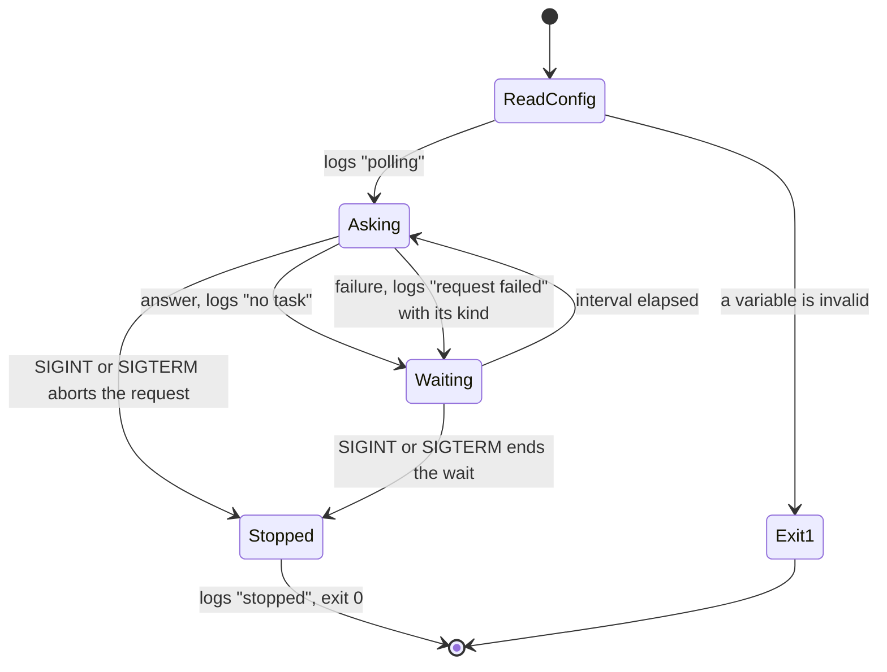
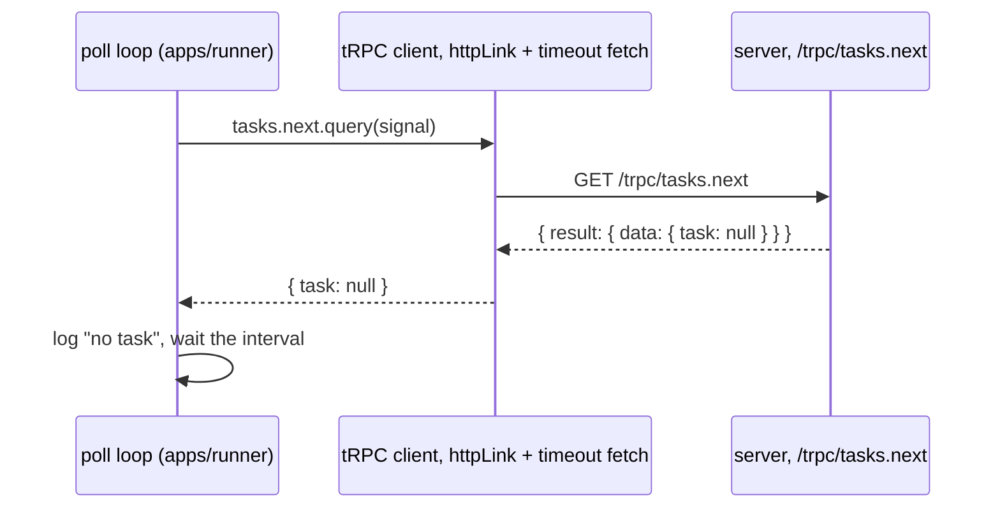

# Runner Asks for a Task - Plan

## Goal Capsule

- **Objective:** A runner on the user's machine asks the remote server for a task at a fixed interval and gets an answer, so the slice that executes tasks builds on a request path that already works.
- **Means:** A new Node app, `apps/runner`, that calls a new `tasks.next` procedure on the server through the tRPC client, one request at a time (KTD1–KTD4).
- **Product authority:** This plan's brainstorm dialogue of 2026-10-22 and the planning synthesis the user confirmed the same day, which added that the interval is an environment variable. A throwaway prototype outside the repo, run the same day, informed it.
- **Execution profile:** U1 can go first and alone. U2 to U5 follow their dependencies. U6 last, once the files it describes exist.
- **Stop conditions:** Stop and report if the runner's typecheck can't follow `AppRouter` into the server's sources (KTD2), or if the integration test can't find the server's folder inside Stryker's sandbox through the package name (KTD7).
- **Ships as:** commits on this worktree's branch, in one pull request.
- **Open blockers:** None.

---

## Product Contract

### Summary

sextou gets a runner: its own app, started by hand on the user's machine, that asks the server for a task every second or so and logs the answer. The server gets an API for that question, and in this slice it always answers that there is no task. The runner executes nothing.

**Product Contract preservation:** changed: AE2 now says "each attempt" instead of "each interval", since the next request waits for the previous one (KTD4); the Outstanding Questions were answered by KTD1, KTD2 and KTD7.

### Problem Frame

sextou has no way to send work to the user's machine. The server runs remotely, and nothing on the user's side asks it for anything but the web app's health check. Executing a task in a sandbox was tried in a throwaway prototype, but it needs a path to receive the task first. Building both at once would mix the questions of how the runner reaches the server and how it runs code.

### Key Decisions

- **The runner polls on a short, fixed interval.** (session-settled: user-directed — chosen over a long poll and over an open connection (WebSocket or SSE): the simplest loop, and the prototype showed a 1-second interval is enough.) Governs R2.
- **The server always answers that there is no task.** (session-settled: user-directed — chosen over a fixed example task and over switching between the two: this slice proves the polling cycle only, and the shape of a task comes with the slice that executes it.) Governs R4.
- **The runner sends no identification.** (session-settled: user-directed — chosen over a name without a secret and over a token the server checks: while the answer is always "no task", an open API exposes nothing.) Governs R5.

### Requirements

**Runner**

- R1. The runner is its own app, separate from the server, and the user starts it by hand from a terminal on their machine.
- R2. The runner asks the server for a task at a fixed interval, about one second by default, and logs each answer.
- R3. When the server does not answer, the request times out, or the server returns an error, the runner logs it and asks again at the next interval, without exiting.

**Server**

- R4. The server has an API through which a runner asks for a task, and in this slice it always answers that there is no task.
- R5. The server answers any caller, with no identification.

### Acceptance Examples

- AE1. **Covers R2, R4.** With the server up, the runner logs a "no task" answer once per interval for as long as it runs.
- AE2. **Covers R3.** The runner starts while the server is down: it logs a failed request on each attempt and keeps running. Once the server comes up, the next request logs "no task".

### Scope Boundaries

- Executing a task. Running code in a microVM (microsandbox with Deno) is the next slice, and in this one the runner installs and runs nothing.
- The shape of a task: what a task carries to the runner and what the runner sends back.
- Identifying or authenticating runners. This has to come before the server hands out real tasks, since a task belongs to an organization and a started task records who runs it (`CONCEPTS.md`, Task graph).
- The server opening a task graph, or reading tasks from one.
- The desktop app starting or bundling the runner.
- More than one runner, and coordinating between runners.
- A config module shared by the server and the runner. The runner copies the parsers it needs (KTD1).
- Considered and not built: a backoff that widens the interval while the server is down. At one record per attempt, the log shows the outage, and a backoff would delay the first "no task" after the server returns. A runner that floods its log during a long outage would change the call.

### Sources / Research

- `apps/server/src/router.ts`, `apps/server/src/modules/health/`: the pattern a new server module follows (AGENTS.md, Building a feature).
- GitHub's self-hosted runner reaches its server with outbound requests only, holding each one open about 50 seconds: [communicating with self-hosted runners](https://docs.github.com/en/actions/hosting-your-own-runners/managing-self-hosted-runners/communicating-with-self-hosted-runners).
- The throwaway prototype, for the execution slice: microsandbox 0.7.8 ran each task in a fresh microVM with Deno 2.9.8, with networking disabled, no access to the host's files, and a per-exec timeout. After the image was pulled, creating a VM took 0.6–0.9s and a whole task 1–2s. The SDK exports `ensureRuntime()`, where its docs say `install()`. Each finished VM stayed a zombie child of the runner process until the runner exited.

---

## Planning Contract

### Key Technical Decisions

- KTD1. **The runner is a Node package, `apps/runner` (`@sextou/runner`), laid out like the server's process files, and runs both from source and from a bundle.** Every gate in the repo (Vitest, Stryker, knip, oxlint) runs on Node, and the microsandbox SDK the next slice needs was a Node package with a native addon in the prototype. `main.ts`, `config.ts`, `logger.ts` and `env.d.ts` mirror `apps/server/src/`. The parsers it needs are copied from `apps/server/src/config.ts` (`parseTimeout`, `parseBoolean`, `parseLogLevel`) and `apps/web/settings.ts` (the URL parse): importing the server's runtime code would break knip and the dependency direction, and a shared package is out of scope. `dev` runs `tsx watch --env-file-if-exists=.env src/main.ts`, `build` bundles to `dist/runner.mjs` with Vite and Pino left external as the server does, and `start` runs the bundle. The root `build` script gains the runner. Governs R1.
- KTD2. **The runner calls the server through `createTRPCClient<AppRouter>` with `httpLink` and a fetch that adds the request timeout.** `httpLink` sends one request per call, and the runner makes one call at a time. The timeout fetch is the web's `timeoutFetch` (`apps/web/src/trpc.ts`), copied: `httpLink` has no timeout of its own, and the fetch merges `AbortSignal.timeout` with the caller's signal, which also lets shutdown abort a request (KTD4). The runner imports `AppRouter` as a whole `import type` statement from `@sextou/server/router`, declares `@sextou/server` as a `workspace:*` dev dependency and `@trpc/client` as a dependency, as the web does. A new `.oxlintrc.json` override for `apps/runner/**` allows `@sextou/server` and `@sextou/server/*` only as types, since today's rule covers only `apps/web/**`. Node sends no `Origin`, so the server's CORS doesn't affect the runner. Governs R2, R3.
- KTD3. **The server's procedure is `tasks.next`, a query whose output is `{ task: null }`.** It lives in a new module, `apps/server/src/modules/tasks/`, registered in `src/router.ts` under `tasks`. The output schema allows only `task: null`, so a later slice widens `task` without changing the outer shape. It is a query because it reads and changes nothing. The slice that hands out real tasks decides whether taking one becomes a mutation. The procedure reads nothing from the context, so `Context` doesn't change. Governs R4, R5.
- KTD4. **The runner makes one request at a time and waits the interval after each one settles.** The loop asks, logs the answer or the failure, then sleeps for `SEXTOU_RUNNER_POLL_INTERVAL_MS` before asking again. Against a server that hangs, requests never pile up: one fails per request timeout plus interval. One `AbortSignal` stops the loop: it ends the sleep, aborts the request in flight, and an abort the runner caused is not logged as a failure. Governs R2, R3.
- KTD5. **Every runner setting is a `SEXTOU_RUNNER_*` environment variable with a default, read in `config.ts`, listed in `apps/runner/.env.example`.** An invalid value is logged at the default level, names the variable, sets the exit code to 1, and the runner never asks, as the server's `main.ts` does. The interval is one of them, as the user asked.

  | Variable                            | Default                 | Meaning                                                |
  | ----------------------------------- | ----------------------- | ------------------------------------------------------ |
  | `SEXTOU_RUNNER_SERVER_URL`          | `http://127.0.0.1:4310` | The server's URL, http or https, trailing slash dropped |
  | `SEXTOU_RUNNER_POLL_INTERVAL_MS`    | `1000`                  | The wait after each request, before the next           |
  | `SEXTOU_RUNNER_REQUEST_TIMEOUT_MS`  | `30000`                 | How long a request may wait for the server             |
  | `SEXTOU_RUNNER_LOG_LEVEL`           | `info`                  | Pino's level                                           |
  | `SEXTOU_RUNNER_DEV`                 | `false`                 | Readable lines through pino-pretty instead of JSON     |

  The request timeout stays above the server's own timeouts, `SEXTOU_SERVER_DATABASE_TIMEOUT_MS` (`20000`) today, so the server answers before the runner gives up. Both `.env.example` files and AGENTS.md's timeout rule say so. Governs R1, R2, R3.
- KTD6. **The runner logs through one Pino logger, one JSON record per line on stdout, with a fixed `msg` per event.** `logger.ts` copies the server's `createLogger({ level, pretty }, destination?)`. The records:

  | When                   | Level  | `msg`            | Fields                                                                          |
  | ---------------------- | ------ | ---------------- | ------------------------------------------------------------------------------- |
  | the runner starts      | `info` | `polling`        | `url`, `intervalMs`                                                             |
  | the server answers     | `info` | `no task`        | none                                                                            |
  | the server sends an error | `warn` | `request failed` | `kind: 'server-error'`, the tRPC `code`, the message                         |
  | no answer comes        | `warn` | `request failed` | `kind: 'no-answer'`, the message (connection refused, timeout, a non-tRPC body) |
  | a signal stops it      | `info` | `stopped`        | none                                                                            |

  The two failure kinds follow AGENTS.md's split: a `TRPCClientError` with `data` is an error the server sent, one without `data` is no answer. A failure record carries no stack, since a down server would otherwise write one every second. A server of another version that lacks the procedure answers `NOT_FOUND`, which shows as a `server-error` on every attempt. Governs R2, R3.
- KTD7. **The runner's unit suite answers for every file, and its integration suite runs the poll against the real server started as a child process.** The loop, the client, the config and `main.ts` are unit-tested with `fetch` stubbed and fake timers for the interval. `main.ts` reaches neither the disk nor a port, so it stays in the unit suite, with `process.on`, `off` and `exit` spied as the server's `tests/integration/main.test.ts` does. The integration test spawns the server as `apps/web/tests/integration/modules/health/health-page.test.tsx` does, but finds its folder through `import.meta.resolve('@sextou/server/router')` instead of a relative path, which breaks inside Stryker's sandbox (`.compound-engineering/artifacts/solutions/developer-experience/stryker-10-with-vitest-5-and-typescript-7.md`, item 3). `integrationOnly` stays empty, as in the web. Every config sets `fsModuleCachePath: 'node_modules/.vitest-cache'` (`vitest-shared-module-cache-race-under-pnpm-recursive.md`), and no test sits inside a `describe`. Governs R2, R3, R4.

### High-Level Technical Design

The runner's lifecycle:



One request, end to end:



### Output Structure

```text
apps/runner/
  .env.example                 every variable the runner reads, with its default
  package.json
  tsconfig.json
  vite.config.mts              bundles src/main.ts to dist/runner.mjs
  vitest.config.mts            unit suite, coverage, integrationOnly (empty)
  vitest.integration.config.mts
  vitest.mutation.config.mts
  stryker.config.mjs
  src/
    env.d.ts                   Node's types
    main.ts                    reads the config, starts the loop, stops on a signal
    config.ts                  every setting, parsed from the environment
    logger.ts                  the Pino logger
    client.ts                  the tRPC client and its timeout fetch
    poll.ts                    the loop: ask, log, wait
  tests/
    unit/                      mirrors src/: config, logger, client, poll, main
    integration/               poll.test.ts, against the server as a child process
```

### Assumptions

- The runner's typecheck follows `AppRouter` into the server's sources the way the web's does. The runner loads Node's types, which the web doesn't, so nothing in the server's router graph should fail it.
- `import.meta.resolve('@sextou/server/router')` resolves inside Stryker's sandbox, since pnpm links `@sextou/server` into the runner's `node_modules`.

### Deferred to Implementation

- The exact signature of the loop function, and whether the client is injected into it or built inside it.
- Which text the `no-answer` record's message carries for each cause, as `TRPCClientError` reports it.

---

## Implementation Units

### U1. Add the `tasks.next` procedure to the server

- **Goal:** The server answers `tasks.next` with `{ task: null }` to any caller.
- **Requirements:** R4, R5; KTD3.
- **Dependencies:** none.
- **Files:**
  - `apps/server/src/modules/tasks/index.ts`, `tasks.router.ts`, `tasks.schema.ts` (new)
  - `apps/server/src/router.ts`
  - `apps/server/tests/unit/modules/tasks/tasks.router.test.ts` (new)
  - `apps/server/tests/unit/app.test.ts`
- **Approach:** Mirror `modules/health/`: the schema file holds the output schema, the router file `router({ next: procedure.output(…).query(…) })`, and `index.ts` exports the router. `router.ts` adds it as `tasks`.
- **Patterns to follow:** `apps/server/src/modules/health/`, `apps/server/tests/unit/modules/health/health.router.test.ts` (the `caller` helper with a silent logger).
- **Test scenarios:**
  - `tasks.next` through `createCallerFactory(tasksRouter)` returns `{ task: null }`.
  - `tasks.next` with a context that has no database and no version still returns `{ task: null }`, since it reads nothing from the context.
  - `GET /trpc/tasks.next` through `createApp(…).request` answers 200 with `{ result: { data: { task: null } } }`.
  - The batched form, `GET /trpc/tasks.next?batch=1&input=%7B%7D`, answers an array with the same data.
  - `GET /trpc/tasks.next` with no `Origin` header still answers 200. Covers R5.
- **Verification:** the server's unit suite passes at 90% per file, with `tasks.router.ts` and `tasks.schema.ts` covered.

### U2. Create the runner package and wire it into the repo's gates

- **Goal:** `apps/runner` exists with its config, logger, build and test setup, and every repo gate runs it.
- **Requirements:** R1; KTD1, KTD2, KTD5, KTD6, KTD7.
- **Dependencies:** none.
- **Files:**
  - `apps/runner/package.json`, `tsconfig.json`, `.env.example`, `vite.config.mts`, `vitest.config.mts`, `vitest.integration.config.mts`, `vitest.mutation.config.mts`, `stryker.config.mjs` (new)
  - `apps/runner/src/env.d.ts`, `config.ts`, `logger.ts` (new)
  - `apps/runner/tests/unit/config.test.ts`, `logger.test.ts` (new)
  - `package.json` (the `build` script)
  - `vitest.config.ts` (root projects)
  - `.github/workflows/tests.yml` (the level matrix: `runner / unit`, `runner / integration`; the mutation matrix: `runner / mutation`)
  - `.oxlintrc.json` (the `apps/runner/**` override)
  - `apps/server/.env.example` (the database timeout stays below the runner's request timeout)
- **Approach:**
  1. `package.json` declares `@trpc/client`, `pino` and `pino-pretty` as dependencies, and `@sextou/server` (`workspace:*`), `@trpc/server`, `@types/node`, `tsx`, `vite`, `vitest`, `@vitest/coverage-v8` and the two Stryker packages as dev dependencies, at the versions the server and the web use. Its scripts copy the server's: `dev`, `build`, `start`, `typecheck`, `test`, `test:unit`, `test:integration`, `test:mutation`.
  2. `config.ts` reads KTD5's variables from the environment passed in, with the copied parsers. It rejects an interval or timeout outside 1..2147483647 ms, a URL that isn't http or https, a level outside Pino's, and a boolean other than `true` or `false`, naming the variable.
  3. `logger.ts` copies the server's.
  4. The Vitest configs copy the server's, named `runner/unit`, `runner/integration`, with an empty `integrationOnly` and the integration suite's `testTimeout` of 30 s.
  5. The `.oxlintrc.json` override copies the web's `@sextou/server` entries with a message about the runner and no `electron` entry.
- **Patterns to follow:** `apps/server/package.json`, `apps/server/src/config.ts`, `apps/server/src/logger.ts`, `apps/server/vite.config.mts`, `apps/server/vitest*.mts`, `apps/server/stryker.config.mjs`, `apps/web/settings.ts` (the URL parse), `apps/web/vitest.config.ts` (an empty `integrationOnly`).
- **Test scenarios:**
  - `loadConfig` with an empty environment returns each default of KTD5.
  - `loadConfig` takes each variable when set.
  - `loadConfig` drops a trailing slash from `SEXTOU_RUNNER_SERVER_URL`.
  - `loadConfig` throws naming the variable for an `ftp://` URL, a non-URL, an interval of `0`, a non-numeric timeout, a timeout above 2147483647, an unknown log level, and `SEXTOU_RUNNER_DEV=yes`.
  - `createLogger` writes one JSON record per line, with `level` and `msg`, to the destination it is given.
  - `createLogger` at level `warn` writes no `info` record.
- **Verification:** `pnpm lint`, `pnpm typecheck` and `pnpm --filter @sextou/runner test:unit` pass. The bundle is checked in U4, once `src/main.ts` exists.

### U3. Build the client and the poll loop

- **Goal:** The runner asks `tasks.next`, logs each answer or failure, and waits the interval after each request, until its signal aborts.
- **Requirements:** R2, R3; AE1, AE2; KTD2, KTD4, KTD6.
- **Dependencies:** U1, U2.
- **Files:**
  - `apps/runner/src/client.ts`, `poll.ts` (new)
  - `apps/runner/tests/unit/client.test.ts`, `poll.test.ts` (new)
- **Approach:**
  1. `client.ts` builds the tRPC client from the server URL and the request timeout, with the copied timeout fetch.
  2. `poll.ts` loops while the signal is not aborted: it asks with the signal, logs per KTD6, then waits the interval through a wait that the signal ends early.
  3. A failure is told apart by the error's `data`: present is `server-error` with `data.code`, absent is `no-answer`. A rejection caused by the runner's own abort is not logged.
- **Patterns to follow:** `apps/web/src/trpc.ts` and `apps/web/tests/unit/trpc.test.ts` (real timers for `AbortSignal.timeout`: fake ones don't fire it).
- **Test scenarios:**
  - The timeout fetch passes a request through when the server answers in time.
  - The timeout fetch rejects with a timeout when the stubbed fetch never settles, on real timers with a timeout of a few milliseconds.
  - The timeout fetch rejects when the caller's signal aborts first.
  - The client builds its URL as the server URL plus `/trpc`.
  - Covers AE1. With `fetch` stubbed to answer `{ task: null }` and fake timers, three intervals produce three `no task` records.
  - The second request starts only one interval after the first one settles, not one interval after it started: with a stubbed fetch that takes 5 s to answer and a 1 s interval, the second call is made at 6 s.
  - Covers AE2. With `fetch` rejecting as a refused connection, each attempt writes a `warn` record with `kind: 'no-answer'`, and the loop keeps asking.
  - Covers AE2. After two refused attempts, a `fetch` that answers makes the next record `no task`.
  - A tRPC error response, such as a `NOT_FOUND` body with status 404, writes `kind: 'server-error'` and `code: 'NOT_FOUND'`.
  - A 500 that isn't tRPC's shape writes `kind: 'no-answer'`.
  - No failure record carries a `stack` field.
  - Aborting during the wait ends the loop before the next request.
  - Aborting during a request ends the loop and writes no `request failed` record.
- **Verification:** the runner's unit suite passes at 90% per file, with `client.ts` and `poll.ts` covered.

### U4. Wire the process in `main.ts`

- **Goal:** Running the runner reads its config, starts the loop, and stops it cleanly on SIGINT or SIGTERM.
- **Requirements:** R1, R3; KTD5, KTD6.
- **Dependencies:** U2, U3.
- **Files:**
  - `apps/runner/src/main.ts` (new)
  - `apps/runner/tests/unit/main.test.ts` (new)
- **Approach:**
  1. Read the config. On an invalid variable, log it at the default level, set `process.exitCode = 1`, and return without asking.
  2. Create the logger and the client, write the `polling` record with the URL and the interval, and start the loop with an `AbortController`'s signal. The loop itself writes only the per-request records.
  3. The first SIGINT or SIGTERM removes both handlers, aborts the controller, logs `stopped` once the loop returns, and exits with 0. A second signal gets Node's default.
- **Patterns to follow:** `apps/server/src/main.ts` (invalid config, the first-signal-only shutdown), `apps/server/tests/integration/main.test.ts` (importing `main` after `vi.resetModules()`, `vi.stubEnv`, spying `process.on`, `off` and `exit`, the logger to a `Writable`).
- **Test scenarios:**
  - With an invalid `SEXTOU_RUNNER_POLL_INTERVAL_MS`, `main` logs an error naming it, sets the exit code to 1, and `fetch` is never called.
  - With a valid environment and `fetch` stubbed, `main` writes `polling` with the URL and interval, then `no task`.
  - SIGTERM during the wait writes `stopped` and calls `process.exit(0)`.
  - SIGINT during a request aborts it, writes no `request failed`, and exits with 0.
  - After the first signal, both handlers are removed.
- **Verification:** the runner's unit suite passes at 90% per file with `main.ts` included, `pnpm --filter @sextou/runner build` produces `apps/runner/dist/runner.mjs`, and `pnpm --filter @sextou/runner dev` against `pnpm --filter @sextou/server dev` logs `no task` once a second.

### U5. Test the runner against the real server

- **Goal:** One test shows the runner's loop getting `no task` from a real server, and failures with no server.
- **Requirements:** R2, R3, R4; AE1, AE2; KTD7.
- **Dependencies:** U1, U3.
- **Files:**
  - `apps/runner/tests/integration/poll.test.ts` (new)
- **Approach:** Start the server as a child process from its sources, as the web's health-page test does, on port `0` with an in-memory database, and read its URL from the `listening` record. Find the server's folder from `import.meta.resolve('@sextou/server/router')`. Run the loop in-process with a logger to a `Writable` and a short interval, and abort it once the records needed have arrived. For the no-server case, listen on port `0`, read the port and close it, as that test does.
- **Patterns to follow:** `apps/web/tests/integration/modules/health/health-page.test.tsx` (spawning, waiting for `listening`, SIGTERM then waiting for `exit`).
- **Test scenarios:**
  - Covers AE1. Against the running server, the loop writes two `no task` records in a row.
  - Covers AE2. Against a port nothing listens on, the loop writes two `request failed` records with `kind: 'no-answer'` and keeps going.
- **Verification:** `pnpm --filter @sextou/runner test:integration` passes, and `pnpm --filter @sextou/runner test:mutation` reaches 80%, which also shows the server's folder resolves inside Stryker's sandbox.

### U6. Describe the runner in AGENTS.md

- **Goal:** AGENTS.md describes the runner the way it describes the server and the web app, so the next feature follows it.
- **Requirements:** R1; KTD1, KTD2, KTD5, KTD7.
- **Dependencies:** U1–U5.
- **Files:**
  - `AGENTS.md`
- **Approach:**
  1. The opening line and Architecture name the runner, with a bullet for `apps/runner`, and the dependency direction says the runner imports only the server's router type.
  2. Commands list the runner's `dev`, beside the server's, among the long-running processes left to the user.
  3. Structure gains `apps/runner/`'s tree, and Building a feature names `SEXTOU_RUNNER_*` beside the other prefixes, the timeout rule with the runner, and the import rule for `apps/runner`.
  4. Tests says the runner has an integration suite that answers for no file, and CI lists its checks.
- **Test expectation:** none -- documentation only.
- **Verification:** every path AGENTS.md names for the runner exists, and its tree matches `apps/runner/` on disk.

---

## Verification Contract

| Gate            | Command                                                                        | Proves                                                    |
| --------------- | ------------------------------------------------------------------------------ | --------------------------------------------------------- |
| Format and lint | `pnpm lint`                                                                    | oxlint, with the runner's import override, and oxfmt      |
| Lint gates      | `pnpm exec oxlint -c .oxlintrc.gates.json .`                                   | no `console` in the runner                                |
| Types           | `pnpm typecheck`                                                               | the runner following `AppRouter` into the server          |
| Unit            | `pnpm test:unit`                                                               | each unit suite at 90% per file, the runner's and server's included |
| Integration     | `pnpm test:integration`                                                        | the runner against the real server (U5)                   |
| Mutation        | `pnpm --filter @sextou/runner test:mutation`, then `@sextou/server`            | each package at 80%                                       |
| Build           | `pnpm build`                                                                   | the runner's bundle beside the others                     |
| Manual          | `pnpm --filter @sextou/server dev`, then `pnpm --filter @sextou/runner dev`    | AE1; stop the server for AE2, start it again for the return to `no task` |

`git push` runs `pnpm typecheck` and `pnpm test:unit` through the pre-push hook. CI's `tests.yml` runs `runner / unit`, `runner / integration` and `runner / mutation` as their own checks.

## Definition of Done

- Every unit's Verification holds, and every gate in the Verification Contract passes.
- `apps/runner/.env.example` lists every variable `config.ts` reads, with the default the code uses, and both `.env.example` files state the timeout relation of KTD5.
- Nothing in `apps/runner/src/` imports `@sextou/server` except `import type` from `@sextou/server/router`.
- AGENTS.md's trees match the files on disk.
- Code from abandoned attempts is removed from the diff.
