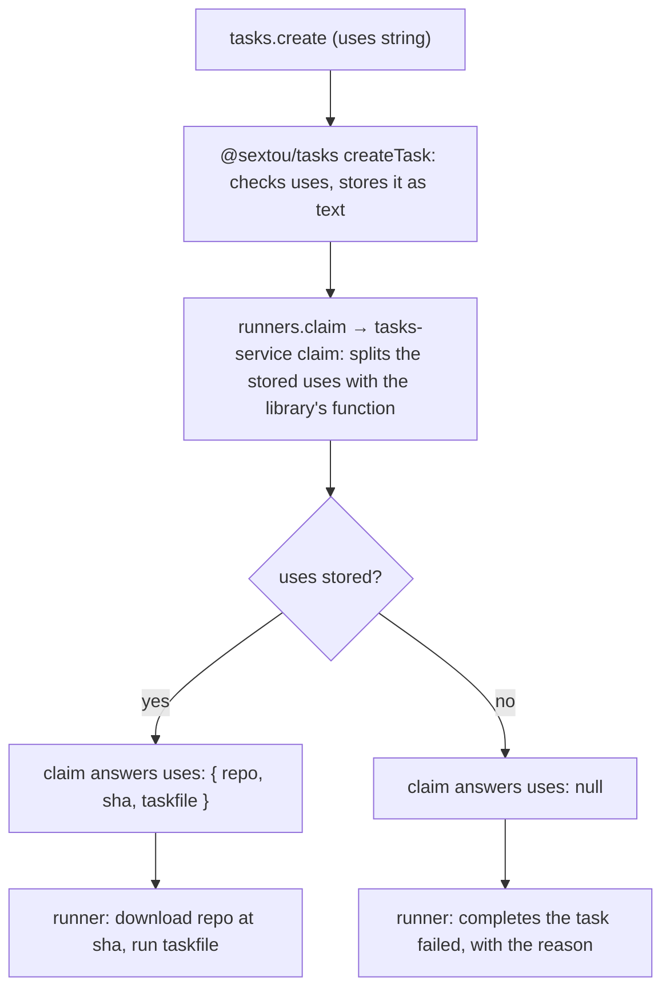

# The Workflow a Task Runs - Plan

## Goal Capsule

- **Objective:** whoever creates a task names the Taskfile its runner runs, so `sextou/development`, `git/checkout` and `harness/claude-headless` can run through a task, and every attempt of a task runs the same code.
- **Means:** a `uses` reference on each task, in the syntax of reusable workflows, checked by `@sextou/tasks` and handed to the runner by the claim (issue #101; KTD1, KTD4).
- **Product authority:** the repository owner. Resolves issue #101.
- **Authority order:** the Product Contract's Requirements win on behavior, the KTDs on mechanism, and a unit overrides neither.
- **Stop conditions:** stop and report if drizzle-kit can't regenerate the initial migration with the new column, or if Turso refuses the DDL it generates.
- **Execution profile:** one branch and one pull request. Units land in order, and the full Verification Contract runs before the push.
- **Open blockers:** none.

---

## Product Contract

Product Contract preservation: Product Contract unchanged. Its questions deferred to planning are answered by KTD1, KTD2 and U5, and removed here.

### Summary

A task may carry a `uses` reference, `owner/repo/path/to/Taskfile.yml@<sha>`, checked when the task is created.
The claim splits it into the repository, the commit and the Taskfile's path, and hands them to the runner, which runs that Taskfile instead of the fixed hello-world stub every claim answers today.
A task without `uses` is still ready and claimed, and its run fails with a reason.

### Problem Frame

Every claim answers the same Taskfile: `runners.claim` returns `stubSource` (`apps/server/src/modules/runners/stub-source.ts`), this repository's hello-world at the commit that added it, whatever the task.
A task carries what its run works on (`context`) but not what runs, so the workflows in `packages/workflows` can't be run through a task.

### Key Decisions

- **`uses` follows the syntax of GitHub's and Gitea's reusable workflows, pinned to a full commit SHA.** Every attempt of a task then runs the same code, and creating a task calls nothing on the network. Gitea likewise fixes what a job runs when the job is created, not when it is picked. Governs R1, R2.
- **Which tasks are ready does not change; a task without `uses` fails at the runner.** (session-settled: user-directed — chosen over offering runners only tasks with a `uses`, in the ready index or only in the claim, over failing the task in the server's claim, and over requiring `uses` on every task: readiness stays as it is, and the case of a task without `uses` gets better handling later.) Governs R7, R9, R11.
- **The claim's field is named `uses`, replacing `source`.** (session-settled: user-directed — chosen over keeping `source`: a task's `source` already means its source path, so each name keeps one meaning.) Governs R5, R6.
- **The claim hands `uses` to the runner already split, as an object.** (session-settled: user-directed — chosen over sending the `uses` string for the runner to split: the server splits and checks it in one place, and the runner never learns the syntax.) Governs R6.

### Requirements

**A task names what it runs**

- R1. A task may carry a `uses` reference, `owner/repo/path/to/Taskfile.yml@<sha>`, naming a Taskfile in a public GitHub repository at a commit; `tasks.create` accepts it as optional.
- R2. `tasks.create` refuses a `uses` whose ref is not a full commit SHA (40 lowercase hex characters), or whose repository or path breaks the rules the claim's answer applies today: `owner/name` with neither part `.` or `..`, and a path inside the repository with no empty, `.` or `..` segment.
- R3. A task's `uses` is stored as given and never changes after creation.
- R4. Every procedure that answers a task shows its `uses`, or null, as it shows `context`.
- R5. A task's existing `source`, where its longer text lives, keeps its name and meaning.

**The claim hands it to the runner**

- R6. `runners.claim` answers the claimed task's `uses` as `{ repo, sha, taskfile }`, in a field named `uses` that replaces today's `source`.
- R7. For a claimed task with no `uses`, the claim's `uses` is null.
- R8. The fixed stub every claim answers today is removed.
- R9. Which tasks are ready, and which one a claim takes, does not change: a task without `uses` is ready and claimed like any other.

**The runner runs it**

- R10. The runner downloads the repository at the commit the claim's `uses` names and runs the Taskfile at its path, as it does with `source` today.
- R11. Given a claim whose `uses` is null, the runner downloads nothing and completes the task as `failed`, with a reason that says the task names nothing to run; the runner keeps running and goes on claiming.

### Acceptance Examples

- AE1. **Covers R2.**
  - **Given:** a `tasks.create` call whose `uses` is `thatsnotmynameio/sextou/packages/workflows/hello-world/Taskfile.yml@main`.
  - **Then:** the task is refused as invalid, and nothing is created.
- AE2. **Covers R6, R10.**
  - **Given:** a ready task whose `uses` is `thatsnotmynameio/sextou/packages/workflows/sextou/development/Taskfile.yml@<sha>`.
  - **When:** a runner claims it.
  - **Then:** the claim's `uses` is `{ repo: 'thatsnotmynameio/sextou', sha: '<sha>', taskfile: 'packages/workflows/sextou/development/Taskfile.yml' }`, and the runner runs that Taskfile at that commit.
- AE3. **Covers R7, R9, R11.**
  - **Given:** a ready task with no `uses`, whose assignee a runner serves.
  - **When:** the runner claims it.
  - **Then:** the task becomes `running` with its first attempt, the claim's `uses` is null, and the runner completes the task as `failed` with its reason, without downloading anything. The tasks it blocks keep waiting, as behind any failed blocker, and the runner claims its next task.

### Scope Boundaries

- Resolving a branch or a tag to its commit when a task is created.
- Better handling of a task without `uses`, such as not offering it to runners or refusing it at the claim.
- Changing a task's `uses` after creation.
- Private repositories, and hosts other than GitHub.
- The runner's `source/` folder, where it extracts the downloaded repository, keeps its name.
- Tasks databases created before this change: the initial migration is regenerated (KTD3), and an older `tasks.db` is not supported.

#### Deferred to Follow-Up Work

- Removing the "stored and never read" wording from the comments: issue #110. This plan leaves that wording where it stands.

### Sources / Research

- Issue #101, which this plan resolves. Issue #105, "Let a task name the workflow it runs", appears to cover the same subject.
- `apps/server/src/modules/runners/runners.schema.ts`: `sourceSchema`, the rules R2 reuses, and the claim's answer.
- `apps/server/src/modules/runners/stub-source.ts`: the stub R8 removes, whose coordinates the smoke drivers keep (KTD6).
- `packages/tasks/src/schema.ts`: the `tasks` table, its `context` column and the `task_ready` index R9 leaves unchanged.
- `apps/runner/src/runner.ts`: the loop that completes a run as `failed` with a reason; `apps/runner/src/taskfile.ts`: the execute that downloads and runs the Taskfile.
- `.compound-engineering/artifacts/plans/2026-10-22-1503-refactor-drizzle-task-graph-plan.md`: the precedent for one regenerated initial migration with no path from older files.

---

## Planning Contract

### Key Technical Decisions

- KTD1. **`@sextou/tasks` checks `uses` on `createTask` and exports the function that splits it.** (session-settled: user-directed — chosen over the server alone checking the format while the library stores opaque text: the task graph refuses a malformed `uses` from any caller.) `createTaskSchema` gains `uses`, absent as null, and an input it rejects is refused as `invalid` like any other, which the server already answers as `BAD_REQUEST`. The same rules split a stored `uses` into `{ repo, sha, taskfile }` for the claim, so the check and the split can't disagree. Governs R1, R2, R6.
- KTD2. **`uses` splits at its last `@`.** The part after it is the ref, which must be 40 lowercase hex characters. Before it, the first two segments are `owner/name` and the rest is the Taskfile's path, which must hold at least one segment. The rules on each part are today's `sourceSchema` rules, moved into the library. A SHA holds no `@`, so a path that does still splits exactly. Governs R2, R6.
- KTD3. **The initial migration is regenerated with the new column, not followed by a second one.** (session-settled: user-directed — chosen over a new migration that adds the column: no one runs a tasks database yet.) The `packages/tasks/drizzle/20261026162145_init` folder is deleted and drizzle-kit generates `init` again from the schema. `uses` is one nullable text column on `tasks`, with no index: no query filters by it (R9).
- KTD4. **The claim's split happens in `tasks-service.ts`, the only server file that imports `@sextou/tasks`.** The `Tasks` port's claim result carries the split `uses` (or null) beside the task, and `runners.claim` only passes it on. `Task` in `apps/server/src/tasks.ts` gains `uses` as the stored string, for R4. Governs R4, R6, R7.
- KTD5. **The claim's output schema keeps today's rules, renamed `sourceSchema` → `usesSchema`.** The library already checked the value, but the output check still guards what the runner joins into a path on its machine, as every procedure's output is checked. Governs R6.
- KTD6. **The smoke drivers create their task with the stub's coordinates as `uses`:** `thatsnotmynameio/sextou/tasks/hello-world/Taskfile.yml@87dfc7f4f839d6e334ab1a1cdf6494c62499d9ff`. The runner's smoke then still runs the real hello-world from GitHub, as it does now through the stub. Governs R8, R10.
- KTD7. **The runner handles a null `uses` at the top of `taskfileExecute`, before it makes its temporary folder.** It resolves `failed` with the reason, so the loop completes the task through its existing path and no download, folder or go-task process happens. Governs R11.

### High-Level Technical Design

Where a `uses` goes, from creation to the run:

### Assumptions

- The web app reads nothing from a task or a claim yet, so the renamed claim field and the new task field change no web code. Its typecheck follows `AppRouter` and confirms this.

---

## Implementation Units

### U1. The task graph stores and checks `uses`

- **Goal:** `@sextou/tasks` accepts, checks, stores and returns a task's `uses`, and exports its split.
- **Requirements:** R1, R2, R3, R6 (the split), R9; KTD1, KTD2, KTD3.
- **Dependencies:** none.
- **Files:**
  - `packages/tasks/src/schema.ts` (the `uses` column on `tasks`)
  - `packages/tasks/src/schemas.ts` (the `uses` schema, `createTaskSchema`, the split)
  - `packages/tasks/src/graph.ts` (`Task`, `NewTask`, the insert and the selected columns)
  - `packages/tasks/src/index.ts` (export the split and its type)
  - `packages/tasks/drizzle/` (the `20261026162145_init` folder deleted, `init` regenerated)
  - `packages/tasks/tests/unit/schemas.test.ts`
  - `packages/tasks/tests/integration/graph.test.ts`
  - `packages/tasks/tests/integration/schema.test.ts`
- **Approach:**
  1. Add the nullable `uses` text column beside `context`, and carry it through `Task`, `NewTask`, the insert and the columns every read selects, so `claimTask` returns it too.
  2. Move today's `sourceSchema` rules into `schemas.ts` as the parts of a `uses`, and add `uses` to `createTaskSchema` as optional, null when absent.
  3. Export the function that splits a `uses` string into `{ repo, sha, taskfile }`, built on the same rules (KTD2).
  4. Delete the initial migration and regenerate it with `pnpm --filter @sextou/tasks exec drizzle-kit generate --name init` (KTD3). Never hand-edit the result.
- **Patterns to follow:** `context` and `sourcePath` in `schemas.ts` and `graph.ts`; the refusal of an input the schema rejects as `invalid`.
- **Test scenarios:**
  - `createTaskSchema` accepts `thatsnotmynameio/sextou/packages/workflows/hello-world/Taskfile.yml@<40 hex>`.
  - Covers AE1. `createTaskSchema` rejects a ref that is a branch (`@main`), a short SHA (7 hex), uppercase hex, and a missing `@`.
  - `createTaskSchema` rejects an owner or name of `.` or `..`, an empty or `.`/`..` path segment, a leading or trailing slash, and a reference with no path after `owner/name`.
  - `createTaskSchema` rejects an empty string, and maps an absent `uses` to null.
  - The split of a valid `uses` returns its `repo`, `sha` and `taskfile`, and a path holding `@` splits at the last one.
  - `createTask` with a `uses` returns the task with that `uses`, and a later `claimTask` returns it unchanged.
  - `createTask` without a `uses` returns `uses: null`, and the task is listed ready and claimed like any other (R9).
  - `createTask` with a malformed `uses` is refused as `invalid` and creates no task.
  - The schema test that leaves a task's description, source path and context optional covers `uses` too, and the drift test passes on the regenerated migration.
- **Verification:** the package's unit and integration suites pass at the 90% floor, and its mutation score stays at or above 80%.

### U2. The server stores and answers `uses`

- **Goal:** `tasks.create` takes a `uses`, every task the server answers shows it, and the port's claim carries it split.
- **Requirements:** R1, R2, R4, R5, R7; KTD1, KTD4.
- **Dependencies:** U1.
- **Files:**
  - `apps/server/src/tasks.ts` (`Task.uses`, `NewTask.uses`, the split's type, the claim result)
  - `apps/server/src/tasks-service.ts` (create, claim and `toTask` mappings)
  - `apps/server/src/modules/tasks/tasks.schema.ts` (`createInputSchema`, `taskSchema`)
  - `apps/server/tests/tasks.ts` (`fakeTasks`)
  - `apps/server/tests/unit/modules/tasks/tasks.router.test.ts`
  - `apps/server/tests/integration/tasks-service.test.ts`
- **Approach:**
  1. `createInputSchema` takes `uses` as an optional string and leaves its check to the library, whose `invalid` the router already answers as `BAD_REQUEST`. `taskSchema` answers `uses` as a nullable string.
  2. `tasks-service.ts` passes `uses` to `createTask`, maps it back in `toTask`, and on a claim splits the stored `uses` with the library's function into the claim result (KTD4).
  3. `tasks.ts` stays free of Node: the split's type is declared there, not imported from the library.
- **Patterns to follow:** how `context` crosses `tasks.ts`, `tasks-service.ts` and `tasks.schema.ts`; `fakeTasks` for router unit tests.
- **Test scenarios:**
  - `tasks.create` with a `uses` answers the task with that `uses`; without one it answers `uses: null`.
  - `tasks.create` whose port refuses as `invalid` answers `BAD_REQUEST` (router unit test, through `fakeTasks`).
  - Covers AE1. The tasks service refuses a create with `@main` as `invalid` (integration, on the real library).
  - The tasks service's claim of a task created with a `uses` returns its split `{ repo, sha, taskfile }`.
  - The tasks service's claim of a task created without a `uses` returns the task with `uses: null` beside it.
  - A task's `source` and `uses` come back as given, each in its own field (R5).
- **Verification:** the server's unit and integration suites pass at the 90% floor, and `pnpm typecheck` passes for the server and the web app.

### U3. The claim hands `uses` to the runner

- **Goal:** `runners.claim` answers `uses` in place of `source`, and the stub is gone.
- **Requirements:** R6, R7, R8, R9; KTD4, KTD5.
- **Dependencies:** U2.
- **Files:**
  - `apps/server/src/modules/runners/runners.schema.ts` (`sourceSchema` → `usesSchema`, the claim output's `uses`, nullable)
  - `apps/server/src/modules/runners/runners.router.ts`
  - `apps/server/src/modules/runners/stub-source.ts` (deleted)
  - `apps/server/tests/unit/modules/runners/runners.router.test.ts`
  - `apps/server/tests/unit/modules/runners/runners.schema.test.ts`
  - `apps/server/tests/integration/main.test.ts`
- **Approach:** rename the schema and the field, make it nullable, pass the port's split `uses` through, and delete `stub-source.ts` with its import.
- **Patterns to follow:** the existing claim mapping in `runners.router.ts`; `runners.schema.test.ts`'s table of rejected paths, renamed.
- **Test scenarios:**
  - Covers AE2. A claim of a task with a `uses` answers `uses: { repo, sha, taskfile }` and no `source` field.
  - Covers AE3. A claim of a task without a `uses` answers `uses: null` and starts its first attempt.
  - The claim output schema still rejects a repository with a `.` part, a short SHA, and a path with an empty, `.` or `..` segment.
  - The server's `main.test.ts` claim, end to end, carries the `uses` its task was created with.
- **Verification:** the server's suites pass at the floor; no file in `apps/server` names `stubSource`.

### U4. The runner runs the claim's `uses`

- **Goal:** the runner downloads and runs what `uses` names, and fails a task whose `uses` is null without downloading.
- **Requirements:** R10, R11; KTD7.
- **Dependencies:** U3.
- **Files:**
  - `apps/runner/src/taskfile.ts`
  - `apps/runner/tests/unit/client.test.ts`
  - `apps/runner/tests/unit/runner.test.ts`
  - `apps/runner/tests/integration/taskfile.test.ts`
  - `apps/runner/tests/integration/main.test.ts`
- **Approach:**
  1. `taskfileExecute` reads `uses` where it read `source`, and its comment says so.
  2. On a null `uses` it resolves `failed` with the reason before `mkdtemp` (KTD7).
  3. `runner.ts` and `client.ts` take their types from `AppRouter`, so they change only where a test fixture or comment names `source`.
- **Patterns to follow:** the `download:` failure path in `taskfileExecute`, which resolves `failed` with a reason; the tarball server in `tests/archive.ts`.
- **Test scenarios:**
  - `taskfileExecute` with a `uses` downloads that repository at that SHA and runs the Taskfile at its path (existing cases, renamed).
  - Covers AE3. `taskfileExecute` with `uses: null` resolves `failed` with the reason, and the tarball server receives no request.
  - Covers AE2, AE3. `main.test.ts` creates one task with a `uses` the local tarball serves, which succeeds with its output logged, and one without a `uses`, which ends `failed` with the reason. The runner keeps claiming after the failed one.
- **Verification:** the runner's unit and integration suites pass at the floor, with go-task installed so the integration tests that need it run.

### U5. The smoke drivers and the docs describe `uses`

- **Goal:** the `run-tasks`, `run-server` and `run-runner` skills and the repository's docs describe `uses` instead of the stub.
- **Requirements:** R2, R6, R8, R10; KTD6.
- **Dependencies:** U3, U4.
- **Files:**
  - `packages/tasks/.claude/skills/run-tasks/driver.mjs`
  - `packages/tasks/.claude/skills/run-tasks/SKILL.md`
  - `apps/server/.claude/skills/run-server/driver.mjs`
  - `apps/server/.claude/skills/run-server/SKILL.md`
  - `apps/runner/.claude/skills/run-runner/driver.mjs`
  - `apps/runner/.claude/skills/run-runner/SKILL.md`
  - `AGENTS.md` (the server's claim, the workflows package's stub sentences, the Structure tree's `hello-world/` line)
  - `CONCEPTS.md` (the Task graph entry: a task may name, with `uses`, the Taskfile a runner runs for it)
- **Approach:**
  1. `run-tasks`'s smoke creates a task with KTD6's `uses` and checks that `claimTask` returns it unchanged, claims a task without one and gets `uses: null`, and has a `uses` ending in `@main` refused as `invalid`. Its SKILL.md names `uses` in the smoke's row and among the refusals.
  2. The `run-server` and `run-runner` smokes create their task with KTD6's `uses`.
  3. The server's smoke checks the claim's `uses.taskfile` where it checked `source.taskfile`, and adds a create with a malformed `uses` answered `400`.
  4. The docs drop every mention of the stub, and say a task without `uses` is claimed and fails at the runner.
- **Patterns to follow:** the smoke's existing `step` checks in `driver.mjs`; AGENTS.md's prose register.
- **Test scenarios:** Test expectation: none -- drivers and docs; the smokes themselves are the check.
- **Verification:** the `run-tasks`, `run-server` and `run-runner` smokes pass, and `rg -n "stub" AGENTS.md CONCEPTS.md apps/*/.claude/skills` finds no claim stub.

---

## Verification Contract

| Check            | Command                                                                                                                  | Applies to                                                             |
| ---------------- | ------------------------------------------------------------------------------------------------------------------------ | ---------------------------------------------------------------------- |
| Lint and format  | `pnpm lint`                                                                                                              | every unit                                                             |
| Gate rules       | `pnpm exec oxlint -c .oxlintrc.gates.json .`                                                                             | every unit                                                             |
| Types            | `pnpm typecheck`                                                                                                         | every unit; covers the web app through `AppRouter`                     |
| Task graph       | `pnpm --filter @sextou/tasks test` and `pnpm --filter @sextou/tasks test:mutation`                                       | U1                                                                     |
| Server           | `pnpm --filter @sextou/server test` and `pnpm --filter @sextou/server test:mutation`                                     | U2, U3                                                                 |
| Runner           | `pnpm --filter @sextou/runner test` and `pnpm --filter @sextou/runner test:mutation`, with go-task as `task` on the PATH | U4                                                                     |
| Task graph smoke | `node --import tsx .claude/skills/run-tasks/driver.mjs smoke`, from `packages/tasks`, as its SKILL.md runs it            | U5                                                                     |
| Server smoke     | `node .claude/skills/run-server/driver.mjs smoke`, from `apps/server`, as its SKILL.md runs it                           | U5                                                                     |
| Runner smoke     | `node .claude/skills/run-runner/driver.mjs smoke`, from `apps/runner`, as its SKILL.md runs it                           | U5                                                                     |
| Build            | `pnpm build`                                                                                                             | before the push; the server's bundle carries the regenerated migration |

Each `test` run must meet the 90% floor per file, and each mutation run 80% of mutants killed.

---

## Definition of Done

- Every check in the Verification Contract passes.
- A task created with a `uses` runs that Taskfile through a runner, and one created without fails with the reason (AE2, AE3).
- No code, test, driver or doc names `stubSource` or the claim's `source` field.
- `packages/tasks/drizzle/` holds one initial migration, the regenerated one.
- No code from abandoned attempts is left in the diff.
