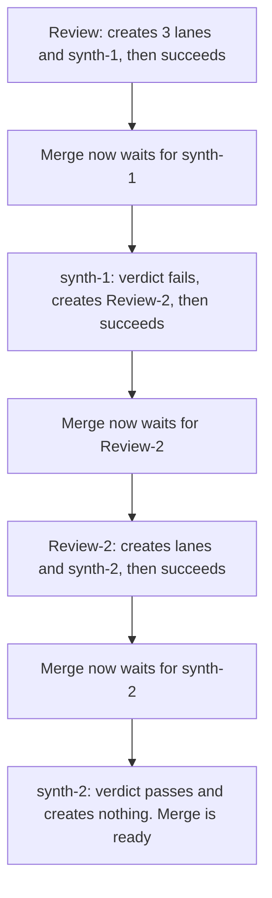
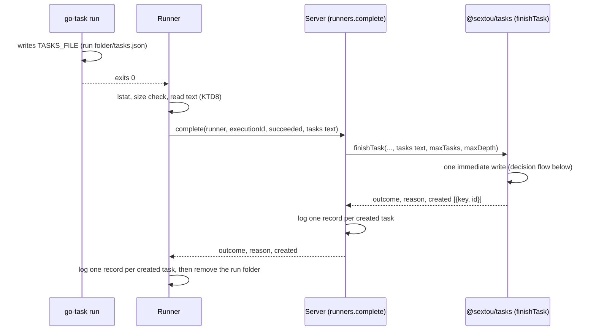
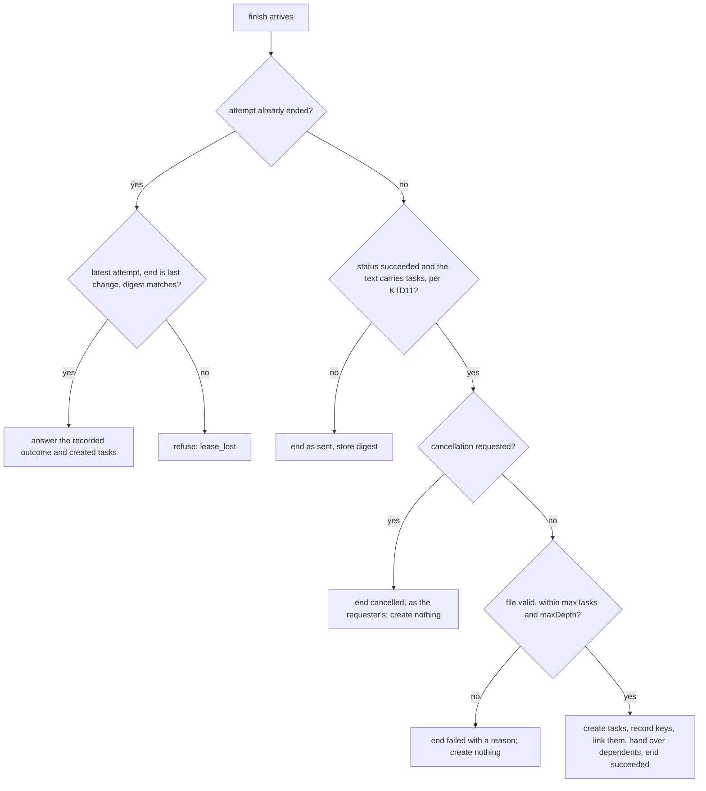

# Let a Task's Run Create the Tasks That Follow It - Plan

## Goal Capsule

- **Objective:** a workflow in `packages/workflows` decides, while it runs, which tasks follow it (one lane per item, a lane left out, a task that waits for every lane, another round, another workflow) by writing them down, with no change to the server or the runner for each new workflow.
- **Means:** a file of tasks that a successful run leaves, which the runner sends with `runners.complete` and the server creates in the write that finishes the task.
- **Product authority:** the repository owner. Resolves issue #117. Workflows that use the mechanism, such as a code review or an implementation flow, are later work and not active scope.
- **Authority order:** the Product Contract's Requirements win on behavior, the KTDs on mechanism, and a unit overrides neither.
- **Stop conditions:** stop and report if a requirement can't be met without a stored column on `tasks`, a second database, or a change to how an attempt's lease is judged.
- **Execution profile:** one branch and one pull request. Units land in order; U7's run-runner smoke pins the commit that adds U6's Taskfile, so that commit is pushed before U7's pin is written. The pre-push hook makes every push contain the latest `main`, so a rebase after U6's push gives that commit a new SHA: rewrite the pin to the rebased commit, and check it against the final pushed branch as the last step before the pull request is marked ready. The full Verification Contract runs before the push that opens the pull request.
- **Open blockers:** none.

---

## Product Contract

Product Contract preservation: changed: R17, R18 and R19 added, with their Key Decisions, from the planning synthesis the owner confirmed; the questions deferred to planning are answered by KTD1, KTD3, KTD5 and KTD8 and removed here.

### Summary

A run that succeeds may leave a file of tasks where the runner told its Taskfile to write it, and the runner sends that file with `runners.complete`.
In the same write that finishes the task, the server creates the file's tasks as its children, links them as the file says, and makes every task that waited for the finished task wait for the file's final tasks as well.
A file that is invalid, or that exceeds the per-file or the depth limit, fails the task and creates nothing.

### Problem Frame

sextou exists to run simple, reusable workflows.
Today a task's run ends with only an outcome, succeeded or failed with a reason, so the whole shape of a flow has to be created from outside before it starts.
A workflow cannot decide at run time how many review lanes to open, whether to skip one, or whether another round is needed after a failed verdict.
Each such flow would need its graph written out by hand, or a separate declarative format with its own expander, which was considered and rejected as too close to rebuilding a CI engine.

Gas City compiles a formula's whole graph at launch and gets its dynamism from patches on top: selector gates, `check` loops, and decompose plus drain, where an agent writes `tasks.md` and a script turns it into beads.
This work generalizes decompose: any task's run may do what it does.

### Key Decisions

- **The run hands its tasks to the runner in a file, sent with `runners.complete`.** (session-settled: user-directed — chosen over the run's script calling `tasks.create`, `tasks.link` and `tasks.assign` itself: that needs the server's URL and a credential inside the run, leaves half a graph when the run dies, and creates everything again on a retry, since `createTask` has no idempotency key.) Governs R2, R6, R9.
- **The finished task finishes as today, and the tasks that waited for it are handed to its file's final tasks.** (session-settled: user-directed — chosen over keeping the creating task `running` until its children end, which needs rules for how it ends and for children held behind a failed sibling, and over letting only tasks inside the file wait: the parent keeps only organizing, and no state changes meaning.) Governs R7.
- **An invalid file fails the task and creates nothing.** (session-settled: user-directed — chosen over finishing the task as succeeded and ignoring the file, which frees its dependents silently, and over creating only the valid tasks, which leaves a graph with missing parts.) Governs R10.
- **Two limits, tasks per file and depth.** (session-settled: user-approved — chosen over also limiting the total per tree, which needs each task's root and can come later; a template that needs more tasks than one file allows creates a task that creates the next batch.) Governs R11, R12, R13.
- **No restriction on the assignee, `uses` or context of a created task.** (session-settled: user-approved — chosen over limiting created tasks to the creating task's assignee or to an allowlist of assignees: the server has no authentication, so no identity exists to restrict by; the restriction comes with authentication.) Governs R4.
- **A created task's `createdBy` is the runner that sent the completion.** (session-settled: user-approved — chosen over inheriting the creating task's `createdBy`, which records a creator who never saw the task, and over naming the creating task, which `parent_id` already holds.) Governs R8.
- **Data reaches a created task only through the context its creator wrote.** (session-settled: user-approved — chosen over handing a task's result to the tasks it unblocks, which is issue #108 and stays separate; larger work stays where it already lives, in the branch, the pull request or the issue.) Governs R14.
- **Only the mechanism; no workflow uses it yet.** (session-settled: user-directed — chosen over shipping a first template with it: the goal is that later workflows expand without new server or runner code.) Governs R15.
- **A cancellation asked for before the completion arrives wins over the file.** (session-settled: user-approved — chosen over letting the file create its tasks anyway, which lets a request to stop a flow start its next round.) Governs R17.
- **The runner reads only a regular file, up to a size limit.** (session-settled: user-approved — chosen over reading whatever sits at the path, where a FIFO hangs the run and a huge file or a link to `/dev/zero` exhausts the runner's memory.) Governs R18.
- **A field the file's format doesn't define is refused.** (session-settled: user-approved — chosen over ignoring it, which lets a typo such as `blocked_by` make a task ready out of order with no sign.) Governs R19.

### Requirements

**What a run hands over**

- R1. The runner tells each Taskfile run where to write its file of tasks, as it tells it where its workspace is.
- R2. When the run succeeds, the runner reads the file before it removes the run's folder and sends its tasks with `runners.complete`; with no file, or a file with no tasks, the task finishes as it does today.
- R3. The file of a run that fails, is cancelled or loses its lease is never read.
- R4. Each task in the file carries what `tasks.create` takes except its parent and its creator, plus a key that names it within the file and the keys of the file's tasks it waits for.
- R5. A task in the file waits only for other tasks in the same file.

**What the server does with it**

- R6. In the write that finishes the task as succeeded, the server creates every task in the file with the finished task as its parent, and the links the file declares; either all of it is written or none of it.
- R7. In that same write, every open task that waited for the finished task also waits for each final task of the file, a task no other task in the file waits for.
- R8. A created task's creator is recorded as the runner that sent the completion.
- R9. A completion sent again as it was, after its answer was lost, gets the answer the first one got and creates nothing more, including one whose file R10 refused: the server recognizes it by what the runner sent, not by the status it recorded.

**Refusals and limits**

- R10. A file the server can't accept finishes the task as failed, with a reason that names what was wrong: a file that can't be read as tasks, a task `tasks.create` would refuse, a duplicated key, a key that names no task in the file, or links that close a cycle.
- R11. A file with more tasks than the per-file limit is refused as R10 says.
- R12. A file is refused as R10 says when its tasks would sit deeper than the depth limit, a task's depth being the number of parents above it.
- R13. Both limits are server settings, `SEXTOU_SERVER_*` variables with defaults listed in `apps/server/.env.example`, and the depth default leaves room for a template that chains creators to go past the per-file limit.

**Data between tasks**

- R14. A created task gets its data only from the context its creator wrote for it in the file.

**Proving it**

- R15. `packages/workflows` gains a minimal Taskfile that writes a file of tasks, for the tests and the `run-*` skills' smokes; it is not a workflow for real use.

**Finding the created tasks**

- R16. The answer to `runners.complete` names each created task's id by its key in the file, and the runner logs one record per created task with its key, its id and the finished task's id, so someone can unlink or cancel any of them.

**Guards**

- R17. When someone asked to cancel the task before its completion arrives, a completion that carries tasks finishes the task as cancelled and creates nothing; a completion without tasks behaves as it does today.
- R18. The runner reads the file only when it is a regular file, not a link, no larger than a runner setting (`SEXTOU_RUNNER_*`); a file at the path that breaks those rules fails the task with a reason, while no file at the path still means no tasks.
- R19. A file holding a field its format doesn't define is refused as R10 says, and no refusal's reason quotes the file's content.

### Handing dependents to the final tasks

R7 moves what waits for a task onto the tasks its run created. Round by round, in the issue's review loop, where `Merge` waits for `Review`:

### Acceptance Examples

- AE1. **Covers R6, R7.** **Given** `Merge` waits for `Review`, **when** `Review`'s run succeeds with a file of three lanes and a `synthesize` that waits for all three, **then** the four tasks exist as `Review`'s children, `Merge` waits for `synthesize`, and `Review` is `succeeded`.
- AE2. **Covers R2.** **Given** a run that succeeds and writes no file, or a file with no tasks, **when** it completes, **then** the task is `succeeded` and its dependents are freed as today.
- AE3. **Covers R3.** **Given** a run that wrote a file and then failed, **when** it completes as failed, **then** no task is created.
- AE4. **Covers R9.** **Given** a completion with a file whose answer was lost, **when** the runner sends it again as it was, **then** it succeeds and the file's tasks exist once.
- AE5. **Covers R10.** **Given** a file whose third task names a `uses` without a full commit SHA, **when** the run completes, **then** the task is `failed` with a reason naming that task, no task is created, and its dependents stay held as by any failed blocker.
- AE6. **Covers R11, R12.** **Given** a limit of 50 tasks per file, **when** a run's file holds 51, **then** the task is `failed` and nothing is created; the same holds when the file's tasks would sit one level past the depth limit.
- AE7. **Covers R7.** **Given** the lane `security` fails after AE1, **then** `synthesize` stays held by it and `Merge` stays held by `synthesize`, under today's rules, until someone removes a link: unlinking `synthesize` from `security` lets `synthesize` run, and unlinking `Merge` from `synthesize` frees `Merge`; cancelling `synthesize` frees neither, since a cancelled blocker holds as a failed one does.
- AE8. **Covers R9, R10.** **Given** AE5's refused file whose answer was lost, **when** the runner sends the same completion again, **then** it gets the same answer, and the task stays `failed` with the first reason.
- AE9. **Covers R17.** **Given** someone asked to cancel `Review` while it ran, **when** its run succeeds with a file before its next heartbeat, **then** `Review` is `cancelled` and none of the file's tasks exist.
- AE10. **Covers R18.** **Given** a run that left a FIFO, or a file one byte over the runner's limit, at the file's path, **when** the run succeeds, **then** the task is `failed` with a reason naming the rule, and the runner never blocks on the read.
- AE11. **Covers R19.** **Given** a file whose task carries `blocked_by` instead of `blockedBy`, **when** the run completes, **then** the task is `failed`, its reason names the unknown field and not the file's text, and nothing is created.

### Scope Boundaries

- A status for the creating task that reflects its descendants, and stopping a whole flow with one command, go to a later issue; until then each live task is cancelled on its own, and the depth limit stops a loop that never ends.
- Restricting which assignee, `uses` or context a created task may carry waits for authentication. Until then a run, such as a review lane that reads a pull request with a prompt injection, can send work to runners other than its own.
- Handing a task's result to the tasks it unblocks is issue #108.
- A limit on the total tasks under one root.
- Workflows that use the mechanism, such as a code review or an implementation flow.
- Showing a template's graph before it runs: the graph appears as its tasks run.
- A task in the file waiting for a task outside the file, and a file marking its own final tasks.
- A task linked to a creating task after that task finished does not wait for the tasks its run created: a caller that links late links to the final tasks among its children.

### Dependencies / Assumptions

- The runner is the only one that talks to the server during a run, and a run gets only the runner's own environment (`apps/runner/src/taskfile.ts`).
- The server has no authentication: `tasks.create` takes `createdBy` as a name the caller writes (`apps/server/src/config.ts`, `apps/server/src/modules/tasks/tasks.schema.ts`).

### Sources / Research

- `packages/tasks/src/schema.ts`: `parent_id` only organizes; readiness is `holding_blockers`; no creator column, the creator being the first row of `task_status_changes`.
- `packages/tasks/src/graph.ts`: `finishTask` runs in one transaction and accepts the same finish again; `createTask` mints a new id each call; `link` refuses a task that isn't open and a link that closes a cycle; `cancelTask` refuses a finished task.
- `apps/server/src/modules/runners/runners.schema.ts`: `runners.complete` takes `runner`, `executionId`, `outcome` and `reason`.
- `apps/runner/src/taskfile.ts`: the Taskfile gets `CONTEXT` and `WORKSPACE`, and the run's folder is removed once the run ends.
- Issue #117, and #108 and #106 for context.

---

## Planning Contract

### Key Technical Decisions

- KTD1. **The file is JSON, an object whose `tasks` holds the list.** Each task has `key`, `title`, `kind`, `priority`, `assignee`, and optionally `description`, `source`, `context`, `uses` and `blockedBy` (a list of keys): the field names `tasks.create` takes, so `source` maps to `createTask`'s `sourcePath` inside the package. The object and each task are strict zod objects, so an unknown field is refused (R19). Content that is empty or only whitespace counts as no tasks (R2). The wrapper object lets a later field join the format without breaking files written today. Governs R4, R5, R19.
- KTD2. **The runner sends the file's text; `@sextou/tasks` is its only judge.** `finishTask` parses and checks the text inside its write. Every judgement about the file, including a repeated key inside one task's `blockedBy`, commits a `failed` finish with a reason: it never throws and never refuses the call. A refused or thrown call would leave the task `running` until its lease expires, and the sweep would reopen it and run the same file again until the attempts ran out. The server's input schema puts no size cap on the text for the same reason; R18's runner limit bounds it. A reason names the task by its key or position and the rule it broke, never the file's text or a JSON parser's message, which quotes the input. Governs R10, R19.
- KTD3. **`finishTask` takes the text and both limits per call.** The server passes `maxTasks` and `maxDepth` from its settings on each call, as it passes `leaseMs` and `maxAttempts` today (`apps/server/src/tasks-service.ts`). The answer grows from `{ ok: true }` to the recorded outcome, its reason, and the created tasks as `{ key, id }` pairs. Governs R11, R12, R16.
- KTD4. **A resend is recognized by a digest of what was sent.** Every finish stores, on its attempt, a SHA-256 digest of its `changedBy`, status, reason, result path and tasks text. A finish whose attempt already ended gets the recorded answer when that attempt is its task's latest, its end is still the task's last change, and the digests match; otherwise it is refused as `lease_lost`, as today. The recorded answer reads the end's status and reason, and the created tasks from a new side table, one row per created task with its attempt, its key and its id. This replaces the field-by-field comparison in `finishTask`, which can't recognize a `succeeded` completion the server recorded as `failed`. Governs R9, R16.
- KTD5. **Depth is counted from the parent chain when a file arrives.** A recursive query walks `parent_id` up from the finishing task, beside the cycle check's query: no column stores depth, so no stored value can drift from the chain. The created tasks sit one level below the finishing task, and the file is refused when that level passes `maxDepth`. Governs R12.
- KTD6. **Cycles are checked in memory, over the file alone.** A created task waits only for tasks in its own file, and the tasks that are handed over wait for created tasks that wait for nothing outside the file, so no path can reach the existing graph. A topological pass over the file's links is enough; the database's cycle query isn't used. Governs R10.
- KTD7. **The hand-over happens in the same write, after the tasks and their links exist.** For each open task linked to the finishing task, a link to each final task is inserted, and its count of holding blockers grows by the number of final tasks; the finishing task's end then frees that dependent's hold on it as today. A cancelled dependent keeps its links and gets none. A dependent that already waits for another task keeps that hold. Governs R7.
- KTD8. **The runner points the Taskfile at `tasks.json` in the run's folder.** go-task gets a third variable, `TASKS_FILE`, the path of `tasks.json` beside `source/` and `workspace/`, so nothing the run does in its workspace (a `git clean`, a checkout) removes the file by accident. After a run that succeeded, and before the folder's removal, the runner checks the path without following links, reads it only when it is a regular file no larger than `SEXTOU_RUNNER_MAX_TASKS_FILE_BYTES` (1 MiB by default), and fails the task with a reason otherwise. A missing path is no tasks. Governs R1, R2, R3, R18.
- KTD9. **Two server settings, parsed with `parseCount`.** `SEXTOU_SERVER_MAX_CREATED_TASKS`, 50 by default, and `SEXTOU_SERVER_MAX_TASK_DEPTH`, 20 by default, which leaves room for about ten rounds of a review loop that spends two levels per round. Governs R11, R12, R13.
- KTD10. **The server and the runner each log one record per created task.** The runners procedure logs, through `ctx.logger`, the key, id and parent of each task the completion created, so the ids survive a lost answer and a runner that stopped. The runner logs the same from the answer, a record when the server failed the task over its file, and no longer logs the whole completion it sent, which would put every task's context in the log. Governs R16.
- KTD11. **A cancellation request with a file ends the attempt as cancelled, recorded as the requester's.** `finishTask` reads the attempt's cancellation request, as `expireExecutions` does; with a request and a text that carries tasks, it ends the task as `cancelled`, with the request's author and reason, and creates nothing. A text carries tasks unless it is blank or a valid file whose `tasks` list is empty; a text that doesn't parse counts as carrying tasks, so the cancellation wins over its refusal. Governs R17.
- KTD12. **The schema change regenerates the one `init` migration.** The repository has no release, and #84 and #113 regenerated `init` in place; this change does the same rather than stacking a second migration.
- KTD13. **The minimal Taskfile writes its own context to the file.** `packages/workflows/examples/create-tasks/Taskfile.yml` writes the task's context, as JSON, to `TASKS_FILE`, so a task whose context is a tasks file creates those tasks. It is YAML only, with no script, so it adds nothing to coverage or mutation. Governs R15.

### High-Level Technical Design

A completion with a file, across the three processes:

Inside `finishTask`'s write:

### Assumptions

- A Taskfile run that wants to create tasks writes the whole file before go-task exits; the runner reads it once, after the exit.
- No caller other than the runner finishes an attempt with a tasks text; the field is optional, so other finishes behave as today.

### Risks

- The run-runner smoke pins the new Taskfile at a commit on the pull request's branch. Any rebase onto a newer `main`, which the pre-push hook requires once `main` moves, rewrites that commit and breaks the pin until it is rewritten (see the Execution profile). After the squash merge, the pinned commit stays reachable only through the pull request's ref, which GitHub keeps.
- The run's write holds the tasks database's lock while it inserts up to `maxTasks` tasks and their links. At 50 tasks this is a few hundred statements inside `SEXTOU_SERVER_TASKS_TIMEOUT_MS`; a much higher limit could make the write time out, which rolls it back and answers `timeout`, and the runner sends it again.

---

## Implementation Units

### U1. Store a finish's digest and the tasks it created

**Goal:** the tasks database can hold what KTD4 needs: each attempt's finish digest, and one row per task a finish created.

**Requirements:** R9, R16; KTD4, KTD12.

**Dependencies:** none.

**Files:**

- `packages/tasks/src/schema.ts`
- `packages/tasks/drizzle/` (regenerated `init`)
- `packages/tasks/tests/integration/schema.test.ts`

**Approach:**

1. Add a nullable digest column to `task_executions`, set only once the attempt ends.
2. Add a side table for an attempt's created tasks, named by the repository's rule for a table whose rows exist only for another's (`task_execution_` prefix): its attempt, the key from the file, and the created task, with the attempt and key as its primary key and the task unique.
3. Delete and regenerate the `init` migration with drizzle-kit; the drift test must pass.

**Patterns to follow:** `taskLinks` and `taskExecutions` in `schema.ts` for keys and indexes, and the header comment's rules (literal SQL in checks, rowid tables).

**Test scenarios:**

- Inserting a second row with the same attempt and key fails on the primary key.
- Inserting a row whose task doesn't exist fails on its foreign key.
- The drift test reports no changes after the regeneration.

**Verification:** `@sextou/tasks`' integration suite passes, and drizzle-kit generates nothing new.

### U2. Accept a tasks file and the limits in `finishTask`'s input

**Goal:** the package exports the file's schema (KTD1) and a `finishTask` input that carries the tasks text and both limits.

**Requirements:** R4, R5, R11, R12, R19; KTD1, KTD3.

**Dependencies:** none.

**Files:**

- `packages/tasks/src/schemas.ts`
- `packages/tasks/src/index.ts`
- `packages/tasks/tests/unit/schemas.test.ts`

**Approach:**

1. Build each file task's schema from the create schema without its parent and creator, plus `key` (a name, as an assignee is) and `blockedBy`, all strict.
2. Add `tasks` (text, optional), `maxTasks` and `maxDepth` (counts from 1) to the finish schema; the limits are required whenever `tasks` is present.
3. Export the file schema and its types from `index.ts`.

**Patterns to follow:** `createTaskSchema` and `contextSchema` in `schemas.ts`; the way `claimTaskSchema` takes `leaseMs`.

**Test scenarios:**

- A file task with every field parses, and one with only the required fields parses.
- A file task with an unknown field (`blocked_by`) is rejected, and a file object with an unknown top-level field is rejected.
- A file task with a `uses` whose ref isn't a full commit SHA is rejected, as `createTask` rejects it.
- A finish input with `tasks` but no `maxTasks` is rejected; one without `tasks` needs neither limit.
- `maxTasks` or `maxDepth` of 0 is rejected.

**Verification:** the unit suite reaches 90% on `schemas.ts`.

### U3. Create a run's tasks in the write that finishes it

**Goal:** `finishTask` creates, links and hands over the file's tasks, refuses a bad file with a `failed` finish, honors a cancellation request, and answers a resend with the first answer.

**Requirements:** R2, R5, R6, R7, R8, R9, R10, R11, R12, R16, R17, R19; KTD2, KTD3, KTD4, KTD5, KTD6, KTD7, KTD11.

**Dependencies:** U1, U2.

**Files:**

- `packages/tasks/src/graph.ts`
- `packages/tasks/tests/integration/graph.test.ts`

**Approach:**

1. Compute the digest of what was sent, before any branch.
2. For an attempt that already ended, follow the resend branch of the decision flow: compare digests, then answer the recorded status, reason and created tasks.
3. For a running attempt with `succeeded` and a text that carries tasks (KTD11): check the cancellation request, then parse the text, check every task with the file schema, unique keys, known `blockedBy` keys with no repeat, no cycle (KTD6), the count against `maxTasks`, and the depth against `maxDepth` (KTD5). The first broken rule ends the attempt `failed`, with a reason naming the task by key or position and the rule.
4. On a valid file: insert each task with the finishing task as parent, recording its creation as the runner's; insert its row in the side table; insert the file's links, moving each count of holding blockers; hand over the open dependents (KTD7); then end the attempt `succeeded`.
5. Store the digest with every end, and widen the `Graph` type's `finishTask` answer.
6. Every query runs on the write's transaction.

**Execution note:** start with failing tests for AE1, AE4 and AE8; they fix the shape of the answer and of the resend.

**Patterns to follow:** `createTask`, `link` and `end` in `graph.ts`; `reaches` for the recursive query; the resend tests at the top level of `graph.test.ts`, with no `describe`; `expireExecutions` for reading a cancellation request.

**Test scenarios:**

- Covers AE1. A file of three lanes and a task blocked by all three creates four children of the finishing task; the dependent now waits for the fan-in task; the finishing task is `succeeded`; the answer lists four keys with their ids.
- Each created task's first status change is recorded as the runner that finished, and each has the context the file gave it.
- A created task with no `blockedBy` is ready at once; one blocked by another created task isn't.
- A file whose every task is final hands each dependent all of them; the dependent stays held until every one succeeded or was skipped.
- A dependent that already waited for a second, open blocker stays held by it after its first blocker hands over.
- A cancelled dependent of the finishing task gets no new link.
- Covers AE2. Empty text, whitespace, and `{"tasks": []}` each finish `succeeded` and create nothing.
- A `failed` or `cancelled` finish carrying a text creates nothing and records the status sent.
- Covers AE5. A task with a bad `uses` fails the finish with a reason naming its key, and creates nothing; its dependents stay held.
- Text that isn't JSON fails the finish, and the reason holds none of the text.
- Covers AE11. An unknown field fails the finish, and the reason names the field.
- A repeated key, a `blockedBy` naming no task in the file, a key repeated within one `blockedBy`, and a cycle of two tasks each fail the finish with their own reason.
- Covers AE6. A file one task over `maxTasks` fails; one at `maxTasks` succeeds. A finishing task at depth `maxDepth - 1` may create children; one at `maxDepth` may not.
- Covers AE4. The same completion sent again answers the same keys and ids and creates nothing more.
- Covers AE8. A refused file's completion sent again answers `failed` with the first reason.
- A resend that differs in its text, status, reason or `changedBy` is refused as `lease_lost`.
- A plain finish with no text sent again still succeeds, so today's resend behavior holds.
- Covers AE9. With a cancellation requested and a non-empty file, the task ends `cancelled`, recorded as the requester's, and nothing is created; with a request and no file, or a file whose `tasks` list is empty, it ends as the runner sent.
- With a cancellation requested and a text that isn't JSON, the task ends `cancelled`, not `failed`.
- A finish past the write's timeout rolls back every created task and link.

**Verification:** the integration suite reaches 90% on `graph.ts`, and Stryker stays at or above 80% for the package.

### U4. Carry the file through the server

**Goal:** `runners.complete` accepts the tasks text, passes the limits, answers the outcome and the created tasks, and logs each created task.

**Requirements:** R9, R11, R12, R13, R16; KTD3, KTD9, KTD10.

**Dependencies:** U3.

**Files:**

- `apps/server/src/tasks.ts`
- `apps/server/src/tasks-service.ts`
- `apps/server/src/config.ts`
- `apps/server/src/main.ts`
- `apps/server/.env.example`
- `apps/server/src/modules/runners/runners.schema.ts`
- `apps/server/src/modules/runners/runners.router.ts`
- `apps/server/tests/tasks.ts`
- `apps/server/tests/unit/config.test.ts`
- `apps/server/tests/unit/modules/runners/runners.router.test.ts`
- `apps/server/tests/unit/modules/runners/runners.schema.test.ts`
- `apps/server/tests/integration/tasks-service.test.ts`

**Approach:**

1. Add the two settings to `Config`, read with `parseCount`, listed in `.env.example` with their defaults and a line on what each bounds.
2. Add them to the tasks service's options, built in `main.ts`, and pass them on each `finish`.
3. Widen the `Tasks` port's `finish` input with the optional text and its answer with the outcome, reason and created tasks; `tasks.ts` stays free of Node.
4. Add `tasks` (optional text, no size cap, per KTD2) to the complete input schema, and replace the `null` output with the answer's schema.
5. Log one record per created task in the procedure, through `ctx.logger`.

**Patterns to follow:** `leaseMs` and `maxAttempts` from `config.ts` through `tasks-service.ts`; the `complete` tests in `runners.router.test.ts`.

**Test scenarios:**

- The settings default to 50 and 20, take a valid override, and name the variable on an invalid value.
- `complete` with a text passes it and both limits to the port, and answers what the port answered.
- `complete` without a text answers the outcome sent with no created tasks.
- `complete` logs one record per created task, with its key, id and the finished task's id.
- `lease_lost` still answers `CONFLICT`, and a bad outcome still answers `BAD_REQUEST`.
- Integration: the service finishes a started attempt with a file over a real `@sextou/tasks` and answers the created ids; the same call again answers the same ids.

**Verification:** the server's unit and integration suites each reach 90% on the files they answer for.

### U5. Read the file in the runner and send it

**Goal:** the runner tells go-task where to write, reads the file safely after a successful run, sends it, and logs what the server created.

**Requirements:** R1, R2, R3, R16, R18; KTD8, KTD10.

**Dependencies:** U4.

**Files:**

- `apps/runner/src/config.ts`
- `apps/runner/.env.example`
- `apps/runner/src/taskfile.ts`
- `apps/runner/src/runner.ts`
- `apps/runner/src/main.ts`
- `apps/runner/tests/unit/config.test.ts`
- `apps/runner/tests/unit/runner.test.ts`
- `apps/runner/tests/integration/taskfile.test.ts`
- `apps/runner/tests/integration/main.test.ts`

**Approach:**

1. Add `SEXTOU_RUNNER_MAX_TASKS_FILE_BYTES` to the config, with its default, in `.env.example`.
2. In `taskfileExecute`, pass `TASKS_FILE` beside `CONTEXT` and `WORKSPACE`; after a run that succeeded, and before the folder's removal, check and read the file per KTD8. A read that breaks a rule turns the result into `failed` with a reason.
3. Let a successful `Result` carry the optional text, and send it with the completion; the resend logic sends the same object again, unchanged.
4. Log per KTD10: every record the completion loop writes (`completed`, `complete failed`, `complete refused`) carries the ids, outcome and reason, never the tasks text.

**Patterns to follow:** `runFolder()` and `contextTaskfile` in `taskfile.test.ts`; the fake client in `runner.test.ts`; the server child process in `main.test.ts`.

**Test scenarios:**

- A Taskfile that writes `TASKS_FILE` succeeds with the file's text in its result.
- A Taskfile that writes nothing succeeds with no text.
- Covers AE10. A FIFO at the path fails the run with a reason and returns without blocking; a link at the path fails it; a file one byte over the limit fails it; a file at the limit is read.
- Covers AE3. A Taskfile that writes the file and then exits non-zero fails, and its result carries no text.
- The file is read before the run's folder is removed.
- The runner sends the text with the completion and, on `no_answer`, sends the same completion again.
- The runner logs one record per created task from the answer, and one when the answer is `failed` over the file.
- No record the completion loop writes, a retried or a refused one included, holds the tasks text.
- Integration, against the server as a child process: a task whose Taskfile writes a file of two tasks ends `succeeded`, and the runner's log names both created ids.
- The setting defaults, takes an override, and names the variable on an invalid value.

**Verification:** the runner's unit and integration suites each reach 90% on the files they answer for; `taskfile.test.ts` runs with go-task on the PATH.

### U6. A minimal Taskfile that writes a tasks file

**Goal:** a Taskfile a runner can download that creates the tasks its context names, for tests and smokes.

**Requirements:** R15; KTD13.

**Dependencies:** U5.

**Files:**

- `packages/workflows/examples/create-tasks/Taskfile.yml`
- `packages/workflows/tests/integration/examples/create-tasks/Taskfile.test.ts`

**Approach:** read the context per the package's convention and write it, as JSON and quoted with `| q`, to `TASKS_FILE`.

**Patterns to follow:** `hello-world/Taskfile.yml`; `tests/integration/sextou/development/Taskfile.test.ts` for running go-task with variables.

**Test scenarios:**

- With a context holding two tasks, go-task writes a file whose JSON equals the context.
- A context with `{{` in a value is written verbatim, not read as a template.

**Verification:** the workflows integration suite passes with go-task on the PATH.

### U7. Smokes and documentation

**Goal:** the three `run-*` drivers exercise a completion with a file, and the repository's documentation states the new behavior.

**Requirements:** R15, R16; KTD5, KTD8, KTD9.

**Dependencies:** U3, U4, U5, U6.

**Files:**

- `packages/tasks/.claude/skills/run-tasks/driver.mjs`
- `packages/tasks/.claude/skills/run-tasks/SKILL.md`
- `apps/server/.claude/skills/run-server/driver.mjs`
- `apps/server/.claude/skills/run-server/SKILL.md`
- `apps/runner/.claude/skills/run-runner/driver.mjs`
- `apps/runner/.claude/skills/run-runner/SKILL.md`
- `AGENTS.md`
- `CONCEPTS.md`

**Approach:**

1. run-tasks: a finish with a file of two linked tasks, its resend, and a refused file.
2. run-server: the same through `runners.complete`, reading the answer's ids.
3. run-runner: a task whose `uses` names `examples/create-tasks` at the pull request's commit that adds it, with a context of two tasks; the smoke checks the created tasks exist.
4. AGENTS.md: the runner's third variable and size limit, the new settings, `finishTask`'s file and resend digest, the second recursive query beside the cycle check, the minimal Taskfile; CONCEPTS.md: a task's run may create tasks, which become its children, and what waited for it waits for them too.

**Test expectation:** none -- drivers and documentation; each smoke is run once by hand per its SKILL.md.

**Verification:** each driver's smoke passes; AGENTS.md no longer says the cycle check is the only query outside drizzle's builder.

---

## Verification Contract

| Gate             | Command                                                                                   | Applies to      |
| ---------------- | ----------------------------------------------------------------------------------------- | --------------- |
| Lint and format  | `pnpm lint`                                                                               | every unit      |
| Gates lint       | `pnpm exec oxlint -c .oxlintrc.gates.json .`                                              | every unit      |
| Types            | `pnpm typecheck`                                                                          | every unit      |
| Tasks suites     | `pnpm --filter @sextou/tasks test:unit`, `pnpm --filter @sextou/tasks test:integration`   | U1, U2, U3      |
| Tasks mutation   | `pnpm --filter @sextou/tasks test:mutation`                                               | U2, U3          |
| Server suites    | `pnpm --filter @sextou/server test:unit`, `pnpm --filter @sextou/server test:integration` | U4              |
| Server mutation  | `pnpm --filter @sextou/server test:mutation`                                              | U4              |
| Runner suites    | `pnpm --filter @sextou/runner test:unit`, `pnpm --filter @sextou/runner test:integration` | U5              |
| Runner mutation  | `pnpm --filter @sextou/runner test:mutation`                                              | U5              |
| Workflows suites | `pnpm --filter @sextou/workflows test:integration`                                        | U6              |
| Build            | `pnpm build`                                                                              | before the push |
| Smokes           | each `run-*` driver's smoke, per its SKILL.md                                             | U7              |

Each `test:<level>` must hold 90% per file it answers for, and each `test:mutation` 80% of the package's mutants killed. go-task must be on the PATH for the runner's and the workflows' Taskfile tests.

---

## Definition of Done

- Every requirement R1–R19 holds, and each AE has a test that covers it.
- Every gate in the Verification Contract passes.
- The `init` migration is regenerated and the drift test passes.
- Both `.env.example` files list the new settings with their defaults.
- AGENTS.md and CONCEPTS.md describe the behavior as built.
- The run-runner smoke's pin names a commit present on the pull request's branch.
- No code from an abandoned approach remains in the diff.
