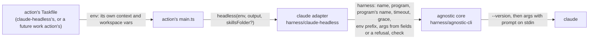

# A Harness That Loads an Action's Skills - Plan

## Goal Capsule

- **Objective:** an action in `packages/workflows` runs claude with the skills kept in the action's own folder, though that folder exists only inside the runner's temporary download, and the harness the action runs is not tied to claude.
- **Means:** `harness/claude-headless` splits into an agnostic core and a claude adapter, and the action injects the adapter and its own folder from its code (KTD1, KTD2, KTD3).
- **Product authority:** the repository owner. Resolves issue #134, part of #132.
- **Authority order:** the Product Contract's Requirements win on behavior, the KTDs on mechanism, and a unit overrides neither.
- **Stop conditions:** stop and report if keeping `harness/claude-headless`'s Taskfile, `headless.test.ts` or `sextou/development`'s Taskfile test green would need a changed expectation, since that breaks R5.
- **Execution profile:** one branch and one pull request. Units land in order, and the full Verification Contract runs before the push.
- **Open blockers:** none.

---

## Product Contract

Product Contract preservation: Product Contract unchanged. Its two questions deferred to planning are answered by KTD1, KTD2 and KTD4, and removed here.

### Summary

The harness becomes two parts: a core that runs any harness it is given, and a claude adapter that turns the task's context into claude's arguments.
An action hands the adapter the folder that holds its skills, from its own code, and claude gets it as one more `--add-dir`.
`harness/claude-headless`'s Taskfile still runs alone as it does today.

### Problem Frame

Each action of #132 carries its own skill, in `.claude/skills/` inside the action's folder, and claude loads it only when `--add-dir` names that folder.
The runner downloads sextou into a new temporary folder for every run, such as `/tmp/run-a8f3/source/`, so the folder's path exists only once the run starts.
Whoever creates the task writes its context before that, so the context's `addDir` can't name it, and today the context is the only way options reach claude.

### Key Decisions

- **The action injects its own folder from its code, not through go-task or the context.** The skills an action uses never change, so the action states them where it lives. (session-settled: user-directed — chosen over a go-task var the including Taskfile passes, in `includes: vars:` or on each `task:` call, and over the context naming the folder: in `includes: vars:` go-task resolves `{{.TASKFILE_DIR}}` to the included Taskfile's folder, and `{{.ROOT_DIR}}` breaks once the action is itself included.) Governs R6, R8.
- **An agnostic core with a claude adapter injected into it.** (session-settled: user-directed — chosen over the action importing `headless()` and handing it a context it built, which reaches into claude-headless's internals, and over a generic CLI action that takes a program and its arguments from the Taskfile, which still needs the var and moves claude's options into every Taskfile.) Governs R1, R2, R3, R4.
- **The injected folder is one more `addDir`, alongside the context's.** (session-settled: user-directed — chosen over a separate notion of a skills folder: it is the same claude option.) Governs R6, R8.
- **A folder without `.claude/skills/` is refused.** (session-settled: user-directed — chosen over passing whatever folder arrives unchecked.) Governs R7.
- **Options that stop the skills from loading are documented, not refused.** (session-settled: user-directed — chosen over refusing them alongside an injected folder and over leaving them to #100; sextou does not use `bare`.) Governs R9.
- **No example action.** This issue prepares the ground for the work and validate actions, which are the first to inject a folder. (session-settled: user-directed — chosen over an example action under `examples/` that includes the harness with a test skill.) Governs R10.

### Requirements

**The agnostic core**

- R1. The core runs the harness it is given, in the workspace at the context's `path`, with the context's `prompt` on its stdin, and names no harness itself.
- R2. The core keeps claude-headless's exit codes: 2 on an input it refuses, 127 when the program doesn't run, 124 once the timeout stops it (SIGTERM, then SIGKILL after the grace), else the program's own code.
- R3. The program, the timeout and the grace reach the core from the adapter, never from environment variables the core reads itself.

**The claude adapter**

- R4. The claude adapter builds claude's arguments from the context as claude-headless does today, and reads `CLAUDE_HEADLESS_BIN`, `CLAUDE_HEADLESS_TIMEOUT_MS` and `CLAUDE_HEADLESS_KILL_GRACE_MS` under those names.
- R5. `harness/claude-headless`'s Taskfile runs alone with the same context and the same behavior as today, so `sextou/development` does not change.

**Skills from the action's folder**

- R6. An action may hand the claude adapter a folder from its own code, and claude then gets that folder as one more `--add-dir`, besides the context's `addDir`.
- R7. When the folder handed holds no `.claude/skills/`, the run is refused with 2 before claude runs, with the reason on stderr.
- R8. Without a folder handed, claude gets only the context's `addDir`, as today.
- R9. The harness's documentation says that a context whose `settingSources` leaves out `project`, or that sets `safeMode`, keeps the injected skills from loading, with no error.

**Tests**

- R10. The core and the adapter are tested with the fake claude, through the injection itself, with no action written for the test.

### Acceptance Examples

- AE1. **Covers R6.** **Given** the work action hands `/tmp/run-a8f3/source/packages/workflows/sextou/work`, which holds `.claude/skills/sextou-work/`, and the context sets `addDir: "/data"`, **when** the run starts, **then** claude gets `--add-dir` for both folders.
- AE2. **Covers R7.** **Given** an action hands a folder with no `.claude/skills/`, or one that doesn't exist, **when** the run starts, **then** it exits with 2, claude never runs, and stderr says why.
- AE3. **Covers R5, R8.** **Given** `sextou/development` with today's context, **when** it runs, **then** claude gets the same arguments as before this change.

### Scope Boundaries

- An adapter for any agent other than claude.
- Restricting the other skills claude loads in a run (the runner user's `~/.claude/skills`, the checkout's project skills, enabled plugins): #100.
- `bare`, which sextou does not use.
- The skills themselves (#139, #140) and the actions that inject them (#141, #142).
- Considered and not built: following symlinks or refusing one inside the injected folder. The folder is the action's own, inside the download the runner made, so no task's input reaches it; a task able to place a link there would already control the action's code.

### Dependencies / Assumptions

- Claude Code loads `.claude/skills/` from a directory passed with `--add-dir`, together with its `.claude/commands/` and `.claude/agents/`, and only while the `project` setting source is on (code.claude.com/docs/en/skills).
- When an added directory's skill shares its name with a personal or project skill, it runs under a prefixed name, so the skills of #139 and #140 take names unique to sextou, such as `sextou-work`.
- A skill kept in `packages/workflows/<action>/.claude/skills/` also loads in Claude Code sessions that develop sextou, once they read a file in that folder.

<!-- ce-section: work-relationships -->

### How This Work Fits Together

This plan covers the harness change that #132's actions build on. The breakdown below is the current understanding, not a committed roadmap.

- The work skill (#139) and the validate skill (#140): Depend on this plan for being loaded.
  - The work task (#141) and the validate task (#142): Depend on this plan for injecting their folders, and on those skills.

### Sources / Research

- `packages/workflows/harness/claude-headless/headless.ts`, `settings.ts` and `Taskfile.yml`: what the core and the adapter split between them.
- `packages/workflows/shared/run.ts`: the run under a timeout, with SIGTERM and SIGKILL, that the core already has.
- go-task 3.54.0, checked in this session: in `includes: vars:`, `{{.TASKFILE_DIR}}` resolves to the included Taskfile's folder and `{{.ROOT_DIR}}` to the root Taskfile's; in a `task:` call's `vars:`, `{{.TASKFILE_DIR}}` is the caller's folder.

---

## Planning Contract

### Key Technical Decisions

- KTD1. **The core lives in `packages/workflows/harness/agnostic-cli/`, as modules with no Taskfile.** It is a library the actions import by relative path, as they import `shared/`: alone it has nothing to run, since a harness reaches it only through the code of whoever uses it. (session-settled: user-approved — chosen over a Taskfile action of its own: without code to inject a harness, a Taskfile could only take the program from the context or a go-task var.) Governs R1, R2, R3.
- KTD2. **The claude adapter stays in `packages/workflows/harness/claude-headless/`.** Its Taskfile, `main.ts`, the `CLAUDE_HEADLESS_*` variables and every message (`claude-headless: …`) stay as they are, so `sextou/development` and the existing behavior tests need no change. (session-settled: user-approved — chosen over a new `harness/claude/` folder: moving it would rename what `sextou/development` includes and the variables a runner's environment sets.) Governs R4, R5.
- KTD3. **The core takes the context, the workspace and the program's environment as values, and reads no environment variable.** Each action's `main.ts` reads its own variables, as claude-headless's reads `CLAUDE_HEADLESS_CONTEXT` and `CLAUDE_HEADLESS_WORKSPACE` today, and hands their values on. (session-settled: user-approved — chosen over the core reading `CLAUDE_HEADLESS_*` names, which would tie it to claude.) Governs R3.
- KTD4. **The core owns what every harness shares, and the adapter what only claude has.**
  - The core: parsing the context, `prompt` and `path` (inside the workspace, not through a symlink, a folder), the `--version` check, running the program with the prompt on its stdin under the timeout and grace, the exit codes, and the prefix of each message, which the adapter names.
  - The adapter: its program, timeout and grace from its variables, the prefix of its own variables that stays out of the program's environment, its options (`worktree` and the table in `settings.ts`), and the injected folder.
  - The contract between them is directional here and named at implementation: the harness hands the core a name for messages, a program, the program's name for messages (`claude` for the adapter, apart from the program it runs), a timeout, a grace, a prefix to keep out of the environment, the arguments it builds from the context's fields (or the reason it refuses them), and an optional check that runs before the program.
  - The adapter's own refusals (a bad `CLAUDE_HEADLESS_TIMEOUT_MS`, `CLAUDE_HEADLESS_KILL_GRACE_MS` or `CLAUDE_HEADLESS_BIN`) travel in the harness too, and the core reports them where `headless()` does today: after the context, `prompt`, `path` and the harness's arguments, before the symlink and folder checks.
    Governs R1, R2, R3, R4.
- KTD5. **The injected folder goes to claude after the context's `addDir`, and its check runs after the path checks and before `--version`.** The check is that `<folder>/.claude/skills` is a directory, so a missing folder and a folder without it refuse the same. It reads the disk, so it is the harness's optional check from KTD4 and lives in an integration-only file. Governs R6, R7.
- KTD6. **`headless()` stays claude-headless's entry point, and takes the injected folder as an optional third argument.** An action's `main.ts` calls it with `import.meta.dirname`. Its existing callers pass nothing and get today's behavior, which is how the unchanged behavior tests prove R5 and R8. Governs R5, R6, R8.

### High-Level Technical Design

Directional: who hands what to whom on a run. The arrows are values passed in code, not variables read from the environment.

### Implementation Constraints

- Each script imports only `node:` modules and other scripts by relative path naming the `.ts` file, since the runner downloads the repository with no `node_modules` (AGENTS.md, `packages/workflows`).
- Tests sit at the top level of their file, with no `describe`, and code reaching a child process or the disk is listed in `integrationOnly` in `packages/workflows/vitest.config.ts` with the reason (AGENTS.md, Tests).

---

## Implementation Units

### U1. The agnostic core

- **Goal:** a core that runs any harness it is handed, with claude-headless's checks, run and exit codes, and no knowledge of claude.
- **Requirements:** R1, R2, R3; KTD1, KTD3, KTD4.
- **Dependencies:** none.
- **Files:**
  - create `packages/workflows/harness/agnostic-cli/settings.ts` (reads the context, `prompt` and `path`, with no disk)
  - create `packages/workflows/harness/agnostic-cli/run.ts` (the checks on disk, `--version`, the run, the exit codes)
  - create `packages/workflows/tests/unit/harness/agnostic-cli/settings.test.ts`
  - create `packages/workflows/tests/integration/harness/agnostic-cli/run.test.ts`
  - modify `packages/workflows/vitest.config.ts` (add `harness/agnostic-cli/run.ts` to `integrationOnly`, with the reason)
- **Approach:**
  1. Move the context, `prompt` and `path` reading out of `harness/claude-headless/settings.ts` into the core's `settings.ts`, built on `shared/settings.ts`'s `readContext` and `insideWorkspace`.
  2. Move the body of `headless()` that isn't claude's (symlink and folder checks, `--version`, `run`, the deadline) into `run.ts`, driven by the harness of KTD4.
  3. The exit codes 2, 127 and 124 live in the core. Each message keeps today's wording, with the harness's name as the prefix and the program's name for messages (KTD4) where today's says `claude`, never a name taken from the program's path.
  4. The core's refusals keep today's order: the context, `prompt` and `path`, then the harness's refusal of the fields, then the adapter's own refusals the harness carries (KTD4), then the symlink and folder checks, then the harness's check, then `--version`.
- **Patterns to follow:** `packages/workflows/harness/claude-headless/headless.ts` and its tests; `packages/workflows/shared/run.ts` for the stop.
- **Test scenarios:**
  - The core hands the program the prompt on its stdin, and the arguments the harness built.
  - It runs the program in the workspace by default, and in the context's `path` when set.
  - It hands the program the environment it was given without the variables under the harness's prefix.
  - It exits with the program's code, and with 1 when a signal ends the program.
  - It exits with 2, runs no program and prints its reason under the harness's name for: a context that isn't a JSON object, a blank `prompt`, a `path` outside the workspace, a `path` through a symlink, a `path` that is not a folder.
  - It exits with 2 with the harness's own reason when the harness refuses the context's fields, and runs no program.
  - It exits with 2 with the check's reason when the harness's check refuses, and runs no program, not even `--version`.
  - It exits with 127 when the program doesn't start, and when its `--version` fails, running no `-p` call after a failed `--version`.
  - It exits with 124 once the program took longer than the harness's timeout, and the program is gone afterwards.
  - Its messages name the program by the harness's name for it, not by the program's path: with the program at `/tmp/x/none`, the reason reads `<harness>: <name> does not run`.
  - With a bad context and a harness that carries a refusal of its own, it reports the context's refusal.
  - Unit: the core's `settings.ts` refuses each bad `prompt` and `path` as today's `readSettings` does, and resolves `path` to `.` by default.
- **Verification:** the core's suites pass at 90% per file, and the core names neither claude nor any `CLAUDE_HEADLESS_` variable.

### U2. claude-headless as the core's claude adapter

- **Goal:** `harness/claude-headless` builds a claude harness and runs it through the core, with today's behavior.
- **Requirements:** R4, R5, R8; KTD2, KTD4, KTD6.
- **Dependencies:** U1.
- **Files:**
  - modify `packages/workflows/harness/claude-headless/settings.ts` (keeps `worktree` and the option table; reads the fields the core parsed)
  - modify `packages/workflows/harness/claude-headless/headless.ts` (reads `CLAUDE_HEADLESS_BIN`, `CLAUDE_HEADLESS_TIMEOUT_MS`, `CLAUDE_HEADLESS_KILL_GRACE_MS`, builds the harness, calls the core; keeps exporting `refused`, `noClaude`, `timedOut`)
  - modify `packages/workflows/tests/unit/harness/claude-headless/settings.test.ts` (its `prompt` and `path` cases now live in U1's unit test)
  - test, unchanged: `packages/workflows/tests/integration/harness/claude-headless/headless.test.ts`, `packages/workflows/tests/integration/harness/claude-headless/Taskfile.test.ts`, `packages/workflows/tests/integration/sextou/development/Taskfile.test.ts`
- **Approach:**
  1. `settings.ts` turns the parsed fields into claude's arguments, `-p` first, as today.
  2. `headless(env, output)` reads its three variables, then hands the core `CLAUDE_HEADLESS_CONTEXT`, `CLAUDE_HEADLESS_WORKSPACE`, the environment, and a harness named `claude-headless` whose prefix is `CLAUDE_HEADLESS_` and whose program's name for messages is `claude`. A bad variable becomes the harness's refusal with today's message, which the core reports in today's order (KTD4), so a context the core refuses is still reported first.
  3. `main.ts` and `Taskfile.yml` don't change.
- **Execution note:** run the three unchanged behavior tests before the change and after it. They are the characterization of R5, and none of their expectations may change (Goal Capsule, stop conditions).
- **Patterns to follow:** today's `headless.ts`, and the order its refusals run in.
- **Test scenarios:**
  - Covers AE3. The unchanged `headless.test.ts`, claude-headless's `Taskfile.test.ts` and `sextou/development`'s `Taskfile.test.ts` pass as they are.
  - Unit: `settings.ts` builds each option kind and `worktree` as today, and refuses each bad value with today's reason.
- **Verification:** the workflows package's unit and integration suites and its mutation run pass, with no expectation of the three behavior tests changed.

### U3. The injected skills folder

- **Goal:** an action hands `headless()` its own folder, and claude gets it as one more `--add-dir` once it holds `.claude/skills/`.
- **Requirements:** R6, R7, R8, R10; KTD5, KTD6.
- **Dependencies:** U2.
- **Files:**
  - modify `packages/workflows/harness/claude-headless/headless.ts` (the optional folder, the check, the extra `--add-dir`)
  - modify `packages/workflows/tests/integration/harness/claude-headless/headless.test.ts` (new cases only)
- **Approach:**
  1. `headless()` takes an optional folder. With one, the harness's arguments end with `--add-dir=<folder>`, after any the context's `addDir` produced.
  2. The harness's check refuses when `<folder>/.claude/skills` is not a directory, with a reason that names the folder's missing `.claude/skills`.
  3. Without a folder, the harness has no check and the arguments are today's.
- **Test scenarios:**
  - Covers AE1. Given a folder with `.claude/skills/x/SKILL.md` and a context with `addDir: "/data"`, claude gets `--add-dir=/data` and then `--add-dir=<folder>`.
  - Given a folder with `.claude/skills/` and a context with no `addDir`, claude gets exactly one `--add-dir`, the folder's.
  - Given a folder and a context whose `addDir` is a list of two, claude gets the two and then the folder.
  - Covers AE2. Given a folder that doesn't exist, it exits with 2, claude never runs, and stderr names the reason.
  - Covers AE2. Given a folder with no `.claude/`, and one whose `.claude/skills` is a file, each exits with 2 and claude never runs.
  - Given a refused folder and a bad context, the context's refusal comes first, as the core's checks run before the harness's.
  - Covers R8. With no folder, claude gets no `--add-dir` beyond the context's (the unchanged cases of U2 hold this too).
- **Verification:** every scenario passes through `headless()` with the fake claude, with no action written for the test.

### U4. Documentation

- **Goal:** the repository's docs describe the core, the adapter and the injected folder, and say which options keep the skills from loading.
- **Requirements:** R9; KTD1, KTD2.
- **Dependencies:** U3.
- **Files:**
  - modify `packages/workflows/harness/claude-headless/Taskfile.yml` (its header: the folder an action may inject from code, and that `settingSources` without `project` or `safeMode` keeps it from loading)
  - modify `AGENTS.md` (the `packages/workflows` paragraph of Architecture, the Structure tree with `harness/agnostic-cli/` and its tests, and the Tests section's list of integration-only files)
- **Approach:** follow the voice and density of the paragraphs already there. The note of R9 lives once in the Taskfile's header and once in AGENTS.md's `harness/claude-headless/` sentence.
- **Test scenarios:** Test expectation: none -- documentation only.
- **Verification:** AGENTS.md's Structure tree lists every file U1 created, and its integration-only list matches `integrationOnly` in `packages/workflows/vitest.config.ts`.

---

## Verification Contract

| Gate               | Command                                                                                         | Applies to |
| ------------------ | ----------------------------------------------------------------------------------------------- | ---------- |
| Lint and format    | `pnpm lint`                                                                                     | every unit |
| Gates lint         | `pnpm exec oxlint -c .oxlintrc.gates.json .`                                                    | every unit |
| Types              | `pnpm typecheck`                                                                                | every unit |
| Workflows suites   | `pnpm --filter @sextou/workflows test:unit`, `pnpm --filter @sextou/workflows test:integration` | U1, U2, U3 |
| Workflows mutation | `pnpm --filter @sextou/workflows test:mutation`                                                 | U1, U2, U3 |

Each `test:<level>` must hold 90% per file it answers for, and `test:mutation` 80% of the package's mutants killed. go-task must be on the PATH for the Taskfile tests, which otherwise skip and fail the integration suite on coverage.

---

## Definition of Done

- Every requirement R1–R10 holds, and each AE has a test that covers it.
- Every gate in the Verification Contract passes.
- `headless.test.ts`, claude-headless's `Taskfile.test.ts` and `sextou/development`'s `Taskfile.test.ts` pass with none of their expectations changed.
- No code from an abandoned approach is left in the diff.
