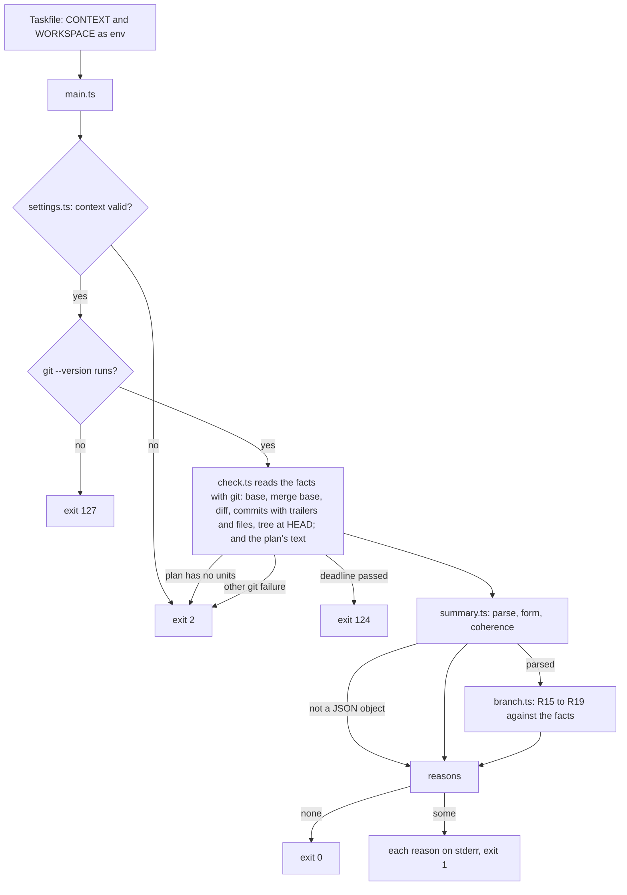

# The Work Summary's Format and Its Check - Plan

## Goal Capsule

- **Objective:** the validate task refuses, without a model, a work summary that is malformed, contradicts itself or contradicts the branch, so the validate skill is left with one judgment: whether the evidence says enough.
- **Means:** a JSON format for the summary the work skill leaves, and an action in `packages/workflows`, `work-summary/check/`, that the validate task includes (KTD1).
- **Product authority:** the repository owner. Resolves issue #138, part of #132.
- **Authority order:** the Product Contract's Requirements win on behavior, the KTDs on mechanism, and a unit overrides neither.
- **Stop conditions:** stop and report if keeping `git/checkout`'s tests green after U1 would need a changed expectation, since U1 must not change what the checkout does.
- **Execution profile:** one branch and one pull request. Units land in order, and the full Verification Contract runs before the push.
- **Open blockers:** none. The check's tests build their own repositories, so the work doesn't wait for #135; running it inside the validate task does.

---

## Product Contract

Product Contract preservation: Product Contract unchanged. Its four questions deferred to planning are answered by KTD5, KTD6, KTD7 and KTD8, and removed here.

### Summary

The work summary becomes a JSON object with a fixed set of fields, whose verification evidence holds one entry per unit tried and records each command run as its command, its exit code and an excerpt of its output.
A script the validate task runs checks the summary's form, its coherence with itself and its agreement with the branch: the files the diff changed, the plan's units, the `Units:` trailer on each commit and the test files it cites.
It answers that the summary is valid, or every reason it refuses it.

### Problem Frame

In #132's chain, the work task (T1, and T3 on recovery) implements a plan and the validate task (T2, and T4) checks the result in a later run, in a new folder, with nothing left of the work's session but what was pushed.
The validate task learns what the work did only from the summary the work leaves.
Today that summary is `ce-work`'s return, described in prose: it mixes a command with its output in one string and leaves the shape of the evidence open.
No script can check such text, so contradictions a script would catch for free (a unit completed but never tried, a "red" run that passed, a file changed but not listed) fall to a model, which may miss them.

### Key Decisions

- **The check compares the summary with the branch, not only with itself.** (session-settled: user-directed — chosen over checking only the fields' presence and types, and over checking presence plus the summary's own coherence: a summary that lies about what changed passes both.) Governs R15, R16, R17, R18.
- **A summary always describes the whole branch since the base, recovery included.** (session-settled: user-directed — chosen over each summary describing only its own run from a recorded start commit, which splits the picture across two summaries.) Governs R5, R15.
- **Each commit names the units it covers in a `Units:` trailer.** (session-settled: user-directed — chosen over no link between commits and units, which lets a unit be marked complete with no code, and over exactly one commit per unit, which contradicts `ce-work`'s own guidance that a unit may take several commits or share one.) Governs R6, R17.
- **Each command run is recorded as command, exit code and output, apart.** (session-settled: user-directed — chosen over `ce-work`'s single string mixing command and output, which nothing can check.) Governs R3, R13, R14.
- **The test files the evidence cites are checked in the repository.** (session-settled: user-directed — chosen over checking only that the evidence's keys are filled.) Governs R18.
- **Only the validate task runs the check; the work does not validate its own work.** (session-settled: user-directed — chosen over the work task running the full check after claude, with or without the validate task running it again.) This narrows #138's body, which said the script is shared by the work and validate tasks: the format stays the contract between both, and the script is the validate's. Governs R21.
- **Paths the check ignores come from the task's context.** (session-settled: user-directed — chosen over a built-in exemption for the plan's commit, and over starting the range at the commit where the work began: the diff is always the branch's.) The plan is committed on the branch before the work starts, so the template puts its path on the list. Governs R19.
- **The check gives every reason at once, and refuses fields the format doesn't define.** Who reads a refusal sees all of it in one pass, and an unknown field is refused as `@sextou/tasks`'s `tasksFileSchema` refuses one. (session-settled: user-approved — proposed in the scoping synthesis and confirmed.) Governs R7, R20.

### Requirements

**The summary's format**

- R1. A summary is one JSON object with exactly these fields: `status`, `changed_files`, `u_ids_attempted`, `u_ids_completed`, `verification`, `verification_evidence`, `settled_decision_conflicts`, `behavior_change` and `blockers`. `settled_decision_conflicts` lists one entry per conflict with a settled decision of the plan, each naming the decision, the evidence and whether the work proceeded and flagged it or stopped on it, and is empty when there is none.
- R2. `status` is `complete`, `blocked` or `failed`.
- R3. A run is a command the work ran: its `command` as run, its `exit_code` as an integer and its `output`, an excerpt holding the lines that show the result. The summary's `verification` lists the final runs over the whole branch.
- R4. `verification_evidence` holds one entry per unit in `u_ids_attempted`, each with its `unit`, `behavior_changed`, `tests` (`inspected`, `added_or_changed` and `used_unchanged`, lists of repository paths), `red` (a run, or `null` when none applies), `verification` (the runs that verify the unit as it stands) and `exception` (a reason, or `null`).
- R5. A summary describes the whole branch from the base to `HEAD`, on every run of the work: a recovery's summary restates the units, files and evidence of the runs before it.
- R6. Every commit the work makes names, in a `Units:` trailer, the plan's units it covers; a unit may span several commits and a commit may cover several units.
- R7. The check refuses a field the format does not define.

**The check: form and coherence**

- R8. The check refuses a summary where a field is missing or has the wrong type, or where a run lacks its command, exit code or output.
- R9. Every unit in `u_ids_completed` is in `u_ids_attempted`, and `verification_evidence` holds exactly one entry per unit in `u_ids_attempted`: the check refuses a missing or an extra entry.
- R10. A `complete` summary has completed every unit it tried and has no blockers; a `blocked` or `failed` one has at least one blocker.
- R11. The summary's `behavior_change` is true exactly when some entry's `behavior_changed` is true.
- R12. An entry whose `behavior_changed` is true cites at least one test inspected, at least one test added, changed or used unchanged, and at least one verification run, or else carries an `exception` with its reason.
- R13. A `red` run has an exit code other than 0.
- R14. The verification runs of a completed unit exit with 0, and so do the summary's own runs when its `status` is `complete`.

**The check: against the branch**

- R15. `changed_files` lists exactly the files the diff from the base to `HEAD` changed, ignored paths left out. Here and in R18, that diff starts at the merge base of the base ref and `HEAD`, so it holds only the branch's own changes even when the base moved after the work branched.
- R16. Every unit in `u_ids_attempted` and `u_ids_completed` is a unit of the plan.
- R17. Every completed unit is named in the `Units:` trailer of at least one commit from the base to `HEAD`, and every such commit names at least one unit of the plan, unless it changes only ignored paths.
- R18. Every file in `tests.inspected` and `tests.used_unchanged` exists at `HEAD`, and every file in `tests.added_or_changed` is in the diff from the base to `HEAD`.
- R19. The paths to ignore are a list in the validate task's context; the template that creates the chain puts the plan's path on it, and the check ignores nothing the list doesn't name.

**The check's answer and who runs it**

- R20. The check answers that the summary is valid, or lists every reason it refuses it, in one answer.
- R21. The validate task runs the check (T2, and T4 on recovery); the work task does not.

### Acceptance Examples

- AE1. **Covers R5, R15.** **Given** T1 committed U1 to U3 and T3, on recovery, added one test for U1, **when** T3's summary lists every file the branch changed since the base, **then** the check accepts it; **when** it lists only the new test, **then** the check refuses it, naming the files missing from `changed_files`.
- AE2. **Covers R17, R19.** **Given** the plan's path is on the ignore list, **when** the branch's first commit changes only the plan and has no `Units:` trailer, **then** the check accepts it; **when** that commit also changes a source file, **then** the check refuses it for naming no unit.
- AE3. **Covers R13.** **When** an entry's `red` run has `exit_code` 0, **then** the check refuses the summary.
- AE4. **Covers R10.** **When** the `status` is `blocked` and `blockers` is empty, **then** the check refuses the summary.
- AE5. **Covers R18.** **When** `tests.added_or_changed` cites a test file the diff from the base doesn't touch, **then** the check refuses the summary, naming the file.
- AE6. **Covers R20.** **When** a summary both lacks `blockers` and lists a completed unit it never tried, **then** the check's one answer names both.

<!-- ce-section: work-relationships -->

### How This Work Fits Together

This plan covers the summary's format and the check. The rest of #132's chain is the current breakdown, not a committed roadmap.

- #139, the work skill: depends on this format; it writes the summary in it and the `Units:` trailer on each commit.
- #142, the validate task: runs this check before the validate skill; what it does with a refusal is its own.
- #140, the validate skill: judges what this check leaves, whether the evidence says enough.
- #143, the template: puts the plan's path on the ignore list of the validate task's context.
- #144, the recovery: still to decide whether a refusal by this check, and not only vague evidence, earns a recovery.
- #137, notes: carries the summary from the work task to the validate task, and to the recovery's work task.
- #135, the checkout: this check depends on it for the base ref.

### Scope Boundaries

- Proof that the commands in the summary really ran, from the stream-json output the work's claude run writes, is deferred.
- The work task reading the summary's `status` to fail on `blocked` is deferred to a default end-of-task validation.
- Running the verification commands again is out.
- Judging whether the evidence is vague is the validate skill's (#140).
- What the validate task does on a refusal, failing or recovering, is #142's and #144's.
- Moving the summary between tasks is #137's.

### Dependencies / Assumptions

- The validate task's checkout holds the base ref and the branch's whole history back to their merge base (#135), so the check reads every commit and the diff from the base to `HEAD`, and git runs in its run.
- The base ref may have moved since the work branched.
- On recovery, the work task reads the previous work summary from its note (#137), so it can restate that run's units, files and evidence, its `red` runs included.
- The plan is a file on the branch, at the path the context names, and its units carry the U-IDs `ce-plan` gives them.
- The check runs with Node and only `node:` modules, since the runner downloads the repository without `node_modules` (#132).

---

## Planning Contract

### Key Technical Decisions

- KTD1. **The check is an action of its own, `packages/workflows/work-summary/check/`, which the validate task's Taskfile includes.** It follows `git/checkout`'s layering: a Taskfile hands the context and workspace to `main.ts`, which calls `check.ts`. `check.ts` reads git, and two pure modules judge: `summary.ts` (form and coherence, R1 to R14) and `branch.ts` (the branch, R15 to R19). Keeping the judging pure puts nearly all the rules in the unit suite and under mutation, and leaves git to the integration suite. (session-settled: user-approved — chosen over a library folder the validate action's script imports, as `harness/agnostic-cli` is: the validate task chains actions, as `sextou/development` does.) Governs R21.
- KTD2. **Exit codes: 0 when the summary is valid, 1 when the check refuses it, 2 when the task's input is wrong, 124 when git ran past its timeout, and 127 when git doesn't run.** 1 is new in the package and means "checked, and refused". 2, 124 and 127 keep the meanings `git/checkout/checkout.ts` gives them, so the validate task (#142) tells a bad summary from a badly built task. Each reason is one stderr line, `work-summary: <reason>`, as checkout prefixes its own. A missing or non-JSON summary file is a refused summary (1). Any other git failure exits 2, with a line that names the command and its code, so 1 never comes from git. Unlike the checkout, the check doesn't pass git's code through: `git merge-base` exits 1 when the checkout lacks the history back to the merge base, and `shared/run.ts` resolves 1 when a signal ends git. A base that shares no merge base with `HEAD` gets its own reason: the checkout lacks the branch's history (#135). (session-settled: user-approved — chosen over one non-zero code for every failure.) Governs R20.
- KTD3. **The judges collect reasons instead of stopping at the first.** Every reader in the package returns `{ ok: false, reason }` at the first refusal. R20 asks for all of them, so `summary.ts` and `branch.ts` add each reason to a list. Once the text parses as a JSON object, every coherence and branch rule runs. Each rule skips only when a field it reads failed the form check, so no reason rests on a malformed field, and a form failure elsewhere hides nothing (AE6). A reason states the rule and names where it broke, in the package's style (`verification_evidence[2].red.exit_code is not 0`). Governs R20.
- KTD4. **Git runs through `shared/run.ts` with the checkout's isolation, moved to `shared/git.ts` so both actions share it.** That means an empty `HOME`, no global or system config, no `GIT_*` variable but `GIT_SSL_CAINFO`, and no prompt. Then a user's `diff.external`, `log.showSignature` or `core.quotePath` can't change the output the check parses. One deadline covers every git call (`WORK_SUMMARY_TIMEOUT_MS`, 60 seconds by default), with `WORK_SUMMARY_KILL_GRACE_MS` and `WORK_SUMMARY_GIT_BIN`, read as checkout reads its own. The check reads git's output from `run()`'s line callback, and asks for NUL-separated paths (`-z`), so a path with a space or a newline survives.
- KTD5. **The check's input is flat context fields, beside the ones the checkout and claude already read:** `path` (the repository in the workspace, `.` by default, the same field the checkout and claude read), `base` (the base ref, required), `plan` (the plan's path in the repository, required), `ignore` (a list of paths in the repository, `[]` by default) and `summary` (the summary file's path in the workspace, required). `path` and `summary` go through `insideWorkspace` and `throughSymlink`, as the checkout's `path` does. The template (#143), #135 and #137 use the same names. (session-settled: user-approved — chosen over a nested object of the check's own.) Governs R19.
- KTD6. **The plan's units are its `### U<n>. ` headings, outside fenced code.** ce-plan writes every unit that way, and IDs may have gaps. A Unit Index table or prose that cites U-IDs is not a unit. A plan with no unit heading is the task's input error (2), not a refused summary.
- KTD7. **The ignore list holds exact repository paths, with no patterns.** An ignored path is left out of both sides of the R15 comparison: the summary need not list it, and the check doesn't refuse it when it does. (session-settled: user-approved — chosen over glob patterns, which nothing needs yet.) Governs R15, R17, R19.
- KTD8. **A run's `output` holds at most 4,000 characters.** That forces the excerpt R3 asks for instead of a whole suite's log, and keeps the note small. (session-settled: user-approved — chosen over no limit.) Governs R3.
- KTD9. **The diff for R15 and R18 runs without rename detection,** so a renamed file appears under its old path and its new one, and a deleted file appears too. (session-settled: user-approved — chosen over git's rename detection, whose similarity threshold would make the list depend on a heuristic.) Governs R15, R18.
- KTD10. **The `Units:` trailer is read through git's own trailer parsing.** The key matches regardless of case, several `Units:` trailers on one commit add up, and each value is a comma-separated list of U-IDs. A merge commit is a commit like any other: without a trailer, and touching more than ignored paths, it is refused. Each commit's paths come from its diff against its first parent (`--diff-merges=first-parent`, without rename detection per KTD9). A merge of the base into the branch therefore lists the files it brought in, where git's default would list none for a merge and let it pass as touching nothing. Governs R6, R17.

### High-Level Technical Design

How one run of the check goes, from the Taskfile to its exit code:

### Assumptions

- Every git the runner and CI use is 2.31 or later. 2.31 added `--diff-merges=first-parent`, and 2.22 added `git log`'s `%(trailers:key=Units,valueonly)` placeholder.

---

## Implementation Units

### U1. Shared git isolation

- **Goal:** the checkout's git isolation becomes a module both actions use, and the checkout behaves exactly as before.
- **Requirements:** KTD4.
- **Dependencies:** none.
- **Files:**
  - create `packages/workflows/shared/git.ts`
  - modify `packages/workflows/git/checkout/checkout.ts`
  - create `packages/workflows/tests/unit/shared/git.test.ts`
- **Approach:**
  1. Move the environment the checkout builds for git into a pure function in `shared/git.ts`. It takes the process's environment and the empty `HOME` folder, and returns git's environment.
  2. The temporary `HOME` stays in each caller, so `shared/git.ts` touches no disk and belongs to the unit suite.
  3. The checkout calls the function where it built the environment inline. Its comment on why each variable is dropped moves with the code.
- **Patterns to follow:** `git/checkout/checkout.ts` (the environment block and its rationale comment), `shared/settings.ts` (pure helpers with unit tests).
- **Test scenarios:**
  - `GIT_SSL_CAINFO` is kept, and every other `GIT_` variable is dropped.
  - `SSH_ASKPASS` and `NETRC` are dropped.
  - `HOME` is the folder given, `GIT_TERMINAL_PROMPT` is `0`, and both config variables point to `/dev/null`.
  - A variable that has nothing to do with git, such as `PATH`, is kept.
- **Verification:** the checkout's unit and integration tests pass unchanged, and `shared/git.ts` reaches the unit suite's 90% floor.

### U2. The summary's form and coherence

- **Goal:** a pure judge that reads the summary's text and returns every reason the summary breaks R1 to R14.
- **Requirements:** R1, R2, R3, R4, R7, R8, R9, R10, R11, R12, R13, R14, R20; KTD3, KTD8. Covers AE3, AE4, AE6.
- **Dependencies:** none.
- **Files:**
  - create `packages/workflows/work-summary/check/summary.ts`
  - create `packages/workflows/tests/unit/work-summary/check/summary.test.ts`
- **Approach:**
  1. Parse the text. Text that isn't a JSON object is one reason, and nothing else runs.
  2. Check the form, depth first, and collect every reason. That covers each object's fields, unknown ones included, at the top level, in each entry, in `tests`, in each run and in each conflict. It covers types and enumerations (`status`, a conflict's routing), integers for `exit_code`, and the 4,000-character `output`.
     - `blockers` is a list of strings with text.
     - A conflict entry has `decision` and `evidence`, strings with text, and `routing`, either `proceeded_and_flagged` or `blocker`.
  3. Apply the coherence rules R9 to R14 per KTD3: each runs unless a field it reads failed the form, and its reasons join the list.
  4. Return the reasons, with each field's value where it passed the form, so `branch.ts` judges what it can.
  5. The doc comments on the summary's types are the format's reference for the work skill (#139).
- **Patterns to follow:** the kind and expected-text tables in `harness/claude-headless/settings.ts`, and the type guards there (`text`, `texts`, `Number.isFinite`). Reasons state the rule, as `git/checkout/settings.ts`'s do.
- **Test scenarios:**
  - A complete summary with two units, one that changed behavior and one that didn't, is valid.
  - Text that isn't JSON, a JSON array and `null` are each refused with one reason.
  - A missing `blockers` is refused, naming the field.
  - An unknown field is refused at the top level, inside an evidence entry, inside `tests` and inside a run, each naming its path.
  - A `status` of `done` is refused.
  - An `exit_code` of `1.5`, and one of `"0"`, are refused.
  - An `output` of 4,001 characters is refused, and one of 4,000 is accepted.
  - A completed unit that is not in `u_ids_attempted` is refused (R9).
  - An attempted unit with no evidence entry is refused, and so are an entry for a unit nobody tried and two entries for one unit (R9).
  - Covers AE4: `blocked` with no blockers is refused, and `complete` with a blocker, or with a tried unit left uncompleted, is refused (R10).
  - `behavior_change: true` with every entry false is refused, and so is `false` with an entry true (R11).
  - An entry with `behavior_changed: true` and no test inspected is refused. So is one with no test added, changed or used unchanged, and one with no verification run. The same entry with an `exception` reason is valid (R12).
  - Covers AE3: a `red` run with `exit_code` 0 is refused (R13).
  - A completed unit's verification run with `exit_code` 1 is refused. A summary-level run with `exit_code` 1 is refused when the `status` is `complete` and accepted when it is `blocked` (R14).
  - A conflict entry with an unknown routing is refused.
  - Covers AE6: a summary that lacks `blockers` and lists a completed unit it never tried gets both reasons in one answer.
  - A summary with a non-integer `exit_code` in one entry's `red` still gets R9's reason for an untried completed unit, and R13 is skipped for that entry only.
- **Verification:** the unit suite covers `summary.ts` at 90% or more, and each rule from R1 to R14 has a test that fails when the rule is removed.

### U3. The branch's judge

- **Goal:** a pure judge that compares a well-formed summary with facts read from git and the plan's text, and returns every reason it breaks R15 to R19.
- **Requirements:** R15, R16, R17, R18, R19, R20; KTD3, KTD6, KTD7, KTD9, KTD10. Covers AE1, AE2, AE5.
- **Dependencies:** U2, for the summary's type.
- **Files:**
  - create `packages/workflows/work-summary/check/branch.ts`
  - create `packages/workflows/tests/unit/work-summary/check/branch.test.ts`
- **Approach:**
  1. The facts are:
     - the paths the diff changed from the merge base;
     - the commits since the merge base, each with the units its `Units:` trailers name and the paths it changed;
     - the paths in `HEAD`'s tree;
     - the ignore list.
  2. Read the plan's units from its text per KTD6, separately from the judging, so `check.ts` can report a plan without units as an input error.
  3. Apply R15 to R18, leaving ignored paths out per KTD7, and collect every reason. A reason names the path, unit or commit it is about. A commit is named by its short SHA and subject.
- **Patterns to follow:** U2's reason list and wording.
- **Test scenarios:**
  - Covers AE1: a summary whose `changed_files` equals the diff is valid. One that leaves out a file is refused, naming the file, and one that lists a file the diff doesn't hold is refused, naming it.
  - An ignored path in the diff need not be listed, and is not refused when it is.
  - A renamed file is required under its old path and under its new one.
  - A tried unit that the plan doesn't have is refused (R16).
  - The plan's units come from its `### U<n>. ` headings: gaps (U1, U3) are kept, a heading inside a fenced block is ignored, and a U-ID cited in prose or in a table is not a unit.
  - Plan text with no unit heading is reported as having no units.
  - A completed unit that no commit's trailer names is refused (R17).
  - A commit with no trailer that changes a source file is refused, naming the commit.
  - Covers AE2: a commit with no trailer that changes only the ignored plan is accepted, and the same commit changing a source file too is refused.
  - A commit whose trailer names a unit the plan lacks is refused.
  - A merge commit with no trailer is refused like any other commit.
  - A file in `tests.inspected` missing from `HEAD`'s tree is refused (R18).
  - Covers AE5: a file in `tests.added_or_changed` that the diff doesn't hold is refused, naming the file.
  - A file in `tests.used_unchanged` that exists at `HEAD` is accepted.
- **Verification:** the unit suite covers `branch.ts` at 90% or more.

### U4. The action: settings, git and the Taskfile

- **Goal:** the validate task can include `work-summary/check/`, which reads its input, reads the facts with git, runs both judges and exits per KTD2.
- **Requirements:** R19, R20, R21; KTD1, KTD2, KTD4, KTD5. Covers AE1, AE2 end to end.
- **Dependencies:** U1, U2, U3.
- **Files:**
  - create `packages/workflows/work-summary/check/Taskfile.yml`
  - create `packages/workflows/work-summary/check/main.ts`
  - create `packages/workflows/work-summary/check/settings.ts`
  - create `packages/workflows/work-summary/check/check.ts`
  - modify `packages/workflows/vitest.config.ts` (`integrationOnly` gets `work-summary/check/check.ts`, with its reason)
  - create `packages/workflows/tests/unit/work-summary/check/settings.test.ts`
  - create `packages/workflows/tests/integration/work-summary/check/check.test.ts`
  - create `packages/workflows/tests/integration/work-summary/check/Taskfile.test.ts`
- **Approach:**
  1. **`settings.ts`:** reads the context's fields per KTD5 with `readContext` and `insideWorkspace`. It returns the settings or the first reason, since a task's input error is a single fix, as in the checkout. It also holds the default timeout.
  2. **`check.ts`:** reads the environment's settings as `checkout.ts` does, then:
     1. refuses a path through a symlink;
     2. probes `git --version`;
     3. resolves `base` to a commit and takes the merge base with `HEAD`;
     4. reads the diff, the commits with their trailers and paths, and `HEAD`'s tree;
     5. reads the plan and the summary from disk;
     6. runs U2's judge, then U3's when the form passes;
     7. writes each reason and returns the code.
  3. **`main.ts`:** passes `process.env` and a stderr line sink, then sets the exit code.
  4. **`Taskfile.yml`:** sets `WORK_SUMMARY_CONTEXT` and `WORK_SUMMARY_WORKSPACE` and runs `main.ts`. Its header documents the context's fields, the variables with their defaults, the exit codes, and that it needs node and git.
- **Execution note:** each integration test builds its own repository with `tests/repository.ts`'s `git()` helper. The shared served repository is read-only and has no trailers.
- **Patterns to follow:** `git/checkout/` (Taskfile, `main.ts`, `checkout.ts`'s settings reading, deadline and `--version` probe), `tests/integration/git/checkout/checkout.test.ts` (calling the module in-process, so coverage and Stryker see it), `tests/integration/git/checkout/Taskfile.test.ts` (go-task through `tests/go-task.ts`).
- **Test scenarios:**
  - `settings.ts` takes a full context, defaults `path` to `.` and `ignore` to `[]`, and refuses each of these with its reason: a missing `base`, `plan` or `summary`, an `ignore` that isn't a list of strings, and a `summary` or `path` outside the workspace.
  - Covers AE1, AE2: a branch whose first commit adds only the plan, followed by two commits with `Units:` trailers, and a summary that matches, exits 0 with nothing on stderr.
  - A base that gains a commit after the branch left it still exits 0, since the diff starts at the merge base.
  - Covers AE1: a recovery summary that lists only its own new test exits 1, and stderr names each missing file on its own `work-summary:` line.
  - A summary file that doesn't exist exits 1, and so does one that isn't JSON.
  - A plan with no unit heading exits 2.
  - A `base` that names no commit exits 2.
  - A `base` from an unrelated history, with no merge base with `HEAD`, exits 2 with the reason that the checkout lacks the branch's history.
  - A merge of the moved base into the branch, made by a commit with no `Units:` trailer, exits 1, naming that commit.
  - A `WORK_SUMMARY_GIT_BIN` that doesn't run exits 127.
  - A git that sleeps past `WORK_SUMMARY_TIMEOUT_MS` exits 124. This uses a fake git script that answers `--version` and then sleeps.
  - A `path` that goes through a symlink exits 2.
  - Through go-task, the Taskfile exits 0 on a valid summary and 1 on a refused one, with the reason on stderr.
- **Verification:** both suites meet their 90% floor with `check.ts` in `integrationOnly`. `pnpm --filter @sextou/workflows test:mutation` stays at 80% or more.

### U5. Documentation

- **Goal:** a reader of AGENTS.md knows the action, the summary's format and how the validate task uses them.
- **Requirements:** R21; KTD1, KTD2, KTD5.
- **Dependencies:** U4.
- **Files:**
  - modify `AGENTS.md`
- **Approach:** add `work-summary/check/` to the `packages/workflows` paragraph of Architecture, in the style of its neighbours. Say what it reads, what it refuses, and its exit codes, and that `summary.ts` documents the format. Add the action's files to the Structure tree and to Tests > Coverage's integration-only list, and add `shared/git.ts` to the tree.
- **Test expectation:** none, documentation only.
- **Verification:** the Structure tree lists every file U1 to U4 created, and the integration-only list matches `integrationOnly`.

---

## Verification Contract

| Gate              | Command                                                      | Proves                                                                                          |
| ----------------- | ------------------------------------------------------------ | ----------------------------------------------------------------------------------------------- |
| Unit suite        | `pnpm --filter @sextou/workflows test:unit`                  | U1 to U3's judges and settings, each file at 90% or more                                        |
| Integration suite | `pnpm --filter @sextou/workflows test:integration`           | U4 against real repositories and go-task, `check.ts` at 90% or more, and the checkout unchanged |
| Mutation          | `pnpm --filter @sextou/workflows test:mutation`              | the package's score stays at 80% or more                                                        |
| Types             | `pnpm typecheck`                                             | the erasable-syntax-only `.ts` files compile                                                    |
| Lint              | `pnpm lint` and `pnpm exec oxlint -c .oxlintrc.gates.json .` | the formatter, the lint rules and the gates                                                     |

go-task must be on the PATH (`task`), or the Taskfile tests skip and the integration suite fails on coverage.

---

## Definition of Done

- Every unit's Verification holds, and every gate in the Verification Contract passes.
- Each R from R1 to R20 is enforced by a test that fails without it, and AE1 to AE6 each have the test that covers them. The check enforces R5 through R15's tests. R21 is #142's to enforce, since the validate task is the one that runs the check.
- `git/checkout`'s tests pass without a changed expectation.
- No code left from an approach that didn't pan out remains in the diff.
