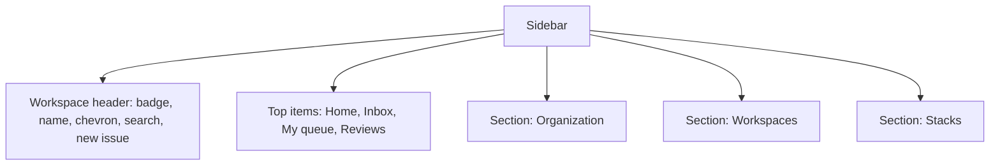
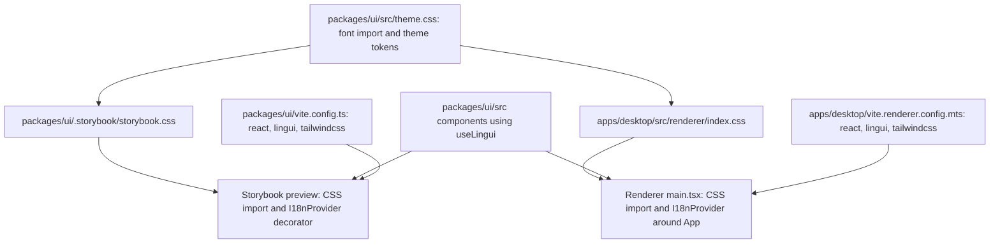

# Left Sidebar Components - Plan

## Goal Capsule

- **Objective:** The left sidebar from the design can be reviewed in Storybook as styled components in English, and it renders with the same styling when the desktop app uses it.
- **Means:** React components in `@sextou/ui`, styled with Tailwind CSS (KTD1), translatable with Lingui (KTD2), with Storybook stories.
- **Product authority:** the repository owner. Only the left sidebar is in scope; no screen, page or app layout is.
- **Stop conditions:** stop and report if Lingui's Vite plugin cannot compile macros under Vite 8 with `@vitejs/plugin-react` 6, or if CI's knip reports an unlisted production dependency that moving it into `dependencies` does not fix (see Risks).
- **Execution profile:** one pull request against `main`, squash-merged. `ce-work` implements, the user reviews and merges.
- **Open blockers:** none.

---

## Product Contract

Product Contract preservation: restructured, no scope change. A short Problem Frame was added, R7 was clarified to say that the hover look comes from the design's global link hover, and the four questions deferred to planning were resolved by KTD4, KTD5, KTD7 and the Risks section.

### Summary

The design's left sidebar becomes a set of `@sextou/ui` components: a workspace header, a navigation item, a titled section, and a full sidebar built from them. Each one has Storybook stories. Tailwind styles them, and Lingui makes them translatable, with English as the only language. Both are also set up in the desktop renderer so the components work the same there. The app does not show the sidebar yet.

### Problem Frame

The app's design exists only as an HTML prototype in Portuguese (`~/Work/pocs/entendendo-gascity/design`), and `@sextou/ui` holds only a placeholder `Button`. The left sidebar is the first part of that design to become real, reviewable components.

### Requirements

**Components**

- R1. `@sextou/ui` provides the sidebar's parts (workspace header, navigation item, titled section) and a full sidebar composed of them, matching the design's left bar without the slot-usage card.
- R2. The workspace header shows the workspace's initial badge, its name, a chevron, a search button and a new-issue button.
- R3. A navigation item shows an icon and a label, plus either a highlighted badge (as on Inbox) or a plain count (as on Reviews), both optional.
- R4. A navigation item can be the active one, which looks as the design shows and is announced as the current page to assistive technology.
- R5. A titled section shows its title above a list of navigation items.
- R6. The chevron, search and new-issue buttons only report clicks to the caller; nothing opens.
- R7. Navigation items and header buttons have a hover state (text brightens, as in the design's global link hover) and a keyboard-focus state the design does not show, drawn from the design's palette.



**Text and language**

- R8. The component's own strings are translatable through Lingui: the accessible labels "Main navigation", "Search", "New issue" and "Switch workspace".
- R9. Menu text (the workspace name, item labels, section titles, counts) comes in through props, and whoever renders the bar translates it with Lingui, as the stories do.
- R10. English is the source language, and it is the only one; no other locale is added.
- R11. Lingui works in both Storybook and the desktop renderer.

**Styling**

- R12. The components are styled with Tailwind and match the design's dark palette, spacing, radii and type (Instrument Sans).
- R13. Tailwind is set up for both Storybook and the desktop renderer, so the components render styled in either.
- R14. The fonts render without network access, since the desktop app has to work offline.

**Stories**

- R15. Every part and the full sidebar has stories using the design's "Tatu" workspace content in English, covering the active, badge and count states.

The English copy the stories use, translated from the design:

| Design                                                                      | English                                                                      |
| --------------------------------------------------------------------------- | ---------------------------------------------------------------------------- |
| Início, Caixa de entrada, Minha fila, Revisões                              | Home, Inbox, My queue, Reviews                                               |
| Organização: Fila, Iniciativas, Projetos, Roadmap, Ciclos, Atores, Métricas | Organization: Queue, Initiatives, Projects, Roadmap, Cycles, Actors, Metrics |
| Workspaces: app-web, api, Contratos, Financeiro                             | Workspaces: app-web, api, Contracts, Finance                                 |
| Stacks: Catálogo                                                            | Stacks: Catalog                                                              |

### Key Decisions

- **Tailwind is set up in the desktop renderer too, not only in Storybook.** `@sextou/ui` ships sources that each app compiles, so without this the components would show up unstyled in the app. Governs R13. (session-settled: user-directed — chosen over setting up Tailwind for Storybook only: the components must look right wherever they are used)
- **Lingui handles translation from the start, with English as the only language.** The components can be translated later without changing them. Governs R8, R10, R11. (session-settled: user-directed — chosen over plain props with English defaults and no library: the user picked Lingui as the translation library)
- **Menu text stays as props, not in the component's catalog.** Components take data as props, which is the `@sextou/ui` convention, so the caller owns and translates the menu content. Governs R9. (session-settled: user-approved — chosen over putting every sidebar string in the component's catalog: the menu is data from the caller)
- **The slot-usage card is left out.** (session-settled: user-directed — chosen over including the "Slots in use" card from the main screen's sidebar: not needed)
- **Only the sidebar is built.** No screen, page or app layout uses it in this work. (session-settled: user-directed — chosen over treating the sidebar as groundwork for screens: the request is the left bar only)

### Scope Boundaries

- The slot-usage card, and with it the Geist Mono font, which only the card uses.
- Any screen, page or app layout, including showing the sidebar in the desktop app.
- A workspace switcher menu, a search field and a new-issue dialog.
- A second language, a language switcher, and translation catalogs other than English.
- A light theme, a collapsible bar and responsive widths.
- The smaller "Gabinete" sidebar from the design's other screens.
- A unit test runner. Behavior is checked by Storybook interaction checks (KTD6).
- Restyling the desktop app's placeholder screen. It loses the browser's default styles under Tailwind's base reset and is otherwise left as is.

### Sources / Research

- Design: `~/Work/pocs/entendendo-gascity/design/Main.dc.html`, the `<nav aria-label="Navegação principal">` block. It has the full sidebar and the colors and spacing. Every other screen repeats it, with a different active item.
- `AGENTS.md`: the `@sextou/ui` convention (each component in `src/<Name>/` with `<Name>.tsx` and `<Name>.stories.tsx`, exported from `src/index.ts`, with data and callbacks as props).
- `packages/ui/.storybook/preview.ts` loads no stylesheet. `apps/desktop/src/renderer/main.tsx` imports `index.css`, the only CSS file in the repo. Neither Tailwind nor PostCSS is installed anywhere.

---

## Planning Contract

### Key Technical Decisions

- KTD1. **Tailwind v4 through `@tailwindcss/vite`, with the tokens in a CSS file `@sextou/ui` exports.** `packages/ui/src/theme.css` holds the font import and an `@theme` block with the design's colors. Storybook and the desktop renderer each keep their own entry stylesheet, which imports `tailwindcss`, imports the theme, and points `@source` at the real `packages/ui/src` path. It can't go through `node_modules`, because `nodeLinker: hoisted` makes `@sextou/ui` a symlink there that Tailwind skips. `@tailwindcss/vite` 4.3.3 supports Vite 8. Governs R12, R13.
- KTD2. **Lingui v6 with its native macro transform: `lingui({ macroTransform: { macro: { descriptorFields: 'message' } } })` from `@lingui/vite-plugin`, next to `react()`.** The `macro` options carry KTD3's setting. The plugin needs a Lingui config: each consumer's `package.json` gets a `lingui` key with `sourceLocale` and `locales` set to `en`. The plugin reads it from the build's working directory, which is `packages/ui` for Storybook and `apps/desktop` for Forge. `@vitejs/plugin-react` 6 has no `babel` option, so the older Babel recipes do nothing, and SWC doesn't apply. Components call `useLingui()` from `@lingui/react/macro` and never the global `t`. `@lingui/core` and `@lingui/react` are peer dependencies of `@sextou/ui`, and each consumer mounts the single `I18nProvider`. Governs R8, R11.
- KTD3. **The builds keep the English text, and there are no catalog files yet.** In production builds (`storybook build`, `electron-forge package`) Lingui's macros emit ids only and would show hashes. With `descriptorFields: 'message'` (KTD2) the macro keeps the message. Each consumer then activates `en` with an empty catalog and registers Lingui's runtime message compiler (`i18n.setMessagesCompiler(compileMessage)`, from `@lingui/message-utils`), which Lingui's docs pair with this setting. Extraction, `.po` files and `@lingui/cli` come with the second language. Governs R10. (session-settled: user-approved — chosen over committing an English catalog and an extract script now: less setup and fewer new files for knip until a second language exists)
- KTD4. **The icons are inline SVG components copied from the design's paths**, in one `Icon` module inside `@sextou/ui`, with no icon library. Each one is 16×16, uses `currentColor` for its stroke and is `aria-hidden`. Governs R1, R3. (session-settled: user-approved — chosen over an icon library: no new dependency, and the shapes match the design exactly)
- KTD5. **A navigation item is an anchor.** It takes `href` and passes the other anchor props through, so a caller with no router can intercept `onClick`. The active item gets `aria-current="page"`. Header buttons are `<button type="button">` with callback props. Governs R4, R6.
- KTD6. **Behavior is checked with Storybook `play` functions using `storybook/test`, which ships in the core `storybook` package.** They run in the Storybook UI, not in CI, and no Vitest or addon is added. Governs R4, R6, R15. (session-settled: user-approved — chosen over adding a test runner: no runner exists in the repo, and the scope is the sidebar only)
- KTD7. **Fonts come from `@fontsource-variable/instrument-sans`, imported from `theme.css`.** Vite emits the woff2 files as assets, so both builds work offline. The CSS family name is `Instrument Sans Variable`, and the license is OFL-1.1. Governs R14.
- KTD8. **The sidebar draws its own background** (`#14110E`), text color and font, so it looks right on its own in Storybook and wherever the app places it. No body styles go into the shared CSS. Governs R12, R13.

### Design tokens

The values are taken from the design. Token names are the implementer's choice, as long as they are defined once in `theme.css`.

| Use                                       | Value                                                                             |
| ----------------------------------------- | --------------------------------------------------------------------------------- |
| Sidebar background                        | `#14110E`                                                                         |
| Base text                                 | `#E4E1DE`, 13px, line-height 1.4                                                  |
| Item text (resting)                       | `#C1BDB9`                                                                         |
| Item text (hover, active), workspace name | `#FBF9F7`                                                                         |
| Icon stroke (resting), section title      | `#847F7B`                                                                         |
| Icon stroke (active)                      | `#C498FF`                                                                         |
| Active item background                    | `#26221E`                                                                         |
| Badge                                     | background `#352645`, text `#DCBFFF`, 11px/600, height 18, min-width 20, radius 9 |
| Plain count                               | `#A29D99` 11px, and `#DCBFFF` when the item is active                             |
| Workspace badge                           | background `#5F3C82`, text `#FBF9F7`, 22×22, radius 6, 12px/700                   |
| New-issue button                          | border `#322D29`, background `#1D1915`, 28×28, radius 6                           |
| Search button                             | transparent, 28×28, radius 6, icon `#C1BDB9`                                      |
| Item box                                  | height 32, padding 0 8px, radius 6, gap 10                                        |
| Section title                             | 12px/500, padding 0 8px, margin-bottom 4                                          |
| Sidebar box                               | width 232, padding 12px 10px, gap 20 between groups, gap 1 between items          |
| Focus ring (not in the design)            | 2px `#C498FF`                                                                     |

### High-Level Technical Design

How the CSS and the i18n setup reach each consumer:



### Output Structure

```text
packages/ui/
  vite.config.ts                      (modified)
  package.json                        (modified)
  .storybook/
    preview.tsx                       (replaces preview.ts)
    storybook.css                     (new)
  src/
    theme.css                         (new)
    css.d.ts                          (new, only if TypeScript needs it)
    index.ts                          (modified)
    Icon/Icon.tsx, Icon.stories.tsx
    NavItem/NavItem.tsx, NavItem.stories.tsx
    NavSection/NavSection.tsx, NavSection.stories.tsx
    WorkspaceHeader/WorkspaceHeader.tsx, WorkspaceHeader.stories.tsx
    Sidebar/Sidebar.tsx, Sidebar.stories.tsx
apps/desktop/
  package.json                        (modified)
  vite.renderer.config.mts            (modified)
  src/renderer/index.css              (modified)
  src/renderer/main.tsx               (modified)
```

### Risks & Dependencies

- **CI's knip checks only unlisted dependencies in production code.** The org workflow runs knip 6.40.0 with `--strict --include unlisted`, using the base commit's config, and there is no `knip.json`. A package that production code imports must be listed under `dependencies`, not only `devDependencies`. Production code includes the CSS it imports. It doesn't report unused dependencies or files.
- **The docs don't name `@vitejs/plugin-react` 6 for Lingui's native transform.** Prove it with the first build in U1 before building components on it.
- **`@lingui/vite-plugin` pulls in `@lingui/native-tools`, which ships prebuilt platform binaries.** Check that install passes under the org's pnpm policy (versions at least a day old, no trust downgrade) and needs no `allowBuilds` change. A `pnpm-workspace.yaml` exception would only apply after merge.
- **TypeScript 7 may reject side-effect CSS imports** that have no declaration. The desktop app already has `declare module '*.css'` in `apps/desktop/src/declarations.d.ts`. Mirror it in `@sextou/ui` only if typecheck asks for it.

---

## Implementation Units

### U1. Tailwind, Lingui and fonts in Storybook and the desktop renderer

**Goal:** Both consumers compile Tailwind classes from `packages/ui/src`, compile Lingui macros, load Instrument Sans offline, and provide an English `I18nProvider`.

**Requirements:** R10, R11, R12, R13, R14 (KTD1, KTD2, KTD3, KTD7, KTD8)

**Dependencies:** none

**Files:**

- `packages/ui/package.json`: dependencies, `@lingui/*` peers, and a `./theme.css` export
- `packages/ui/vite.config.ts`
- `packages/ui/src/theme.css`
- `packages/ui/.storybook/storybook.css`
- `packages/ui/.storybook/preview.tsx` (renamed from `preview.ts`)
- `apps/desktop/package.json`
- `apps/desktop/vite.renderer.config.mts`
- `apps/desktop/src/renderer/index.css`
- `apps/desktop/src/renderer/main.tsx`

**Approach:**

1. Add the dependencies, using one version of each across both packages. Anything production code or its CSS imports goes in `dependencies` (see Risks).
   - `packages/ui`: `@fontsource-variable/instrument-sans` in `dependencies`. `@lingui/core` and `@lingui/react` as peers and devDependencies. `tailwindcss`, `@tailwindcss/vite`, `@lingui/vite-plugin` and `@lingui/message-utils` in devDependencies.
   - `apps/desktop`: `@lingui/core`, `@lingui/react`, `@lingui/message-utils` and `tailwindcss` in `dependencies`, next to `react`. `@tailwindcss/vite` and `@lingui/vite-plugin` in devDependencies.
   - Each `package.json` gets the `lingui` config key from KTD2.
2. Both Vite configs get `react()`, `lingui(...)` with the `macro` options from KTD2, and `tailwindcss()`.
3. `theme.css` imports the font and declares the tokens from the Design tokens table, with `--font-sans` set to Instrument Sans Variable.
4. Each entry stylesheet imports `tailwindcss` and the theme, then adds `@source` for the real `packages/ui/src` path (KTD1). The desktop `index.css` drops its current body rules for these.
5. The Storybook preview imports `storybook.css` and wraps every story in an `I18nProvider`, with `en` activated on an empty catalog and the runtime compiler registered (KTD3). Rename it to `.tsx` for the JSX. The renderer's `main.tsx` wraps `App` the same way.
6. Set Storybook's preview background to the sidebar background, so stories don't sit on white.

**Execution note:** this is mostly configuration. Prove it with a smoke check before U2: a temporary component using one Tailwind class and one `t` macro renders styled, with English text, in both `pnpm build-storybook` and `pnpm package` output. Delete it afterwards.

**Patterns to follow:** `packages/ui/vite.config.ts` and `apps/desktop/vite.renderer.config.mts` (plugin lists), `apps/desktop/src/declarations.d.ts` (CSS module declaration).

**Test scenarios:** Test expectation: none. This unit is pure configuration, and the smoke check in the execution note proves it.

**Verification:**

- `pnpm typecheck`, `pnpm lint`, `pnpm build` and a local knip run all pass.
- The packaged app shows the placeholder screen in Instrument Sans with the network off.

### U2. Icons

**Goal:** The 17 icons the sidebar uses exist as React components that match the design.

**Requirements:** R1, R2, R3 (KTD4)

**Dependencies:** U1

**Files:**

- `packages/ui/src/Icon/Icon.tsx`
- `packages/ui/src/Icon/Icon.stories.tsx`

**Approach:**

- Copy each path from the design's nav markup. That covers the header's chevron, search and new-issue icons, plus one icon each for Home, Inbox, My queue, Reviews, Queue, Initiatives, Projects, Roadmap, Cycles, Actors, Metrics, repository (app-web, api), folder (Contracts, Finance) and Catalog.
- Keep the design's viewBox, stroke width 1.5 and line caps. Draw the stroke in `currentColor` so the caller sets the color.
- Export the icons for callers, since menu items are props (R9).

**Patterns to follow:** `packages/ui/src/Button/Button.tsx` for the file layout and named exports.

**Test scenarios:**

- A story renders every icon in a grid with its name. Each one matches the design's shape at 16×16.
- An icon inside an element with a color set inherits that color.

**Verification:** the icon story shows all 17 icons, and each matches its counterpart in `Main.dc.html`.

### U3. NavItem and NavSection

**Goal:** One navigation row and a titled group of rows, matching the design in the resting, hover, focus and active states.

**Requirements:** R3, R4, R5, R7, R12 (KTD5, KTD6)

**Dependencies:** U1, U2

**Files:**

- `packages/ui/src/NavItem/NavItem.tsx`
- `packages/ui/src/NavItem/NavItem.stories.tsx`
- `packages/ui/src/NavSection/NavSection.tsx`
- `packages/ui/src/NavSection/NavSection.stories.tsx`

**Approach:**

- `NavItem` takes an icon, a label, an optional badge or count, an `active` flag, and the anchor props (KTD5). The badge and the count are exclusive by type, so a caller can't pass both.
- When active, the row gets the active background, white text, a purple icon and a purple count.
- On hover the text turns white. Keyboard focus shows the ring.
- `NavSection` takes a title and its items. It renders the title as text, not as a heading, as in the design, and the items as a list.

**Test scenarios:**

- A resting item with the label "Home" renders the label and the icon, with no badge, no count and no `aria-current`.
- Inbox with badge 4 shows the highlighted pill with "4".
- Reviews with count 3 shows a plain grey "3". When it is also active, the "3" turns purple.
- The active item "Queue" has `aria-current="page"`, the active background and the purple icon. The `play` function checks the attribute.
- An item with an `onClick` handler calls it once when clicked (`play` with `fn()`).
- Tabbing to an item shows the focus ring.
- A long label truncates on one line instead of wrapping or pushing the badge out.
- The section "Organization" shows its title above seven items, in order.

**Verification:** the stories match `Main.dc.html` in each state, and every `play` check passes in the Storybook UI.

### U4. WorkspaceHeader

**Goal:** The header row with the workspace badge, name, chevron, search and new-issue buttons.

**Requirements:** R2, R6, R7, R8 (KTD2, KTD5, KTD6)

**Dependencies:** U1, U2

**Files:**

- `packages/ui/src/WorkspaceHeader/WorkspaceHeader.tsx`
- `packages/ui/src/WorkspaceHeader/WorkspaceHeader.stories.tsx`

**Approach:**

- It takes the workspace name, its initial, and the `onSwitchWorkspace`, `onSearch` and `onNewIssue` callbacks.
- The badge, name and chevron form one button labeled "Switch workspace". The search and new-issue buttons are icon-only.
- All three accessible labels come from `useLingui()` (R8).

**Test scenarios:**

- With the name "Tatu" and initial "T", it renders the purple badge with "T", the name, and the chevron.
- Clicking search calls `onSearch` once, and clicking new issue calls `onNewIssue` once. Neither opens anything.
- Clicking the badge or the name calls `onSwitchWorkspace` once.
- The three buttons are reachable by role and name: "Switch workspace", "Search" and "New issue" (`play` with `getByRole`).
- A long workspace name truncates and the two buttons stay on the right.

**Verification:** the story matches the design's header, and the `play` checks pass.

### U5. Sidebar and package exports

**Goal:** The full bar, built from the parts, exported from `@sextou/ui` with a "Tatu" story.

**Requirements:** R1, R8, R9, R12, R15 (KTD8)

**Dependencies:** U3, U4

**Files:**

- `packages/ui/src/Sidebar/Sidebar.tsx`
- `packages/ui/src/Sidebar/Sidebar.stories.tsx`
- `packages/ui/src/index.ts`

**Approach:**

- `Sidebar` takes the header props, a list of top items, and a list of sections. It renders a `<nav>` labeled "Main navigation" through `useLingui()`, at the design's width, background and spacing.
- The story builds the "Tatu" content with English labels from the Product Contract table, wrapped in Lingui's `t` (R9). Queue is active, Inbox has badge 4 and Reviews has count 3.
- Export `Sidebar`, `NavItem`, `NavSection`, `WorkspaceHeader` and the icons from `src/index.ts`, next to `Button`.

**Test scenarios:**

- The "Tatu" story shows, top to bottom: the header, Home, Inbox (4), My queue, Reviews (3), Organization with seven items, Workspaces with app-web, api, Contracts and Finance, and Stacks with Catalog.
- The landmark has the name "Main navigation" (`play` with `getByRole('navigation')`).
- Exactly one item has `aria-current="page"`, and it is Queue.
- A story with Reviews active moves the active look and `aria-current` to Reviews, and its count turns purple.
- A sidebar with no sections renders only the header and the top items, with no empty gap.

**Verification:**

- Side by side with `Main.dc.html`, the story matches in layout, colors and type, apart from the dropped slot card and the English text.
- `@sextou/ui` exports compile from the desktop app.

---

## Verification Contract

| Gate               | Command                                                                                                                                        | Applies to              |
| ------------------ | ---------------------------------------------------------------------------------------------------------------------------------------------- | ----------------------- |
| Format and lint    | `pnpm lint`                                                                                                                                    | all units               |
| Types              | `pnpm typecheck`                                                                                                                               | all units               |
| Production imports | `pnpm dlx knip@6.40.0 --strict --include unlisted`, which is CI's version and flags, run locally because knip isn't in the repo's dependencies | U1, then the final diff |
| Builds             | `pnpm build`, which packages the app and builds Storybook                                                                                      | U1, then the final diff |
| Interaction checks | the `play` functions, passing in `pnpm storybook` (the user runs it)                                                                           | U3, U4, U5              |
| Offline fonts      | the packaged app and the static Storybook render Instrument Sans with the network off                                                          | U1                      |

## Definition of Done

- R1 through R15 hold, and each unit's verification passes.
- Every gate in the Verification Contract passes on the final diff.
- No Portuguese text remains in components or stories.
- The desktop app still renders its placeholder screen and does not render the sidebar.
- The U1 smoke component and any other experimental code are removed from the diff.
